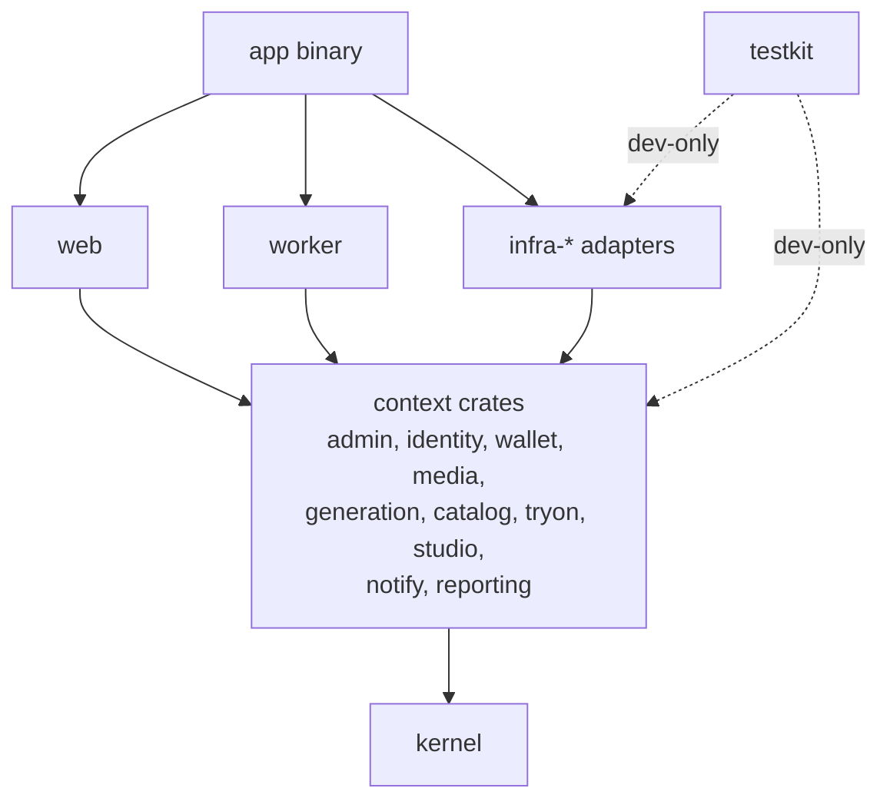

# Taneh — Rust Implementation Pack

**3 November 2026 · Ali Shokoohi**

This pack replaces the Go recommendations in Technical Specification §18. It fixes the stack, the repository layout, the hexagonal rules, the test strategy, the Spec Kit constitution, `AGENTS.md`, and both prompts — `/speckit.specify` (technology-free) and `/speckit.plan` (Rust) — for each of the 15 features.

## 1. Non-negotiables

1. **TDD first.** No production code without a failing test that demands it. Red → green → refactor, one small step at a time.
2. **Rust only**, server-side rendered UI with compiled templates. No SPA framework.
3. **Monorepo**: one Cargo workspace for everything — domain, adapters, web, worker, tests, docs, Spec Kit.
4. **Hexagonal**: domain and application know nothing about HTTP, SQL, S3, SMS or AI vendors. Adapters plug into ports.
5. **Repository pattern** behind ports, with a **Unit of Work** for transactions that span repositories (the ledger needs it).
6. **Five test layers**: unit, mock, integration (Testcontainers), HTTP/contract, end-to-end.
7. **OpenAPI + Swagger UI** for every JSON endpoint, generated from code and checked in CI.

## 2. Stack

Versions marked ✔ were checked on docs.rs on 3 Nov 2026. Others: add with `cargo add <crate>` to get the current release, then pin in `Cargo.lock`.

| Concern | Choice | Version | Why |
| --- | --- | --- | --- |
| Language | Rust stable, edition 2024 | — | Native `async fn` in traits; strong types for money |
| Async runtime | `tokio` | 1.x | Ecosystem default |
| HTTP | `axum` | 0.8.9 ✔ | Tower-based; easy to test with `oneshot` |
| Middleware | `tower`, `tower-http` | — | Tracing, compression, timeouts, CSP headers, static files |
| Templates | `askama` + `askama_web` (feature `axum-0.8`) | 0.16 ✔ | Templates compiled and type-checked; handlers return the template directly |
| Interactivity | `htmx` (vendored file, no CDN) | 2.x | Partial page updates without a JS framework |
| i18n | Project Fluent (`fluent-templates` or `fluent-bundle`) | — | FA/EN plurals and RTL-safe messages |
| Database | PostgreSQL 16+ via `sqlx` (features `postgres`, `runtime-tokio`, `tls-rustls`, `migrate`, `uuid`, `time`, `json`) | 0.9.0 ✔ | Compile-time checked SQL; offline mode always on in 0.9 |
| Job queue | Own table + `FOR UPDATE SKIP LOCKED` + transactional outbox | — | Debit, unit and job must commit in one transaction (L6) |
| Object storage | `aws-sdk-s3` against MinIO/any S3-compatible store | 1.x | Signed URLs, private buckets |
| OpenAPI | `utoipa` 5 + `utoipa-axum` + `utoipa-swagger-ui` (feature `axum`) | utoipa 5, swagger-ui 9.0.2 ✔ | Spec generated from handler annotations |
| Admin passkeys | `webauthn-rs` | — | WebAuthn (Q23) |
| Admin TOTP | `totp-rs` | — | TOTP fallback (Q23) |
| Validation | `validator` or hand-written newtypes | — | Prefer newtypes that can't hold invalid values |
| Errors | `thiserror` (libraries), `anyhow` only in binaries/tests | — | Typed domain errors |
| Observability | `tracing`, `tracing-subscriber`, `opentelemetry` + OTLP exporter | — | One trace per generation unit |
| Config | `figment` or `config` + env | — | 12-factor |
| Images | `image` (+ `libheif-rs` for HEIC) | — | Real type check, re-encode, strip metadata |

**Test and quality tools**

| Tool | Version | Use |
| --- | --- | --- |
| `cargo-nextest` | — | Fast parallel runner; per-test process isolation |
| `mockall` | 0.15 ✔ | Generated mocks for ports; `#[automock]` must sit **above** `#[async_trait]` |
| `async-trait` | — | Dyn-compatible async ports so they can be mocked and boxed |
| `proptest` | 1.x | Property tests for money, ledger, pricing, retention |
| `testcontainers-modules` (features `postgres`, `minio`) | 0.15 ✔ (core 0.27) | Real Postgres and MinIO in integration tests |
| `wiremock` | — | Fake HTTP for SMS, payment gateway, AI providers |
| `insta` | — | Snapshots for HTML fragments and the OpenAPI document |
| `scraper` | — | Assert on rendered HTML (selectors, `dir`, `lang`, ARIA) |
| `fake` | — | Test data builders |
| `cargo-llvm-cov` | — | Coverage gates |
| `cargo-mutants` | — | Mutation testing on domain and wallet: proves tests actually bite |
| `cargo-deny` | — | Licences, advisories, and banned dependencies per crate |
| Playwright (TypeScript) *or* `fantoccini` (Rust) | — | Browser E2E for journeys J1–J5; Playwright is less pain, `fantoccini` keeps it all-Rust |

## 3. Monorepo layout

```text
taneh/
├── Cargo.toml                 # [workspace], shared [workspace.dependencies], lints
├── rust-toolchain.toml
├── deny.toml                  # cargo-deny: bans sqlx/axum/aws in domain crates
├── .config/nextest.toml       # test profiles: unit, integration, ci
├── AGENTS.md                  # OpenCode rules (section 7)
├── .opencode/commands/        # Spec Kit commands (generated)
├── .specify/                  # Spec Kit memory: constitution, templates
├── specs/                     # Spec Kit feature folders 001-…015-…
├── docs/
│   ├── taneh-prd.md
│   ├── taneh-technical-spec.md
│   ├── taneh-decisions-qa.md
│   └── prompts/               # /speckit.specify and /speckit.plan prompts
├── crates/
│   ├── kernel/                # shared value types: ids, Tokens, Irr, Clock, Locale, Page, DomainError
│   ├── admin/                 # settings, flags, audit, admin auth — domain + application + ports
│   ├── identity/              # phone, OTP, sessions, account lifecycle
│   ├── wallet/                # ledger, payments, pricing, quotes
│   ├── media/                 # uploads, consent, retention, private access
│   ├── generation/            # units, attempts, provider routing, cost cap, emergency stop
│   ├── catalog/               # garments, outfits, models, styles, samples, licences, allowlist, content versions
│   ├── tryon/                 # buyer try-on journey and library
│   ├── studio/                # selection, assembly, projects, saved, store, share
│   ├── notify/                # in-app notifications (+ OFF channels)
│   ├── reporting/             # KPIs, guardrails, finance reports
│   ├── infra-postgres/        # repository + UnitOfWork adapters, queue, outbox, migrations/
│   ├── infra-storage/         # S3/MinIO adapter, signed URLs
│   ├── infra-sms/             # two SMS provider adapters + failover
│   ├── infra-payment/         # domestic gateway adapter
│   ├── infra-ai/              # AI provider adapters (one module per vendor)
│   ├── infra-image/           # decode, validate, re-encode, strip metadata
│   ├── web/                   # axum: HTML routes (askama), JSON API (utoipa), auth, i18n, static
│   │   ├── templates/         # askama templates: layouts/, tryon/, studio/, console/, partials/
│   │   ├── locales/           # fa/*.ftl, en/*.ftl
│   │   └── static/            # css (tokens, logical properties), htmx.min.js, fonts (Vazirmatn), lottie
│   ├── worker/                # job loop, sweeps (TTL, reconciliation), outbox relay
│   ├── testkit/               # Testcontainers fixtures, in-memory fakes, builders, wiremock helpers
│   └── app/                   # the binary: `taneh serve | worker | migrate | openapi`
├── e2e/                       # Playwright (or fantoccini) journeys J1–J5
└── deploy/                    # docker-compose (postgres, minio), Dockerfile, CI
```

**Why one crate per bounded context (not one `domain` crate):** each context compiles and tests alone, `cargo-deny` can ban infrastructure crates per context, and Spec Kit features map cleanly onto crates (feature 003 ≈ `wallet` + its adapters).

### 3.1 Dependency rules (enforced)



- Context crates depend only on `kernel`, other contexts' **public ports/DTOs** where unavoidable, and pure libraries (`thiserror`, `time`, `uuid`, `serde`, `async-trait`). **Never** `sqlx`, `axum`, `aws-*`, `reqwest`.
- `infra-*` crates implement ports. They never call each other.
- `web` and `worker` call **application services only**; they never touch repositories directly.
- `app` is the only place that wires concrete adapters into services (composition root).
- `cargo-deny` `[bans]` + a CI script that greps `Cargo.toml` of context crates enforce this.

## 4. Hexagonal design inside a context crate

```text
crates/wallet/src/
├── lib.rs
├── domain/            # entities, value objects, invariants — pure, sync, no I/O
│   ├── tokens.rs      # Tokens(u64) newtype; checked add/sub; never negative
│   ├── ledger.rs      # LedgerTxn, Entry, Account kinds; balance rules L1–L5
│   ├── payment.rs     # PaymentOrder state machine
│   └── price.rs       # PriceVersion, Quote, snapshot
├── application/       # use cases (commands/queries); orchestrate ports
│   ├── confirm_debit.rs
│   ├── post_return.rs
│   ├── verify_payment.rs
│   └── reconcile.rs
└── ports/             # traits the outside world must implement
    ├── repositories.rs   # LedgerRepository, PaymentRepository, PriceRepository
    ├── uow.rs            # UnitOfWork, UnitOfWorkFactory
    └── gateway.rs        # PaymentGateway
```

### 4.1 Repository + Unit of Work

The ledger rule "debit + generation unit + outbox in one transaction" crosses two contexts. Repositories alone can't express that; a Unit of Work can.

```rust
// crates/kernel/src/uow.rs
#[async_trait::async_trait]
pub trait UnitOfWork: Send {
    async fn commit(self: Box<Self>) -> Result<(), DomainError>;
    async fn rollback(self: Box<Self>) -> Result<(), DomainError>;
}

// crates/wallet/src/ports/repositories.rs
#[cfg_attr(any(test, feature = "mocks"), mockall::automock)]
#[async_trait::async_trait]
pub trait LedgerRepository: Send + Sync {
    /// Inserts a balanced txn. Returns AlreadyApplied if the idempotency key exists.
    async fn append(&self, tx: &mut dyn TxHandle, txn: &LedgerTxn) -> Result<AppendOutcome, DomainError>;
    async fn balance_for_update(&self, tx: &mut dyn TxHandle, wallet: WalletId) -> Result<Tokens, DomainError>;
}
```

- **Postgres adapter**: `TxHandle` wraps `sqlx::Transaction<'_, Postgres>`; `balance_for_update` uses `SELECT … FOR UPDATE`; idempotency is a `UNIQUE` constraint, so a duplicate becomes `AppendOutcome::AlreadyApplied`, not an error.
- **In-memory fake** (`testkit`): a `Mutex<HashMap>` that obeys the same contract, for fast application tests.
- **One contract test suite per port**, run against **both** the fake and the Postgres adapter. If the fake and the real thing disagree, the suite fails. This is what keeps fakes honest.

### 4.2 Use case shape

```rust
pub struct ConfirmDebit<U, L, G> { uow: U, ledger: L, units: G, clock: Arc<dyn Clock> }

impl<U: UnitOfWorkFactory, L: LedgerRepository, G: UnitRegistrar> ConfirmDebit<U, L, G> {
    pub async fn execute(&self, cmd: ConfirmDebitCmd) -> Result<ConfirmOutcome, WalletError> {
        let mut tx = self.uow.begin().await?;
        let balance = self.ledger.balance_for_update(tx.handle(), cmd.wallet).await?;
        let quote = cmd.quote.verify(self.clock.now())?;           // stale price → PriceChanged
        let debit = LedgerTxn::debit(cmd.wallet, quote.total(), cmd.unit_id)?; // key debit:<unit_id>
        balance.checked_sub(quote.total()).ok_or(WalletError::Insufficient)?;
        match self.ledger.append(tx.handle(), &debit).await? {
            AppendOutcome::AlreadyApplied => { tx.rollback().await?; Ok(ConfirmOutcome::Duplicate) }
            AppendOutcome::Appended => {
                self.units.register(tx.handle(), &cmd.unit_spec, &quote).await?; // unit + outbox row
                tx.commit().await?;
                Ok(ConfirmOutcome::Confirmed)
            }
        }
    }
}
```

Generics give zero-cost dispatch in production and let tests pass mocks or fakes. Use `Arc<dyn Trait>` only at the composition root if generic signatures get unwieldy.

### 4.3 Domain rules as types

| Rule | Type-level encoding |
| --- | --- |
| Tokens never negative (L3) | `Tokens(u64)` with `checked_sub` returning `Option` |
| IRR and tokens never mixed | Separate `Irr` and `Tokens` newtypes; no `From` between them |
| One garment per try-on (Q39) | `TryOnRequest { garment: GarmentId }`, not a `Vec` |
| Max 50 cards (Q15) | `Project::add_card` returns `Err(CardLimit)`; limit read from a `Settings` port |
| Upload limits (Q05) | `ValidatedImage` constructible only through `ImageValidator::validate` |
| Phone identity (Q09) | `PhoneNumber` newtype normalising `+98`, `0`, Persian digits |
| Attempts ≤ 3 (Q29) | `AttemptCount` saturating at the configured max |
| Price snapshot (Q36) | `Quote { price_version, base, premium, addons }` stored on the unit, never recomputed |

## 5. Server-side rendered frontend

- **Askama templates** in `crates/web/templates`, one base layout per surface (`tryon.html`, `studio.html`, `console.html`) so the two voices and navigations stay separate.
- `<html lang="{{ locale }}" dir="{{ dir }}">` from the request's locale; CSS uses **logical properties** (`margin-inline-start`, `padding-block`) so RTL works without a second stylesheet.
- **Design tokens** from Technical Spec §12.2 as CSS custom properties, with `prefers-color-scheme` and a manual override for light/dark/system.
- **htmx** for partial updates: filter panels, selection summary, card actions, generation status polling. Every htmx endpoint also works as a full-page GET (progressive enhancement, keyboard and screen-reader friendly).
- **Generation status**: Server-Sent Events from axum for live card/try-on state, with polling fallback.
- **i18n**: Fluent `.ftl` files per surface; message keys match the copy keys in Technical Spec §12.7; a test fails if any key exists in one locale but not the other.
- **Fonts and assets** self-hosted (Vazirmatn WOFF2, htmx, Lottie JSON); no third-party CDNs.
- **Security headers**: strict CSP (no inline scripts except hashed), `SameSite=Lax` session cookie on the single host (Q01), CSRF tokens on all forms and htmx requests.
- **PWA**: `manifest.webmanifest` + a small service worker for the offline page and static caching only; never caches money or generation responses.

## 6. JSON API, OpenAPI and Swagger UI

| Item | Decision |
| --- | --- |
| Scope | All JSON endpoints under `/api/v1`: wallet and payment callbacks, generation status, partner widget/API (feature 015), console data endpoints, health |
| HTML routes | Not in OpenAPI (they return HTML), but each has an HTTP test |
| Generation | `utoipa` derives (`#[utoipa::path]`, `ToSchema`) on handlers and DTOs; routes registered through `utoipa_axum::router::OpenApiRouter` so a route can't exist without its spec |
| UI | `utoipa_swagger_ui::SwaggerUi::new("/api/docs").url("/api/openapi.json", ApiDoc::openapi())` |
| Exposure | Open in dev and staging; behind admin auth in production |
| Spec in repo | `taneh openapi > docs/openapi.json`; CI fails if the committed file differs from the generated one (`insta` snapshot or diff) |
| Contract tests | For each documented endpoint: response status and body validated against the generated schema in HTTP tests |
| Errors | One `application/problem+json` error schema (RFC 9457) for every endpoint |
| Idempotency | `Idempotency-Key` header documented and required on every money-moving POST |

## 7. Test strategy (TDD)

### 7.1 The loop

1. Pick the next acceptance criterion from `spec.md` (it cites a PRD `AC-*` or `FR-*`).
2. Write the **outermost failing test** for it: usually an HTTP test or an application-service test.
3. Drop one level and write the **failing unit test** for the first missing domain rule.
4. Make it pass with the simplest code. Refactor with all tests green.
5. Repeat inward/outward until the outer test passes.
6. Add the **integration test** for any new adapter method (Testcontainers), and run the port's **contract suite** against both fake and real adapter.
7. Commit: test and code together, message cites the AC/FR ID.

Spec Kit's `tasks.md` must put every test task **before** the implementation task it drives. `/speckit.analyze` should flag any implementation task without a preceding test task.

### 7.2 Test layers

| Layer | Where | Talks to | Tools | What it proves | Speed target |
| --- | --- | --- | --- | --- | --- |
| **Unit** | `#[cfg(test)] mod tests` beside the code in context crates | Nothing (pure) | std test, `proptest` | Domain rules and invariants | < 1 ms each |
| **Mock** | `crates/<ctx>/tests/` or in-module | Mocked ports | `mockall` | Use case calls the right ports, in the right order, the right number of times (e.g. debit once, never on validation failure) | < 10 ms |
| **Fake / behaviour** | `crates/<ctx>/tests/` | In-memory fakes from `testkit` | std, `proptest` | Use case outcomes and state across several calls | < 50 ms |
| **Contract** | `crates/testkit/src/contracts/` | Fake **and** real adapter | shared test fns | Fake and adapter honour the same port contract | — |
| **Integration** | `crates/infra-*/tests/` | Real Postgres, MinIO (Testcontainers); `wiremock` for HTTP vendors | `testcontainers-modules`, `wiremock`, `sqlx` | SQL, constraints, locking, idempotency, signed URLs, vendor protocol | seconds |
| **HTTP / template** | `crates/web/tests/` | Router with fakes or with Testcontainers | `tower::ServiceExt::oneshot`, `scraper`, `insta` | Routes, auth, CSRF, status codes, HTML structure, RTL/LTR, i18n keys, OpenAPI schema conformance | < 100 ms with fakes |
| **End-to-end** | `e2e/` | Full stack in docker-compose | Playwright or `fantoccini` | Journeys J1–J5 on real browsers | minutes (nightly + pre-release) |

**Mocks vs fakes rule:** use **mocks** to assert interactions that matter for correctness (charging, refunding, notifying, calling a vendor exactly once). Use **fakes** to test behaviour and state. Don't mock what you own when a fake is simpler, and never mock types you don't own (`sqlx`, `reqwest`): wrap them in a port first.

### 7.3 Mandatory test sets

| Area | Tests that must exist |
| --- | --- |
| Ledger (L1–L9) | Property test: random sequences of top-ups, duplicate callbacks, debits, double-taps, retries, returns, forfeits → assert balance = Σ entries, never negative, ≤ 1 debit and ≤ 1 return per unit, ≤ 1 credit per payment. Run against the fake (fast, many cases) and Postgres (fewer cases, real locking). |
| Concurrency | Integration: 50 concurrent confirms on one wallet with insufficient total balance → exactly the affordable number succeed. |
| Generation | Fault injection via `wiremock`: timeout, 5xx, slow success after timeout, malformed output, primary down → backup, both down. |
| Guardrails GR1–GR9 | One named test per guardrail; the test name contains the GR ID. |
| Retention | Clock-controlled tests: day 13/15 buyer temp photos, day 29/31 drafts and temp uploads, outputs survive. |
| Auth | OTP expiry, single use, rate limits; origin preservation for every origin type; admin 2FA required. |
| i18n | Every Fluent key present in `fa` and `en`; every page renders with `dir="rtl"` for FA. |
| Accessibility | `scraper` checks: every form control has a label, every image an `alt`, every page one `h1`; axe-core in E2E. |
| OpenAPI | Snapshot of generated spec; every `/api/v1` route documented; responses validated against schema. |

### 7.4 Quality gates in CI

| Gate | Threshold |
| --- | --- |
| `cargo fmt --check`, `cargo clippy -- -D warnings` | Must pass |
| `cargo nextest run --profile ci` (unit, mock, fake, HTTP) | Must pass |
| Integration suite (Testcontainers) | Must pass on every PR touching `infra-*`, `wallet`, `generation`; nightly for all |
| Line coverage (`cargo llvm-cov`) | ≥ 90% in `kernel`, `wallet`, `generation`, `identity`; ≥ 80% elsewhere *(proposed)* |
| Mutation score (`cargo mutants`) | ≥ 85% caught in `wallet` and `generation` domain modules *(proposed)*; nightly |
| `cargo deny check` | No banned deps in context crates; no unapproved licences; no advisories |
| `sqlx` offline data | `.sqlx/` up to date |
| OpenAPI | Committed `docs/openapi.json` equals generated |
| E2E J1–J5 | Nightly and before every release |

## 8. Spec Kit constitution (Rust)

Run once, replacing the earlier Go version:

```text
/speckit.constitution
Project: Taneh. Sources of truth: @docs/taneh-prd.md @docs/taneh-technical-spec.md @docs/taneh-decisions-qa.md @docs/taneh-rust-implementation-pack.md

I. Test-Driven Development is mandatory and non-negotiable.
   - No production code without a failing test written first. Red → green → refactor.
   - tasks.md lists each test task before the implementation task it drives.
   - Every acceptance criterion (AC-*) and guardrail (GR*) maps to at least one named test.
   - Test layers: unit (pure domain, proptest), mock (mockall on ports), fake/behaviour (in-memory adapters), contract (same suite on fake and real adapter), integration (testcontainers Postgres/MinIO, wiremock for vendors), HTTP/template (axum oneshot, scraper, insta), E2E (journeys J1–J5).
   - Coverage ≥ 90% in kernel, wallet, generation, identity; mutation testing on wallet and generation.

II. Rust monorepo, hexagonal architecture.
   - One Cargo workspace. One crate per bounded context (domain/, application/, ports/) plus infra-* adapter crates, web, worker, testkit, app.
   - Context crates must not depend on sqlx, axum, aws-*, reqwest or any I/O crate. Enforced by cargo-deny.
   - web and worker call application services only. app is the sole composition root.

III. Repository pattern with Unit of Work.
   - Every persistence need is a repository port (async trait, mockall-able). Cross-repository atomicity goes through a UnitOfWork port.
   - Each port has a contract test suite run against the in-memory fake and the real adapter.

IV. Money is sacred.
   - Ledger is double-entry and append-only with database-enforced unique idempotency keys (pay:, debit:, return:, adj:, forfeit:) and CHECK balance >= 0.
   - Debit + generation unit + outbox row in one transaction. Max 3 attempts; on final failure the return is posted in the same transaction.
   - Tokens and Irr are distinct newtypes; no implicit conversion. Every confirmed unit stores its price snapshot.

V. Server-rendered UI.
   - axum + askama (askama_web) + htmx, progressive enhancement; every interaction works as a full-page request.
   - FA (RTL) and EN (LTR), light/dark/system, WCAG 2.2 AA from the first template. CSS logical properties; Fluent messages; no CDN assets.

VI. API contract.
   - Every JSON endpoint lives under /api/v1, is registered through utoipa-axum's OpenApiRouter, uses problem+json errors, and appears in Swagger UI at /api/docs.
   - The generated OpenAPI document is committed and checked in CI.

VII. Security and privacy by default.
   - Server-side authorisation on every request; private media only via short-lived signed URLs; secrets never in logs; uploads validated by content and stripped of metadata; admin views of private media require a ticket ID and are audited.

VIII. Traceability and simplicity.
   - Specs, plans, tasks, tests and commits cite PRD IDs (FR-*, AC-*, GR*, Q*).
   - Decisions Q01–Q41 are final. Prefer the simplest design that passes the tests; no speculative abstraction.
```

## 9. `AGENTS.md`

Put this at the repo root. OpenCode reads it every turn, so the rules apply during `/speckit.implement`, not only during planning.

````markdown
# Taneh — agent rules

## Read first
- Product: docs/taneh-prd.md · Behaviour detail: docs/taneh-technical-spec.md · Decisions (final): docs/taneh-decisions-qa.md · Stack and architecture: docs/taneh-rust-implementation-pack.md
- Active feature: .specify/feature.json → specs/<feature>/spec.md, plan.md, tasks.md

## How you work
1. TDD always. Write the failing test, run it, see it fail for the right reason, then write the minimum code. Never write production code first.
2. One task from tasks.md at a time. Tick it only when its tests pass.
3. Run `cargo nextest run -p <crate>` after every change; run integration tests (`cargo nextest run --profile integration -p infra-postgres`) when touching adapters or SQL.
4. Never weaken a test to make it pass. If a test is wrong, explain why in the commit message.

## Architecture rules
- Context crates (admin, identity, wallet, media, generation, catalog, tryon, studio, notify, reporting): domain/, application/, ports/ only. No sqlx, axum, aws-*, reqwest.
- New persistence = new method on a repository port + fake in testkit + Postgres impl in infra-postgres + contract test for both.
- Transactions spanning repositories use UnitOfWork.
- Tokens and Irr newtypes only; never raw integers for money.
- `#[cfg_attr(any(test, feature = "mocks"), mockall::automock)]` goes ABOVE `#[async_trait::async_trait]`.
- HTML: askama templates, htmx partials, CSS logical properties, every string from Fluent (fa + en).
- JSON: only under /api/v1 via OpenApiRouter with #[utoipa::path]; problem+json errors; regenerate docs/openapi.json.

## Never
- Never mark an unbuilt feature as done or ship a stub behind a flag.
- Never change a decided value (Q01–Q41) without the owner.
- Never log phone numbers, OTPs, keys, photos or payment data.
- Never call a vendor HTTP API from a test; use wiremock.

## Commands
- Unit + mock + HTTP: `cargo nextest run`
- Integration: `cargo nextest run --profile integration` (needs Docker)
- Coverage: `cargo llvm-cov nextest`
- Mutation (wallet): `cargo mutants -p wallet`
- OpenAPI: `cargo run -p app -- openapi > docs/openapi.json`
- Local stack: `docker compose -f deploy/compose.yml up -d`
````

## 10. Per-feature prompts: `/speckit.specify` + `/speckit.plan`

Each feature below has two prompts, run in this order:

1. **Specify** — technology-free (WHAT and WHY). Spec Kit keeps the stack out of `spec.md`, so these prompts never mention Rust, crates or tables.
2. `/speckit.clarify`, then read and fix `spec.md` by hand.
3. **Plan** — the Rust HOW: crates, ports, adapters, tables, and the test plan before implementation.
4. `/speckit.checklist` → `/speckit.tasks` → `/speckit.analyze` → `/speckit.implement` → `/speckit.converge` until converged.

Save each prompt as `docs/prompts/NNN-specify.md` and `docs/prompts/NNN-plan.md` and run `/speckit.specify @docs/prompts/NNN-specify.md` if you prefer files over pasting. Every prompt assumes the constitution in §8 and `AGENTS.md` in §9.

**Specify rules baked into every specify prompt:** decisions Q01–Q41 are final; `[NEEDS CLARIFICATION: …]` only for genuine gaps; every requirement cites PRD IDs (`FR-*`, `AC-*`, `GR*`); explicit out-of-scope list; measurable success criteria.

**Plan common block** — every plan prompt below starts with `[COMMON BLOCK]`; replace it with this text, or save it once as `docs/prompts/plan-common.md` and reference it with `@`:

```text
STACK AND RULES: @docs/taneh-rust-implementation-pack.md (sections 2–7) and the constitution.
Plan must include:
- Crates touched and new modules (domain/, application/, ports/ per context; infra-* adapters; web; worker; testkit).
- Every port as an async trait (mockall-able), its in-memory fake in testkit, its real adapter, and its contract test suite.
- Data model: Postgres tables, constraints (UNIQUE, CHECK, FK), indexes, sqlx migrations; nothing in the domain depends on them.
- Test plan BEFORE implementation, by layer (unit, mock, fake, contract, integration with testcontainers/wiremock, HTTP/template, E2E), naming the AC-*/FR-*/GR* each test proves.
- HTML routes (askama templates, htmx partials, Fluent keys fa+en) and JSON routes (/api/v1, utoipa, problem+json) separately.
- research.md: open technical questions only; product decisions Q01–Q41 are final.
```

### Feature order

| # | Feature | PRD coverage | Depends on |
| --- | --- | --- | --- |
| 001 | Admin foundation: console access, settings, flags, audit, i18n/theme shell | E14 cross-cutting, FR-CON-01–11, 32, 37; E17 base | — |
| 002 | Identity, session and account lifecycle | E2 | 001 |
| 003 | Wallet, payments and token ledger | E12; FR-CON-22, 27 | 001, 002 |
| 004 | Media intake, consent, retention and private access | E4/E11 media parts; FR-CON-23, 25 | 001, 002 |
| 005 | Generation engine: units, retries, providers, refunds, cost control | E5/E10 engine parts; FR-CON-28, 36 | 003, 004 |
| 006 | Content, catalogue and publishing workflow | FR-CON-05–09, 24, 29–31; E3 data | 001, 004 |
| 007 | Try It On: discovery, try-on creation, fitting room, result | E3, E4, E5 | 002–006 |
| 008 | Buyer library: Try-ons, compare, Set aside, photos, profile | E6 | 007 |
| 009 | Studio lobby and step 1 selection | E7, E8 | 002, 006 |
| 010 | Studio step 2 assembly and Create | E9 | 003, 004, 009 |
| 011 | Studio generation page and Projects | E10 | 005, 010 |
| 012 | Studio library, Saved, store profile, Share and publication review | E11; FR-CON-26 | 011 |
| 013 | Notifications, help, maintenance, reports and operations | E13; FR-CON-20, 21, 35, 38 | 005, 007, 011 |
| 014 | Landing and PWA | E1, E16 | 007, 009 |
| 015 | Built-but-OFF: partner widget/API, percentage rollout, usage caps, ticketing, external notifications | E15; FR-CON-33, 34; FR-NTF-02, 04 | all |

---

### 001 — Admin foundation

**Specify**

```text
/speckit.specify
Feature 001 — Taneh admin foundation: secure Owner Console access, versioned settings, feature flags, audit log, and the bilingual/theme shell every later feature builds on.

SOURCES (read before writing):
@docs/taneh-prd.md — §0.4, §3.3, §7, E14 cross-cutting rules FR-CON-01..11, FR-CON-32, FR-CON-37, E17 FR-UX-01..09, FR-UX-14, §10, §12.4
@docs/taneh-technical-spec.md — §8 (P30, P41, P42, P44), §12.1–12.6
@docs/taneh-decisions-qa.md — Q01, Q02, Q03, Q23

RULES FOR THIS SPEC:
- Describe WHAT and WHY only. No technology, frameworks, APIs, schemas or code structure.
- Decisions Q01–Q41 are final. Do not reopen them. Use [NEEDS CLARIFICATION: …] only for gaps the sources do not answer.
- Cite PRD IDs (FR-*, AC-*, GR*) next to every requirement and scenario.
- Stay inside scope. Anything listed under OUT OF SCOPE must not appear as a requirement.

WHY:
The owner must run the platform without engineers and without risk of breaking the live product. Every later feature (pricing, AI config, content, retention) relies on three shared capabilities: an admin can sign in securely, every tunable is a versioned setting rather than a hard-coded value, and every admin action is attributable. The FA/EN and light/dark/system shell must exist from the first screen so no later feature is built LTR-only or light-only.

ACTORS: Admin (all admins have equal full permissions at launch), System (scheduled effects of settings).

IN SCOPE:
1. Console access (FR-CON-01..04, Q23)
   - Console is a separate app at its own path on the single Taneh domain (Q01), reachable only by admin accounts.
   - Admin sign-in requires a second factor: passkey preferred, authenticator-app code (TOTP) as fallback. Without a completed second factor the console never opens.
   - Adding an admin and recovering a locked-out admin are done by another admin; both are audited.
   - Admin sessions are separate from end-user sessions.
2. Settings registry (FR-CON-32, R72)
   - Every tunable value has: key, human label (FA/EN), unit, current value, allowed range, effective-from time, and full history of who changed it, when, from what, to what, and why.
   - Settings to register now (values from PRD §10): buyer temporary photo lifetime 14 days; Studio temporary upload lifetime 30 days; Studio auto-draft lifetime 30 days; account deletion recovery window 30 days; max cards per Studio project 50; buyer permanent photos 5; upload max size 15 MB; allowed formats JPEG/PNG/WebP/HEIC; minimum shortest edge 512 px; max generation attempts 3.
   - Shortening any lifetime shows how many existing items would be affected before it can be published.
   - Security and financial-integrity rules are not settings and cannot be weakened from here.
3. Feature flags (FR-CON-32)
   - Each flag: name, description, state (on/off), impact preview, health check result, history.
   - Register the six launch flags, all OFF: partner widget/API, percentage rollout, per-user usage limits, ticketing, external notifications, paid Share billing.
4. Change workflow for settings and flags (FR-CON-05..10)
   - Saving creates a draft; going live requires preview → approval → publish now or at a scheduled time → new version.
   - Approval binds to the exact version; editing after approval invalidates it.
   - Rollback publishes a previous version as a new event.
   - Urgent changes still show impact and require confirmation.
5. Audit log (FR-CON-37)
   - Append-only, searchable record of admin sign-ins, factor used, setting/flag drafts, approvals, publishes, rollbacks, admin additions and recoveries.
   - Each entry: actor, action, subject, time, reason, before/after where relevant.
   - No admin can edit or delete audit entries.
6. Bilingual and theme shell (FR-UX-01..09, FR-UX-14, Q02, Q03)
   - Every screen (console and, by extension, all future surfaces) supports Persian (RTL) and English (LTR), and light, dark and system themes.
   - Switching language or theme never alters data or unsaved input.
   - RTL rules: reading/focus order mirrors; IDs, URLs and hex codes keep their own direction; logos and photos never mirror; only directional icons flip. Persian digits in Persian prose; Latin digits in codes and IDs.
   - Typeface Vazirmatn with its Latin; palette per approved tokens (dark velvet brown + sky blue).
   - Accessibility baseline WCAG 2.2 AA: contrast, 44×44 touch targets, keyboard operation, visible focus, named controls, errors tied to fields and not colour-only, reduced motion.
   - All UI strings come from a managed string table keyed by surface and situation, never hard-coded.

KEY ACCEPTANCE SCENARIOS:
- Given an admin with correct password but no second factor, when they sign in, then the console stays closed.
- Given an admin changes "auto-draft lifetime" from 30 to 7 days and presses save, then nothing changes live until preview, approval and publish; the preview states how many drafts would be purged.
- Given a published setting change, when another admin rolls it back, then the old value is live again and both events appear in the audit log.
- Given the console in Persian, then layout, focus order and tables are RTL, setting keys and IDs render LTR inside RTL text.
- Given an admin tries to edit an audit entry, then it is impossible.

EDGE CASES TO COVER:
- Two admins edit the same setting draft at once.
- A scheduled publish whose approval was invalidated by a later edit.
- Last remaining admin loses their passkey and TOTP device.
- A setting value outside its allowed range.
- A flag's health check fails when someone tries to enable it.

OUT OF SCOPE (later features): end-user sign-in (002), money and pricing (003), media (004), AI providers and emergency stop (005), content pages and catalogue (006), reports (013), the behaviour behind each OFF flag (015).

SUCCESS CRITERIA:
- 100% of console access attempts without a second factor are refused.
- 100% of setting/flag changes are reachable live only via preview → approval → publish, and each produces an audit entry.
- Every registered setting has unit, range and history.
- Every console screen passes FA/EN and light/dark checks and a WCAG 2.2 AA automated scan with no critical violations.
```

**Plan**

```text
/speckit.plan
[COMMON BLOCK]
Feature 001. Create the workspace skeleton and the admin foundation.
- Workspace: root Cargo.toml with [workspace.dependencies] and [workspace.lints] (unsafe_code = forbid, clippy pedantic warn), rust-toolchain.toml, deny.toml with per-crate bans, .config/nextest.toml profiles (default, integration, ci), deploy/compose.yml (postgres 16, minio), CI pipeline with all gates from §7.4.
- crates/kernel: ids (UUIDv7 newtypes), Clock port + FixedClock, Locale, DomainError, UnitOfWork + TxHandle traits.
- crates/admin: domain Setting<T> (unit, range, effective_from, history), Flag, ChangeDraft → Approved(version_hash) → Published, AuditEntry; application services SaveDraft, Approve, Publish, Rollback, ScheduledPublish; ports SettingsRepository, FlagRepository, AuditRepository, AdminAuthenticator (passkey, TOTP).
- infra-postgres: tables settings, setting_versions, flags, flag_versions, audit_log (append-only: REVOKE UPDATE/DELETE; trigger guard), admins, admin_credentials; Postgres UoW.
- web: console layout template (FA/EN, RTL/LTR, light/dark/system), Fluent setup, CSRF, session for admins separate from users, webauthn-rs + totp-rs flows; Swagger UI at /api/docs wired with an empty OpenApiRouter and health endpoint.
- testkit: Testcontainers Postgres fixture (one container per test binary, schema per test), FixedClock, builders, in-memory fakes.
- Seed the settings and the six OFF flags listed in the spec with their values.
Tests first: Setting range validation (unit, proptest); approval invalidated by later edit (fake); audit append-only (integration: UPDATE must fail); admin without second factor cannot open console (HTTP); RTL layout (template test); OpenAPI snapshot.
```

---

### 002 — Identity, session and account lifecycle

**Specify**

```text
/speckit.specify
Feature 002 — Taneh identity: mobile number + SMS one-time code sign-in, one shared session across Try It On and Studio, origin-preserving sign-in at the moment of a personal action, account settings, and the 30-day deletion/restore lifecycle with token forfeiture.

SOURCES (read before writing):
@docs/taneh-prd.md — E2 (FR-IDN-01..15, AC-IDN-1..6), §10.4, §11.5, §12.4 NFR-SEC-04, §13 auth/account events, RK3, RK5
@docs/taneh-technical-spec.md — §3 (P02, P14), F13, F14, U09, U10, U29
@docs/taneh-decisions-qa.md — Q08, Q09, Q10, Q11

RULES FOR THIS SPEC:
- WHAT and WHY only; no technology, APIs or schemas.
- Q01–Q41 are final. Mark [NEEDS CLARIFICATION: …] only for genuine gaps.
- Cite FR-IDN-* / AC-IDN-* next to each requirement and scenario.
- Respect OUT OF SCOPE strictly.

WHY:
Phone number is the most universal identity in Iran (Q09). Asking for sign-in only when the user does something personal — and returning them to exactly what they chose — removes the biggest drop-off point. One session across both surfaces makes the shared wallet feel like one product.

ACTORS: Guest, Signed-in user, Support/admin (phone change with lost number), System (deletion window expiry).

IN SCOPE:
1. Sign-in method (FR-IDN-01..04)
   - Only mobile number + SMS one-time code. No email, no password.
   - First successful verification of a new number creates the account.
   - Number input accepts Persian or Latin digits and +98 / 0 prefixes; normalised to one canonical form.
   - Code entry: resend control with visible countdown; distinct errors for invalid number, wrong code, expired code, too many attempts.
   - Codes expire, are single-use, and sends/verifies are rate-limited per number and per network origin.
   - Code delivery uses two SMS providers; if the first fails, the second is used without the user doing anything.
2. When sign-in is asked (FR-IDN-05, Q08)
   - Never for browsing either surface.
   - Required for: starting any try-on (including free campaigns), any personal save (Set aside, photos, Saved), entering the Studio build flow from any of its three entries.
3. Origin preservation (FR-IDN-06)
   - The sign-in step carries the origin: selected garment and target item, ring model, sample project, or other personal action, plus the return location.
   - Success returns to that exact context with the selection intact. Cancel returns to the previous screen with the selection intact.
4. Session (FR-IDN-07, FR-IDN-08)
   - One session valid on Try It On, Studio, account and wallet pages.
   - Sign-out ends the session for all surfaces in that browser.
   - Signing in on another device never signs out an existing device.
5. Account settings (FR-IDN-11)
   - Language (FA/EN), theme (light/dark/system), account info, privacy.
   - Buyer profile, store profile and identity settings are separate places; none is a mandatory long form.
6. Phone number change (FR-IDN-10)
   - Requires verifying both old and new numbers; if the old number is lost, a support-assisted, audited process.
7. Deletion lifecycle (FR-IDN-12..15, Q10, Q11)
   - Requesting deletion shows: recovery end date (30 days), current token balance, explicit statement that the balance is forfeited after the window. User must confirm.
   - During the window: running generation jobs finish and results are kept; the account is restorable by signing in with the same number, which brings everything back exactly.
   - After the window: personal data deleted or anonymised; financial history kept anonymised; remaining tokens forfeited. No cash refund.
   - If a payment is still unresolved when the window ends, it is resolved and credited before forfeiture.

KEY ACCEPTANCE SCENARIOS:
- AC-IDN-1: guest presses «یه تن بزن» on a style → signs in → lands on the same style with the same target item.
- AC-IDN-2: guest picks a ring model → cancels sign-in → back in lobby with that model still highlighted.
- AC-IDN-3: signed in on Try It On → goes to landing → opens Studio → already signed in.
- AC-IDN-4: user with 120 tokens requests deletion → sees end date and "120 tokens will be lost after that".
- AC-IDN-5: deletion on day 1, sign-in on day 29 → everything restored.
- AC-IDN-6: too many code requests → refused with a wait time.
- Signing out on Studio signs the user out of Try It On in the same browser.

EDGE CASES:
- SMS never arrives from either provider.
- User changes number while a try-on is running.
- Carrier recycles a number to a new person (support path).
- Deletion requested while a payment is "unknown".
- Deletion requested while Studio cards are still processing.
- User signs in on two devices and requests deletion on one.

OUT OF SCOPE: wallet mechanics and forfeiture accounting (003); notifications about deletion beyond in-page messages (013); admin console access (001); buyer/store profile content (008, 012).

SUCCESS CRITERIA:
- 0 personal actions possible without sign-in; 0 browsing screens requiring it.
- 100% of sign-ins started from a personal action return to the origin with selection intact (automated test per origin type).
- OTP delivery failover proven in a drill where provider 1 is down.
- Deletion → restore within 30 days returns identical account state in tests; post-window deletion leaves no personal data and an anonymised ledger.
```

**Plan**

```text
/speckit.plan
[COMMON BLOCK]
Feature 002 — identity crate + infra-sms.
- Domain: PhoneNumber (normalise +98/0/Persian digits; proptest round-trips), OtpChallenge (hashed code, expiry, attempts, single use), Session, Account lifecycle state machine (active, blocked, deletion_pending{until}, deleted), OriginContext (garment/target, ring model, sample, return path) carried through sign-in.
- Ports: AccountRepository, OtpRepository, SessionRepository, SmsSender (primary/secondary), RateLimiter, Settings (recovery window).
- Application: RequestOtp (rate limit, failover SmsSender), VerifyOtp (create on first verify), SignOut (all surfaces in browser), RequestDeletion (needs wallet balance via a WalletQuery port — read-only, implemented in 003), Restore, FinaliseDeletion (worker sweep; emits AccountDeleted for wallet forfeiture), ChangePhone.
- infra-sms: two adapters behind SmsSender + FailoverSmsSender decorator; wiremock tests for both and for failover.
- web: sign-in pages and htmx steps; origin carried in a signed, short-lived server-side state (not in query strings); session cookie HttpOnly Secure SameSite=Lax on the single host.
- worker: deletion-window sweep (clock-controlled).
Tests first: every OriginContext variant round-trips through sign-in (HTTP); OTP expiry/single-use/rate limits (unit + integration); failover when SMS primary returns 5xx (wiremock); deletion day 29 restore vs day 31 finalise (fake clock); sign-out on Studio ends Try It On session (HTTP).
```

---

### 003 — Wallet, payments and token ledger

**Specify**

```text
/speckit.specify
Feature 003 — Taneh wallet: one token wallet per account, IRR top-up through a domestic gateway, an immutable token ledger that makes double charges and double refunds impossible, price snapshots for confirmed units, history for users, and finance tools for admins.

SOURCES (read before writing):
@docs/taneh-prd.md — E12 (FR-WAL-01..14, AC-WAL-1..3), FR-CON-22, FR-CON-27, §5.3 guardrails GR1–GR4, §5.5, §10.3, §11.2, §12.6, RK4, RK5, RK6
@docs/taneh-technical-spec.md — §6 (P25, P26, ledger invariants L1–L9, quote snapshot), P36, U20, U24
@docs/taneh-decisions-qa.md — Q11, Q13, Q24, Q29, Q36

RULES FOR THIS SPEC:
- WHAT and WHY only; no technology, tables or APIs. Express the ledger as business rules and invariants, not data structures.
- Q01–Q41 are final; [NEEDS CLARIFICATION: …] only for genuine gaps.
- Cite FR-WAL-* / AC-WAL-* / GR* / L* IDs.
- Respect OUT OF SCOPE strictly.

WHY:
Trust is the product's foundation: "no surprise charges" is a core principle. Every later feature spends tokens, so money must be provably correct before anything spends it. Finance must be able to report cash in vs recognised revenue vs unspent liability (Q24).

ACTORS: User, Payment gateway, Reconciliation process, Admin (finance), Generation features (as consumers of debit/return — specified here as rules, used later).

IN SCOPE:
1. Wallet and top-up (FR-WAL-01..07)
   - One wallet per account, spendable on both surfaces.
   - Top-up by preset packs or custom amount; IRR amount and token count always shown separately with units.
   - Discounts only as bulk-purchase tiers; generating more never earns a discount (R68).
   - Payment states: created, succeeded, failed, cancelled, unknown. Tokens are credited only after server-side verification with the gateway.
   - "Unknown" payments are resolved automatically by repeated verification; while one is unknown, the user is told so and is not nudged into paying again.
   - Repeated callbacks or verifications for one payment credit exactly once.
   - After top-up the user returns to the exact request or project they came from, inputs intact; any pending confirmation is still required.
2. Ledger rules (FR-WAL-08..14, L1–L9)
   - Balance always equals the sum of recorded events; corrections are new events, history is never edited.
   - Balance can never go negative.
   - Each confirmed unit (one try-on request or one Studio card) has at most one debit and at most one return.
   - Debit happens only on explicit user confirmation and together with creation of the unit to be generated — never one without the other.
   - Internal retries never charge again.
   - Token return for a failed unit is posted immediately after its final attempt (Q29).
   - Each confirmed unit stores the exact price it was confirmed at: price version, base price for its output type, style premium, add-ons (Q36). Later price changes never alter it.
   - A blocked account keeps its balance and cannot spend.
   - Admin simulations never write real events.
   - Forfeiture at final account deletion is its own event type (Q11).
3. Price confirmation rules (R66)
   - The price shown at confirmation must be the price charged; if it changed since display, fresh confirmation is required.
4. User history (FR-WAL-08)
   - Lists purchases, credits, debits, returns, admin adjustments and forfeiture with time, amount, status, and a reference to the related request, card or payment.
   - IRR and tokens never mixed in one figure. Users never see provider costs or keys.
5. Admin finance (FR-CON-22, FR-CON-27)
   - Manage packs, custom-amount bounds, bulk discount tiers, base price per output type (try-on, Studio image, Studio video), recolour add-on, per-style premiums — all versioned through the draft → approve → publish workflow from feature 001.
   - Balance adjustment: separate event with mandatory reason and confirmation (used e.g. for support goodwill returns, Q13).
   - Views: payment ledger, token ledger, returns, adjustments, forfeitures, unknown-payment queue, daily reconciliation status vs gateway settlements and vs cached balances.
6. Reporting basis (Q24 — accounting sign-off pending)
   - Cash in = verified payments. Recognised revenue = tokens spent on charged units minus returns. Unspent tokens = liability. Forfeited tokens reported separately.

KEY ACCEPTANCE SCENARIOS:
- AC-WAL-1: gateway calls back twice for one payment → exactly one credit.
- AC-WAL-2: browser closes after paying, before redirect → reconciler verifies and credits; history shows it.
- AC-WAL-3: blocked account with 50 tokens tries to confirm → refused; balance stays 50.
- Double-tap on a confirm → one debit (GR1).
- Unit fails after 3 attempts → one return equal to its debit, posted once (GR3).
- Price version changes between display and confirm → user must confirm the new price.
- Nightly check finds cached balance ≠ sum of events → alert and affected wallet frozen (GR4).

EDGE CASES:
- Gateway reports success after the app already showed "failed".
- Reconciler and callback arrive simultaneously.
- Return posted for a unit whose debit failed to record (must be impossible).
- Admin adjustment pushing balance below zero (refused).
- Forfeiture while an unknown payment is pending.
- Price version deleted while units confirmed at it still exist.

OUT OF SCOPE: what triggers debits and returns in UI flows (007, 010, 005 consume these rules); sign-in (002); reports dashboards beyond finance views (013); paid Share billing (012 OFF flag).

SUCCESS CRITERIA:
- GR1, GR2, GR3, GR4 hold at 0 under automated tests including random interleavings of duplicate callbacks, retries, returns and forfeitures.
- 14 consecutive days of zero reconciliation drift in beta.
- 100% of confirmed units carry a full price snapshot.
- Every top-up resolves to a terminal state; unknown payments resolve without user action.
```

**Plan**

```text
/speckit.plan
[COMMON BLOCK]
Feature 003 — wallet crate + infra-payment. This is the highest-risk feature: test depth over speed.
- Domain: Tokens, Irr newtypes; Account kinds (user_wallet, liability, revenue, returns, forfeiture, adjustments); LedgerTxn with balanced entries; idempotency keys pay:/debit:/return:/adj:/forfeit:; PaymentOrder state machine (created, succeeded, failed, cancelled, unknown); PriceVersion, Quote (base per output type + style premium + add-ons) with signed short-lived quote token; Pack and BulkTier.
- Ports: LedgerRepository, WalletBalanceRepository, PaymentRepository, PriceRepository, PaymentGateway, QuoteSigner, UnitRegistrar (implemented by generation in 005; mocked here).
- Application: StartTopUp, HandleGatewayCallback, VerifyPayment, ReconcileUnknown (worker), ConfirmDebit (with UnitRegistrar inside the same UoW), PostReturn, AdjustBalance (admin), Forfeit (on AccountDeleted), WalletHistory query, NightlyReconciliation.
- infra-postgres: ledger_txn (UNIQUE idempotency_key), ledger_entry, wallet_balance (CHECK balance >= 0, row lock FOR UPDATE), payment_order, price_version, quote snapshots; recognised-revenue views for 013.
- infra-payment: gateway adapter (verify, callback signature check), wiremock tests incl. duplicate callbacks and late success.
- web: top-up pages, history page, insufficient-balance partial reused by 007/010; JSON /api/v1/payments/callback (Idempotency-Key, documented), /api/v1/wallet/balance.
Tests first:
- proptest on the fake: random interleavings of top-up, duplicate callback, confirm (incl. double tap), return, adjust, forfeit → L1–L5 always hold (GR1, GR2, GR3).
- Same property suite on Postgres with fewer cases.
- 50 concurrent ConfirmDebit on one wallet → only affordable ones succeed (integration).
- Mock test: ConfirmDebit never calls UnitRegistrar when quote is stale or balance insufficient.
- Reconciler resolves unknown → succeeded exactly once (wiremock + fake clock).
- cargo-mutants target ≥ 85% on wallet::domain.
```

---

### 004 — Media intake, consent, retention and private access

**Specify**

```text
/speckit.specify
Feature 004 — Taneh media: validating uploads for both surfaces, consent for permanent personal photos, buyer photo gallery limits, Studio "save all uploads" retention, automatic expiry, private-by-default access, ticket-gated admin viewing, and the rule that outputs never depend on inputs.

SOURCES (read before writing):
@docs/taneh-prd.md — FR-TRY-09..12, FR-LIB-09..11, FR-STO-01..04, FR-CON-23, FR-CON-25, §10.1, §10.4, §11.6, §12.4 NFR-SEC-02, 06, §12.5, GR5, GR6, RK9
@docs/taneh-technical-spec.md — §4.4 (P06), §4.11 (P13), §5.6 (P18), §5.11 (P22), §10, U07, U14, U25, U34, U46
@docs/taneh-decisions-qa.md — Q05, Q06, Q12, Q40

RULES FOR THIS SPEC:
- WHAT and WHY only; no storage technology, URLs or APIs.
- Q01–Q41 are final; [NEEDS CLARIFICATION: …] only for genuine gaps.
- Cite FR-* / AC-* / GR* IDs.
- Respect OUT OF SCOPE strictly.

WHY:
Personal photos are the most sensitive data Taneh holds. Users must control them, admins must not browse them, and nothing must leak publicly. Clear upload limits rejected before payment avoid paying for unusable input. Sellers need a reusable library; buyers need instant photo reuse. Outputs must survive input expiry so results are never lost.

ACTORS: Buyer, Seller, Admin, System (expiry sweeps).

IN SCOPE:
1. Upload validation (Q05)
   - Max 15 MB; JPEG, PNG, WebP, HEIC; shortest edge ≥ 512 px. Values come from settings (001).
   - Validation by real file content, not file name. Violations produce a specific message (size / format / dimensions / corrupt) before any cost step.
   - Quality advice (low light, pose) is separate from technical rejection and never blocks.
   - Embedded metadata (including location) is removed from stored images.
2. Buyer personal photos (Q40, Q12)
   - Temporary by default, expiring after 14 days.
   - Permanent storage only after explicit consent with an AI-processing notice at first permanent save.
   - Up to 5 permanent photos; one may be default. A sixth requires choosing one to delete.
   - Deleting the default clears it or asks for an explicit replacement; never a random substitute.
   - A photo deleted while a job uses it is kept only for that job, then removed.
3. Studio uploads and library (Q06)
   - Per-seller setting "Save all uploaded photos", default ON.
   - ON: uploads join the permanent product library.
   - OFF: uploads made while OFF are temporary and expire 30 days after upload. Turning OFF never deletes existing library files.
   - The upload step tells the seller which retention applies to the file.
   - Library items carry apparel categories and tags (women, men, shoes, clothing, style), product type, in/out of stock.
   - Unassigning from a card or deleting a card never deletes a library file.
4. Independence of outputs (R16, R172)
   - Generated outputs are separate items. Expiry or deletion of any input never removes or breaks an output.
   - When an input referenced by a saved Studio assembly expires, the assembly shows that the slot needs a new image.
5. Privacy and access (FR-CON-23, GR5, GR6, Q12)
   - All personal photos, uploads and outputs are private by default; access is granted only to the owner, briefly, per request; nothing private is ever reachable via a permanent public address.
   - Admin viewing of a user's personal photos or try-on outputs requires linking a user report or support ticket; access is limited to that case and every view is logged with admin, time and ticket. Without a ticket, access is refused.
   - Viewing in the console never makes anything public.
6. Admin media oversight (FR-CON-25)
   - Admins can list files by owner, type, state, expiry and private/public, and see dependencies before deleting.

KEY ACCEPTANCE SCENARIOS:
- 16 MB photo → rejected "over 15 MB" before review; balance unchanged.
- HEIC 3024×4032 → accepted. 400×600 PNG → rejected for dimensions.
- Buyer declines consent → photo used once, expires in 14 days; any result made with it remains.
- Buyer with 5 permanent photos adds another permanently → must pick one to remove.
- Seller with setting OFF uploads on day 0 → file gone on day 31; outputs remain.
- Seller turns setting OFF → existing library unchanged.
- Admin opens a user's photo without a ticket → refused; with a ticket → shown and logged.

EDGE CASES:
- Upload interrupted mid-transfer.
- File with misleading extension.
- Photo containing no person (advice, not rejection, unless truly unprocessable).
- Retention setting lowered by admin while files exist (impact preview from 001).
- Same file uploaded twice.
- Account in deletion window: photos kept until final deletion.

OUT OF SCOPE: generation itself (005); try-on and Studio screens that use these files (007, 010); public publication of outputs (012); notification of expiry (013).

SUCCESS CRITERIA:
- 0 private files reachable without an owner/admin-authorised, time-limited grant (GR5).
- 0 admin views without a linked ticket (GR6); 100% of allowed views audited.
- 100% of limit violations rejected before any token cost.
- 0 outputs lost after input expiry in automated retention tests.
```

**Plan**

```text
/speckit.plan
[COMMON BLOCK]
Feature 004 — media crate + infra-storage + infra-image.
- Domain: ValidatedImage (only via ImageValidator), UploadLimits (from Settings: 15 MB, JPEG/PNG/WebP/HEIC, ≥512 px), PersonalPhoto {temporary(expires), permanent(consent)}, PhotoGallery (max 5, one default), StudioUpload {library | temporary(expires)}, SaveAllUploads setting (default ON), MediaRef; outputs are separate MediaRef kinds never pointing to inputs.
- Ports: MediaRepository, ObjectStore (put, signed_get(ttl), delete), ImageProcessor (detect real type, dimensions, re-encode, strip metadata), ConsentRepository, AdminMediaAccess (requires TicketId), Settings.
- Application: ValidateAndStore, GrantConsentAndPromote, SetDefaultPhoto, DeletePhoto (retain-for-running-job rule), ToggleSaveAll (affects future uploads only), RetentionSweep (worker), AdminViewMedia (ticket required, audited via admin AuditRepository).
- infra-storage: S3 adapter tested against MinIO (testcontainers): private bucket, signed URL expiry, delete.
- infra-image: image + HEIC decode; property tests that metadata (EXIF GPS) is gone after re-encode.
- web: upload partial (htmx, progress, specific error messages), consent dialog, My Photos page shell (full UI in 008), library upload page shell (full UI in 012).
Tests first: limit boundaries 15 MB / 512 px / extension spoofing (unit + integration); signed URL expires (MinIO); admin view without ticket rejected (HTTP, GR6); output survives input expiry (fake clock, behaviour); sixth permanent photo requires removal choice (fake).
```

---

### 005 — Generation engine

**Specify**

```text
/speckit.specify
Feature 005 — Taneh generation engine: the shared way every try-on request and Studio card is queued, processed by an external AI provider, retried, failed over, cost-capped, finalised, refunded on failure, and stopped in emergencies — plus the admin AI management that controls it.

SOURCES (read before writing):
@docs/taneh-prd.md — FR-RES-02, 04, 07, 08, FR-GEN-02, 04..07, 12, FR-CON-28, FR-CON-36, FR-NTF-06, §10.1, §10.2, §11.1, §12.1 NFR-PERF-04, 06, §12.2, §12.3 NFR-AV-05, GR3, GR7, GR8, RK1, RK2, RK10, RK14
@docs/taneh-technical-spec.md — §7 (lifecycle, state diagram), P37, P43, R45, R79–R82, R89
@docs/taneh-decisions-qa.md — Q17, Q18, Q20, Q25, Q28, Q29, Q39

RULES FOR THIS SPEC:
- WHAT and WHY only; describe behaviour and states, not queues, workers or vendors' APIs.
- Q01–Q41 are final; [NEEDS CLARIFICATION: …] only for genuine gaps.
- Cite FR-* / GR* / Q* IDs.
- Respect OUT OF SCOPE strictly.

WHY:
Generation is where money meets an unreliable external dependency. Users must never pay for nothing, never get a fake result, and never lose work by leaving the page. The owner must survive provider outages and cost spikes without engineers.

ACTORS: Requesting feature (Try It On or Studio, on behalf of the user), External AI provider (primary and backup per capability), Admin, System.

IN SCOPE:
1. Generation unit
   - Unit = one try-on request (exactly one garment, Q39) or one Studio card (image or video, optional recolour, Q18).
   - A unit is created only at user confirmation, together with its debit (rules from 003). Pre-confirmation validation rejections never create a unit or a charge.
2. Lifecycle and states (§11.1): validating, rejected, queued, processing, retryable_error, succeeded, failed, returned.
   - Success is accepted only once the output is stored and linked to the unit.
   - Transient errors retry internally, up to 3 attempts total, at no extra cost (Q29).
   - After the last failed attempt the unit is failed and its token return is posted immediately (003 rule).
   - A unit has only one live attempt at a time; a late success from a superseded attempt is discarded and recorded.
   - Processing continues regardless of whether the user is on the page.
   - Users see only real states — no fake progress or ETA.
3. Capabilities and outputs (Q17, Q18)
   - Four capabilities: try-on, Studio image, Studio video, recolour.
   - Studio image output 2048 px long edge (WebP or JPEG); Studio video MP4 1080p, max 10 seconds; no watermark.
4. Providers and failover (Q25, FR-CON-28)
   - Each capability has a primary and one backup provider/model, configured by admins only. End users never choose.
   - Auto-fallback is ON at launch: when the primary is failing or unavailable, attempts route to the backup.
   - Connection tests for providers never charge users or create duplicate generation.
   - Per-attempt record of provider, model, duration, outcome class and cost.
   - Provider credentials are never displayed in full.
5. Cost control (R82, GR7)
   - Admin-set spend cap per period (overall and per capability).
   - Spend is checked before dispatch; at the cap, new dispatch stops automatically and admins are alerted; running attempts finish.
6. Emergency stop and maintenance (Q20, FR-CON-36, FR-NTF-06)
   - Admin can stop new generation globally or per surface (Try It On / Studio).
   - Running units finish and are delivered or refunded normally; new confirmations are refused with a clear message.
   - Stopping new generation never blocks access to existing results.
7. Outcome events for consumers
   - On each terminal state the engine emits an outcome the surfaces use for notifications and UI (success, failure + returned amount), never a success signal for a failed unit (GR8).
8. Capacity (Q28)
   - Must sustain the launch target of 1,000 units/day and pass a test at 2× with realistic image/video mix and peak-hour concentration.

KEY ACCEPTANCE SCENARIOS:
- Provider returns transient error twice then success → one debit, no return, success.
- Provider fails 3 times → failed, exactly one return, user sees "returned" only after it is recorded.
- Primary down → new attempts use backup; dashboard shows failover.
- Spend cap reached → new units refused, admins alerted, running units finish.
- Emergency stop on Studio only → Studio confirmations refused, try-on unaffected, running Studio cards finish.
- User closes the browser after confirm → unit still completes.
- Primary answers after the attempt was abandoned and retried on backup → first answer discarded; one output, one charge.

EDGE CASES:
- Output stored but marking success fails.
- Provider returns an output that violates the output spec (wrong size/length).
- Both primary and backup down.
- Cost cap changed while units are queued.
- Emergency stop lifted while queue has refused confirmations (users must reconfirm).

OUT OF SCOPE: what screens show during waiting and reveal (007, 011); notification delivery UI (013); provider-specific prompting quality tuning; price setting (003).

SUCCESS CRITERIA:
- GR3 and GR8 at 0 in fault-injection tests (timeouts, 5xx, slow success after timeout, malformed output, primary down).
- 100% of failed units refunded once; 0 refunded successful units.
- Failover and cost-cap drills pass per capability.
- Load test at 2× launch target passes with no lost units.
```

**Plan**

```text
/speckit.plan
[COMMON BLOCK]
Feature 005 — generation crate + infra-ai + worker loop.
- Domain: GenerationUnit {TryOn | StudioCard{output_type, recolour}}, state machine (validating, rejected, queued, processing, retryable_error, succeeded, failed, returned), AttemptCount (max 3 from Settings), Capability (tryon, studio_image, studio_video, recolour), ProviderRoute {primary, backup, fallback_on}, CostCap, EmergencyStop {global | surface}, OutputSpec (2048 px image; MP4 1080p ≤ 10 s).
- Ports: UnitRepository (+ UnitRegistrar used by wallet's ConfirmDebit inside the same UoW), JobQueue (lease, heartbeat, release), Outbox, AiProvider (one trait; one adapter per vendor), CostMeter, OutputStore (media ObjectStore), StopSwitch, OutcomePublisher (consumed by notify/tryon/studio).
- Application: Dispatch (budget guard → route → attempt), CompleteAttempt (store output, verify spec, succeed in one tx), FailAttempt (retry or fail + PostReturn in same tx via wallet port), DiscardLateResult, TestProviderConnection (no user charge), SetEmergencyStop.
- infra-postgres: generation_unit, attempt, job (FOR UPDATE SKIP LOCKED leasing), outbox; relay in worker.
- infra-ai: adapters with timeouts, idempotent attempt ids; wiremock fakes for each vendor.
- worker: lease loop with graceful shutdown, OpenTelemetry span per unit.
- console: AI config pages (primary/backup per capability, fallback toggle ON, cost cap), emergency stop page; JSON /api/v1/units/{id} status (documented); SSE stream for live state.
Tests first: fault-injection matrix (timeout, 5xx, slow success after timeout, malformed output, primary down → backup, both down) asserting one debit and ≤ 1 return (GR3) and no success outcome for failures (GR8); cost cap stops dispatch, running attempts finish (GR7); emergency stop blocks new confirms only; lease expiry re-queues without double processing (integration, two workers); load test harness for 2× 1,000/day.
```

---

### 006 — Content, catalogue and publishing workflow

**Specify**

```text
/speckit.specify
Feature 006 — Taneh content and catalogue: how the owner creates, imports, licenses, previews and publishes everything users see — garments and outfits for Try It On, models/styles/sample projects for Studio, page media and bilingual copy — plus the store allowlist and brand licences.

SOURCES (read before writing):
@docs/taneh-prd.md — FR-CON-05..10, FR-CON-24, FR-CON-29..31, FR-DSC-13, FR-DSC-14, FR-LOB-05, FR-UX-14, §10.4, RK7, RK12
@docs/taneh-technical-spec.md — P33, P38, P39, P40, P42, §9 data model (Style, Model, Campaign, AllowedHost, ContentVersion), U21, U22
@docs/taneh-decisions-qa.md — Q07, Q19, Q26, Q31, Q34

RULES FOR THIS SPEC:
- WHAT and WHY only; no CMS product, storage or schema choices.
- Q01–Q41 are final; [NEEDS CLARIFICATION: …] only for genuine gaps.
- Cite FR-* / AC-* IDs.
- Respect OUT OF SCOPE strictly.

WHY:
Both surfaces are empty without curated, licensed content. The owner must manage it without code, at scale (hundreds or thousands of items), and without ever breaking the live site. Licensing must be enforced, not remembered.

ACTORS: Admin / content operator, Brand (future self-service), System.

IN SCOPE:
1. Content types and their fields (describe as business data, not tables)
   - Garment: bilingual name, brand, garment type, colour, store link (optional), licence reference, availability.
   - Outfit/style for Try It On: full-outfit image or short video, list of outfit parts, exactly one target item per try-on entry (Q39), tags (type, category, model, women/men, mood), related-style tags.
   - Studio model: images, attributes for filtering (age group, gender, skin tone, appearance), licence.
   - Studio style: media, model, attributes (product type, mood), optional premium surcharge (Q36), compatibility with models.
   - Sample project: styles + sample product images; sample products stay sample assets.
   - Page content: landing hero/slogan/intro/footer, Studio poster media, campaigns, menus, section order.
   - UI strings: every user-facing string in FA and EN, keyed by surface and situation.
2. Publishing workflow (FR-CON-05..10)
   - Every change starts as a draft; preview on mobile/tablet/desktop in FA and EN, light and dark; approval binds to the exact version; publish now or scheduled; version history; rollback as a new event.
   - Hiding or removing a section warns which user paths depend on it.
   - Missing translations are visible and block publish per policy.
3. Licensing (Q07, FR-DSC-13, FR-LOB-05)
   - Every public garment, model, style, sample and media asset references a recorded licence (holder, scope, expiry).
   - Items without a valid licence cannot be published; items whose licence expires are withdrawn from public view automatically. Existing user results that used them remain.
   - Brand names used as quality references in Studio never imply partnership.
4. Catalogue sourcing (Q07)
   - At launch: curated set entered by the Taneh team.
   - Later: brand self-service via console and import (enable path designed, details can be minimal now).
5. Bulk import (Q26, FR-CON-30)
   - CSV files, one per entity (styles, models, garments, relations) plus a media archive.
   - UTF-8 with BOM so Persian survives editing in spreadsheet tools; stable IDs; FA/EN names; file references; relations as ID lists separated by "|".
   - Import validates into a staging area, shows per-row errors (missing file, duplicate ID, invalid relation, missing licence, missing translation), and publishes as one content version only when clean. Downloadable templates with examples. Import report kept.
6. Stores and allowlist (FR-CON-24, Q19, Q31)
   - Store records: name, link, status, licence for catalogue images.
   - Allowlist of onboarded store hosts used by buyer link ingestion (feature 007). Add/remove via the same draft → publish flow.
7. Ordering
   - Admin controls display order of gallery and Studio content; any data-driven ordering rules require explicit approval (no automatic ranking by default).

KEY ACCEPTANCE SCENARIOS:
- AC-CON-1: admin changes hero video and saves → live unchanged until preview, approval, publish.
- AC-CON-5: CSV with duplicate ID on row 12 → row error shown, nothing published.
- Garment without licence → cannot be published.
- Licence expires → garment disappears from gallery; a user's existing result with it still opens.
- English string missing for a new Studio button → publish blocked with a list of missing keys.
- Admin removes a store from the allowlist → buyer links from that host are refused from then on.

EDGE CASES:
- CSV saved without BOM (Persian corrupted) — detection and clear error.
- Media archive missing files referenced in CSV.
- Two drafts of the same page by different admins.
- Rolling back to a version that references a now-unlicensed asset.
- Style whose model is deleted.

OUT OF SCOPE: the gallery and Studio user screens (007, 009); generation (005); Share publication review of seller outputs (012); reports (013).

SUCCESS CRITERIA:
- 0 unlicensed items publicly visible.
- 100% of content changes reach live only via the approval workflow, each versioned and reversible.
- A 1,000-row CSV import with errors reports every error per row and publishes nothing until fixed.
- All UI strings exist in FA and EN before publish.
```

**Plan**

```text
/speckit.plan
[COMMON BLOCK]
Feature 006 — catalog crate.
- Domain: Garment, Outfit (parts, exactly one target per try-on entry), StudioModel, StudioStyle (premium, compatible models), SampleProject, Licence (holder, scope, expiry), Store + AllowedHost, PageContent, UiString (fa+en), ContentVersion (draft → approved(hash) → published, rollback), DisplayOrder.
- Ports: CatalogRepository, LicenceRepository, StoreRepository, ContentVersionRepository, CsvImportStaging, MediaStore (from 004).
- Application: EditDraft, PreviewVersion, Approve, Publish/Schedule, Rollback, ImportCsv (stage → validate per row → publish one version → report), ExpireLicences (worker: hide items, keep user results), ManageAllowlist.
- CSV: UTF-8 with BOM detection, one file per entity, "|" relation lists; streaming parser; per-row error model.
- web: console editors with three-size preview (mobile/tablet/desktop iframes) in FA/EN light/dark; missing-translation report blocks publish.
Tests first: unlicensed item cannot publish (unit + HTTP); CSV with duplicate id / missing file / missing BOM / missing translation (fake + golden CSV fixtures); licence expiry hides garment but old result opens (fake clock); approval invalidated by later edit; 1,000-row import performance check (integration).
```

---

### 007 — Try It On: discovery, creation, fitting room, result

**Specify**

```text
/speckit.specify
Feature 007 — Taneh Try It On core journey: public gallery and style detail, choosing exactly one garment, adding one personal photo, reviewing and confirming the price, waiting in the fitting room, and using the result.

SOURCES (read before writing):
@docs/taneh-prd.md — §3.3 principles, §4 personas PS1–PS3, E3 (FR-DSC-01..14, AC-DSC-1..4), E4 (FR-TRY-01..20, AC-TRY-1..6), E5 (FR-RES-01..16, AC-RES-1..4), §9 J1, J2, §13 events for E3–E5, FR-UX-10, FR-UX-13
@docs/taneh-technical-spec.md — §4.1–4.7 (P03–P09), §12.7 copy keys, F02, F03, F05, F18, F20, F21, U01–U07, U32, U35–U38
@docs/taneh-decisions-qa.md — Q05, Q12, Q13, Q14, Q22, Q29, Q31, Q39

RULES FOR THIS SPEC:
- WHAT and WHY only; no frameworks, endpoints or component libraries.
- Q01–Q41 are final; [NEEDS CLARIFICATION: …] only for genuine gaps.
- Write user stories with priorities (P1 = must, P2 = should) and Given/When/Then scenarios; cite FR-* / AC-* IDs.
- Respect OUT OF SCOPE strictly.

WHY:
This is the product's first value moment: from "I like this" to "this is me wearing it" with one photo, no forms, and no surprise charges. If this journey is slow, confusing or untrustworthy, nothing else matters.

ACTORS: Guest, Signed-in buyer.

DEPENDS ON: 002 (sign-in with origin), 003 (prices, debit, return), 004 (uploads, consent, photo gallery), 005 (generation), 006 (catalogue, allowlist, strings).

IN SCOPE:
1. Gallery (FR-DSC-01..08)
   - Public, image-first, calm; Iranian models and licensed Iranian brand garments.
   - Card: full outfit as main image; the try-on-able target item as a thumbnail; independent actions: open detail, set aside, try on, go to store (only if a valid link exists).
   - Text search; filters for garment type, colour, brand, model, mood; compact panel.
   - No price, fabric, rating or commercial comparison anywhere.
   - Primary «یه تن بزن» action always within reach without covering content; it also opens standalone create.
   - Back from detail restores query, filters, category and scroll.
   - Empty state offers clearing filters; media errors offer retry; videos have posters.
2. Style detail (FR-DSC-09..12)
   - Large image, thumbnails of each outfit part, the target item marked by text and image, tags, category, model, brand, store link if valid, related styles by shared tags/categories.
3. Try-on creation (FR-TRY-01..12, FR-TRY-19, FR-TRY-20)
   - Exactly one garment and one photo per request.
   - From a detail: garment preselected; user adds or picks a photo.
   - Standalone create: garment from upload, from a link of an allowlisted store, from gallery, or from Set aside; already-valid choices are never asked again.
   - Links: only allowlisted hosts; other hosts refused with an upload option; fetched image shown for the user to confirm as the target; several candidate images → user picks one.
   - Never start on a guessed garment.
   - Photo: new upload (validation and consent from 004), one of the saved photos, or the default. Swappable before confirm.
   - One short flow, not several mandatory pages.
4. Review and confirm (FR-TRY-13..18)
   - Shows target garment, photo, token cost and balance beside confirm.
   - Nothing generated or charged before confirm; free campaigns show 0 and still need sign-in.
   - Shortfall shown exactly with a top-up path; return to the same review after top-up; confirm still required.
   - Price change since display → reconfirm. Repeated taps → one request, one charge.
5. Fitting room (FR-RES-01..08)
   - Request behind the closed curtain; pulling early triggers the hand-closes-curtain interaction.
   - Real states only; no fake percentage or ETA; screen-reader status; reduced motion.
   - User may leave; copy says the result will wait in Try-ons.
   - Success → in-app notice «بیا یه نظر بده!» linking to that result (Q22); result auto-saved to Try-ons.
   - Failure after final attempt → distinct "returning" then "returned" message with the amount; never a success notice.
6. Result (FR-RES-09..16)
   - Image with garment, brand, date, store link if valid, proportionate AI-generated/no-fit-guarantee notice.
   - Actions: zoom, download, regenerate (same inputs, new price confirmation), change outfit (keeps valid photo; expired photo needs a new pick), compare, share, delete, back to gallery, go to store.
   - Share is file-only via the device share sheet or download; never a link (Q14).
   - Deleting a result never deletes the photo or set-aside item.
   - Unwanted-but-successful results: no automatic refund; help explains support review (Q13).
7. Voice (FR-UX-10, FR-UX-13): warm old-bazaar seller, informal «تو», short sentences, no purchase pressure or fit promise; money and consent copy explicit.

KEY ACCEPTANCE SCENARIOS: include AC-DSC-1..4, AC-TRY-1..6, AC-RES-1..4 from the PRD verbatim in intent, plus:
- Guest presses «یه تن بزن» → signs in → returns to same style with same target.
- Balance 3, cost 5 → "2 tokens short" → top-up → same review → confirm → 5 tokens debited once.
- Non-allowlisted link → refused, upload offered, no fetch.

EDGE CASES: garment withdrawn while a user is on its detail; licence expired mid-flow; network drop after confirm; photo expired before regenerate; allowlisted store removed mid-flow; maintenance or emergency stop active at confirm.

OUT OF SCOPE: Try-ons gallery, compare, Set aside, My Photos, profile (008); landing and PWA (014); notification list (013); widget (015).

SUCCESS CRITERIA:
- A guest can go from gallery to confirmed try-on with sign-in in one uninterrupted flow on mobile.
- GR1, GR8, GR9 hold at 0 in end-to-end tests of this journey.
- Journey J1 and J2 pass on Android Chrome, iOS Safari and desktop Chromium in FA and EN, light and dark.
- KPIs K1, K2, K3, K4, K5 are measurable from emitted events.
```

**Plan**

```text
/speckit.plan
[COMMON BLOCK]
Feature 007 — tryon crate (journey) + web templates for gallery, detail, create, review, fitting room, result.
- Domain: TryOnDraft (exactly one garment + one photo source), GarmentSource {gallery | upload | allowlisted_link{confirmed_image} | set_aside}, ReviewQuote (from wallet), ResultView, ShareFile.
- Ports (mostly consumed): CatalogQuery (006), MediaService (004), WalletService/Quote (003), GenerationService (005), IdentityOrigin (002), LinkFetcher (allowlist-only; private-IP block after DNS resolution; size and redirect caps).
- Application: BrowseGallery (filters, search, cursor paging), OpenDetail, StartTryOn (origin-preserving), FetchLinkGarment (allowlist → candidates → user picks), Review, Confirm (Idempotency-Key → wallet ConfirmDebit + unit), GetFittingRoomState, GetResult, Regenerate, ChangeOutfit, DeleteResult.
- infra: LinkFetcher adapter (reqwest behind the port) with wiremock tests incl. redirect to non-allowlisted host and to 10.0.0.0/8.
- web: askama pages (gallery masonry, detail, create flow as one page with htmx steps, review, fitting room with curtain + SSE status, result); Web Share Level 2 with file + download fallback (small vendored JS module); Fluent keys from tech spec §12.7 Try It On column; «تو» voice.
- Back-navigation state: filters/query/cursor in URL; scroll restored via htmx history.
Tests first: AC-DSC-1..4, AC-TRY-1..6, AC-RES-1..4 each as HTTP tests with fakes; non-allowlisted link never fetched (mock asserts LinkFetcher not called); double-tap confirm → one debit (GR1); failed unit shows returned only after return posted (GR8); no price/fabric strings in any Try It On template (template test); E2E J1 and J2.
```

---

### 008 — Buyer library

**Specify**

```text
/speckit.specify
Feature 008 — Taneh buyer library: the Try-ons gallery, visual comparison of up to three results, the Set aside list «نشون‌کرده‌ها», My Photos (up to 5, one default), the optional height/weight profile, and buyer navigation.

SOURCES (read before writing):
@docs/taneh-prd.md — E6 (FR-LIB-01..14, AC-LIB-1..4), FR-DSC-03, §10.1, §13 library events, FR-UX-10
@docs/taneh-technical-spec.md — §4.8–4.13 (P10–P13, P45, P46), F06, F15, F17, F19, U08, U31, U33, U34
@docs/taneh-decisions-qa.md — Q30, Q40, Q41

RULES FOR THIS SPEC:
- WHAT and WHY only. Q01–Q41 final. [NEEDS CLARIFICATION: …] only for genuine gaps. Cite FR-LIB-* / AC-LIB-*. Respect OUT OF SCOPE.

WHY:
Shoppers decide over time and across shops. They need their results, the clothes they're considering, and their photos in one calm place, and a simple way to see options side by side before leaving to buy.

ACTORS: Signed-in buyer; Guest (only for the sign-in prompt on save).

DEPENDS ON: 002, 004, 007.

IN SCOPE:
1. Try-ons («تن‌زده‌ها») (FR-LIB-01, 02)
   - All successful results until the user deletes them; no promotional subtitle; in-flight/failed items, if shown, clearly separated.
   - Actions per result: open, download, file share, delete, select for compare, go to store if purchasable.
   - Paging and back preserve scroll and compare selection.
   - Empty state invites discovery or creating a try-on.
2. Compare (FR-LIB-03..05)
   - 1 to 3 results from any stores; a 4th shows a limit message and keeps the 3.
   - Each item shows its own garment and store link only; never price, fabric, rating or commercial data.
   - On mobile every item reachable (scroll or tabs). Removing from compare never deletes a result.
   - Reachable from Try-ons and from a result; no duplicate menu.
3. Set aside («نشون‌کرده‌ها») (FR-LIB-06..08, Q30)
   - Keep garments for later, tried or not. Guest save → sign-in → that garment saved. Saving twice keeps one entry.
   - Open, try on, go to store, remove. Unavailable items show a clear state. Removing never deletes photos or results.
   - Separate from Try-ons and from Studio Saved.
4. My Photos (FR-LIB-09..11, Q40)
   - Up to 5 permanent photos, one default; temporary photos marked with remaining lifetime.
   - Adding a sixth permanent photo asks which to remove. Deleting the default clears it or asks for a replacement.
5. Profile (FR-LIB-12, 13, Q41)
   - Only height and weight, both optional; small yellow "!" badge with accessible name "Optional profile completion" until filled; no repeated pop-ups.
   - The UI must not claim these improve results unless the active provider uses them.
6. Buyer navigation (FR-LIB-14)
   - Explore, + Try It On, My Photos, Try-ons, Set aside, Profile, Account & wallet, Help.
   - Account icon and token balance always visible with a producible-count estimate based on real prices.
   - No link to Studio.

KEY ACCEPTANCE SCENARIOS: AC-LIB-1..4 plus:
- Set-aside garment tried on → appears in both lists; removing from Set aside keeps the result.
- Guest taps "set aside" → signs in → item saved; tapping again doesn't duplicate.

EDGE CASES: result whose brand store link became invalid; set-aside garment whose licence expired; deleting a photo that is a default and used by an in-flight job; very large Try-ons history (hundreds of items).

OUT OF SCOPE: creating try-ons (007); photo validation and consent mechanics (004); notification list (013).

SUCCESS CRITERIA:
- Compare never exceeds 3; never shows commercial data.
- 0 cases where removing a library item deletes another object.
- Profile and photo limits enforced as specified in automated tests.
- All screens pass FA/EN, light/dark and WCAG 2.2 AA checks.
```

**Plan**

```text
/speckit.plan
[COMMON BLOCK]
Feature 008 — tryon crate library modules + web pages.
- Domain: TryOnsList (successful results only), CompareSet (1..=3, typed so a 4th cannot be inserted), SetAsideList (idempotent add), PhotoGallery view (from 004), BuyerProfile {height_cm?, weight_kg?} with plausible ranges.
- Ports: ResultRepository, SetAsideRepository, ProfileRepository, ProviderCapabilities (does active try-on provider use height/weight?).
- Application: ListTryOns (cursor), ToggleCompare, OpenCompare, AddSetAside, RemoveSetAside, UpdateProfile, BuyerNav (balance + producible estimate from real prices).
- web: Try-ons grid, compare view (scroll/tabs on mobile), «نشون‌کرده‌ها» page, My Photos page, profile page with yellow "!" badge (aria-label "Optional profile completion"), buyer nav without any Studio link.
Tests first: CompareSet rejects 4th (unit, proptest); AC-LIB-1..4 (HTTP); removing set-aside never deletes results (behaviour); profile copy never claims better results when ProviderCapabilities says unused (template test); no "/studio" href in any Try It On template (template test, R161).
```

---

### 009 — Studio lobby and step 1 selection

**Specify**

```text
/speckit.specify
Feature 009 — Taneh Studio lobby and build step 1: the cinematic public lobby (poster, model ring, sample showcase), the three build entries with sign-in at build start, and step 1 where sellers select styles and models in one shared selection with live pricing.

SOURCES (read before writing):
@docs/taneh-prd.md — §4 personas PS4, PS5, E7 (FR-LOB-01..11, AC-LOB-1..3), E8 (FR-SEL-01..13, AC-SEL-1..3), §9 J3, §10.1, §10.3, FR-UX-09, FR-UX-11
@docs/taneh-technical-spec.md — §5.1–5.4 (P15, P16, P47, P48), F07, F08, F22–F24, F26, U11, U12, U41–U43, U52
@docs/taneh-decisions-qa.md — Q08, Q15, Q34, Q36

RULES FOR THIS SPEC:
- WHAT and WHY only. Q01–Q41 final. [NEEDS CLARIFICATION: …] only for genuine gaps. Cite FR-LOB-* / FR-SEL-* / AC-* IDs. User stories with P1/P2 priorities and Given/When/Then scenarios. Respect OUT OF SCOPE.

WHY:
Sellers must feel they've walked into a professional agency and be able to explore quality before committing. Starting from any inspiration — a blank project, a model they like, or a sample — must be one tap, and cost must be visible from the first glance.

ACTORS: Guest seller, Signed-in seller.

DEPENDS ON: 002 (sign-in with origin), 003 (prices), 006 (models, styles, samples).

IN SCOPE:
1. Lobby (FR-LOB-01..07)
   - Order: cinematic poster → model ring → sample showcase.
   - Poster: rotating media, muted autoplay, pause control, poster fallback; models in it are not selectable.
   - Ring: rotate, focus/hover reveals a model's styles around it; touch and explicit controls including stop on mobile; reduced motion stops auto-rotation.
   - Showcase: sample projects; browse their image/video set on hover, focus or tap.
   - Create Project always reachable (small at top, more prominent on scroll); small account control; no full workspace sidebar over the lobby.
   - Professional voice («شما»).
2. Build entries and sign-in (FR-LOB-08..11, Q08, Q34)
   - Browsing is public; entering the build requires sign-in first with the origin preserved.
   - Create Project → step 1, Styles view, empty selection.
   - Ring model → step 1 with all of that model's styles preselected; seller can remove some or all and add others; count and estimated cost visible before continuing; picking costs nothing.
   - Sample project → step 2 with sample styles and sample product images (step 2 behaviour itself is feature 010; this feature hands off the preloaded state).
3. Step 1 selection (FR-SEL-01..13)
   - Opens on Styles; no "model or style?" interstitial. Styles and Models are two views on one shared selection.
   - Style cards: media, price (base for default output type + style premium), select, save, open detail.
   - Opening a style detail or model profile never selects or changes cost.
   - Style detail: three separate actions — select for project, save style, view model.
   - Model profile: select one, several or all styles; save model separately; "select all" states count and cost and never duplicates already-selected styles.
   - Filters: styles by product type and mood; models by age group, gender, skin tone, appearance; collapsible panel; removable active chips persist.
   - Summary: items, count, running total from first selection; prices visible without hover on touch.
   - Selection survives switching views, opening details/profiles, visiting Saved and coming back.
   - Only compatible style–model combinations offered.
   - Project limit 50 cards shown before it is reached; selection beyond is blocked with explanation (Q15).
   - Next → step 2 with valid selections.
   - No public likes or ratings; views, detail opens, selections are recorded separately for internal analytics.

KEY ACCEPTANCE SCENARIOS: AC-LOB-1..3, AC-SEL-1..3 plus:
- Guest picks sample → cancels sign-in → back in lobby with that sample highlighted.
- Seller opens 10 style details → nothing selected, total unchanged.

EDGE CASES: model with no styles; style becomes unlicensed while selected; price version changes during selection (totals refresh with notice); 48 selected then "select all" on a 5-style model; poster media fails.

OUT OF SCOPE: step 2 assembly and Create (010); generation (011); Saved management screens (012); content entry (006).

SUCCESS CRITERIA:
- All three entries land in the right step with the right preloaded state after sign-in in automated tests.
- 0 implicit selections from viewing.
- Selection persists across all navigation in step 1.
- Lobby passes reduced-motion and WCAG 2.2 AA pause/stop checks.
```

**Plan**

```text
/speckit.plan
[COMMON BLOCK]
Feature 009 — studio crate (selection) + web lobby and step 1.
- Domain: Selection (shared by Styles and Models views; set semantics, no duplicates from "select all"), SelectionSummary (count, total from Quote per style + default output type), CardLimit (50 from Settings), BuildOrigin {button | ring(model) | sample(project)}, Compatibility (style ↔ model).
- Ports: CatalogQuery (styles, models, samples), PriceQuery (003), DraftRepository (shared with 010; JSONB document + version column for optimistic concurrency), Settings.
- Application: StartBuild(origin) (ring → preselect all model styles; sample → hand off to 010 with sample cards), Select, Deselect, SelectAllForModel (truncate to limit with explanation), ApplyFilters, Next.
- web: lobby (poster video with pause, ring with keyboard controls and stop, showcase), step 1 with two views as htmx tabs over the same selection, filter drawer with chips, sticky summary; «شما» voice.
Tests first: viewing detail/profile never changes Selection (mock: DraftRepository.save not called with changes); select-all never duplicates (proptest); 48 + select-all(5) → 50 with explanation (unit); AC-LOB-1..3, AC-SEL-1..3 (HTTP); reduced-motion disables ring auto-rotation (template test); draft version conflict across two tabs (integration).
```

---

### 010 — Studio step 2 assembly and Create

**Specify**

```text
/speckit.specify
Feature 010 — Taneh Studio build step 2: assigning product images to style cards, duplicating cards for more products or colours, choosing image or video and recolour per card, Back/Undo/auto-draft, and the Create confirmation that debits tokens and starts generation.

SOURCES (read before writing):
@docs/taneh-prd.md — E9 (FR-ASM-01..19, AC-ASM-1..5), §9 J3, J4, §10.1, §10.3, §11.3, FR-UX-11, FR-UX-13
@docs/taneh-technical-spec.md — §5.5, §5.6 (P17, P18), F09, F10, F25, F29, U13–U16, U44, U45, U48
@docs/taneh-decisions-qa.md — Q05, Q06, Q15, Q18, Q32, Q33, Q36

RULES FOR THIS SPEC:
- WHAT and WHY only. Q01–Q41 final. [NEEDS CLARIFICATION: …] only for genuine gaps. Cite FR-ASM-* / AC-ASM-*. User stories with priorities. Respect OUT OF SCOPE.

WHY:
This is where sellers save the most time: upload a product once and get many variants, with exact, visible cost and no way to be charged for something incomplete.

ACTORS: Signed-in seller.

DEPENDS ON: 003 (debit, price snapshot), 004 (upload validation, library, retention setting), 009 (selection handoff).

IN SCOPE:
1. Cards and slots (FR-ASM-01..04)
   - "Step 2 of 2"; there is no step 3.
   - One card per style instance, one product slot, one output.
   - Empty slot covered by the velvet curtain; tapping offers Choose from library or Upload new image; no URL input.
   - Curtain stays open after assignment; closes again when the image is removed.
   - Sample-project entry: cards start with sample images.
2. Output type and price (FR-ASM-05, 06, Q18, Q36)
   - Each card chooses image or video; recolour is an optional per-card add-on.
   - Card price = output-type base + style premium + recolour add-on (if on). Each card shows its price; project total always visible.
3. Card actions (FR-ASM-07..10)
   - Replace image, remove image only, delete card with its assignment, duplicate, set exact colour (value + swatch). Each named clearly.
   - Duplicate = same model, pose, settings; empty image slot.
   - One upload may be assigned to many cards, each with its own colour.
   - 50-card limit applies to duplication.
   - Removing images or cards never deletes library files.
4. Navigation and recovery (FR-ASM-11..14, Q32)
   - Back → step 1 keeping images, colours, copies and selections; returning shows compatible assignments intact; removing a style that affects filled cards shows the effect before applying.
   - Undo reverts at least the last edit on this page (remove image, delete card, replace image); Undo never navigates.
   - Save project → Saved → Assembled projects (no expiry).
   - Leaving without saving keeps an auto-draft for 30 days from last activity; expiry never touches library files or saved projects.
5. Create (FR-ASM-15..18, Q33)
   - Any empty card → Create disabled; empty cards highlighted with a count.
   - All cards filled → confirmation with output count, per-card breakdown (type, premium, recolour), total, balance, and an optional "Add another style?" path.
   - Confirm with enough balance → one debit per card (rules from 003) and generation starts (005); navigation to the generation page (011).
   - Shortfall → top-up → back to the exact assembly; confirm still required. No direct project payment.
   - Price change since display → reconfirm.
6. Uploads (FR-ASM-19): same limits as buyers; retention per the seller's setting (004), stated at upload.
7. Voice: professional («شما»), precise verbs, itemised money copy.

KEY ACCEPTANCE SCENARIOS: AC-ASM-1..5 plus:
- Card with video + recolour on a premium style shows base(video) + premium + recolour.
- Confirm double-tap → one debit per card.
- Seller removes in step 1 a style that has 3 filled cards → warned before applying.

EDGE CASES: library image deleted elsewhere while assigned; temporary upload expires before Create; balance changes in another tab; 50 cards reached by duplication; price version changes mid-assembly; network loss during Create.

OUT OF SCOPE: generation page and Projects (011); Saved management screens (012); upload validation internals (004).

SUCCESS CRITERIA:
- 0 projects created with empty cards (GR9 equivalent for Studio).
- Totals always equal the sum of card prices in property tests across random card configurations.
- Auto-draft recoverable at day 29 and gone at day 31 in tests.
- One-upload-five-colours scenario completes with five priced outputs.
```

**Plan**

```text
/speckit.plan
[COMMON BLOCK]
Feature 010 — studio crate (assembly) + web step 2.
- Domain: Assembly (cards ≤ 50), Card {style, model, pose, settings, slot: Empty | Assigned(MediaRef), output: Image|Video, recolour: Option<Colour>}, Colour (exact value + swatch), CardPrice = base(output) + premium + recolour, ProjectTotal, UndoStack (at least last edit), AutoDraft (expires 30 d from last activity), CreateReadiness (Blocked{empty_count} | Ready).
- Ports: DraftRepository (from 009), SavedProjectRepository, MediaService (004), QuoteService + ConfirmDebit (003), GenerationService (005).
- Application: AssignImage, ReplaceImage, RemoveImage, DeleteCard, DuplicateCard (empty slot), SetOutputType, ToggleRecolour, SetColour, Undo, Back, SaveProject, PrepareCreate (itemised confirmation), ConfirmCreate (one debit per card inside one UoW + one unit per card; Idempotency-Key).
- worker: draft expiry sweep.
- web: card grid with curtain slots, per-card menu, image picker (library | upload), colour picker, sticky total, confirmation dialog with "Add another style?" path.
Tests first: total == Σ card prices for random assemblies (proptest); duplicate never copies image (unit); Create blocked with empty cards (unit + HTTP, AC-ASM-3); Undo restores deleted card with image (unit); ConfirmCreate double submit → one debit per card (integration, GR1); price change between prepare and confirm → PriceChanged (mock); draft day 29 vs 31 (fake clock, AC-ASM-5).
```

---

### 011 — Studio generation page and Projects

**Specify**

```text
/speckit.specify
Feature 011 — Taneh Studio generation and Projects: the per-card reveal page after Create, honest progress, per-output and final notifications, and the two-group Projects area (In Production, Completed) with outputs browsable by project, model or style.

SOURCES (read before writing):
@docs/taneh-prd.md — E10 (FR-GEN-01..13, AC-GEN-1..3), §11.3, §10.2, FR-UX-11
@docs/taneh-technical-spec.md — §5.7, §5.9 (P19, P20), F11, F27, U17, U49
@docs/taneh-decisions-qa.md — Q16, Q17, Q22, Q29

RULES FOR THIS SPEC:
- WHAT and WHY only. Q01–Q41 final. [NEEDS CLARIFICATION: …] only for genuine gaps. Cite FR-GEN-* / AC-GEN-*. Respect OUT OF SCOPE.

WHY:
Sellers want the first good output as soon as it exists, not when the slowest card finishes, and they need to trust that failures are reported honestly and refunded.

ACTORS: Signed-in seller.

DEPENDS ON: 005 (engine and outcome events), 010 (Create).

IN SCOPE:
1. Generation page (FR-GEN-01..07)
   - Separate page after confirm (not a build step); curtain covers each output in production.
   - Per-card state: queued, processing, ready, failed.
   - Tapping an unfinished curtain: opens slightly, Taneh logo flashes, hand closes it; optional text "Generating output"; no fake outputs; screen-reader status; reduced motion.
   - Ready outputs revealed and downloadable immediately; real counter "N of M outputs ready".
   - Leaving never stops generation; project reachable from Projects.
   - Failed card: its own tokens returned (rule from 003/005); others unaffected.
   - In-app notice per ready output and one final notice when all cards are final; with failures the final notice shows the split ("6 ready, 2 failed, 24 tokens returned"), never "all ready".
2. Projects (FR-GEN-08..11, Q16)
   - Exactly two groups: In Production, Completed; switchable in-page; reachable from the sidebar.
   - A project moves to Completed when all cards are final; partly/fully failed projects show a result summary; zero-success projects visibly flagged.
   - Project detail: outputs, per-card state, downloads, tokens debited and returned, Share actions (Share flow itself is 012).
   - Outputs browsable by project, model or style; outputs carry categories and tags.
3. Outputs (FR-GEN-12, 13, Q17)
   - Images 2048 px long edge (WebP/JPEG), video MP4 1080p ≤ 10 s, no watermark.
   - Outputs persist regardless of input retention.

KEY ACCEPTANCE SCENARIOS: AC-GEN-1..3 plus:
- Seller closes the page after confirm, returns via Projects → sees current per-card states.
- All cards succeed → final notice "All project outputs are ready."

EDGE CASES: every card fails; emergency stop while some cards are queued (queued ones still run — they were confirmed); output downloaded while project still in production; very large project (50 cards) rendering.

OUT OF SCOPE: Share submission and review (012); notification list UI (013); engine internals (005).

SUCCESS CRITERIA:
- First ready output visible without waiting for others in 100% of multi-card tests.
- 0 "all ready" notices for projects with failures.
- Downloaded files match output spec in automated checks.
```

**Plan**

```text
/speckit.plan
[COMMON BLOCK]
Feature 011 — studio crate (projects) + web generation page and Projects.
- Domain: Project {in_production | completed{summary}}, ProjectSummary {ready, failed, returned_tokens, zero_success flag}, CardView state from generation outcomes.
- Ports: ProjectRepository, GenerationQuery (005), OutcomeSubscriber (outbox events), NotificationPort (013, mocked here).
- Application: OnCardOutcome (update project; on all-final → complete + final summary notification; never "all ready" with failures), ListProjects(group), ProjectDetail, BrowseOutputs(by project | model | style), DownloadOutput (signed URL).
- web: generation page with per-card curtain, SSE updates, "N of M ready" counter; Projects with two tabs; output browser.
Tests first: first ready card visible before others (HTTP with fake outcomes, AC-GEN-1); 2 failures → summary and no "all ready" (behaviour, GR8, AC-GEN-2); download serves files matching OutputSpec (integration with MinIO, AC-GEN-3); out-of-order and duplicate outcome events are idempotent (proptest).
```

---

### 012 — Studio library, Saved, store profile, Share and publication review

**Specify**

```text
/speckit.specify
Feature 012 — Taneh Studio assets and publishing: product library management, the Saved area (models, styles, assembled projects), the Studio dashboard/sidebar, the store profile, Share to Taneh with admin review and immediate withdrawal, and paid Share billing built but OFF.

SOURCES (read before writing):
@docs/taneh-prd.md — E11 (FR-STO-01..13, AC-STO-1..4), FR-CON-26, §11.4, §10.4, K9
@docs/taneh-technical-spec.md — §5.8, §5.10–5.13 (P21–P24, P49), P35, F12, F28, F29, U18, U19, U46, U47, U50, U51
@docs/taneh-decisions-qa.md — Q06, Q19, Q35

RULES FOR THIS SPEC:
- WHAT and WHY only. Q01–Q41 final. [NEEDS CLARIFICATION: …] only for genuine gaps. Cite FR-STO-* / AC-STO-* / FR-CON-26. Respect OUT OF SCOPE.

WHY:
Sellers come back to reuse assets and setups; they need them organised. Share closes the two-sided loop: seller content becomes shopper inspiration — but only after review, and with seller control to withdraw instantly.

ACTORS: Signed-in seller, Admin reviewer.

DEPENDS ON: 004 (library storage and retention), 006 (publishing into public gallery), 011 (outputs).

IN SCOPE:
1. Product library (FR-STO-01..04): upload in bulk or gradually; categories and tags; product type; in/out of stock; edit metadata; delete with dependency notice; retention setting visible (default ON).
2. Saved (FR-STO-05, 06): three independent tabs — Models, Styles, Assembled projects. Saved assemblies resume in step 2; saved models/styles open selection or detail. Removing a save never deletes projects or library files. Invalid references show a clear state and replacement option; generation can never start with an invalid reference.
3. Studio dashboard (FR-STO-07): one sidebar — Projects (In Production, Completed), Saved, Library, Wallet, Account; subtle on lobby, explicit in workspace; mobile collapsible with same destinations; navigation preserves work.
4. Store profile (FR-STO-08, Q19): store name, store link, related info; one store per account; never required to create projects; small completion badge.
5. Share to Taneh (FR-STO-09..13, Q35)
   - Submit one specific image or video from the generation page or a completed project; one output never publishes the whole project.
   - Requires store name + valid link, checked at review; seller warned if missing.
   - States: not submitted → pending review → approved (public) / rejected (with reason) → withdrawn.
   - Cancel before approval prevents publication.
   - Withdraw after publication hides the output from all public display immediately; the dialog says copies already downloaded by others cannot be recalled.
   - Free at launch; paid Share billing fully built behind its OFF flag (001), with a test invoice path.
6. Publication review (FR-CON-26)
   - Admin queue with output, target item, store, licence status; approve or reject per output with a reason; history kept; separate from generation.
   - Approved outputs appear in the public Try It On surface in the place defined by content rules (006).

KEY ACCEPTANCE SCENARIOS: AC-STO-1..4 plus:
- Seller cancels a pending Share → never becomes public.
- Admin rejects with reason → seller sees the reason on that output.
- Paid Share flag ON in test → seller sees price and is charged once; OFF → free.

EDGE CASES: Share submitted for an output whose style licence later expires; store link becomes invalid after approval; seller deletes account while an output is published (withdrawn on final deletion); same output submitted twice.

OUT OF SCOPE: generation (011); public gallery placement design (006/007); reports (013).

SUCCESS CRITERIA:
- 0 outputs public without approval.
- Withdrawal effective on the next public request in 100% of tests.
- Saved items independent of each other and of projects/library in deletion tests.
- Paid Share path passes ON and OFF tests.
```

**Plan**

```text
/speckit.plan
[COMMON BLOCK]
Feature 012 — studio crate (library, saved, store, share) + catalog publication hook + console review.
- Domain: LibraryItem (categories, tags, stock), Saved {model | style | assembly}, StoreProfile (one per account), ShareRequest state machine (not_submitted, pending_review, approved, rejected{reason}, withdrawn), ShareEligibility (store name + valid link), PaidShare (behind flag; price from 003).
- Ports: LibraryRepository, SavedRepository, StoreRepository, ShareRepository, PublicGalleryPublisher (006), FlagQuery (001), WalletService (paid share).
- Application: ManageLibrary, SaveItem, ResumeSavedAssembly (validates references), UpdateStore, SubmitShare, CancelShare, ReviewShare (admin approve/reject), WithdrawShare (immediate unpublish), ChargePaidShare (flag ON only).
- web: library page, Saved (three tabs), Studio sidebar layout, store profile, share dialogs, console review queue.
Tests first: unapproved output never public (HTTP, AC-STO-*); withdraw → next public request 404/hidden (integration); invalid saved reference blocks generation (behaviour); paid share ON charges once, OFF free (mock + flag); saves independent of projects/library on delete (behaviour).
```

---

### 013 — Notifications, help, maintenance, reports and operations

**Specify**

```text
/speckit.specify
Feature 013 — Taneh operations and communication: in-app notification centre, help content, maintenance banners, owner reports and dashboards, user management (block, deactivate), backups and restore, and mandatory operational alerts.

SOURCES (read before writing):
@docs/taneh-prd.md — E13 (FR-NTF-01, 03, 05, 06), FR-CON-20, FR-CON-21, FR-CON-35, FR-CON-38, §5 (north star, K1–K10, GR1–GR9, §5.4, §5.5), §12.3, §12.9, §13.3 dashboards, §16.4
@docs/taneh-technical-spec.md — P27, P29, P31, P32, P43, P44, §13, U24, U26
@docs/taneh-decisions-qa.md — Q20, Q22, Q24, Q27

RULES FOR THIS SPEC:
- WHAT and WHY only. Q01–Q41 final. [NEEDS CLARIFICATION: …] only for genuine gaps. Cite FR-* / K* / GR* IDs. Respect OUT OF SCOPE.

WHY:
Users must find out when their work is ready and when parts of the service are down. The owner must see whether the product works (KPIs), whether money is right (guardrails), and must be able to recover from disaster within committed targets.

ACTORS: User (buyer/seller), Admin, System.

DEPENDS ON: 001, 003, 005, 007, 011.

IN SCOPE:
1. In-app notifications (FR-NTF-01, Q22)
   - Types: try-on ready, Studio output ready, Studio project final summary (with failure split), tokens returned, Share approved/rejected.
   - Each deep-links to its subject; a notification list keeps them for later; read/unread state.
   - Only in-app at launch (external channels are feature 015).
2. Help (FR-NTF-03): public help content in FA and EN for both surfaces, including how pricing, returns, deletion/forfeiture and privacy work, and how to reach support (a visible contact channel; ticketing is OFF).
3. Maintenance and stops (FR-NTF-05, 06, Q20): banners stating which surface is affected and what still works; independent maintenance for Try It On and Studio; during an emergency stop, clear "new generation paused" messaging while running work completes.
4. Reports (FR-CON-20, §5, Q24)
   - North star (weekly successful generations used) and K1–K10 with definitions, window, refresh time and lineage.
   - Guardrails GR1–GR9 as live indicators with breach alerts.
   - Finance: cash in, recognised revenue, unspent-token liability, forfeited tokens, AI cost at invoice-date FX, estimated profit with method shown.
   - Catalogue per garment and brand: views, detail opens, try-ons, store clicks. Studio: model/style views vs selections vs real use.
   - Dashboards: product funnels, quality, catalogue, Studio usage, finance, operations (PRD §13.3).
5. User management (FR-CON-21): search; view account, store, projects, ledger; temporary block (duration, reason) vs permanent deactivation; block keeps balance and stops spending; everything audited.
6. Backups and recovery (FR-CON-35, Q27): daily full backups plus continuous change capture; recovery point 1 hour, recovery time 4 hours; backups kept 30 days; restore drills recorded with results.
7. Mandatory alerts (FR-CON-38): cost cap reached, provider down/failover, SMS delivery degraded, unknown-payment backlog, ledger drift, backup failure, guardrail breach. Routed to admins; never silenced by user notification settings.

KEY ACCEPTANCE SCENARIOS:
- Try-on succeeds while user browses → notice appears; tapping opens the result; later visible in the notification list.
- Project with 2 failures → final notice shows split.
- Studio maintenance on → Studio banner shown, Try It On unaffected.
- AC-CON-6: restore drill restores within 4 hours with ≤ 1 hour data loss.
- Ledger drift in nightly check → alert raised and wallet frozen.
- Admin blocks a user for 7 days → user cannot spend; balance unchanged; block lifts automatically.

EDGE CASES: notification for an item the user later deleted; burst of 50 per-output notices for one project (grouping must stay readable); KPI definitions changed (history of definitions); restore requires replaying payments that arrived after the restore point.

OUT OF SCOPE: push/SMS/email and ticketing (015); event capture inside each surface (each feature emits its own events); AI provider config (005).

SUCCESS CRITERIA:
- Every KPI and guardrail in PRD §5 visible with definitions.
- Restore drill meets RPO 1 h / RTO 4 h.
- 100% of listed alert conditions fire in drills.
- Notifications deep-link correctly in 100% of tested types.
```

**Plan**

```text
/speckit.plan
[COMMON BLOCK]
Feature 013 — notify + reporting crates + console ops.
- notify: Notification {type, subject link, read}, NotificationRepository, Publisher subscribed to outbox events (try-on ready, studio output ready, project summary, tokens returned, share decision); notification list page; SSE badge.
- reporting: KPI definitions K1–K10 + north star as versioned definitions; GuardrailCheck GR1–GR9 as scheduled SQL checks with alert on breach; finance views (cash in, recognised revenue at spend, liability, forfeited, AI cost at invoice-date FX, estimated profit with method); per-garment and per-brand catalogue stats; Studio usage stats. Event ingestion table partitioned by month, client events with event_id dedup.
- Console: dashboards (server-rendered charts as SVG from templates), user management (block with duration, deactivate), maintenance banners per surface, backup status, alert routing.
- Ops: backup = Postgres base backup + WAL archiving to object storage; restore runbook and an automated restore-drill job asserting RPO 1 h / RTO 4 h in staging.
- JSON: /api/v1/admin/reports/* (documented, admin-only).
Tests first: each guardrail check fires on a seeded breach (integration); dedup of duplicate client events (integration); notification deep links per type (HTTP); block keeps balance and refuses spend (behaviour across 003); KPI definition change keeps history (unit).
```

---

### 014 — Landing and PWA

**Specify**

```text
/speckit.specify
Feature 014 — Taneh landing page and installable app: the curtain intro and two-surface choice on the single domain, and PWA installation and offline behaviour on the target platforms.

SOURCES (read before writing):
@docs/taneh-prd.md — E1 (FR-LND-01..12, AC-LND-1..4), E16 (FR-PWA-01..05), FR-UX-09, FR-UX-15, §12.1 NFR-PERF-01, 02, §12.7
@docs/taneh-technical-spec.md — §2, §2.1 (P01), §11.3, F01, F13, F30, U30, U53
@docs/taneh-decisions-qa.md — Q01, Q02, Q04, Q37, Q38

RULES FOR THIS SPEC:
- WHAT and WHY only. Q01–Q41 final. [NEEDS CLARIFICATION: …] only for genuine gaps. Cite FR-LND-* / FR-PWA-* / AC-LND-*. Respect OUT OF SCOPE.

WHY:
The landing page is the brand's first impression and the only switch between the two experiences. Installation makes Taneh feel like an app on phones, without promising what the web can't do.

ACTORS: Visitor, Signed-in user.

DEPENDS ON: 006 (editable hero content), 007 and 009 (destinations).

IN SCOPE:
1. Landing (FR-LND-01..12)
   - Logo, dark velvet-brown curtain, sky or owner-chosen media behind it; scrolling draws the curtain aside, reveals the name Taneh, slogan above.
   - Two large tiles below: «یه تن بزن» → gallery with matching transition; «استودیو» → Studio lobby.
   - Optional animated preview per tile on hover/focus; explicit tap equivalent on touch.
   - Short visual intro of both services; footer with contact channel and legal links.
   - Never wait for animation or video to navigate; reduced-motion version; deep links skip the intro.
   - All surfaces on one domain with paths (Q01); Try It On never links to Studio.
   - Brand and motion assets from the in-house designer (Q04) with reduced-motion stills.
   - Hero, slogan, intro and footer editable via 006.
2. PWA (FR-PWA-01..05, Q37)
   - Installable on Android Chrome, iOS Safari (Add to Home Screen) and desktop Chromium; Firefox works as a website.
   - Install is never required; installed app opens signed-in and restores work.
   - No offline generation; no notification permission implied by install.
   - Offline: clear offline state; never shows a purchase or generation as successful without server confirmation; clean recovery when back online.
3. Performance targets (proposed, to confirm in alpha): landing and gallery LCP ≤ 2.5 s at p75 on a mid-range phone over 4G; INP ≤ 200 ms.

KEY ACCEPTANCE SCENARIOS: AC-LND-1..4 plus:
- iOS Safari user adds to home screen → opens signed in on last surface.
- Device goes offline during top-up redirect → no success shown until confirmed online.

EDGE CASES: hero video blocked by data-saver; user switches language on landing (layout mirrors, tiles keep meaning); installed app after account deletion request (restore path via sign-in).

OUT OF SCOPE: gallery and lobby internals (007, 009); push notifications (015).

SUCCESS CRITERIA:
- Journey F01 passes on all target platforms in FA/EN, light/dark, reduced motion.
- PWA install and reopen verified on each target platform.
- Performance targets met or formally revised at end of alpha.
```

**Plan**

```text
/speckit.plan
[COMMON BLOCK]
Feature 014 — web landing + PWA.
- Landing template with curtain (CSS + Lottie from in-house designer, reduced-motion still), two tiles, intro, footer; content from catalog PageContent (006); deep links skip intro.
- PWA: manifest.webmanifest (FA/EN names, icons), service worker limited to static assets + offline page; never caches HTML for money or generation routes; iOS meta tags.
- Performance budget: LCP ≤ 2.5 s p75 mid-range 4G, INP ≤ 200 ms (proposed); image srcset, preload Vazirmatn, compression via tower-http.
Tests first: AC-LND-1..4 (HTTP/template); no Studio link from Try It On (template); service worker never caches /api/v1/* or wallet/generation pages (unit test on SW route table + E2E offline check); Lighthouse CI budget in nightly.
```

---

### 015 — Built-but-OFF capabilities

**Specify**

```text
/speckit.specify
Feature 015 — Taneh capabilities that must be fully built, integrated and tested at launch but shipped disabled: partner store try-on widget and API, percentage rollout, per-user usage limits, ticketing, and external notification channels (push, SMS, email).

SOURCES (read before writing):
@docs/taneh-prd.md — §0.4 (definition of P0-OFF), §6.2, E15 (FR-WID-01..07, AC-WID-1..2), FR-CON-33, FR-CON-34, FR-NTF-02, FR-NTF-04, RK8, RK11, RK13, AS5
@docs/taneh-technical-spec.md — §11.1 (P28), P41, P42, §7.2, F31, U27, U55
@docs/taneh-decisions-qa.md — Q21, Q22

RULES FOR THIS SPEC:
- WHAT and WHY only. Q01–Q41 final. [NEEDS CLARIFICATION: …] only for genuine gaps. Cite FR-* / AC-* IDs. Respect OUT OF SCOPE.
- "OFF" means: real, end-to-end behaviour exists and is tested in both states; when OFF, users see nothing of it (no dead buttons), and APIs answer "not enabled".

WHY:
These capabilities shape identity, wallet, consent and messaging. Building them now avoids redesigning core flows later; shipping them OFF keeps launch risk low and lets the owner turn each on deliberately with impact preview (001).

ACTORS: Partner store, Shopper on a partner site, Admin, Signed-in user.

DEPENDS ON: all previous features.

IN SCOPE:
1. Partner widget and API (FR-WID-01..07, Q21)
   - A partner embeds Try It On on its product pages for its own garments.
   - Shopper signs in to Taneh with SMS OTP and pays from their own Taneh wallet, including top-up, within the partner flow.
   - Sign-in and top-up must work when browsers block third-party cookies (use a separate window or full redirect, not an embedded-only session).
   - Partner configuration: credentials, allowed domains, garment reference; stores pay nothing per try-on.
   - Results also appear in the shopper's Try-ons.
   - A sample partner store passes the full flow and the OFF state.
   - Not white-label Taneh; no Studio API.
2. Percentage rollout (FR-CON-33)
   - Admin releases a change to a percentage of accounts; assignment is stable per account; rollback tested.
3. Per-user usage limits (FR-CON-34)
   - Configurable caps (e.g. generations per period) with clear user messages; designed to counter abuse (RK13).
4. Ticketing (FR-NTF-04)
   - Users open tickets from help or a result; admins handle them; tickets can be linked when an admin needs to view private media (004 rule).
5. External notifications (FR-NTF-02, Q22)
   - Push, SMS, email for the same notification types as in-app (013).
   - Explicit opt-in per channel; opt-out at any time; installing the app grants nothing.
   - Delivery contracts per channel before enabling.
6. Enablement
   - Each capability has its flag (001), impact preview, health check and an audited enable/disable history.

KEY ACCEPTANCE SCENARIOS: AC-WID-1, AC-WID-2 plus:
- Rollout at 10% → same accounts stay in the group across sessions; rollback restores all.
- Usage cap 5/day enabled → 6th confirm refused with clear message; balance untouched.
- Ticket opened → admin can link it to view the user's photo; view logged.
- User opts into push → receives try-on ready push; opts out → stops.
- Every capability OFF → no visible UI, APIs answer "not enabled".

EDGE CASES: partner domain not on allowed list; shopper without balance in widget; flag turned OFF while a widget session is active; usage cap lowered mid-day; notification channel provider down.

OUT OF SCOPE: paid Share billing (012); any change to core decisions (Q21 stands until the owner revisits it).

SUCCESS CRITERIA:
- Each capability passes automated ON and OFF tests end to end.
- 0 visible traces of OFF capabilities in production UI.
- Widget flow passes with third-party cookies blocked on Safari and Chrome.
```

**Plan**

```text
/speckit.plan
[COMMON BLOCK]
Feature 015 — widget/API, percentage rollout, usage caps, ticketing, external notifications; each behind its 001 flag.
- Widget: small vendored JS embed + /api/v1/widget/* (utoipa-documented, partner credentials, allowed origins via CORS per partner); shopper auth by popup window + postMessage handshake with origin checks; top-up in the same popup; results land in Try-ons.
- Rollout: deterministic bucket = hash(flag_key, account_id) % 100; middleware exposes enabled features to templates.
- Usage caps: policy in admin settings; enforced in Confirm paths of 007 and 010 via a UsagePolicy port.
- Ticketing: ticket crate module in notify or admin; ticket id usable by AdminViewMedia (004).
- External notifications: ChannelSender port with push (Web Push/VAPID), SMS (reuse infra-sms), email adapters; per-channel opt-in records.
- OFF behaviour: no UI traces; APIs return problem+json "not_enabled" (documented).
Tests first: every capability ON and OFF end-to-end (HTTP + E2E sample partner page with third-party cookies blocked); rollout stability (proptest); cap refusal leaves balance untouched (behaviour); opt-out stops delivery (wiremock); OpenAPI includes widget endpoints with security schemes.
```

## 11. Order of work and first week

| Day | Do |
| --- | --- |
| 1 | `specify init . --integration opencode --script sh`; copy docs; write `AGENTS.md`; run the constitution (§8). |
| 1–2 | Feature 001 specify (§10) → clarify → plan (§10) → tasks → analyze. Review `tasks.md`: every implementation task must sit after its test task. |
| 2–5 | `/speckit.implement` 001 in small batches; after each batch run `cargo nextest run` and read the diff. Converge. |
| 5+ | 002 → 003. Do not start any UI-heavy feature until 003 and 005 pass their property and fault-injection suites. |

## 12. Changes to other documents

- Technical Specification §18 now points to this pack (Rust) instead of the Go recommendations.
- `/speckit.specify` prompts are included in §10 next to their plan prompts; they are technology-free.
- The earlier Go constitution is replaced by §8.

## Sources

- [axum on docs.rs](https://docs.rs/crate/axum/latest) — 0.8.9
- [askama_web on docs.rs](https://docs.rs/crate/askama_web/latest) — 0.16.0, feature `axum-0.8`
- [sqlx on docs.rs](https://docs.rs/crate/sqlx/latest) — 0.9.0
- [utoipa-swagger-ui on docs.rs](https://docs.rs/crate/utoipa-swagger-ui/latest) — 9.0.2, utoipa 5, axum feature
- [testcontainers-modules on docs.rs](https://docs.rs/crate/testcontainers-modules/latest) — 0.15.0, testcontainers 0.27
- [mockall on docs.rs](https://docs.rs/crate/mockall/latest) and [mockall async-trait guidance](https://docs.rs/mockall/latest/mockall/) — 0.15.0; `#[automock]` before `#[async_trait]`
- [Spec Kit spec-driven guide](https://github.com/github/spec-kit/blob/main/spec-driven.md)
