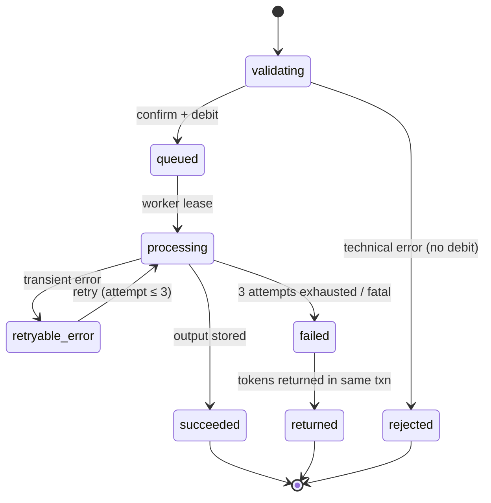
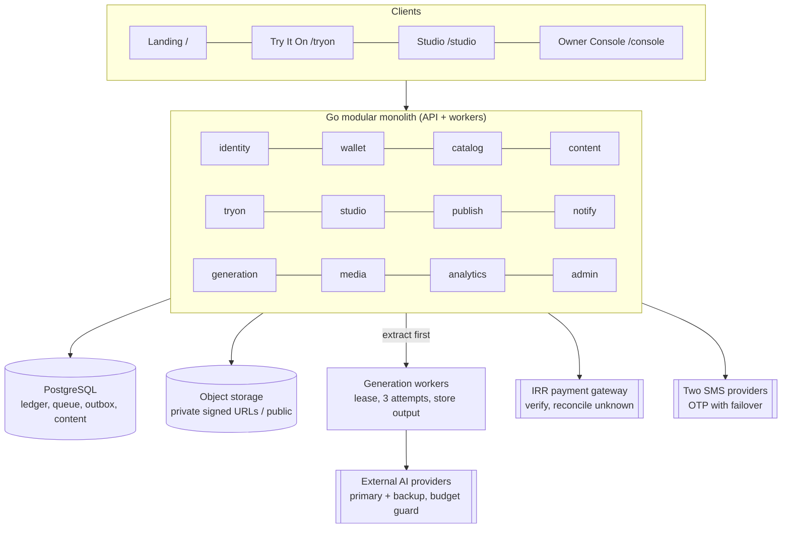

# تنه — مشخصات فنی

**نسخه 4.0 (نهایی) · 3 نوامبر 2026 · Ali Shokoohi**

## 0. کنترل سند

این، مشخصات مهندسی نهایی انگلیسی برای **Taneh** (تنه) است. این سند، *مشخصات جامع محصول تنه نسخه 3.0* فارسی (2 نوامبر 2026) را ترجمه می‌کند که خود با `Tan_Full_Design_Specification_v3(1).docx` تطبیق داده شده است، و تمام 41 تصمیم محصول اتخاذشده در 3 نوامبر 2026 را ادغام می‌کند. هیچ تصمیمی باز نمانده است؛ هر موردی که پیش‌تر «باز» بود، اکنون قانون تأییدشده خود را بیان می‌کند و به شناسه Q مربوط به آن ارجاع می‌دهد.

| مورد | مقدار |
| --- | --- |
| منبع | مشخصات جامع محصول تنه نسخه 3.0 (فارسی)، 2 نوامبر 2026 |
| مرجع بالادستی | مشخصات Word نسخه 3؛ تصمیم‌های مالک در 3 نوامبر 2026 (§16) بر موارد باز پیشین اولویت دارند |
| نام محصول | **Taneh** (تنه)، نهایی (Q38). محیط خریدار: **Try It On** («یه تن بزن»). محیط فروشنده: **استودیو تنه** |
| بازار اصلی | ایران؛ پرداخت‌های IRR از طریق درگاه‌های داخلی |
| مخاطبان | بک‌اند، فرانت‌اند، هوش مصنوعی/یادگیری ماشین، تضمین کیفیت، DevOps، طراحی و محصول |

**زبان هنجاری.** باید / نباید / توصیه می‌شود / مجاز است مطابق RFC 2119 هستند. *پیشنهادی* یک مقدار طراحی را مشخص می‌کند که همچنان به تأیید بصری روی نمونه‌های واقعی نیاز دارد (توکن‌ها، زمان‌بندی‌های حرکت). قابلیتی که با عنوان «ساخته‌شده اما خاموش» فهرست شده است باید به‌طور کامل پیاده‌سازی، متصل و آزمایش شود و سپس به‌صورت غیرفعال پشت یک فلگ عرضه شود.

**طرح شناسه‌گذاری (برای قابلیت ردیابی از منبع حفظ شده است).**

| پیشوند | معنا | بازه |
| --- | --- | --- |
| P | صفحه / نمایشگر / ماژول | P01–P49 |
| F | جریان سرتاسری کاربر | F01–F31 |
| U | داستان کاربر با معیارهای پذیرش | U01–U55 |
| Q | تصمیم محصول (همگی تصمیم‌گیری‌شده) | Q01–Q41 |
| R | نیازمندی | R01–R177 |
| W | نگاشت به بخش‌های منبع Word | W01–W60 |
| L | ناوردای دفتر کل | L1–L9 |

**بخش 18 غیرهنجاری است.** این بخش شامل توصیه‌های رهبر فنی برای پیاده‌سازی است؛ هر چیزی در آن که با §0–§17 در تعارض باشد، فاقد اعتبار است.

**تأیید نهایی همچنان خارج از مهندسی لازم است:** Q11 (از دست رفتن توکن‌ها هنگام حذف حساب) به بررسی حقوقی نیاز دارد؛ Q24 (شناسایی درآمد) به بررسی حسابداری نیاز دارد. هر دو توسط مالک تصمیم‌گیری شده‌اند و مطابق آنچه بیان شده پیاده‌سازی می‌شوند، مگر اینکه این بررسی‌ها آن‌ها را تغییر دهند.

## 1. نمای کلی محصول

تنه یک پلتفرم مد مبتنی بر هوش مصنوعی با دو محیط روی یک حساب و یک کیف پول توکن است: **«یه تن بزن»** پوشاک واقعی برندها را روی عکس خود خریدار رندر می‌کند و **استودیو تنه** عکس‌های محصول فروشنده را با استفاده از مدل‌های انسانی و استایل‌های منتخب به تصاویر و ویدئوهای تبلیغاتی تبدیل می‌کند. یک **کنسول مالک** محتوا، کیفیت، هزینه، انتشار و عملیات هر دو را کنترل می‌کند.

### 1.1 اهداف

- خریدار: کوتاه‌ترین مسیر از دیدن یک پوشاک تا دیدن آن روی عکس خودش؛ نگه‌داشتن، مقایسه‌کردن و سپس رفتن به فروشگاه برای خرید.
- فروشنده: تولید محتوای قابل‌استفاده محصول بدون نیاز به عکاس یا مدل زنده برای هر جلسه عکاسی، با حداقل بارگذاری مجدد.
- مالک: کنترل کامل محتوا، قیمت‌گذاری، ارائه‌دهندگان هوش مصنوعی، عرضه تدریجی و بازیابی، بدون دست‌زدن مستقیم به کد یا فضای ذخیره‌سازی.

### 1.2 موارد خارج از هدف و محدودیت‌های سخت

- تنه **فروشگاه نیست**. هیچ قیمت محصول، جنس پارچه، رتبه‌بندی تجاری یا مقایسه قیمت/کیفیتی نمایش داده نمی‌شود.
- نتیجه پرو مجازی، تصویری تولیدشده با هوش مصنوعی است. نباید به‌عنوان تضمین سایز یا تن‌خور ارائه شود.
- کلیک خرید، اثبات خرید نیست؛ تولید محتوا نیز اثبات افزایش فروش نیست. معیارهای موفقیت باید بر تکمیل جریان، استفاده مجدد و رفتار واقعی تکیه کنند.
- هر حساب حداکثر **یک** پروفایل فروشگاه دارد. استودیو به حساب دوم نیاز ندارد.
- پرداخت به IRR و از طریق درگاه‌های داخلی انجام می‌شود. با IRR توکن خریداری می‌شود؛ عملیات توکن مصرف می‌کنند. پرداخت مستقیم به‌ازای هر پروژه وجود ندارد.
- هر درخواست پرو مجازی دقیقاً روی **یک** پوشاک اعمال می‌شود (Q39).

### 1.3 تمایزها (مبنای طراحی، نه ادعاهای بازار)

| تمایز | رفتار عینی | معیار پیشنهادی |
| --- | --- | --- |
| کشف پیش از ثبت‌نام | گالری عمومی تصویرمحور پیش از ثبت‌نام | گالری ← جزئیات ← شروع پرو مجازی |
| شروع ساده پرو مجازی | یک عکس شخصی، بدون اندازه‌گیری‌های بدن | تکمیل درخواست پس از انتخاب پوشاک |
| مقایسه بصری | 1–3 نتیجه در کنار یکدیگر، هرکدام با پیوند فروشگاه مختص خود | میزان استفاده از مقایسه و ارجاع‌ها به فروشگاه |
| پیوند دوسویه | خروجی تأییدشده استودیو می‌تواند در تنه منتشر شود | محتوای تأییدشده قابل‌استفاده در گالری |
| هویت و اقتصاد مشترک | یک حساب و موجودی برای خریدار و استودیو | استفاده یک حساب از هر دو محیط |
| چیدمان بصری استودیو | ساخت دومرحله‌ای، تکثیر کارت، محصول یا رنگ برای هر کارت | زمان آماده‌سازی، استفاده مجدد از پروژه |
| تداوم کار | تولید پس از خروج ادامه می‌یابد؛ ورودی‌ها پس از ورود یا افزایش موجودی حفظ می‌شوند | بازیابی صحیح نتیجه یا چیدمان |
| امضای برند | پرده قهوه‌ای مخملی تیره، آشکارسازی مستقل هر خروجی | درک وضعیت و یادآوری برند در آزمون‌های کاربری |

### 1.4 واژه‌نامه

| اصطلاح | تعریف |
| --- | --- |
| آیتم هدف | تک پوشاکی که از یک ست کامل برای پرو مجازی انتخاب می‌شود |
| استایل استودیو | ترکیب‌بندی بصری آماده: مدل انسانی، ژست، ویژگی‌های عکاسی/خروجی |
| مدل استودیو | شخصیت انسانی نمایش‌داده‌شده در نمونه‌های مد. نه مدل هوش مصنوعی |
| مدل هوش مصنوعی | موتور تولید خارجی که مدیر برای هر قابلیت اختصاص می‌دهد |
| کارت چیدمان | یک نمونه مستقل از یک استایل به‌همراه جایگاه محصول، نوع خروجی و تنظیمات آن |
| Try-ons («تن‌زده‌ها») | گالری خروجی‌های موفق پرو مجازی خریدار |
| Set aside («نشون‌کرده‌ها») | پوشاکی که خریدار برای بعد ذخیره کرده و لزوماً پرو نشده‌اند (Q30) |
| ذخیره‌شده‌های استودیو | سه سطل مستقل: مدل‌ها، استایل‌ها، پروژه‌های چیدمان‌شده |
| پروژه‌های استودیو | پروژه‌هایی که تولیدشان آغاز شده است: در حال تولید یا تکمیل‌شده |
| پیش‌نویس خودکار | وضعیت موقت کار ناتمام که به‌مدت 30 روز نگه‌داری می‌شود و از ذخیره‌سازی دستی و کتابخانه جداست |
| انتشار در تنه | درخواست بررسی و انتشار یک خروجی استودیو در تنه |
| بازگشت توکن | بازگرداندن توکن‌های یک عملیات ناموفق به کیف پول. این بازپرداخت ریالی نیست |

### 1.5 وضعیت دامنه

| گروه | دامنه |
| --- | --- |
| خریدار، فعلی | گالری، جست‌وجوی متنی و فیلترها، فایل پوشاک یا لینک مجازشده در یک فضای اختصاصی، استایل‌های مرتبط مبتنی بر برچسب، پرو، «تن‌زده‌ها»، «نشون‌کرده‌ها»، مقایسه، اشتراک‌گذاری خارجی فایل |
| استودیو، فعلی | صفحهٔ فرود سینمایی، حلقه و ویترین مدل‌های انسانی، انتخاب مدل/استایل، چیدمان دومرحله‌ای، تصویر، ویدئو و تغییر رنگ، کتابخانه، مدیریت پروژه، انتشار |
| زیرساخت مشترک | احراز هویت SMS-OTP، حساب، کیف پول، تاریخچه، زبان و پوسته، حریم خصوصی، کنسول مالک |
| ساخته‌شده، آزموده‌شده، عرضه‌شده در حالت OFF | ویجت و API پرو، عرضهٔ درصدی، محدودیت استفاده برای هر کاربر، تیکتینگ، اعلان‌های خارجی (پوش، پیامک، ایمیل)، صورتحساب پولی انتشار |
| آینده (خریدار) | سازندهٔ ست پوشاک چندفروشگاهی؛ گالری با تصاویر چرخشی خودکار |
| خارج از تجربهٔ فعلی | جست‌وجوی بصری و تطبیق تصاویر مشابه، اسلایدر قبل/بعد، پیام‌رسانی داخلی یا شبکهٔ اجتماعی، فرایند طولانی و اجباری عکس، پرو چندپوشاکی |
| خارج از تعهد تأییدشده | نسخه وایت‌لیبل تنه، API عمومی استودیو، رابط کاربری مدیریت دستگاه، موتور هوش مصنوعی قابل‌انتخاب توسط کاربر، ورودی URL در چیدمان استودیو، لینک‌های عمومی اشتراک‌گذاری |

آواتار پایدار و کمد لباس سه‌تب از ایده‌های اولیه بودند و **تأیید نشده‌اند**. پخش یک ویدئوی کوتاه برای هر کارت با گالری چرخشی خودکار تفاوت دارد. مقایسهٔ فعلی یک سازندهٔ ست پوشاک چندپوشاکی نیست. قاعدهٔ «ساخته‌شده اما خاموش» شامل دو موردی که صراحتاً به آینده موکول شده‌اند نمی‌شود.

## 2. زمینهٔ سیستم

سه محیط کاربری، یک هویت، یک کیف پول و یک بک‌اند تولید را در **یک دامنه با مسیریابی مبتنی بر مسیر** به‌اشتراک می‌گذارند (Q01)؛ فقط صفحهٔ فرود بین دو محیط کاربری مسیریابی می‌کند.

| محیط | مسیر (نمونه) | کاربران | ناوبری | لحن |
| --- | --- | --- | --- | --- |
| صفحهٔ فرود (P01) | `/` | ناشناس و واردشده | دو کاشی ورود: «یه تن بزن»، استودیو | خنثی، تصویرمحور |
| «یه تن بزن» (P03–P13, P45, P46) | `/tryon` | خریداران | داشبورد خریدار (P12) | گرم، «تو»ی غیررسمی |
| استودیو تنه (P15–P24, P47–P49) | `/studio` | فروشندگان | یک نوار کناری مشترک استودیو (P49) | حرفه‌ای، «شما» |
| مشترک (P02, P14, P25, P26, P27, P29) | `/account`, `/wallet` | همه | قابل‌دسترسی از هر دو محیط | خنثی؛ راهنماها از محیط مبدأ پیروی می‌کنند |
| کنسول مالک (P30–P44) | `/console` | مدیران | برنامهٔ امن جداگانه | اداری و ساده |

نام دقیق مسیرها یک انتخاب پیاده‌سازی است؛ قاعدهٔ تک‌میزبان ثابت است.

**قواعد مسیریابی.**

- «یه تن بزن» نباید حاوی لینک مستقیم یا میان‌بر به استودیو باشد (R161). جابه‌جایی بین محیط‌ها از طریق P01 انجام می‌شود.
- نشست مشترک روی یک میزبان: ورود در یک محیط در محیط دیگر نیز معتبر است؛ خروج در یک مرورگر، نشست مشترک هر دو را پایان می‌دهد (R61, R62).
- لینک‌های عمیق به یک محیط نباید پویانمایی مقدمه را اجباری کنند.
- اهداف PWA: Android Chrome، iOS Safari، Chromium دسکتاپ (Q37).

### 2.1 P01 — صفحهٔ فرود و انتخاب مسیر

- بخش اصلی: لوگو، پردهٔ اتاق پرو با رنگ **قهوه‌ای مخملی تیره** (Q02)، آسمان یا رسانهٔ انتخاب‌شده پشت آن. با اسکرول به پایین، پرده کنار می‌رود، نام **تنه** نمایان می‌شود و شعار بالای تصویر قرار می‌گیرد. حرکت، لباس پوشیدن پشت پرده و دوباره بازشدن آن را تداعی می‌کند. رسانهٔ بخش اصلی در پنل محتوا انتخاب می‌شود.
- زیر تصویر: دو کاشی ورودی مستطیلی بزرگ، **«یه تن بزن»** (Try It On) و **«استودیو»** (Studio). اولی گالری عمومی را با یک گذار هماهنگ باز می‌کند؛ دومی لابی استودیو را باز می‌کند.
- سپس یک اسکرول کوتاه: معرفی بصری هر دو سرویس، پاورقی با راه ارتباطی، ایمیل یا کانال انتخاب‌شده و لینک‌های الزامی. صفحه کوتاه، تصویرمحور و کم‌متن باقی می‌ماند.
- مرور و انتخاب مسیر به حساب نیاز ندارد. دسکتاپ مجاز است هنگام قرارگرفتن نشانگر و فوکوس، پیش‌نمایش هر کاشی را نمایش دهد؛ موبایل باید یک کنترل لمسی صریح داشته باشد.
- ناوبری نباید منتظر پایان پویانمایی یا دانلود ویدئو بماند. حالت کاهش حرکت همان معنا را با یک تغییر وضعیت ساده منتقل می‌کند.
- لوگو، لوگوتایپ لاتین و دارایی‌های حرکتی پرده/دست توسط طراح داخلی به‌شکل Lottie/SVG به‌همراه تصاویر ثابت حالت کاهش حرکت تولید می‌شوند (Q04).

## 3. هویت، نشست‌ها و حساب

ورود **فقط با شمارهٔ موبایل + رمز یک‌بارمصرف پیامکی** انجام می‌شود؛ شمارهٔ تلفن هویت حساب است (Q09). احراز هویت تا زمان انجام یک اقدام شخصی به تعویق می‌افتد و زمینهٔ مبدأ باید در رفت‌وبرگشت احراز هویت حفظ شود.

### 3.1 P02 — ورود و ثبت‌نام با حفظ مبدأ

- یک فرم: شمارهٔ تلفن، سپس کد یک‌بارمصرف. شماره‌های جدید در اولین تأیید موفق، یک حساب ایجاد می‌کنند. هنگام عرضه هیچ فرایند ایمیل یا رمز عبوری وجود ندارد.
- رابط کاربری باید خطاهای واضح (شمارهٔ نامعتبر، کد اشتباه یا منقضی‌شده)، کنترل ارسال مجدد همراه با شمارش معکوس و محدودیت نرخ ارسال و تأیید را نمایش دهد.
- بازیابی با تأیید دوبارهٔ همان شمارهٔ تلفن انجام می‌شود. تغییر شمارهٔ تلفن حساب مستلزم تأیید شمارهٔ قدیمی و جدید است، یا در صورت ازدست‌رفتن شمارهٔ قدیمی، از طریق فرایندی ممیزی‌شده و با کمک پشتیبانی انجام می‌شود.

**زمانی که احراز هویت لازم است.**

| محیط | عمومی (بدون احراز هویت) | نیازمند احراز هویت |
| --- | --- | --- |
| «یه تن بزن» | گالری، جزئیات، فیلترها، جست‌وجو | شروع یک تن‌زدن (از جمله کمپین‌های رایگان)، هرگونه ذخیره‌سازی شخصی |
| استودیو تنه | لابی، حلقه مدل‌های انسانی، پیش‌نمایش‌های ویترین | ورود به جریان ساخت از هر یک از سه ورودی (ایجاد پروژه، مدل حلقه، پروژه نمونه)، پیش از P16 یا P17 (Q08) |

مشاهده نمونه‌ها یا پیش‌نمایش‌ها به‌معنای شروع ساخت نیست.

**حفظ مبدأ (R11، R147، R159).** احراز هویت باید لباس انتخاب‌شده، مدل انسانی مبدأ یا پروژه نمونه و مقصد بازگشت را حفظ کند. پس از موفقیت، کاربر به همان بافت دقیق بازمی‌گردد. لغو، بدون پاک‌کردن انتخاب مبدأ، کاربر را به موقعیت قبلی بازمی‌گرداند. تکمیل پروفایل خریدار یا جزئیات فروشگاه مرحله‌ای جداگانه و غیرمسدودکننده است.

**نشست‌ها.**

- یک حساب و یک موجودی در هر دو محیط؛ بدون احراز هویت مجدد یا حساب دوم (R02، R61).
- خروج از حساب در یک مرورگر، نشست مشترک را خاتمه می‌دهد (R62).
- ورود هم‌زمان در چند دستگاه مجاز است؛ دستگاه دوم نباید دستگاه اول را بیرون بیندازد (R64).
- رابط کاربری مدیریت دستگاه‌ها خارج از محدوده است (R65).
- از آنجا که شماره تلفن تنها شناسه هویتی است، بر اثر پیوند روش‌ها نمی‌تواند برای یک فرد دو کیف پول واگرا ایجاد شود.

### 3.2 P14 — تنظیمات و حذف حساب

- تنظیمات: زبان (FA/EN)، پوسته (روشن، تیره، سیستم)، اطلاعات حساب، مدیریت حریم خصوصی. پروفایل تدریجی خریدار، جزئیات فروشگاه و تنظیمات هویت مشترک سه کارکرد متمایزند و نباید در یک فرم اجباری طولانی ادغام شوند.
- **درخواست حذف** یک **بازه بازیابی 30روزه** را آغاز می‌کند (R26). تاریخ پایان باید قابل مشاهده باشد. کارهای پردازشی در حال اجرا به‌طور عادی تکمیل می‌شوند و نتایج آن‌ها تا حذف نهایی نگه داشته می‌شوند (Q10).
- **بازیابی** در طول این بازه با ورود از طریق همان شماره تلفن (SMS OTP) انجام می‌شود؛ حساب دقیقاً به وضعیت قبلی خود بازمی‌گردد.
- **توکن‌های باقی‌مانده** هنگام حذف نهایی **ضبط می‌شوند**. پیش از تأیید کاربر، پنجره تأیید باید موجودی فعلی را نمایش دهد و ضبط‌شدن آن را صراحتاً اعلام کند (Q11). ردیف‌های دفتر کل با ناشناس‌سازی فرد نگه داشته می‌شوند.
- پس از پایان بازه، داده‌های شخصی حذف یا ناشناس‌سازی می‌شوند؛ سوابق مالی مطابق سیاست داده‌ها به‌صورت ناشناس نگه داشته می‌شوند. هیچ بازپرداخت IRR یا تبدیل توکن به وجه نقد ارائه نمی‌شود. Q11 پیش از راه‌اندازی مشمول بررسی حقوقی است.

## 4. دامنه خریدار — «یه تن بزن»

هر درخواست تن‌زدن دقیقاً یک آیتم هدف و یک عکس شخصی دارد، پیش از اجرا قیمت‌گذاری و تأیید می‌شود، با ترک‌کردن صفحه توسط کاربر از بین نمی‌رود و یا یک خروجی تحویل می‌دهد یا توکن‌هایش را بازمی‌گرداند.

### 4.1 P03 — گالری عمومی و کشف

- گالری به استایل پینترست/نمایش مد از مدل‌های انسانی ایرانی و لباس‌های واقعی برندهای ایرانی. معرفی برند در اولویت دوم است؛ اقدام اصلی تن‌زدن مجازی است. مهمان‌ها می‌توانند مرور کنند، فیلتر کنند و جزئیات را باز کنند.
- **تأمین کاتالوگ (Q07):** مجموعه‌ای منتخب برای راه‌اندازی که تیم تنه آن را تأمین کرده و مجوزش را گرفته است، به‌علاوه سلف‌سرویس برندها از طریق کنسول و واردسازی CSV در آینده. هر لباس پیش از عمومی‌شدن به مجوز امضاشده استفاده از تصویر نیاز دارد.
- هر استایل دارای برچسب‌های ساختاریافته است: نوع لباس (کفش، پیراهن و غیره)، دسته‌بندی استایل، مدل انسانی، زنانه/مردانه. جست‌وجوی متنی به‌همراه فیلترهای نوع، رنگ، برند، مدل انسانی و حال‌وهوای استایل. فیلترها قابل مشاهده اما فشرده‌اند؛ داده‌ها در پنل محتوا مدیریت می‌شوند. **فیلتر قیمت یا پارچه وجود ندارد.**
- کارت: تصویر اصلی = ست کامل؛ تصویر بندانگشتی = آیتم قابل تن‌زدن. اقدام‌های مستقل: بازکردن جزئیات، افزودن به «نشون‌کرده‌ها» برای بعد، تن‌زدن، رفتن به فروشگاه.
- CTA اصلی «یه تن بزن» در تمام مدت مرور، در موبایل و دسکتاپ، بدون پوشاندن گالری در محدوده دسترسی انگشت باقی می‌ماند. بارگذاری لباس خارجی از طریق همان CTA وارد P05 می‌شود.
- بازگشت از جزئیات باید عبارت جست‌وجو، فیلترها، دسته‌بندی و موقعیت پیمایش را بازیابی کند. وضعیت خالی گزینه «پاک‌کردن فیلترها» را ارائه می‌دهد؛ خطای رسانه گزینه تلاش مجدد را ارائه می‌دهد؛ ویدئو دارای تصویر پوستر جایگزین است.
- ثبت رویداد از روز نخست: مشاهده، کلیک، تن‌زدن، ارجاع به فروشگاه. ورود رایگان برندها، الزام مجوز تصویر یا اعتبار لینک فروشگاه را لغو نمی‌کند.

### 4.2 P04 — جزئیات استایل و اجزای ست

- تصویر اصلی بزرگ به‌همراه تصاویر بندانگشتی هر جزء ست (آیتم تکی یا مجموعه: بالاتنه، شلوار، کفش). برچسب‌ها، دسته‌بندی استایل، مدل انسانی و لینک فروشگاه ایرانی. آیتم هدف باید با متن و تصویر مشخص شود تا مشاهده یک ست هرگز به‌معنای انتخاب همه اجزا نباشد.
- انتخاب یا بارگذاری عکس شخصی و شروع تن‌زدن از همین‌جا. مهمان‌ها هنگام اقدام احراز هویت می‌شوند؛ استایل و آیتم حفظ می‌شوند. عکس ذخیره‌شده و قابل استفاده مجدد که رضایت معتبر دارد دوباره درخواست نمی‌شود، اما همچنان قابل تعویض است. استایل را می‌توان برای بعد به «نشون‌کرده‌ها» افزود.
- استایل‌های مرتبط در پایین، بر اساس برچسب‌ها و دسته‌بندی‌های مشترک. این قابلیت مبتنی بر محتواست، نه جست‌وجوی بصری.
- لینک فروشگاه فقط زمانی نمایش داده می‌شود که معتبر باشد. نمایش چندبخشی ثابت است؛ **در هر درخواست تن‌زدن یک لباس** (Q39): هزینه و نتیجه فقط همان آیتم را پوشش می‌دهند. برای تن‌زدن بخش دیگری، کاربر درخواست دیگری را آغاز می‌کند.

### 4.3 P05 — تن‌زدن مستقل (ایجاد)

از طریق "+ یه تن بزن" باز می‌شود. دو ورودی الزامی:

| ورودی | منابع |
| --- | --- |
| عکس شخصی | بارگذاری جدید، یکی از حداکثر 5 عکس ذخیره‌شده یا عکس پیش‌فرض |
| لباس | فایل تصویر؛ لینک تصویر یا محصول از یک **فروشگاه پذیرش‌شدهٔ عضو فهرست مجاز** (Q31)؛ انتخاب از کاوش یا «نشون‌کرده‌ها» |

- لباسی که از قبل از روی یک کارت انتخاب شده است حفظ می‌شود و دوباره درخواست نمی‌شود.
- **دریافت لینک (Q31):** فقط میزبان‌های موجود در فهرست مجازِ فروشگاه‌های پذیرش‌شده که توسط مالک مدیریت می‌شود، واکشی می‌شوند. تصویر واکشی‌شده باید پیش از تولید برای تأیید آیتم هدف نمایش داده شود. میزبان خارج از فهرست مجاز، لینک نامعتبر، شکست واکشی یا وجود چند تصویر مبهم → خطای واضح به‌علاوه مسیر جایگزین بارگذاری. **تولید نباید بر اساس حدس درباره پوشاک آغاز شود.** ورودی URL نباید به چیدمان استودیو تعمیم داده شود.
- شخص، پوشاک و بازبینی، کارهایی درون یک جریان کوتاه هستند، نه چهار صفحه اجباری. پروفایل و آواتار پیش‌نیاز نیستند. برای پوشاکی که فروشگاهی ندارد، اطلاعات خرید ساختگی ارائه نمی‌شود.

### 4.4 P06 — انتخاب عکس شخصی

- یک عکس کافی است. قد، وزن، اندازه‌های بدن و عکس‌های چندزاویه‌ای پیش‌نیاز نیستند. پیش‌نمایش و تعویض پیش از تأیید؛ راهنمایی کوتاه و غیربازدارنده برای عکس.
- **محدودیت‌های بارگذاری (Q05):** حداکثر **15 MB**؛ JPEG، PNG، WebP یا HEIC؛ کوتاه‌ترین ضلع **≥ 512 px**. فایل‌های خارج از این محدودیت‌ها با پیامی مشخص و **پیش از کسر هرگونه توکن** رد می‌شوند.
- **توصیه درباره کیفیت در برابر شکست فنی.** نور کم، حالت بدنی غیربهینه یا کیفیت پایین نباید مانع کاربر شود. فایل خراب، فرمت پشتیبانی‌نشده، حجم بیش‌ازحد یا ورودی واقعاً پردازش‌ناپذیر، خطای فنی جداگانه‌ای است. متن رابط و معیارهای پذیرش باید این دو را از هم متمایز کنند.
- **گالری شخصی (Q40):** حداکثر **5** عکس ذخیره‌شده که یکی به‌عنوان پیش‌فرض علامت‌گذاری شده است. استفاده مجدد فوری است؛ استفاده از عکس جدید همیشه امکان‌پذیر است. افزودن عکس ششم مستلزم حذف یکی از عکس‌ها است.
- ذخیره‌سازی دائمی نیازمند رضایت صریح همراه با اطلاعیه پردازش هوش مصنوعی در نخستین بارگذاری است (Q12)؛ رد کردن، مسیر موقت را حفظ می‌کند. **TTL پیش‌فرض عکس موقت: 14 روز**، قابل پیکربندی توسط مالک.
- عکس حذف‌شده یا منقضی‌شده هرگز دوباره استفاده نمی‌شود. انتخاب عکس پیش‌فرض به‌معنای تأیید خودکار هزینه نیست. حذف یک ورودی، خروجی‌های موفق قبلی را حذف نمی‌کند.

### 4.5 P07 — بازبینی و تأیید

- آیتم هدف، عکس شخصی، هزینه توکن و موجودی را در کنار اقدام تأیید نمایش می‌دهد. کمپین‌های رایگان هزینه واقعی 0 را نمایش می‌دهند و همچنان به حساب کاربری نیاز دارند. هر درخواست قیمت تأییدشده خود را دارد؛ هیچ‌چیز پیش از تأیید اجرا نمی‌شود.
- موجودی ناکافی → میزان کسری + مسیر افزایش موجودی. پس از پرداخت، همان درخواست بازمی‌گردد؛ پرداخت به‌تنهایی هرگز یک کار پردازشی تأییدنشده را آغاز نمی‌کند. تغییر قیمت → تأیید مجدد.
- دوبار کلیک نباید درخواست‌ها یا برداشت‌های تکراری ایجاد کند. لغو، ورودی‌های معتبر را حفظ می‌کند.

### 4.6 P08 — اتاق پرو و انتظار

- درخواست پذیرفته‌شده پشت پرده، در مقابل آسمان یا تصویر انتخاب‌شده قرار می‌گیرد. کشیدن زودهنگام پرده: دستی آن را دوباره می‌کشد و می‌بندد. متن بصری اجباری نیست؛ وضعیت برای صفحه‌خوان باید وجود داشته باشد. انیمیشن نباید وضعیت واقعی صف/پردازش را پنهان کند. **درصدها یا زمان‌های تخمینی ساختگی ممنوع است.** حالت کاهش حرکت، پیام و امکان خروج را حفظ می‌کند.
- کاربر مجاز است خارج شود؛ پردازش سرور ادامه می‌یابد. پس از موفقیت، یک اعلان **درون‌برنامه‌ای** با متن «بیا یه نظر بده!» از طریق لینک عمیق به همان نتیجه هدایت می‌کند (Q22). اگر مرورگر بسته شده باشد، نتیجه و وضعیت آماده پس از بازگشت قابل مشاهده‌اند. هنگام عرضه اولیه، SMS، اعلان پوش یا ایمیل وجود ندارد.
- موفقیت به «تن‌زده‌ها» هدایت می‌شود. شکست بدون خروجی قابل استفاده، توکن‌های همان درخواست را بلافاصله پس از آخرین تلاش مجدد بازمی‌گرداند (Q29)؛ *در انتظار بازگشت* و *بازگردانده‌شده* وضعیت‌های متمایزی هستند. تلاش مجدد، درخواستی جدید با تأیید هزینه جدید است.
- **خروجی موفق اما ناخواسته (Q13):** بازگشت خودکاری وجود ندارد. کاربر مجاز است با پشتیبانی تماس بگیرد؛ پشتیبانی مورد را به‌صورت موردی بررسی می‌کند و مجاز است توکن‌ها را از طریق یک تعدیل مدیریتی حسابرسی‌شده بازگرداند. شکست نهایی هرگز اعلان موفقیت دریافت نمی‌کند.

### 4.7 P09 — نمای نتیجه

- تصویر بزرگ همراه با آیتم هدف، برند، تاریخ و اطلاعات خرید موجود. اطلاعیه تولیدشده با هوش مصنوعی و افشای نبود تضمین سایز یا تن‌خور، به‌شکلی متناسب و بدون پوشاندن تصویر.
- اقدامات: بزرگ‌نمایی، دانلود، تولید مجدد، تغییر لباس، مقایسه، اشتراک‌گذاری، حذف، بازگشت به کاوش و رفتن به فروشگاه، در صورت وجود مقصد معتبر.
    - تولید مجدد، ورودی‌ها را برای تأیید هزینه جدید حفظ می‌کند.
    - تغییر لباس، عکس شخصی معتبر را حفظ کرده و انتخاب پوشاک را باز می‌کند؛ عکس منقضی‌شده نیازمند انتخابی جدید است. خروجی قبلی حذف نمی‌شود.
- اسلایدر قبل/بعد وجود ندارد.
- موفقیت به‌طور خودکار در «تن‌زده‌ها» ذخیره می‌شود؛ مرحله ذخیره اضافی و کمد لباس جدیدی وجود ندارد. قرار دادن پوشاک در «نشون‌کرده‌ها»، اقدام مستقل P45 است. حذف نتیجه نباید عکس شخصی یا آیتم موجود در «نشون‌کرده‌ها» را حذف کند.
- **اشتراک‌گذاری خارجی فقط به‌صورت فایل است (Q14):** استفاده از Web Share API همراه با فایل تصویر در صورت پشتیبانی و دانلود به‌عنوان مسیر جایگزین؛ Telegram، WhatsApp و ایمیل مقصدهای نمونه هستند. **هیچ لینک عمومی‌ای** هرگز ایجاد نمی‌شود. صندوق ورودی، مخاطبان یا شبکه اجتماعی داخلی وجود ندارد.

### 4.8 P10 — گالری «تن‌زده‌ها»

- گالری تصویرمحورِ همه «تن‌زده‌ها»ی موفق؛ تا زمانی که کاربر حذف کند باقی می‌ماند. زیر عنوان، زیرعنوان تبلیغاتی وجود ندارد؛ نام دسترس‌پذیر حفظ می‌شود. آیتم‌هایی که فقط در «نشون‌کرده‌ها» هستند، عضو این گالری نیستند.
- اقدامات: باز کردن، دانلود، اشتراک‌گذاری فایل، حذف، انتخاب برای مقایسه، رفتن به فروشگاه (در صورت قابل‌خرید بودن). کارهای پردازشی در حال اجرا یا ناموفق، در صورت نمایش، از موارد موفق جدا می‌شوند. در وضعیت خالی، پیوندهایی به کشف یا ایجاد نمایش داده می‌شود. صفحه‌بندی و بازگشت، موقعیت پیمایش و انتخاب مقایسه را حفظ می‌کنند.

### 4.9 P11 — مقایسه

- 1 تا 3 نتیجه، با امکان انتخاب از فروشگاه‌های متفاوت. هر تصویر، پوشاک و فروشگاه مختص خود را نمایش می‌دهد؛ لینک هر فروشگاه متعلق به نتیجه خودش است. انتخاب مورد 4ام، پیام محدودیت را نمایش می‌دهد و 3 مورد قبلی را حفظ می‌کند.
- **صرفاً بصری.** بدون قیمت، جنس پارچه، کیفیت تجاری، امتیاز فروشگاه یا مقایسه خرید. حذف از مقایسه، نتیجه را حذف نمی‌کند. در موبایل باید دسترسی به همه انتخاب‌ها از طریق پیمایش یا تب‌ها ممکن باشد. قاب‌بندی یکسان مفید است، اما نباید پوشاک را دچار اعوجاج کند یا اندازه‌ای را القا کند. از نتیجه و «تن‌زده‌ها» قابل دسترسی است؛ منوی تکراری وجود ندارد.

### 4.10 P45 — «نشون‌کرده‌ها»

- پوشاکی که بدون الزام به پرو کردن ذخیره شده‌اند. نام رابط کاربری: **«نشون‌کرده‌ها»** (EN "Set aside"، Q30). ذخیره توسط مهمان، هنگام انجام عمل نیازمند احراز هویت است و سپس همان پوشاک را ذخیره می‌کند؛ ذخیره‌های تکراری ایدمپوتنت هستند. تصویر ست لباس، آیتم هدف و اطلاعات معتبر برند و فروشگاه ذخیره می‌شوند.
- باز کردن، «یه تن بزن»، خرید یا حذف. می‌تواند هم‌زمان با یک نتیجه در «تن‌زده‌ها» وجود داشته باشد. حذف یک آیتم، عکس‌ها، خروجی‌ها یا محصولات فروشگاه را حذف نمی‌کند. آیتم‌های ناموجود، وضعیت واضحی نمایش می‌دهند. با ذخیره‌شده‌های استودیو یکسان نیست.

### 4.11 P13 — عکس‌های شخصی

- فضای خصوصی برای مشاهده، انتخاب، تعویض و حذف حداکثر **5** عکس و انتخاب عکس پیش‌فرض (Q40). موقت یا دائمی بودن به‌وضوح مشخص می‌شود؛ عکس اول فقط با رضایت کاربر ذخیره می‌شود.
- حذف عکس پیش‌فرض یا آن را پاک می‌کند یا جایگزینی صریح درخواست می‌کند؛ هرگز جایگزین تصادفی انتخاب نمی‌شود. حذف یک ورودی هرگز نتیجه قبلی را مختل نمی‌کند. عکسی که در میانه تولید حذف شود، فقط تا زمانی نگهداری می‌شود که کار پردازشی در حال اجرا به آن نیاز دارد و سپس پاک‌سازی می‌شود.

### 4.12 P46 — پروفایل تدریجی

- تا زمانی که فیلدهای پیشنهادی تکمیل نشده‌اند، یک نشان تعجب کوچک زرد کنار پروفایل نمایش داده می‌شود؛ هرگز مانع ادامه کار نمی‌شود. معنا فقط بر رنگ متکی نیست: نام دسترس‌پذیر "تکمیل اختیاری پروفایل". هیچ مودال مزاحم تکرارشونده‌ای وجود ندارد.
- **فیلدها (Q41): فقط قد و وزن**، هر دو اختیاری. فقط در صورتی به ارائه‌دهنده پرو مجازی ارسال می‌شوند که آن ارائه‌دهنده از آن‌ها استفاده کند؛ در غیر این صورت، جمع‌آوری آن‌ها نباید به‌عنوان بهبود کیفیت تبلیغ شود. تغییرات، نتایج گذشته را تغییر نمی‌دهند. مبنای پرو مجازی یک عکس واقعی است؛ آواتار دائمی تأیید نشده است.

### 4.13 P12 — ناوبری خریدار

آیکون حساب و موجودی توکن همیشه قابل مشاهده هستند. برآورد تعداد خروجی‌های قابل تولید از قیمت‌گذاری واقعی هر عملیات استفاده می‌کند؛ نرخ جعلی واحد وجود ندارد. اینجا پیوندی به استودیو وجود ندارد.

| ورودی | مقصد | دسترسی |
| --- | --- | --- |
| کاوش | گالری، جست‌وجو، دسته‌بندی‌ها، جزئیات | عمومی |
| + «یه تن بزن» / ایجاد | پرو مستقل با فایل/پیوند | اجرا و ذخیره شخصی پس از احراز هویت |
| عکس‌های من | گالری خصوصی (حداکثر 5) و عکس پیش‌فرض | شخصی |
| «تن‌زده‌ها» | نتایج موفق و مقایسه | شخصی |
| «نشون‌کرده‌ها» | پوشاک ذخیره‌شده برای بعد | ذخیره پس از احراز هویت |
| پروفایل | قد/وزن اختیاری، راهنمای عکس | اختیاری برای پرو |
| حساب و کیف پول | تنظیمات، تاریخچه مالی | شخصی |
| راهنما | راهنمای استفاده، مسیر پشتیبانی | راهنما عمومی؛ تیکت‌ها بر اساس فلگ |

خانه به کاوش هدایت می‌شود؛ تاریخچه بصری به «تن‌زده‌ها» هدایت می‌شود. برای هر مفهوم یک منو وجود دارد. تاریخچه مالی از تاریخچه تصاویر جدا است.

## 5. دامنه استودیو

یک ساخت استودیویی دقیقاً شامل دو مرحله است (انتخاب، سپس چیدمان) که روی یک وضعیت انتخاب مشترک انجام می‌شوند؛ هر کارت یک خروجی مستقل تولید می‌کند و قیمت‌گذاری و کسر هزینه آن فقط با تأیید صریح ایجاد انجام می‌شود.

### 5.1 P15 — لابی استودیو

- حس ورود به یک آژانس حرفه‌ای طراحی مد و تبلیغات. از بالا به پایین: پوستر با رسانه سینمایی ← حلقه مدل‌ها ← ویترین پروژه‌های آماده.
- **پوستر:** ویدئوها و تصاویر سینمایی چرخشی؛ مدل‌های انسانی مانند نمایش مد راه می‌روند. رسانه جنبه نمایشی دارد؛ مدل انسانی داخل ویدئوی پوستر، هدف انتخاب نیست. پخش خودکار بی‌صدا، کنترل توقف، جایگزین پوستر و حالت کاهش حرکت.
- **حلقه مدل‌ها:** کاروسل چرخان شامل مدل‌های انسانی متعدد. نگه‌داشتن نشانگر/فوکوس روی یک مدل انسانی، استایل‌های آن را در اطرافش نمایش می‌دهد؛ لمس، کنترل‌های صریح و توقف، همان قابلیت را در موبایل فراهم می‌کنند. دارایی‌ها فقط در صورت داشتن **حقوق استفاده** مجاز است از Pinterest یا منابع دیگر تأمین شوند؛ نام بردن از منبع به‌معنای داشتن مجوز نیست.
- **ویترین:** پروژه‌های نمونه آماده (تصویر + ویدئو). Nike، Calvin Klein و Gucci مراجع کیفیت در مشخصات Word هستند (Adidas در نسخه پایه). این نام‌ها به‌معنای هیچ‌گونه همکاری یا مجوز دارایی نیستند. نگه‌داشتن نشانگر/فوکوس/لمس، مجموعه رسانه‌ای یک نمونه را مرور می‌کند.
- **ایجاد پروژه** همیشه قابل دسترسی است: در ابتدا کوچک و در گوشه بالایی، و هنگام پیمایش برجسته‌تر می‌شود. کنترل حساب کوچک اما قابل یافتن است. نوار کناری کامل کار نباید روی نمای سینمایی قرار بگیرد.

| ورودی ساخت | احراز هویت | مقصد و وضعیت اولیه |
| --- | --- | --- |
| ایجاد پروژه | پیش از ورود به ساخت | P16، نمای پیش‌فرض استایل‌ها، انتخاب خالی |
| مدل انسانی از حلقه | پیش از ورود به ساخت؛ مدل انسانی مبدأ حفظ می‌شود | P16 با **همه استایل‌های آن مدل انسانی از پیش انتخاب‌شده**؛ قابل حذف، گسترش و پاک‌سازی (Q34) |
| پروژه نمونه آماده | پیش از ورود به ساخت؛ نمونه حفظ می‌شود | P17 با استایل‌ها و تصاویر محصول نمونه؛ قابل جایگزینی و حذف، بازگشت به P16 |

انتخاب یک مدل انسانی از حلقه هیچ هزینه‌ای ندارد؛ تعداد از پیش انتخاب‌شده و برآورد توکن باید پیش از ادامه قابل مشاهده باشند.

### 5.2 P16 — مرحله 1: انتخاب استایل‌ها و مدل‌های انسانی

- روی استایل‌ها باز می‌شود. هیچ صفحه واسط «مدل انسانی یا استایل؟» وجود ندارد. نمای استایل‌ها و نمای مدل‌های انسانی، دو پنجره به **یک وضعیت انتخاب مشترک** هستند، نه دو مرحله.
- گالری استایل: تصویر یا ویدئو، قیمت توکن، انتخاب، ذخیره، باز کردن جزئیات. **باز کردن جزئیات به‌معنای انتخاب نیست.** گالری مدل‌های انسانی: جست‌وجو، فیلتر، باز کردن پروفایل؛ انتخاب یک، چند یا همه استایل‌های یک مدل انسانی، یا ذخیره صرفاً خود مدل انسانی. ترکیب مدل انسانی و استایل مستقل نباید تعداد خروجی‌ها یا هزینه را مبهم کند.
- فیلترها: استایل‌ها بر اساس نوع محصول و حال‌وهوا (کفش، پوشاک، ورزشی، کلاسیک، روزمره، لوکس)؛ مدل‌ها بر اساس سن یا گروه سنی، جنسیت، رنگ پوست و ویژگی‌های ظاهری مرتبط. پنل جمع‌شونده است؛ چیپ‌های فعال و قابل‌حذف پس از بسته‌شدن پنل باقی می‌مانند. طبقه‌بندی عمیق و چندسطحی وجود ندارد؛ فهرست‌ها در پنل محتوا مدیریت می‌شوند.
- **نمایش قیمت (Q36):** هر کارت استایل، در صورت وجود، هزینهٔ افزودهٔ استایل خود را افزون بر قیمت پایهٔ نوع خروجی نمایش می‌دهد. مجموع جاری از نخستین انتخاب نمایش داده می‌شود و با افزودن/حذف به‌صورت زنده به‌روزرسانی می‌شود. قیمت در موبایل نباید به هاور وابسته باشد.
- خلاصهٔ کوچک، آیتم‌ها و تعداد را قابل‌مشاهده نگه می‌دارد. پروژه‌ها و ذخیره‌شده‌ها از همان پیمایش داشبورد قابل‌دسترسی‌اند. جابه‌جایی میان نماها، جزئیات، پروفایل و ذخیره‌شده‌ها، انتخاب‌ها را حفظ می‌کند. **بعدی** انتخاب‌های معتبر را به مرحلهٔ 2 می‌برد. لایک یا امتیازدهی عمومی وجود ندارد؛ بازدیدها، انتخاب‌ها و استفادهٔ واقعی به‌صورت داخلی ردیابی می‌شوند.
- **محدودیت (Q15):** حداکثر **50 کارت در هر پروژه**، که پیش از رسیدن کاربر به این حد در خلاصه اعلام می‌شود.

### 5.3 P47 — جزئیات استایل

رسانهٔ بزرگ‌تر، مدل، ویژگی‌های استایل، قیمت. انتخاب برای پروژه، ذخیرهٔ استایل و مشاهدهٔ مدل، سه اقدام مجزا هستند. بازکردن یا بستن جزئیات، تعداد یا هزینه را تغییر نمی‌دهد. رفتن به پروفایل مدل و بازگشت، انتخاب مشترک و زمینهٔ گالری را حفظ می‌کند.

### 5.4 P48 — پروفایل مدل

تصاویر و استایل‌های مدل را مرور کنید. یک، چند یا همهٔ استایل‌ها را انتخاب کنید؛ مدل را به‌صورت مستقل ذخیره کنید. «انتخاب همه» باید تعداد و تأثیر بر هزینه را اعلام کند و نباید آیتم‌های ازپیش‌انتخاب‌شده را تکرار کند (تکرار عمدی در مرحلهٔ 2 انجام می‌شود). ورود به پروفایل، سایر انتخاب‌ها را پاک نمی‌کند.

### 5.5 P17 — مرحلهٔ 2: چیدمان

از انتخاب دستی، از انتخاب‌های حلقه پس از P16، یا از یک پروژهٔ نمونه وارد می‌شود و با برچسب «مرحلهٔ 2 از 2» نمایش داده می‌شود.

- **برای هر نمونهٔ استایل یک کارت**، که هرکدام یک جایگاه محصول دارند. جایگاه خالی با پردهٔ مخملی پوشانده می‌شود؛ کلیک، کتابخانه یا بارگذاری جدید را باز می‌کند. پس از تخصیص، پرده باز می‌ماند؛ حذف تصویر آن را می‌بندد. نمونه‌ها از ابتدا تصویر محصول خود را نمایش می‌دهند. راهنما: «تصویر محصول را به این استایل اختصاص دهید».
- **نوع خروجی برای هر کارت (Q18):** هر کارت **تصویر** یا **ویدئو** را انتخاب می‌کند؛ **تغییر رنگ** یک افزونه با قیمت‌گذاری جداگانه در همان کارت است. قیمت کارت = قیمت پایهٔ نوع خروجی + هزینهٔ افزودهٔ استایل + افزونهٔ تغییر رنگ در صورت استفاده.
- عملیات مجزا: جایگزینی تصویر، فقط حذف تصویر، حذف کل کارت به‌همراه تخصیص آن، تکثیر. حذف یک تخصیص یا کارت هرگز فایل کتابخانه را حذف نمی‌کند. منوی کوچک برای هر کارت؛ نام هر اقدام باید اثر آن را به‌روشنی بیان کند.
- **تکثیر** تا سقف محدودیت 50 کارت در هر پروژه (Q15)، کارتی جدید با همان مدل، ژست و تنظیمات و یک جایگاه تصویر **خالی** ایجاد می‌کند. استفاده از پنج یا شش پوشاک متفاوت روی یک استایل معتبر است. یک بارگذاری را می‌توان عمداً به چند نسخه با رنگ‌های دقیق متفاوت (مقدار + نمونه‌رنگ قابل‌مشاهده) اختصاص داد — برای مثال، یک بارگذاری، پنج خروجی، پنج رنگ. فایل موقت پروژه تا پایان TTL خود، مستقل از فضای ذخیره‌سازی دائمی، قابل‌استفادهٔ مجدد است.
- **بازگشت** با حفظ تصاویر، رنگ‌ها، نسخه‌ها و انتخاب‌ها به P16 می‌رود؛ استایل‌ها را اضافه/حذف کنید و بازگردید تا تخصیص‌های سازگار را ببینید. **واگرد** حداقل آخرین ویرایش این صفحه را برمی‌گرداند (حذف تصویر، حذف کارت به‌همراه تخصیص، جایگزینی تصویر). واگرد پیمایش نیست؛ تاریخچهٔ چندسطحی تضمین نشده است. حذف انتخابی از مرحلهٔ 1 که بر یک کارت پُر اثر می‌گذارد، باید اثری قابل‌درک داشته باشد.
- مجموع توکن‌ها همیشه قابل‌مشاهده است: تکثیر آن را افزایش می‌دهد و حذف کاهش می‌دهد. ذخیرهٔ دستی، چیدمان را به ذخیره‌شده‌ها ← زبانهٔ پروژه‌ها منتقل می‌کند. خروج بدون ذخیره‌کردن، یک **پیش‌نویس خودکار را به‌مدت 30 روز از آخرین فعالیت** حفظ می‌کند (Q32). انقضای پیش‌نویس هرگز کتابخانه یا ذخیره‌های دستی را حذف نمی‌کند.
- **ایجاد:** اگر هر کارتی تصویر محصول نداشته باشد، **ایجاد غیرفعال است** و کارت‌های خالی تا زمانی که هرکدام پُر یا حذف شوند برجسته می‌مانند (Q33). وقتی همهٔ کارت‌ها آماده‌اند: کادر گفت‌وگوی تأیید شامل تعداد خروجی‌ها، مجموع توکن‌ها، موجودی و همچنین پرسش اختیاری «مایلید استایل دیگری اضافه کنید؟» نمایش داده می‌شود (دو مسیر روشن: گسترش یا تأیید). موجودی کافی + تأیید ← کسر توکن و شروع تولید. کسری موجودی ← افزایش موجودی ← بازگشت به دقیقاً همان صفحه و وضعیت؛ همچنان تأیید لازم است. **پرداخت مستقیم برای پروژه وجود ندارد.** پس از تأیید، صفحهٔ تولید جداگانه‌ای باز می‌شود؛ مرحلهٔ 3 وجود ندارد.

### 5.6 P18 — ورودی محصول: کتابخانه یا بارگذاری

- فقط دو ورودی: انتخاب از کتابخانه، بارگذاری تصویر جدید. **در استودیو هیچ ورودی URL وجود ندارد.** محدودیت‌های بارگذاری همان محدودیت‌های خریداران است: 15 MB، JPEG/PNG/WebP/HEIC، ≥ 512 px (Q05). پیش‌نمایش پیش از اعمال؛ لغو یا خطای بارگذاری هرگز تصویر معتبر قبلی را جایگزین نمی‌کند. تخصیص متعلق به یک کارت است؛ لغو تخصیص به‌معنای حذف فایل نیست.
- فروشندگان می‌توانند همهٔ تصاویر محصولات فروشگاه را از پیش بارگذاری کنند و آن‌ها را با دسته‌بندی‌ها و برچسب‌های ساختاریافتهٔ پوشاک پیدا کنند. تنظیم **«ذخیرهٔ همهٔ عکس‌های بارگذاری‌شده» به‌طور پیش‌فرض روشن است** (Q06): بارگذاری‌های جدید پروژه به کتابخانهٔ دائمی می‌پیوندند. وقتی فروشنده آن را خاموش می‌کند، بارگذاری‌های جدید موقت هستند و **30 روز** پس از بارگذاری پاک می‌شوند.
- یک بارگذاری در سراسر پروژه و نسخه‌های آن قابل‌استفادهٔ مجدد است. ذخیره‌سازی به‌معنای انتشار نیست. محصولات نمونه به‌عنوان دارایی‌های نمونه باقی می‌مانند و هرگز به محصول فروشنده تبدیل نمی‌شوند. اگر فایلی که در یک چیدمان ذخیره‌شده استفاده شده است منقضی شود، وضعیت و نیاز به بارگذاری مجدد نمایش داده می‌شود؛ خروجی‌های قبلی باقی می‌مانند.

### 5.7 P19 — تولید و رونمایی

- پس از تأیید، همان کارت‌ها در صفحه‌ای خارج از دو مرحلهٔ ساخت ادامه می‌یابند. اکنون پرده، خروجی در حال تولید را می‌پوشاند. هر کارت وضعیت مستقلِ در صف، در حال پردازش، آماده یا خطای نهایی خود را دارد.
- کلیک روی یک پرده ناتمام، آن را کمی باز می‌کند، لوگو/انیمیشن تنه را لحظه‌ای نمایش می‌دهد و سپس دستی آن را می‌بندد. متن اختیاری: «در حال تولید خروجی» (با لحن حرفه‌ای). وضعیت دسترس‌پذیر همیشه وجود دارد. هیچ خروجی جعلی‌ای نمایش داده نمی‌شود.
- هر تصویر یا ویدیوی آماده، بلافاصله نمایان و قابل دانلود می‌شود و منتظر خروجی‌های هم‌گروه خود نمی‌ماند. شمارنده واقعی: «3 از 8 خروجی آماده است». کاربر مجاز است صفحه را ترک کند و از طریق پروژه‌ها بازگردد؛ پردازش سرور ادامه می‌یابد. بلافاصله پس از آخرین تلاش مجدد، **فقط توکن‌های همان کارت ناموفق** بازگردانده می‌شوند (Q29)؛ موفق‌ها باقی می‌مانند.
- **اعلان‌ها (Q22):** هنگام راه‌اندازی فقط درون‌برنامه‌ای — یک رویداد برای هر خروجی آماده و یک رویداد نهایی هنگامی که همه کارت‌ها به وضعیت نهایی رسیده‌اند. اگر هر کارتی ناموفق باشد، رویداد نهایی تفکیک نتایج را گزارش می‌کند («6 آماده، 2 ناموفق، توکن‌ها بازگردانده شدند»)، و هرگز نمی‌گوید «همه آماده‌اند». دانلود و انتشار در تنه از اینجا در دسترس‌اند.

### 5.8 P49 — داشبورد و نوار کناری استودیو

یک داشبورد و یک نوار کناری، پروژه‌ها، ذخیره‌شده‌ها، کتابخانه، کیف پول و حساب را به هم متصل می‌کنند؛ ورودی‌های مستقیم برای در حال تولید و تکمیل‌شده وجود دارند. دسترسی به فضای کاری صریح است؛ در صفحه فرود به‌شکلی ظریف ارائه می‌شود. هیچ داشبورد دومی برای افزایش موجودی یا ذخیره‌ها وجود ندارد. پیمایش، انتخاب‌ها، تصاویر و مقصد بازگشت را حفظ می‌کند. پیمایش جمع‌شونده موبایل همان مقصدها را دارد. این بخش با داشبورد خریدار یا کنسول مالک ادغام نمی‌شود.

### 5.9 P20 — پروژه‌های من

- دقیقاً دو گروه وجود دارد: **در حال تولید** و **تکمیل‌شده**، که درون همان صفحه قابل جابه‌جایی‌اند. باز کردن موردی در حال تولید، صفحه پردازش همان پروژه را باز می‌کند. جزئیات، خروجی‌ها، وضعیت هر کارت، دانلود، کسر و بازگشت توکن و درخواست‌های انتشار را نشان می‌دهد. خروجی‌ها بر اساس پروژه، مدل یا استایل قابل مرورند؛ باز کردن یک پروژه فقط خروجی‌های همان پروژه را نشان می‌دهد. رسانه‌های تولیدشده دسته‌بندی و برچسب‌گذاری می‌شوند. همه خروجی‌ها باقی می‌مانند؛ خاموش کردن ذخیره‌سازی ورودی هرگز آن‌ها را حذف نمی‌کند. پیش‌نویس‌ها و ذخیره‌شده‌ها تب سوم نیستند.
- **پروژه‌های ناموفق (Q16):** هنگامی که همه کارت‌ها به وضعیت نهایی رسیدند، پروژه با خلاصه نتیجه (آماده، ناموفق، توکن‌های بازگردانده‌شده) به **تکمیل‌شده** منتقل می‌شود. پروژه‌ای که هیچ خروجی موفقی ندارد، در بخش تکمیل‌شده به‌وضوح به‌عنوان ناموفق علامت‌گذاری می‌شود.
- **مشخصات خروجی (Q17):** تصاویر با ضلع بلند **2048 px**، با فرمت WebP یا JPEG؛ ویدیو با فرمت **MP4، وضوح 1080p، حداکثر 10 s**؛ **بدون واترمارک**. خروجی‌ها برای استفاده خارجی هستند (اینستاگرام، وب‌سایت فروشگاه، تبلیغات).

### 5.10 P21 — ذخیره‌شده‌ها

بخشی مستقل با سه تب: **مدل‌ها**، **استایل‌ها**، **پروژه‌های چیدمان‌شده**. یک مدل بدون استایل یا پروژه ذخیره می‌شود؛ یک استایل به‌تنهایی ذخیره می‌شود؛ یک پروژه، مدل‌ها، استایل‌ها و تصاویر تخصیص‌یافته را بازیابی می‌کند و لزوماً تولیدشده نیست. مدل/استایل ذخیره‌شده، بخش انتخاب یا جزئیات را باز می‌کند؛ چیدمان ذخیره‌شده از مرحله 2 ادامه می‌یابد. حذف یک مورد ذخیره‌شده هرگز نباید بدون اطلاع، پروژه‌ای تولیدشده یا فایلی از کتابخانه را حذف کند. مراجع غیرفعال یا حذف‌شده، وضعیت واضح و گزینه‌ای برای جایگزینی نشان می‌دهند؛ تولید با یک مرجع نامعتبر **نباید** آغاز شود.

### 5.11 P22 — کتابخانه محصول و نگهداشت تصاویر

- آپلود یک‌جا یا تدریجی همه محصولات فروشگاه از قبل. دسته‌ها و برچسب‌های ساختاریافته پوشاک (زنانه، مردانه، کفش، لباس، استایل)؛ نوع محصول، موجود/ناموجود و برچسب‌های مرتبط. دسته‌های نامحدود و نامرتبط الزامی نیستند.
- تنظیم **«ذخیره همه عکس‌های آپلودشده»** (به‌طور پیش‌فرض روشن، Q06): روشن ← آپلودهای موفق برای استفاده مجدد نگهداری می‌شوند؛ خاموش ← ورودی‌های پروژه 30 روز نگهداری و سپس پاک‌سازی می‌شوند. خاموش کردن این تنظیم فقط بر آپلودهایی اثر می‌گذارد که پس از آن انجام می‌شوند؛ فایل‌هایی که از قبل در کتابخانه هستند باقی می‌مانند. تصاویر عمداً افزوده‌شده به کتابخانه، به‌عنوان دارایی‌های ذخیره‌شده نگهداری می‌شوند.
- افزودن، ویرایش فراداده، تخصیص به کارت، حذف — هرکدام اقدامی واضح هستند. انقضای پیش‌نویس یا حذف کارت یا تخصیص، هرگز فایل‌های دائمی کتابخانه را حذف نمی‌کند. حذف یا انقضای ورودی هرگز خروجی‌های قبلی را مختل نمی‌کند. ادامه دادن یک چیدمان با ورودی موقت منقضی‌شده، مستلزم جایگزینی است که پیش از تولید نشان داده می‌شود.

### 5.12 P23 — حساب و پروفایل فروشگاه

هویت، فروشگاه و تنظیمات از همان داشبورد در دسترس‌اند. پروفایل حرفه‌ای: نام فروشگاه، لینک فروشگاه، اطلاعات مرتبط. موجودی توکن قابل مشاهده است. هر حساب یک فروشگاه دارد؛ برای استودیو حساب دومی وجود ندارد. جزئیات فروشگاه برای شروع یک پروژه **الزامی نیستند**؛ نشان تکمیل کوچک و نامحسوس است. **انتشار در تنه مستلزم نام فروشگاه + یک لینک معتبر فروشگاه است (Q19)** که در زمان بازبینی بررسی می‌شود؛ هنگام راه‌اندازی، اثبات مالکیت الزامی نیست.

### 5.13 P24 — انتشار در تنه

- ارسال یک تصویر یا ویدیوی مشخص برای بازبینی و انتشار در پلتفرم، چه بلافاصله از یک خروجی آماده و چه بعداً از یک پروژه تکمیل‌شده. انتخاب یک خروجی هرگز کل پروژه را منتشر نمی‌کند. انتشار فقط پس از تأیید مدیر انجام می‌شود.
- هنگام راه‌اندازی فعال و **رایگان** است؛ زیرساخت پولی ساخته شده اما خاموش است. وضعیت‌ها: ارسال‌نشده، در انتظار بازبینی، تأییدشده، ردشده، پس‌گرفته‌شده — به گروه‌های پروژه‌ها افزوده نمی‌شود. با اشتراک‌گذاری خارجی خریدار متفاوت است.
- لغو پیش از انتشار **باید** از انتشار آن درخواست جلوگیری کند. **پس‌گرفتن پس از انتشار، خروجی را فوراً از تمام نمایش‌های عمومی پنهان می‌کند** (Q35). نسخه‌هایی که دیگران از قبل دانلود کرده‌اند خارج از کنترل تنه هستند؛ رابط کاربری پس‌گرفتن **باید** این موضوع را بیان کند. آیتم هدف، فروشگاه و مجوز تصویر پیش از نمایش عمومی بررسی می‌شوند.

## 6. کیف پول، پرداخت‌ها و دفتر کل توکن

برای هر حساب یک کیف پول توکن وجود دارد؛ IRR صرفاً برای خرید توکن استفاده می‌شود، توکن‌ها صرفاً هزینه عملیات را می‌پردازند و هر تغییر موجودی یک رویداد تغییرناپذیر و ایدمپوتنت در دفتر کل است.

### 6.1 P25 — موجودی و افزایش موجودی

- توکن‌های خریداری‌شده در هر یک از دو بخش محصول برای پرداخت هزینه تن‌زدن خریدار، تصویر استودیو، ویدیو و تغییر رنگ استفاده می‌شوند. **مدل قیمت‌گذاری (Q36):** یک قیمت پایه ثابت برای هر نوع خروجی (تن‌زدن، تصویر استودیو، ویدیوی استودیو، افزونه تغییر رنگ) به‌علاوهٔ هزینهٔ افزودهٔ استایلِ اختیاری؛ همهٔ این قیمت‌ها توسط مالک تعیین و نسخه‌بندی می‌شوند. هزینه پیش از هر تأیید نمایش داده می‌شود. **تولید دسته‌ای هیچ تخفیف جداگانه‌ای ندارد** (R68).
- افزایش موجودی از طریق بسته‌های ازپیش‌تعیین‌شده یا مبلغ دلخواه انجام می‌شود. سطوح تخفیف خرید عمده فقط برای خرید توکن بیشتر اعمال می‌شوند. مبلغ IRR و تعداد توکن همیشه به‌صورت جداگانه و همراه با واحد نمایش داده می‌شوند.
- **ماشین حالت پرداخت:** `succeeded`، `failed`، `cancelled` و `unknown` حالت‌هایی متمایز هستند. موجودی **فقط پس از تأیید درگاه در سمت سرور** افزایش می‌یابد. وضعیت `unknown` باید استعلام (تطبیق) شود و نباید کاربر را به خرید ناخواسته دوم سوق دهد. تأیید مکرر یک پرداخت باید فقط یک بار اعتبار منظور کند.
- پس از افزایش موجودی، کاربر به همان درخواست یا چیدمان بازمی‌گردد؛ قیمت تغییریافته به تأیید مجدد نیاز دارد؛ ورودی‌های معتبر حفظ می‌شوند.

### 6.2 P26 — تاریخچه مالی و مصرف

- هر خرید IRR، اعتبار توکن، برداشت، بازگشت و تعدیل مدیریتی همراه با زمان، مبلغ، وضعیت و ارجاع به درخواست یا کارت مربوط به آن قابل ردیابی است. IRR و توکن هرگز در یک ستون ترکیب نمی‌شوند.
- بازگشت توکن، بازپرداخت IRR نیست. نقدکردن توکن ارائه نمی‌شود. کاربران هرگز حساب‌های دیگر، کلیدهای ارائه‌دهنده یا هزینه‌های محرمانه ارائه‌دهنده را نمی‌بینند.
- درخواست‌های تکراری، تلاش‌های مجدد خودکار ارائه‌دهنده و callbackهای تکراری نباید باعث برداشت یا بازگشت دوگانه شوند.
- تن‌زدن ناموفق ← هزینه همان درخواست بازگردانده می‌شود. شکست جزئی استودیو ← فقط هزینه کارت‌های ناموفق بازگردانده می‌شود. بازگشت‌ها **بلافاصله** پس از آخرین تلاش ناموفق، در همان تراکنشی که واحد را ناموفق علامت‌گذاری می‌کند، ثبت می‌شوند (Q29). پیام قطعی «بازگردانده شد» فقط پس از ثبت بازگشت ظاهر می‌شود.
- خروجی‌های موفق اما ناخواسته از قاعده بررسی پشتیبانی در §4.6 پیروی می‌کنند (Q13).

### 6.3 ناورداهای دفتر کل

| ID | ناوردا |
| --- | --- |
| L1 | موجودی از رویدادهای معتبر دفتر کل مشتق می‌شود؛ موجودی cache‌شده باید با مجموع رویدادها برابر باشد |
| L2 | رویدادهای دفتر کل فقط الحاقی هستند. اصلاحات، رویدادهای جبرانی جدیدی با دلیل و عامل هستند؛ تاریخچه هرگز ویرایش نمی‌شود |
| L3 | موجودی نباید منفی شود |
| L4 | یک سفارش پرداخت، صرف‌نظر از تکرار callback یا تأیید، حداکثر یک اعتبار ایجاد می‌کند |
| L5 | یک عملیات تأییدشده (درخواست یا کارت) حداکثر یک برداشت و حداکثر یک بازگشت ایجاد می‌کند |
| L6 | برداشت و قرارگیری کار پردازشی در صف در یک تراکنش ثبت می‌شوند: هیچ کار پردازشیِ هزینه‌برداشت‌شده‌ای بدون کار پردازشی پایدار و هیچ کار پردازشی پایداری بدون برداشت هزینه آن وجود ندارد |
| L7 | تلاش‌های مجدد ارائه‌دهنده داخلی هستند و هرگز دوباره از کاربر هزینه کسر نمی‌کنند |
| L8 | مسدودسازی، موجودی را حفظ می‌کند و هزینه‌کرد جدید را رد می‌کند |
| L9 | شبیه‌سازی‌ها (پیش‌نمایش مدیر) هرگز رویدادهای واقعی دفتر کل را ثبت نمی‌کنند |

**نسخهٔ ثبت‌شدهٔ برآورد قیمت.** هر عملیات تأییدشده، نسخه قیمت، قیمت پایه نوع خروجی، هزینه ویژه استایل و هر افزونه‌ای را که با آن تأیید شده است ذخیره می‌کند تا تغییرات بعدی قیمت هرگز چیزی را که کاربر با آن موافقت کرده است تغییر ندهند.

## 7. خط لوله تولید

تولید، یک کار پردازشی پایدار و سمت سرور برای هر واحد (یک درخواست تن‌زدن یا یک کارت استودیو) است که موفقیت آن فقط پس از تحویل خروجی پذیرفته می‌شود و شکست آن دقیقاً توکن‌های همان واحد را بازمی‌گرداند.

### 7.1 چرخه عمر

1. **پیش از پذیرش:** ورودی (محدودیت‌های Q05)، مجوز و قیمت را اعتبارسنجی کنید. ردهای فنی در این مرحله و پیش از هرگونه برداشت رخ می‌دهند.
2. **تأیید:** کاربر قیمت اعلام‌شده را تأیید می‌کند. رویداد برداشت، ردیف کار پردازشی و پیام outbox در یک تراکنش نوشته می‌شوند (L6).
3. **پردازش:** worker تلاش‌ها، ارائه‌دهنده استفاده‌شده و خروجی را ثبت می‌کند. خطاهای گذرا به‌صورت داخلی و **در مجموع تا 3 تلاش**، بدون هزینه برای کاربر، مجدداً امتحان می‌شوند (L7). هنگام قطعی ارائه‌دهنده، router به **تنها ارائه‌دهنده پشتیبان** آن قابلیت failover می‌کند (Q25).
4. **نهایی‌سازی:** موفقیت فقط پس از ذخیره‌شدن خروجی ثبت می‌شود. پس از آخرین تلاش ناموفق، واحد با وضعیت `failed` علامت‌گذاری و بازگشت آن در همان تراکنش ثبت می‌شود (Q29، L5).
5. **اطلاع‌رسانی:** رویداد درون‌برنامه‌ای متصل به نتیجه دقیق (خریدار) یا کارت و پروژه (استودیو).

| وضعیت داخلی | معنی | قابل‌مشاهده برای کاربر |
| --- | --- | --- |
| `validating` | بررسی‌های ورودی، مجوز و قیمت | پیش از تأیید |
| `queued` | پایدار، هزینه‌برداشت‌شده، در انتظار | در صف |
| `processing` | تلاش در حال انجام با یک ارائه‌دهنده | در حال پردازش |
| `retryable_error` | شکست گذرا؛ تعداد تلاش < 3 | همچنان در حال پردازش |
| `succeeded` | خروجی ذخیره و پیوند داده شده است | آماده |
| `failed` | شکست نهایی، بدون خروجی قابل‌استفاده | ناموفق + وضعیت بازگشت |

رد فنی پیش از تأیید رخ می‌دهد، بنابراین هرگز دفتر کل را تغییر نمی‌دهد؛ هر مسیر پس از تأیید یا به یک خروجی ذخیره‌شده ختم می‌شود یا دقیقاً به یک بازگشت ثبت‌شده. هنگام تلاش مجدد پس از شکست، کاربر وضعیت «بازگردانده‌شده» برای هزینهٔ قبلی و هزینهٔ جدید را می‌بیند.

### 7.2 اعلان‌ها (P29)

- **در زمان راه‌اندازی فقط داخل اپلیکیشن (Q22).** پوش، پیامک و ایمیل ساخته و آزمایش شده‌اند و خاموش هستند؛ فعال‌سازی آن‌ها به قرارداد تحویل و رضایت صریح نیاز دارد. نصب PWA هیچ مجوزی برای ارسال اعلان اعطا نمی‌کند.
- خریدار: هنگام آماده‌شدن، «بیا یه نظر بده!» نمایش داده می‌شود که با لینک عمیق به همان نتیجه هدایت می‌کند؛ پس از بازگشت نیز قابل بازیابی است.
- استودیو: برای هر خروجی آماده یک رویداد و یک رویداد نهایی؛ خرابی جزئی همراه با تفکیک آن گزارش می‌شود و هرگز به‌صورت «همه آماده‌اند» گزارش نمی‌شود.
- محتوای راهنما عمومی است. سامانه تیکتینگ ساخته و آزمایش شده است و هنگام راه‌اندازی خاموش است؛ هیچ کنترل غیرفعالی نمایش داده نمی‌شود. خاموش‌کردن کانال‌ها هرگز وضعیت تولید داخلی یا دسترسی به نتیجه را متوقف نمی‌کند.

### 7.3 P27 — نگه‌داری، توقف اضطراری و محدودیت‌های دسترسی

- پیام‌های وضعیت مشخص می‌کنند کدام بخش در دسترس نیست و چه کارهایی همچنان ممکن است. نگه‌داری «یه تن بزن» و استودیو مستقل از یکدیگر است (R90).
- **توقف اضطراری (Q20):** تولید جدید را بلافاصله مسدود می‌کند؛ کارهای پردازشی که از قبل در حال اجرا هستند به‌طور عادی تکمیل می‌شوند و طبق روال، خروجی‌شان تحویل داده می‌شود یا توکن‌هایشان بازگردانده می‌شود. توقف کار جدید هرگز دسترسی به خروجی‌های پیشین را مسدود نمی‌کند.
- حساب مسدودشده موجودی خود را حفظ می‌کند و نمی‌تواند خرج کند (R84). زمان بازگشایی فقط در صورت معلوم‌بودن نمایش داده می‌شود. بنرهای عمومی با تصمیم مالک منتشر می‌شوند.

## 8. کنسول مالک

هیچ‌چیزی که مدیر ذخیره می‌کند مستقیماً منتشر نمی‌شود: هر تغییر محتوا، طراحی، قیمت یا عملیات از پیش‌نویس → پیش‌نمایش → تأیید → انتشار → نسخه عبور می‌کند و هر اقدام مدیر به او منتسب و قابل حسابرسی است.

در حال حاضر همه مدیران مجوزهای کامل و برابری دارند؛ هویت و فعالیت هر مدیر جداگانه ثبت می‌شود. برای تغییرات غیربصری، پیش‌نمایش تأثیر یا شبیه‌سازی جایگزین پیش‌نمایش صفحه می‌شود.

| ID | ماژول | الزامات |
| --- | --- | --- |
| P30 | ورود امن مدیر | احراز هویت پایه + **عامل دوم اجباری: passkey (WebAuthn)، با TOTP به‌عنوان روش جایگزین** (Q23). کنسول بدون آن هرگز باز نمی‌شود. دسترسی مدیر قفل‌شده توسط مدیر دیگری بازیابی می‌شود؛ هر بازیابی و افزودن مدیر حسابرسی می‌شود. به کاربران نهایی تعمیم داده نمی‌شود |
| P31 | نمای کلی و گزارش‌ها | کاربران، درآمد IRR، خرید و خرج توکن، هزینه هوش مصنوعی، خطاها، بازگشت‌ها، سود تخمینی، روندهای استفاده — از روز اول به‌صورت زنده. **درآمد هنگام خرج توکن شناسایی می‌شود؛ توکن‌های خرج‌نشده به‌عنوان بدهی گزارش می‌شوند؛ هزینه هوش مصنوعی با نرخ ارز تاریخ صورتحساب تبدیل می‌شود** (Q24، تأیید نهایی حسابداری در انتظار است). هر شاخص دارای تعریف، بازه، زمان به‌روزرسانی و منشأ داده است. مشاهده/کلیک/تن‌زدن/کلیک خرید خریدار به پوشاک و برند مرتبط می‌شود. مشاهده مدل/استایل استودیو، بازکردن جزئیات، انتخاب و استفاده واقعی در پروژه جداگانه نگه داشته می‌شوند. جمع‌آوری داده به‌معنای وجود الگوریتم رتبه‌بندی خودکار نیست |
| P32 | کاربران و تصاویر خصوصی | بررسی حساب، فروشگاه متصل، پروژه‌ها و دفتر کل. مسدودسازی موقت و غیرفعال‌سازی دائمی اقداماتی جداگانه هستند. مسدودسازی موجودی را حفظ و خرج‌کردن را متوقف می‌کند؛ تعدیل موجودی فقط به‌صورت رویدادی جداگانه همراه با دلیل و حسابرسی انجام می‌شود. **عکس‌های خصوصی و خروجی‌های تن‌زدن فقط زمانی قابل مشاهده‌اند که به گزارش کاربر یا تیکت پشتیبانی مرتبط باشند**، با دامنه محدود به همان پرونده و همراه با ثبت رویداد (Q12). این امر هرگز فایل‌ها را عمومی نمی‌کند |
| P33 | فروشگاه‌ها | یک فروشگاه برای هر حساب؛ پروفایل، وضعیت و محتوای مرتبط. پروفایل ناقص هرگز پروژه‌های عادی را مسدود نمی‌کند. انتشار به نام فروشگاه + لینک معتبر نیاز دارد (Q19). پذیرش رایگان برند در گالری خریدار مستقل از «انتشار در تنه»ی رایگان استودیو است. **فهرست مجاز دریافت لینک** میزبان‌های فروشگاه‌های پذیرفته‌شده را نگه‌داری می‌کند (Q31) |
| P34 | رسانه و پروژه‌ها | فایل‌ها، درخواست‌ها و کارت‌های خروجی بر اساس مالک، نوع، وضعیت، TTL و خصوصی/عمومی‌بودن ردیابی می‌شوند. خطای هر کارت و بازگشت توکن قابل مشاهده است. مشاهده در کنسول هرگز باعث انتشار نمی‌شود. حذف، اصلاح یا اجرای مجدد، پیش از تأیید، تأثیر وابستگی و هزینه را نمایش می‌دهد. اجرای مجدد توسط مدیر یا بازگشت توکن برای خروجی‌های مورد اختلاف، اقدامی پشتیبانی همراه با حسابرسی است (Q13) |
| P35 | بازبینی انتشار | هر تصویر/ویدئو همراه با خروجی، آیتم هدف، فروشگاه و مجوزها بازبینی می‌شود. تأیید/رد برای هر خروجی. موارد لغوشده پیش از انتشار هرگز عمومی نمی‌شوند؛ پس‌گرفتن پس از انتشار، آن را بلافاصله پنهان می‌کند (Q35). دلیل رد قابل‌فهم ارائه و تاریخچه حفظ می‌شود. صف از تولید جدا است |
| P36 | امور مالی و قیمت‌گذاری | بسته‌ها، خرید سفارشی، قیمت پایه برای هر نوع خروجی، هزینه‌های افزودهٔ استایل، افزونه تغییر رنگ، سطوح تخفیف خرید عمده و دفترهای کل پرداخت/توکن/بازگشت/تعدیل (Q36). شبیه‌سازی‌ها هرگز موجودی واقعی را تغییر نمی‌دهند. تغییرات قیمت نسخه‌بندی می‌شوند؛ درخواست‌های تأییدشده قیمت اعلام‌شده خود را حفظ می‌کنند. تعدیل‌ها مستقل، مستدل و تأییدشده‌اند و هرگز تاریخچه را پاک نمی‌کنند |
| P37 | مدیریت هوش مصنوعی | تن‌زدن، تصویر استودیو، ویدئو و تغییر رنگ، هرکدام ارائه‌دهنده اصلی و **یک ارائه‌دهنده پشتیبان** مخصوص به خود دارند. ارائه‌دهندگان خارجی هستند؛ OpenRouter یا مشابه آن یک نمونه است؛ قابلیت واقعی هر یکپارچه‌سازی باید آزمایش شود. فقط مدیران موتورهای پردازشی را انتخاب می‌کنند. **بازگشت خودکار به ارائه‌دهنده پشتیبان هنگام راه‌اندازی روشن است** (Q25). سقف هزینه API، پایش، هشداردهی و توقف خودکار از روز اول آماده هستند. آزمایش‌های اتصال و بازگشت به ارائه‌دهنده پشتیبان نباید باعث دوبار کسر هزینه یا تولید تکراری شوند. کلیدهای کامل هرگز در UI یا لاگ‌ها ظاهر نمی‌شوند |
| P38 | محتوا و صفحات | متن، تصاویر، ویدئو، ترتیب بخش‌ها، کارت‌ها، منوها، مدل‌ها، استایل‌ها، تعرفه‌های توکن و محتوای دوزبانه بدون کدنویسی مدیریت می‌شوند. ابتدا پیش‌نویس و سپس پیش‌نمایش همان نسخه. پنهان‌کردن یک بخش، وابستگی‌های مسیر کاربر را نمایش می‌دهد. مالک برای عملیات روزمره هرگز به repo یا فضای ذخیره‌سازی خام نیاز ندارد |
| P39 | واردسازی انبوه محتوا | صدها یا هزاران فایل به‌همراه **فایل‌های CSV** (Q26): یک CSV برای هر موجودیت (استایل‌ها، مدل‌ها، پوشاک، روابط) و یک آرشیو رسانه. UTF-8 با BOM (تا متن فارسی پس از ویرایش در Excel سالم بماند)، شناسه‌های پایدار، نام‌های FA/EN، ارجاعات فایل؛ روابط به‌صورت فهرست‌های شناسه جداشده با `|`. فایل مفقود، شناسه تکراری، رابطه نامعتبر ← خطاهای قابل‌اصلاح در سطح هر ردیف پیش از انتشار. تکمیل بارگذاری به‌معنای انتشار نیست؛ گزارش نتیجه واردسازی الزامی است |
| P40 | زبان، تم، طراحی | ترجمه‌ها، جهت، رنگ‌ها، مؤلفه‌ها، رسانه و انیمیشن در اینجا مدیریت می‌شوند. پیش‌نمایش، موبایل، تبلت، دسکتاپ، هر دو زبان و حالت‌های نمایش را پوشش می‌دهد. ترجمه‌های مفقود قابل‌مشاهده‌اند و مشمول سیاست انتشار هستند |
| P41 | تنظیمات و پرچم‌های قابلیت | مقادیر پیش‌فرض نگهداری (عکس موقت خریدار به‌مدت 14 روز، بارگذاری موقت استودیو به‌مدت 30 روز، پیش‌نویس به‌مدت 30 روز)، کمپین‌ها و هدایا، سقف‌های استفاده و سایر مقادیر قابل‌تنظیم، خارج از کد قرار دارند. هر تنظیم دارای واحد، مقدار، بازه مجاز، زمان اعمال و تاریخچه است. کوتاه‌کردن یک TTL هرگز بدون سیاست منتشرشده، حذف انبوه و مبهمی را فعال نمی‌کند. قابلیت‌های ساخته‌شده اما غیرفعال، دارای کلید فعال‌سازی، پیش‌نمایش اثر و بررسی سلامت هستند. امنیت و یکپارچگی مالی را نمی‌توان از طریق تنظیمات دور زد |
| P42 | انتشار و نسخه‌ها | چرخه مشترک: ذخیره پیش‌نویس، پیش‌نمایش، تأیید مدیر، انتشار فوری یا زمان‌بندی‌شده، نسخه‌گذاری، بازگردانی. تأیید به همان نسخه دقیق مقید است. پیش‌نمایش مالی/عملیاتی هیچ تراکنش واقعی ایجاد نمی‌کند. بازگردانی یک رویداد جدید است. انتشار درصدی به‌طور کامل ساخته و آزمایش شده، هنگام راه‌اندازی OFF است و تخصیص پایدار مخاطبان دارد. اقدامات فوری (مسدودسازی، تعدیل، توقف) همچنان پیش‌نمایش اثر و تأیید متناسب دریافت می‌کنند |
| P43 | عملیات و بازیابی | صف، سلامت سرویس، هزینه، خطاها و پشتیبان‌ها را پایش کنید. **RPO برابر 1 ساعت، RTO برابر 4 ساعت؛ پشتیبان‌گیری کامل روزانه به‌همراه WAL پیوسته برای بازیابی تا نقطه‌ای از زمان؛ پشتیبان‌ها به‌مدت 30 روز نگهداری می‌شوند** (Q27). آزمون‌های واقعی بازیابی ثبت می‌شوند. توقف اضطراری طبق Q20؛ نگهداری مستقل برای هر محصول |
| P44 | ممیزی و پشتیبانی | فعالیت مدیر، مشاهده تصاویر خصوصی (با گزارش/تیکت پیوندخورده)، مسدودسازی‌ها، تعدیلات مالی، تغییرات هوش مصنوعی، انتشارها و بازیابی‌ها قابل‌جست‌وجو و منتسب به عامل هستند. تیکت‌ها پس از فعال‌شدن، جریان‌های کامل دارند. خاموش‌کردن اعلان‌های اختیاری کاربر هرگز هشدارهای الزامی مالک را ساکت نمی‌کند. داده‌های ممیزی و حساس محافظت می‌شوند |

## 9. معماری و مدل مفهومی داده

معماری باید احراز هویت مرکزی و کیف پول، ذخیره‌سازی امن فایل، صف پایدار تصویر/ویدئو، هم‌زمانی، مدیریت خطا و تلاش مجدد، بازگشت‌های مالی سازگار، ارائه‌دهندگان قابل‌تعویض هوش مصنوعی، محتوا و تنظیمات نسخه‌بندی‌شده، گزارش‌دهی و بازیابی را پوشش دهد. PostgreSQL، ذخیره‌سازی شیء سازگار با S3 و یک CDN **پیشنهاد شده‌اند** و الزامی نیستند.

**ظرفیت (Q28).** آزمون‌های بار راه‌اندازی، **1,000 تولید در روز** را هدف می‌گیرند و با 2× این نرخ و ترکیب واقع‌گرایانه‌ای از تصویر/ویدئو آزمایش می‌شوند. مسیر طراحی همچنان با افزودن پردازشگرهای اجرایی و سهمیهٔ ارائه‌دهنده، به‌سمت هدف رشد حدود 1 میلیون کاربر (R98) مقیاس‌پذیر است؛ هیچ ادعای ظرفیتی فراتر از اعداد آزمایش‌شده وجود ندارد.

| موجودیت | روابط و داده‌های کلیدی | قاعده |
| --- | --- | --- |
| Account, Session | هویت مبتنی بر شماره تلفن؛ نشست‌های احراز هویت | دسترسی مشترک به هر دو محصول؛ خروج از حساب، نشست یکپارچه را پایان می‌دهد |
| StoreProfile | متعلق به Account | حداکثر یکی برای هر حساب |
| Wallet, TokenLedgerEvent | یک کیف پول برای هر حساب؛ رویدادهای تغییر موجودی | موجودی از رویدادهای معتبر محاسبه می‌شود؛ اصلاحات، رویدادهای جداگانه‌اند |
| PaymentOrder | مبلغ IRR، توکن‌ها، وضعیت، مرجع درگاه | تأیید مکرر یک سفارش فقط یک‌بار اعتبار اضافه می‌کند |
| PriceVersion | قیمت پایه برای هر نوع خروجی، هزینه‌های افزوده استایل، افزونه تغییر رنگ، سطوح تخفیف | پس از انتشار تغییرناپذیر است؛ برآوردهای قیمت به آن ارجاع می‌دهند |
| MediaAsset | مالک، نوع، مکان امن، TTL، وضعیت | دارایی‌های خصوصی و عمومی جدا هستند؛ حذف، وابستگی‌ها را رعایت می‌کند |
| PersonalPhoto | Account، رضایت، موقت/دائمی، پرچم پیش‌فرض | حداکثر 5 عکس دائمی برای هر حساب؛ یک عکس پیش‌فرض |
| TryOnRequest | آیتم هدف، عکس شخصی، نسخهٔ ثبت‌شدهٔ قیمت، کار پردازشی تولید | یک پوشاک؛ خروجی مستقل از طول عمر عکس است |
| Style, Model, Campaign | نسخه، دسته‌بندی، روابط، هزینه افزوده | انتخاب‌های معتبر و قابل‌پیش‌نمایش |
| StudioProject, AssemblyCard | پروژه دارای ≤ 50 کارت است؛ کارت دارای نوع خروجی، پرچم تغییر رنگ، تصویر محصول است | یک کارت = یک خروجی؛ تکثیر، مدل، ژست و تنظیمات را با جایگاه تصویر خالی کپی می‌کند |
| StudioSelectionState | نماهای استایل و مدل و جزئیات مشترک | مشاهده جزئیات به‌معنای انتخاب نیست؛ بازگشت، انتخاب‌ها را حفظ می‌کند |
| Draft | داده‌های چیدمان و آخرین فعالیت | 30 روز پس از آخرین فعالیت پاک می‌شود؛ مستقل از ذخیره دستی است |
| StudioSaved | نوع: استایل، مدل یا چیدمان | مستقل از پروژه‌های تولیدشده و پیش‌نویس‌ها |
| SetAsideItem (buyer) | Account، آیتم هدف، زمان افزودن به «نشون‌کرده‌ها» | مستقل از «تن‌زده‌ها» و ذخیره‌شده‌های استودیو |
| BuyerProfile | قد و وزن اختیاری | اختیاری؛ هرگز پیش‌نیاز تولید نیست |
| ReadyNotification | Account، درخواست یا کارت، نتیجه، وضعیت خوانده‌شدن | کلیک، همان نتیجه را باز می‌کند؛ پس از بازگشت قابل‌بازیابی است |
| DiscoveryEvent | مشاهده، کلیک، درخواست «یه تن بزن»/موفقیت آن، کلیک خرید | عکس‌ها و داده‌های بدن هرگز وارد تحلیل رفتار نمی‌شوند |
| GenerationJob | وضعیت، ارائه‌دهنده، تلاش‌ها (≤ 3)، خروجی | تلاش‌های مجدد امن؛ بدون برداشت دوباره یا بازگشت دوباره |
| PublishRequest | خروجی، فروشگاه، بازبینی، وضعیت | تأیید مدیر پیش از عمومی‌شدن؛ پس‌گرفتن فوراً آن را پنهان می‌کند |
| AllowedHost | میزبان فروشگاه برای دریافت لینک خریدار | مدیریت‌شده در P33 |
| ContentVersion, SettingVersion | پیش‌نویس، پیش‌نمایش، تأیید و زمان انتشار | قابل بازگردانی همراه با تاریخچه |
| AuditEvent | کنشگر، اقدام، موضوع، زمان، دلیل، تیکت پیوندشده | قابل ردیابی و محافظت‌شده |

## 10. نگهداشت، حذف و امنیت

ورودی‌ها و خروجی‌ها ارجاعات مستقلی دارند؛ بنابراین حذف یا منقضی‌شدن یک ورودی هرگز یک خروجی موفق را مختل نمی‌کند.

### 10.1 قوانین نگهداشت

| داده | قانون |
| --- | --- |
| عکس موقت خریدار | به‌طور پیش‌فرض 14 روز، قابل پیکربندی توسط مالک؛ حذف مستقل از نتیجه |
| عکس دائمی خریدار | با رضایت ذخیره می‌شود؛ حداکثر 5؛ قابل مدیریت و حذف |
| نتیجه موفق پرو مجازی | تا زمانی که کاربر آن را حذف کند در «تن‌زده‌ها» نگه داشته می‌شود |
| کتابخانه محصول استودیو | دارایی ذخیره‌شده دائمی، مستقل از طول عمر پیش‌نویس |
| بارگذاری جدید استودیو | "Save all uploads" روشن (پیش‌فرض) ← کتابخانه؛ خاموش ← 30 روز پس از بارگذاری پاک‌سازی می‌شود (Q06) |
| چیدمان ذخیره‌شده | ذخیره دستی، مستقل از پیش‌نویس خودکار و کار تولیدشده |
| پیش‌نویس خودکار استودیو | 30 روز پس از آخرین فعالیت پاک‌سازی می‌شود (Q32) |
| درخواست حذف حساب | مهلت بازیابی 30روزه؛ کارهای پردازشی تکمیل می‌شوند؛ سپس داده‌های شخصی حذف یا ناشناس‌سازی و توکن‌ها از دست می‌روند (Q10, Q11) |
| خروجی استودیو | همه خروجی‌های تولیدشده در گالری باقی می‌مانند؛ سیاست‌های حذف عمدی و حذف حساب از یکدیگر جدا هستند |
| نسخه‌های پشتیبان | به‌مدت 30 روز نگهداری می‌شوند (Q27) |
| سوابق مالی، لاگ‌ها | مطابق سیاست داده تأییدشده به‌صورت ناشناس‌سازی‌شده نگهداری می‌شوند |

سیاست حذف باید کش‌ها، نسخه‌های پشتیبان (که با پایان عمرشان پاک‌سازی می‌شوند) و ارائه‌دهندگان خارجی را پوشش دهد. نگهداشت مالی و حذف هویت شخصی از یکدیگر جدا هستند.

### 10.2 الزامات امنیتی

- مجوزدهی برای هر فایل و درخواست **در سمت سرور** اعمال می‌شود.
- فایل‌های خصوصی هیچ URL عمومی دائمی ندارند (فقط URLهای امضاشده کوتاه‌عمر).
- کلیدهای درگاه، SMS و هوش مصنوعی هرگز به رابط کاربری یا گزارش‌ها راه نمی‌یابند.
- مشاهده رسانه‌های خصوصی توسط مدیر نیازمند گزارش یا تیکت پیوندشده است و با هویت، زمان و دامنه دسترسی ثبت می‌شود (Q12).
- داده ارسالی به سرویس‌های خارجی به حداقل موردنیاز عملیات محدود می‌شود؛ سیاست هر ارائه‌دهنده پیش از یکپارچه‌سازی بررسی می‌شود.
- هرگز به نوع واقعی فایل، ورودی CSV و نام فایل‌ها اعتماد نمی‌شود؛ تصاویر هنگام دریافت مجدداً کدگذاری و فراداده‌هایشان حذف می‌شود.
- دریافت لینک خریدار فقط از میزبان‌های موجود در فهرست مجاز انجام می‌شود (Q31)، در یک پردازشگر ایزوله با محدودیت اندازه و تعداد تغییرمسیر.
- ارسال و تأیید OTP پیامکی برای هر شماره و هر IP محدودیت نرخ دارد؛ کدها منقضی‌شونده و یک‌بارمصرف هستند.
- مدیران به passkey یا عامل دوم TOTP نیاز دارند (Q23).

## 11. یکپارچه‌سازی‌های خارجی

ویجت پرو مجازی و API به‌طور کامل ساخته‌شده عرضه می‌شوند، اما غیرفعال‌اند؛ PWA الزامی است، اما نه تولید آفلاین و نه مجوز اعلان را تضمین نمی‌کند.

### 11.1 P28 — ویجت و API پرو مجازی برای فروشگاه‌ها

- پس از فعال‌سازی، یک فروشگاه خارجی می‌تواند «یه تن بزن» را در صفحه محصول جاسازی کند تا خریدار آن پوشاک را روی عکس خودش امتحان کند. از ابتدا به‌طور کامل ساخته، متصل و آزمایش می‌شود؛ هنگام راه‌اندازی خاموش است.
- **خریدار از کیف پول تنه خودش پرداخت می‌کند (Q21)** و بنابراین با OTP پیامکی وارد تنه می‌شود. از آنجا که کوکی‌های شخص ثالث درون iframeها قابل‌اعتماد نیستند (Safari ITP، پارتیشن‌بندی فضای ذخیره‌سازی Chrome)، ورود باید از جریان پنجره بازشو یا تغییرمسیر سطح‌بالا استفاده کند و هرگز نباید صرفاً به نشست داخل iframe متکی باشد.
- سمت فروشگاه: اعتبارنامه‌ها، دامنه‌های مجاز و ارجاع پوشاکی که به ویجت ارسال می‌شود. هنگام راه‌اندازی، فروشگاه‌ها برای هر پرو مجازی هیچ هزینه‌ای پرداخت نمی‌کنند.
- Taneh با برچسب سفید یا API عمومی استودیو ایجاد **نمی‌کند** (R97).
- یک فروشگاه نمونه باید جریان کامل (شامل ورود با پنجره بازشو و افزایش موجودی) و حالت خاموش را در آزمون‌ها نمایش دهد.

### 11.2 ارائه‌دهندگان هوش مصنوعی

به P37 مراجعه کنید. برای هر قابلیت، یک ارائه‌دهنده اصلی + یک ارائه‌دهنده پشتیبان، انتخاب فقط توسط مدیر، جایگزینی خودکار روشن، سقف هزینه API همراه با هشدار و توقف خودکار، و کلیدهایی که هرگز افشا نمی‌شوند.

### 11.3 PWA و اتصال

- سایت، شامل صفحات استودیو، در **Android Chrome، iOS Safari و desktop Chromium** به‌عنوان PWA قابل نصب است (Q37). نصب، بازگشایی و بازیابی حساب/کار روی هرکدام تأیید می‌شود. Firefox به‌عنوان یک وب‌سایت معمولی کار می‌کند. استفاده در وب هرگز نیازمند نصب نیست.
- تولید در سمت سرور اجرا می‌شود. نصب به‌معنای تولید آفلاین یا مجوز اعلان نیست.
- قطع اتصال نباید خرید یا تولید را موفق نشان دهد. وضعیت شبکه، راه بازگشت و بازیابی کار باید قابل‌درک باشند.
- صفحات FA و EN، هر دو تم، حرکت کاهش‌یافته، لمس و صفحه‌کلید بدون از دست‌دادن قابلیت اصلی کار می‌کنند.

## 12. مشخصات فرانت‌اند

هر دو محیط از روز نخست، از جمله کنسول مالک، یک سیستم طراحی، دو زبان (FA, EN) و سه تم (روشن، تاریک، سیستم) مشترک دارند؛ تفاوت آن‌ها فقط در لحن است.

### 12.1 زبان بصری

- جهت‌گیری پایه: **پرده مخملی قهوه‌ای تیره** (Q02) + آبی طبیعی آسمان. قهوه‌ای تقریباً 10% از فضای بصری را دربر می‌گیرد (پرده، تأکید، جزئیات امضایی) — این یک راهنمای ترکیب‌بندی است، نه بودجه پیکسلی. پس‌زمینه غالب، باز و خوانا باقی می‌ماند.
- شیشه / Liquid Glass فقط روی سطوح کنترل‌شده استفاده می‌شود (کنترل‌های روی تصاویر، نوارابزارهای شناور). فرم‌ها، جدول‌های مالی و متن‌های طولانی روی پس‌زمینه‌های پایدار قرار می‌گیرند. در صورت نبود پشتیبانی یا فعال‌بودن شفافیت کاهش‌یافته، از سطوح مات به‌عنوان جایگزین استفاده می‌شود. تصاویر پوشاک، رنگ و جزئیات واقعی خود را حفظ می‌کنند.
- Apple HIG و Material Design مراجع تعامل هستند؛ تنه هویت خودش را حفظ می‌کند.
- تغییر زبان و پوسته هرگز انتخاب‌ها، چیدمان، داده‌های مالی یا نتایج را تغییر نمی‌دهد. FA: ترتیب خواندن و فوکوس راست‌به‌چپ است؛ آدرس‌ها، شناسه‌ها و کدهای هگز جهت خود را حفظ می‌کنند. لوگوها و عکس‌های محصول هرگز آینه‌ای نمی‌شوند؛ فقط آیکون‌های جهت‌دار برعکس می‌شوند.

### 12.2 توکن‌های طراحی

پالت، خط پایه تأییدشده (Q02) است؛ هر جفت متن/پس‌زمینه پیش از نهایی‌شدن توکن‌ها همچنان باید روی نمونه‌های واقعی آزمون کنتراست را با موفقیت پشت سر بگذارد.

| توکن | روشن | تیره | کاربرد |
| --- | --- | --- | --- |
| background | #F8FAFC | #101820 | صفحه |
| surface | #FFFFFF | #18232D | کارت‌ها، فرم‌ها |
| surfaceMuted | #EEF4F8 | #22323F | سطح ثانویه |
| textPrimary | #18232D | #F1F5F9 | متن اصلی |
| textSecondary | #506273 | #BCCAD6 | متن راهنما |
| brandVelvet | #4A2F27 | #D6B5A8 | تأکید برند، جزئیات پرده |
| curtainBase | #4A2F27 | #4A2F27 | بافت پرده؛ کنتراست متن جداگانه مدیریت می‌شود |
| sky | #BDE4F7 | #274E66 | سطوح آبی، فضای تنفس |
| action | #185B7A | #A7DBF3 | کنش تعاملی |
| onAction | #FFFFFF | #102B3B | متن روی کنش |
| border | #CCD6DF | #506273 | حاشیه‌های قابل‌مشاهده |
| success | #146C43 | #80D8A6 | موفقیت، همیشه همراه با متن/آیکون |
| warning | #8A4B08 | #F3C278 | هشدار، همیشه همراه با متن/آیکون |
| danger | #B42318 | #FFB4AB | خطاها و کنش‌های مخرب |

sky روشن برای سطوح است؛ استفاده از متن سفید کوچک روی آن مجاز نیست. رنگ وضعیت همیشه با متن یا آیکون همراه می‌شود.

### 12.3 تایپوگرافی و چیدمان

**Vazirmatn** همراه با فونت لاتین هماهنگ آن، با فونت جایگزین Tahoma، sans-serif (Q03؛ مجوز SIL Open Font License، میزبانی داخلی WOFF2). متن رابط کاربری قابل‌انتخاب و بزرگ‌نمایی است. در نثر FA از ارقام فارسی استفاده می‌شود؛ در URLها، کد، شناسه‌ها از ارقام لاتین با جهت مجزا استفاده می‌شود. مبلغ‌ها با **IRR (ریال)** برچسب‌گذاری می‌شوند؛ نمایش تومان به تصمیمی جداگانه نیاز دارد.

| نقش | اندازه (پیشنهادی) | وزن / ارتفاع خط |
| --- | --- | --- |
| عنوان اصلی، دسکتاپ | 40–56 px | 600 / 1.35 |
| عنوان اصلی، موبایل | 28–36 px | 600 / 1.4 |
| عنوان بخش | 24–32 px | 600 / 1.4 |
| متن اصلی | 16 px | 400 / 1.8 (FA) |
| کنترل | 14–16 px | 500 / 1.6 |
| زیرنویس | حداقل 12–14 px | 400 / 1.7 |

مقیاس فاصله‌گذاری 4، 8، 12، 16، 24، 32، 48، 64 px است. شعاع گوشه‌ها 8، 16، 24 px است. ارتفاع دکمه اصلی 48 px؛ هدف لمسی عمومی 44×44 px است. در عرض‌های 360، 768، 1024، 1440 px و عرض‌های بین آن‌ها آزمایش شود.

### 12.4 حرکت

پرده، حرکت لوگوی ورود، حلقه مدل، کارت‌های کمپین و وکتورهای بازیگوش هرکدام به هدفی روشن نیاز دارند؛ حرکت به درک وضعیت کمک می‌کند و هرگز مسیریابی یا گالری را مسدود نمی‌کند. پیشنهاد: حرکت‌های کوچک رابط کاربری 150–250 ms، پرده 400–700 ms، با تنظیم بر اساس نمونه‌های اولیه واقعی. حالت کاهش حرکت همان معنا و کنش‌ها را از طریق تغییرات وضعیت ساده‌تر منتقل می‌کند. دارایی‌های حرکتی از طراح داخلی به‌صورت Lottie/SVG به‌همراه تصاویر ثابت برای حالت کاهش حرکت دریافت می‌شوند (Q04). ویدئو یک تصویر جایگزین پوستر و کنترل مکث دارد و به‌صورت بی‌صدا شروع می‌شود. حالت hover همیشه معادل‌های لمسی و صفحه‌کلیدی دارد.

### 12.5 قراردادهای کامپوننت‌ها

هر کامپوننت از یک تعریف مشترک برای وضعیت، هزینه، انتخاب و خطا استفاده می‌کند و وضعیت‌های پیش‌فرض، فوکوس، فعال، غیرفعال، در حال بارگذاری و خطا، به‌علاوه موبایل، هر دو زبان، هر دو پوسته و حالت کاهش حرکت را تعریف می‌کند.

| کامپوننت | داده و رفتار | قاعده ویژه |
| --- | --- | --- |
| سربرگ محیط | برند، ورود/حساب، موجودی، زبان، پوسته | حساب مشترک؛ در «یه تن بزن» پیوندی به استودیو وجود ندارد |
| کارت استایل گالری | تصویر ست کامل، تصویر بندانگشتی آیتم هدف، بازکردن جزئیات | آیتم هدف از طریق متن قابل‌شناسایی است |
| جزئیات پوشاک | تصویر بزرگ، محصول، فروشگاه، دکمه «یه تن بزن» | بازگشت، موقعیت گالری را بازیابی می‌کند |
| انتخاب‌گر عکس شخصی | حداکثر 5 عکس ذخیره‌شده، پیش‌فرض، بارگذاری موقت | پیش‌نمایش و تعویض؛ دریافت رضایت هنگام نخستین ذخیره |
| کنترل «نشون‌کرده‌ها» | ذخیره پیش از تن‌زدن؛ احراز هویت در نقطه ذخیره | جدا از «تن‌زده‌ها» و ذخیره‌شده‌های استودیو |
| ورودی پوشاک خریدار | فایل، پیوند موجود در فهرست مجاز، انتخاب از گالری یا «نشون‌کرده‌ها» | فقط P05؛ پیش‌نمایش آیتم هدف و خطاهای میزبان |
| پروفایل تدریجی | نشان کوچک زرد با "!"، قد/وزن اختیاری | نام دسترس‌پذیر؛ هیچ فیلدی تن‌زدن را مسدود نمی‌کند |
| اعلان آماده‌شدن | «بیا یه نظر بده!» با پیوند به همان نتیجه | هنگام عرضه فقط درون‌برنامه‌ای |
| ورود | شماره تلفن، کد OTP، شمارش معکوس ارسال مجدد | بازگشت به زمینه قبلی |
| بارگذاری محصول استودیو | فایل یا کتابخانه؛ 15 MB، JPEG/PNG/WebP/HEIC | URL در چیدمان مجاز نیست |
| حلقه مدل، ویترین | پیش‌نمایش و ورود، مبدأ در طول احراز هویت حفظ می‌شود | حلقه → P16 با تمام استایل‌های مدل؛ نمونه → P17 |
| کارت استایل و مدل | انتخاب چندگانه، ذخیره، هزینه افزوده استایل، رابطه استایل–مدل | بازکردن جزئیات به‌معنای انتخاب نیست |
| جزئیات استایل، پروفایل مدل | مرور یک، چند یا همه استایل‌ها؛ ذخیره جداگانه | وضعیت مشترک در P16، P47، P48 |
| کارت چیدمان | پرده، تصویر محصول، تغییر حالت تصویر/ویدئو، تغییر رنگ، تکثیر، حذف، Undo | نسخه تکثیرشده تصویر خالی دارد؛ تا زمانی که هر اسلاتی خالی باشد، Create مسدود است |
| فیلتر جمع‌شونده استودیو | گزینه‌های مختص هر نما؛ چیپ‌های فعال قابل‌حذف | چیپ‌ها پس از بستن پنل باقی می‌مانند |
| داشبورد و نوار کناری استودیو | یک مسیریابی برای پروژه‌ها، ذخیره‌شده‌ها، کتابخانه، امور مالی، حساب | در صفحه فرود نامحسوس، در فضای کاری صریح |
| تأیید ایجاد | تعداد کارت‌ها، مجموع توکن‌ها، موجودی، درخواست افزودن استایل | پرداخت فقط از موجودی توکن |
| اعلان استودیو | برای هر خروجی آماده یک اعلان و یک رویداد جمع‌بندی نهایی | شکست جزئی، تفکیک آماده/ناموفق را نشان می‌دهد |
| انتخاب‌گر رنگ | نمونه رنگ، مقدار دقیق، پیش‌نمایش | برچسب متنی؛ هوش مصنوعی ممکن است انحراف داشته باشد |
| خلاصه هزینه | تعداد کارت، پایه + پریمیوم + افزونه، مجموع، موجودی، محدودیت 50 کارت | تغییر قیمت پیش از اجرا نیازمند تأیید مجدد است |
| کارت تولید | در صف، در حال پردازش، موفق، خطا، بازگرداندن توکن | نمایش مستقل؛ بدون حرکت قابل دسترسی است |
| کارت «یه تن بزن» | تصویر نتیجه و عملیات | انتخاب برای مقایسه تا حداکثر 3 مورد |
| مقایسه | 1–3 نتیجه، هرکدام با فروشگاه مربوطه | همه در موبایل قابل دسترسی هستند |
| پروژه‌ها و ذخیره‌شده‌ها | پروژه‌ها جدا از سه دسته ذخیره‌شده‌ها | برای هر مفهوم یک برچسب |
| کیف پول و دفتر کل | موجودی، خرید، خرج، بازگشت، تعدیل | IRR و توکن‌ها با واحدهای متمایز |
| گفت‌وگوی حذف حساب | بازه 30روزه، تاریخ پایان، موجودی توکنی که از دست خواهد رفت | اعلام صریح از دست رفتن موجودی پیش از تأیید |
| گفت‌وگو و پنل کناری | عملیات اصلی و بستن، مدیریت تمرکز | داده‌های ذخیره‌نشده هرگز بدون هشدار از دست نمی‌روند |
| پیش‌نمایش ادمین | موبایل، تبلت، دسکتاپ، شبیه‌سازی عملیات | پیش‌نویس و منتشرشده به‌وضوح مشخص شده‌اند |
| جدول و فیلتر ادمین | جست‌وجو، صفحه‌بندی، جزئیات، تاریخچه | دسترسی به داده‌های خصوصی کنترل می‌شود |
| بنر و حالت خالی | توضیح کوتاه و عملیات مرتبط | بنرهای عمومی با تصمیم ادمین |

### 12.6 دسترس‌پذیری

- هدف: **WCAG 2.2 AA**. کنتراست متن ≥ 4.5:1؛ متن بزرگ ≥ 3:1 ([کنتراست](https://www.w3.org/WAI/WCAG22/Understanding/contrast-minimum.html)).
- حداقل اندازه هدف اشاره‌گر در WCAG 2.2 برابر با 24×24 پیکسل CSS است، با استثناهایی؛ هدف تنه 44×44 است ([اندازه هدف](https://www.w3.org/WAI/WCAG22/Understanding/target-size-minimum.html)).
- حرکت خودکار غیرضروری که بیش از 5 ثانیه در کنار محتوا ادامه دارد، به امکان مکث، توقف یا پنهان‌سازی نیاز دارد. حلقه، ویدئو و کمپین‌ها بر اساس این معیار بررسی می‌شوند ([مکث، توقف، پنهان‌سازی](https://www.w3.org/WAI/WCAG22/Understanding/pause-stop-hide.html)).
- کار با محصول باید کاملاً از طریق صفحه‌کلید ممکن باشد؛ تمرکز باید قابل مشاهده و بدون پوشیدگی باشد؛ گفت‌وگوها باید بازگشت تمرکز و بستن تعریف‌شده داشته باشند. کنترل‌ها نام‌های قابل‌فهم دارند؛ تصاویر معنادار دارای متن جایگزین هستند. وضعیت تولید به صفحه‌خوان‌ها اعلام می‌شود. خطاها به فیلد مربوط به خود متصل می‌شوند و هرگز تنها به رنگ متکی نیستند. بزرگ‌نمایی و بازچینی باید امکان خواندن و انجام عملیات را حفظ کنند؛ هیچ تله‌ای در پیمایش یا گفت‌وگو وجود ندارد ([مرجع سریع WCAG](https://www.w3.org/WAI/WCAG22/quickref/)).
- ریزمتن توضیح می‌دهد چه اتفاقی افتاده و در گام بعد چه باید کرد. «توکن‌ها بازگردانده شدند» تنها پس از ثبت بازگشت نمایش داده می‌شود. خطاها هرگز ورودی معتبر را پاک نمی‌کنند یا بدون دلیل کاربر را به ابتدا بازنمی‌گردانند.

### 12.7 لحن و ریزمتن

«یه تن بزن» مانند فروشنده‌ای خوش‌برخورد، صبور و خوش‌سلیقه در بازار قدیم سخن می‌گوید و کاربر را با **تو** خطاب می‌کند. استودیو مانند مدیر پروژه در یک آژانس محتوا سخن می‌گوید و کاربر را با **شما** خطاب می‌کند. هویت بصری مشترک هرگز این دو لحن را با هم ادغام نمی‌کند.

| معیار | «یه تن بزن» | استودیو |
| --- | --- | --- |
| گوینده | فروشنده‌ای خوش‌برخورد، صبور و خوش‌سلیقه در بازار قدیم | مدیر پروژه و شریک متخصص تولید محتوا |
| خطاب | «تو»، محترمانه، به‌طور طبیعی صمیمی، فارغ از جنسیت | «شما»، حرفه‌ای، شفاف، آشنا با فرایند |
| ریتم | کوتاه، گفتاری | موجز و دقیق: انتخاب، تخصیص، بررسی، تولید، دریافت |
| حس | سر زدن به یک مغازه و پرو کردن، بدون فشار | اطمینان به کیفیت فرایند، کنترل هزینه و نظم |
| واژگان | پوشاک، عکس خودت، تن زدن، تن‌زده‌ها، نشون‌کرده‌ها | مدل، استایل، پروژه، تصویر محصول، تنوع رنگ، خروجی، تولید |
| شوخ‌طبعی و حرکت | بازیگوشی ملایم در پرده و کشف | حرکت سینمایی و امضای پرده؛ متن عملیات حرفه‌ای باقی می‌ماند |
| پول و حریم خصوصی | محاوره‌ای، اما همراه با اعداد، واحدها، اثر و انتخاب شفاف | رسمی و روان، همراه با هزینه ریزشده، وضعیت و گام بعد |
| انگلیسی | صمیمی و طبیعی؛ ترجمه معنایی اصطلاحات بازاری | انگلیسی حرفه‌ای استودیوی بازاریابی |

حال‌وهوای بازار از خوشامدگویی، خوش‌سلیقگی و صبوری می‌آید، نه از نمایش لهجه. از تکرار مداوم «حاجی»، «آبجی»، «خانومی»، «داداش»، «قابل نداره» و تعارف‌هایی که هزینه را مبهم می‌کنند پرهیز شود. «بفرما، یه تن بزن» در ورودی مناسب است، نه روی هر دکمه. خبری از «حتماً بهت میاد»، فشار برای خرید یا تضمین اندازه و تناسب نیست. استودیو از لحن بیش‌ازحد خودمانی، وعده‌های فروش، اصطلاحات تخصصی بی‌فایده و زبان مبهم تبلیغاتی پرهیز می‌کند؛ «کمپین» تنها برای مجموعه‌ای از محتوای مرتبط و «پروژه» برای واحد واقعی کار به کار می‌رود. دکمه‌ها کوتاه هستند؛ متن راهنما اثر عملیات را توضیح می‌دهد.

**کلیدهای متن.** مقادیر داخل آکولاد از داده‌های واقعی می‌آیند. رشته‌های FA در منبع فارسی §2 مرجع اصلی هستند؛ موارد EN زیر پیش از انتشار در بافت مربوطه بازبینی می‌شوند. — یعنی برای آن محیط کاربرد ندارد.

| کلید | «یه تن بزن» (EN) | استودیو (EN) |
| --- | --- | --- |
| intro | بفرما تو، لباس‌ها رو ببین؛ هرکدوم چشمت رو گرفت، یه تن بزن. | تصاویر و ویدئوهای محصول با مدل‌ها و استایل‌های گزینش‌شده |
| primary_cta | یه تن بزن | ایجاد پروژه |
| discover | یه دوری بزن و ببین. | مدل‌ها و استایل‌ها را مرور کنید. |
| detail | خوشت اومد؟ ببین روی عکس خودت چطور می‌شه. | جزئیات استایل و خروجی‌های مرتبط را مشاهده کنید. |
| photo_prompt | برای شروع، یک عکس از خودت اضافه کن. | یک تصویر محصول بارگذاری کنید یا از کتابخانه خود انتخاب کنید. |
| external_garment | خودت یه لباس پیدا کردی؟ عکسش رو بیار و یه تن بزن. | برای هر کارت یک تصویر محصول مشخص کنید. |
| save | خوشت اومد؟ برای بعد نشونش کن. | ذخیره استایل / ذخیره مدل / ذخیره پروژه |
| auth_prompt | برای یه تن زدن، شماره تلفنت رو وارد کن؛ این لباس رو برات نگه می‌داریم. | برای ایجاد پروژه، با شماره تلفن خود وارد شوید. انتخاب شما حفظ می‌شود. |
| profile_optional | می‌تونی جزئیاتت رو بعداً تکمیل کنی. | برای شروع یک پروژه، تکمیل جزئیات فروشگاه الزامی نیست. |
| photo_low_quality | می‌تونی با همین ادامه بدی؛ عکس روشن‌تر جزئیات رو بهتر نشون می‌ده. | کیفیت تصویر ممکن است روی خروجی تأثیر بگذارد. تصویر را جایگزین کنید یا ادامه دهید. |
| file_invalid | این فایل باز نشد. یه عکس دیگه انتخاب کن. | فایل قابل پردازش نیست. آن را دوباره با یکی از فرمت‌های پشتیبانی‌شده بارگذاری کنید. |
| file_too_large | حجم اون عکس بیشتر از 15 MB است. یه عکس کوچک‌تر انتخاب کن. | حجم فایل از 15 MB بیشتر است. تصویر کوچک‌تری بارگذاری کنید. |
| card_empty | این را روی کدام عکس امتحان کنیم؟ | یک تصویر محصول به این کارت اختصاص دهید. |
| create_blocked | — | {n} کارت هنوز به تصویر محصول نیاز دارند. برای ادامه آن‌ها را تکمیل یا حذف کنید. |
| duplicate_colour | — | تکثیر کارت / تنظیم رنگ واریانت |
| back | بازگشت به لباس‌ها | بازگشت به انتخاب استایل |
| undo | برش گردون | برگرداندن آخرین ویرایش |
| pre_generate | این تن‌زدن {cost} توکن هزینه داره. انجامش بدیم؟ | تولید {count} خروجی، {cost} توکن هزینه دارد. پروژه را بررسی و تأیید کنید. |
| studio_extend | — | پروژه آماده تولید است. استایل دیگری اضافه شود؟ |
| insufficient | {shortfall} توکن کم داری. موجودیت رو بیشتر کن تا دقیقاً از همین‌جا ادامه بدیم. | به {shortfall} توکن دیگر نیاز دارید. پس از افزایش موجودی به این پروژه بازمی‌گردید. |
| waiting | هنوز نپوشیدم! | در حال تولید خروجی |
| may_leave | برو یه چرخی بزن؛ نتیجه در «تن‌زده‌ها» منتظرت می‌مونه. | می‌توانید این صفحه را ترک کنید. تولید ادامه می‌یابد و خروجی‌ها در پروژه ذخیره می‌شوند. |
| ready | بیا یه نظر بده! | خروجی {index} برای دانلود آماده است. |
| project_done | — | همه خروجی‌های پروژه آماده‌اند. |
| project_partial | — | پردازش پایان یافت: {ready} آماده، {failed} ناموفق؛ {cost} توکن بازگردانده شد. |
| fail_returned | این بار نشد؛ {cost} توکن به کیف پولت برگشت. دوباره امتحان کنیم؟ | این خروجی قابل تولید نبود. {cost} توکن به کیف پولتان بازگردانده شد. |
| fail_return_pending | این بار نشد؛ اکنون در حال بازگرداندن {cost} توکن هستیم. | این خروجی قابل تولید نبود. بازگرداندن {cost} توکن در حال انجام است. |
| compare | این‌ها رو کنار هم ببین؛ کدوم بیشتر به دلت می‌شینه؟ | خروجی‌های پروژه را بر اساس مدل، استایل یا پروژه مرور کنید. |
| empty | هنوز چیزی تن نزدی؛ برو یه کم بگرد. | هنوز پروژه‌ای وجود ندارد. اولین پروژه خود را ایجاد کنید. |
| share_request | — | ارسال این خروجی برای بررسی انتشار در تنه |
| share_pending | — | درخواست دریافت شد. انتشار پس از تأیید مدیر انجام می‌شود. |
| share_withdraw | — | این خروجی پس گرفته شود؟ فوراً از تنه پنهان می‌شود؛ نسخه‌هایی که دیگران قبلاً دانلود کرده‌اند قابل بازپس‌گیری نیستند. |
| delete_account | حسابت حذف بشه؟ 30 روز فرصت داری نظرت رو عوض کنی. بعد از آن، {balance} توکنت از دست می‌ره. | حسابتان حذف شود؟ تا 30 روز قابل بازیابی است. پس از آن، {balance} توکن باقی‌مانده شما از دست می‌رود. |
| delete_image | این عکس حذف شود؟ | این تصویر حذف شود؟ |

رشته‌های ثابت: «هنوز نپوشیدم!» ("Still getting dressed!") و «بیا یه نظر بده!» ("Your try-on is ready. Take a look!") فقط برای «یه تن بزن» ثبت شده‌اند. پیام بازگرداندن توکن باید با وضعیت واقعی تراکنش مطابقت داشته باشد؛ "رایگان" فقط زمانی نمایش داده می‌شود که هزینه 0 باشد. تأییدیه‌های حذف شامل نام فایل یا تعداد و اثر آن هستند. رضایت برای ذخیره‌سازی عکس و رضایت برای انتشار عمومی، انتخاب‌هایی مستقل و صریح هستند که هرگز پشت لحن دوستانه پنهان نمی‌شوند. صفحات مشترک ورود و کیف پول از متن اصلی خنثی استفاده می‌کنند. همه رشته‌های هر دو زبان در پنل محتوا قرار دارند و بر اساس محیط و موقعیت برچسب‌گذاری شده‌اند.

## 13. تحلیل‌ها، معیارها و آمادگی عرضه

رویدادهای رفتاری از روز نخست با شناسه‌های یکتا و حذف موارد تکراری ثبت می‌شوند، هرگز شامل عکس‌ها یا داده‌های بدنی نیستند و به‌خودی‌خود هیچ رتبه‌بندی‌ای را فعال نمی‌کنند.

### 13.1 رویدادها

- خریدار: مشاهده، کلیک، درخواست تن‌زدن، تن‌زدن موفق، کلیک خرید.
- استودیو: مشاهده مدل/استایل، باز کردن جزئیات، انتخاب، استفاده واقعی در یک پروژه؛ ذخیره‌سازی یک مورد اضافی پیشنهادی است.
- قرارداد رویداد باید شناسه یکتا، برچسب زمانی، موضوع مرتبط و جلوگیری از موارد تکراری را تعریف کند. تفاوت میان "نمایش‌داده‌شده در فید" و "جزئیات بازشده" پیش از هر گزارش عددی تثبیت می‌شود.
- موارد مستثنا از تحلیل رفتاری: عکس‌های شخصی یا محصول، قد، وزن، شماره تلفن، کدهای OTP، کلیدهای سرویس.
- داده‌ها مجاز است برای پیشنهادهای مرتبط یا ترتیب نمایش استفاده شوند؛ وزن‌های رتبه‌بندی و فعال‌سازی باید از پیش‌نمایش و تأیید مالک عبور کنند. پسندهای عمومی جایگزین این فرایند نیستند.

### 13.2 معیارها

| معیار | تعریف عملیاتی | محدودیت تفسیر |
| --- | --- | --- |
| تکمیل تن‌زدن | درخواست‌های موفق / تأییدشده | رد ورودی را از خطای ارائه‌دهنده جدا کنید |
| ارجاع به فروشگاه | خروج به فروشگاه از کارت، جزئیات، نتیجه یا مقایسه | اثبات خرید نیست |
| رفتار گالری به‌ازای هر پوشاک | مشاهده‌ها، کلیک‌ها، تن‌زدن‌ها و کلیک‌های خرید بر اساس پوشاک و برند | از روز نخست؛ مشاهده و حذف موارد تکراری را تعریف کنید |
| تکمیل چیدمان | رسیدن به تأیید پس از ورود به مرحله 1 | ذخیره‌شده و تولیدشده جدا نگه داشته می‌شوند |
| موفقیت کارت استودیو | کارت‌های موفق / شروع‌شده | موفقیت پروژه و کارت را جداگانه گزارش کنید |
| نرخ بازگشت توکن | توکن‌های بازگردانده‌شده / هزینه مرتبط | بازپرداخت IRR نیست |
| هزینه هوش مصنوعی | هزینه ارائه‌دهنده بر اساس قابلیت و دوره، با نرخ تبدیل تاریخ صورتحساب | ارز و تاریخ تبدیل نمایش داده می‌شوند |
| ورود نقدی IRR | پرداخت‌های تأییدشده | درآمد نیست (Q24) |
| درآمد شناسایی‌شده | ارزش توکن‌های مصرف‌شده در دوره | توکن‌های مصرف‌نشده بدهی محسوب می‌شوند |
| سود تخمینی | درآمد شناسایی‌شده منهای هزینه‌های هوش مصنوعی و هزینه‌های تعریف‌شده | روش همراه با گزارش نمایش داده می‌شود |
| بازگشت فروشنده | حساب‌هایی که در یک دوره دوباره خروجی تولید می‌کنند | بازه و تعریف کاربر فعال در P31 تعیین شده است |

### 13.3 وضعیت قابلیت‌ها هنگام راه‌اندازی

| قابلیت | وضعیت هنگام راه‌اندازی | شواهد تحویل |
| --- | --- | --- |
| دو محیط، حساب با SMS-OTP، کیف پول | هسته اصلی | جریان واقعی و متصل، آزمایش‌شده |
| گزارش‌ها، پایش هزینه هوش مصنوعی، هشدار و توقف | از روز اول برای عملیات فعال | تطبیق مالی؛ آزمایش سقف و خرابی |
| انتشار استودیو | روشن، در ابتدا رایگان | ثبت، تأیید، انتشار، پس‌گرفتن فوری |
| جایگزینی خودکار هوش مصنوعی | **روشن**، یک پشتیبان برای هر قابلیت | آزمایش‌های خرابی و قواعد جایگزینی |
| اعلان‌های درون‌برنامه‌ای | روشن | رویدادهای هر خروجی و جمع‌بندی، تفکیک خرابی جزئی |
| صورتحساب انتشار پولی | ساخته‌شده، خاموش | فاکتور آزمایشی؛ هزینه صفر در ابتدا |
| عرضه درصدی | ساخته‌شده، خاموش | تخصیص و بازگردانی آزمایش‌شده |
| محدودیت‌های استفاده به‌ازای هر کاربر | ساخته‌شده، خاموش | وضعیت‌های روشن/خاموش و پیام منطبق |
| تیکت‌ها؛ اعلان‌های پوش، SMS و ایمیل | ساخته‌شده، خاموش | جریان تیکت، اعلام رضایت و لغو رضایت |
| ویجت و API پرو مجازی | ساخته‌شده، خاموش | فروشگاه نمونه با ورود در پنجره بازشو، پرداخت از کیف پول خریدار |
| PWA | الزامی | نصب و بازگشایی در Android Chrome، iOS Safari و Chromium دسکتاپ |
| سازنده ست لباس، گالری با چرخش خودکار | آینده (خریدار) | بدون تعهد ساخت در روز اول |

قابلیتی که ساخته شده اما خاموش است، به رابط کاربری، داده، مجوزها، یکپارچه‌سازی، گزارش‌دهی و آزمایش‌های کامل نیاز دارد؛ ماک‌ها یا وعده‌ها به حساب نمی‌آیند. تحویل بر اساس رفتار واقعی، داده‌های ماندگار، هر دو زبان و سه حالت نمایش، هزینه قابل‌تطبیق، و کنترل و بازیابی ارزیابی می‌شود — نه تعداد صفحه‌ها یا دکمه‌ها.

### 13.4 پوشش آزمایشی الزامی

- مرور لابی توسط مهمان؛ ورود از هر یک از سه مبدأ ساخت؛ موجودی صفر و کافی؛ فروشنده با پروفایل ناقص و کامل؛ مدیر با passkey و با TOTP جایگزین.
- SMS OTP: کد اشتباه، کد منقضی‌شده، محدودیت ارسال مجدد، شماره جدید حساب ایجاد می‌کند، همان شماره حساب حذف‌شده را ظرف 30 روز بازیابی می‌کند.
- ورود و افزایش موجودی به همان لباس یا چیدمان بازمی‌گردند. ترک فرایند تولید هرگز آن را متوقف نمی‌کند. یک کارت ناموفق پس از 3 تلاش فقط هزینه خودش را بازمی‌گرداند. تأیید مکرر پرداخت اثر دوگانه ندارد. حذف ورودی هرگز نتیجه را حذف نمی‌کند. بازگشت، واگرد، ذخیره‌شده‌ها و پیش‌نویس نقش‌های متمایزی دارند.
- محدودیت‌های بارگذاری: مرز 15 MB، پذیرش HEIC، رد ابعاد < 512 px، همگی پیش از کسر اعتبار.
- سه مسیر استودیو؛ تکثیر با تصویر خالی؛ مسدود بودن ایجاد با کارت خالی؛ محدودیت 50 کارت؛ قیمت‌گذاری تصویر/ویدئو و تغییر رنگ برای هر کارت؛ بارگذاری‌های جدید با روشن و خاموش بودن ذخیره‌سازی (پاک‌سازی 30روزه)؛ پاک‌سازی پیش‌نویس در 30 روز؛ اعلان‌های هر خروجی و جمع‌بندی همراه با خرابی جزئی؛ انتشار از هر دو محل؛ پس‌گرفتن فوری؛ پیش‌نمایش اجباری مدیر؛ روشن و خاموش بودن پرچم‌های قابلیت؛ جایگزینی ارائه‌دهنده هنگام خرابی؛ توقف اضطراری همراه با کارهای پردازشی در حال اجرا؛ بازیابی نسخه پشتیبان در محدوده RTO 4 h.
- پیوندهای لباس در فهرست مجاز در برابر پیوندهای خارج از فهرست مجاز. مشاهده عکس خصوصی توسط مدیر بدون تیکت پیوندخورده مسدود است.
- تحویل شامل راهنمای مالک، تنظیمات، قراردادهای CSV و ویجت، یکپارچه‌سازی‌های هوش مصنوعی، مدل داده، شواهد آزمایش و این دفتر ثبت تصمیم‌ها است.

## 14. جریان‌های کاربر

هر جریان سرتاسری است؛ شاخه‌های احراز هویت، افزایش موجودی، خطا و بازگشت بخشی از جریان هستند و ترک یک صفحه هرگز کار را پاک یا تولید را متوقف نمی‌کند.

| ID | هدف | مسیر اصلی | شاخه‌ها و بازگشت‌ها |
| --- | --- | --- | --- |
| F01 | انتخاب محیط | پرده و آسمان ← پیمایش نام و شعار را نمایان می‌کند ← دو کاشی بزرگ ← P03 یا P15 | مقدمه تصویری کوتاه و اطلاعات تماس در پایین؛ حرکت کاهش‌یافته و ورود سریع حفظ می‌شوند |
| F02 | پرو مجازی از گالری | P03 ← P04 ← در صورت نیاز P02 ← P06 ← P07 ← P08 ← P09، P10 | لباس انتخاب‌شده پس از ورود حفظ می‌شود |
| F03 | پرو مجازی مستقل | P05 ← عکس جدید یا ذخیره‌شده ← لباس از فایل، پیوند موجود در فهرست مجاز، کاوش یا P45 ← در صورت نیاز احراز هویت ← P07 ← P08، P09 | انتخاب‌های معتبر قبلی حفظ می‌شوند؛ ثبت‌نام اضافی یا پروفایل طولانی وجود ندارد |
| F04 | افزایش موجودی | P07 یا P17 ← P25 ← درگاه ← پرداخت تأییدشده ← همان صفحه قبلی | خرابی یا لغو، ورودی‌ها را حفظ می‌کند |
| F05 | ترک هنگام پرو مجازی | P08 ← ترک ← ورود در زمانی دیگر ← P10 ← P09 | کار سمت سرور ادامه می‌یابد؛ در صورت خرابی، هزینه همان درخواست بازگردانده می‌شود |
| F06 | مقایسه بصری | P10 ← انتخاب 1–3 ← P11 ← فروشگاه نتیجه انتخاب‌شده | انتخاب مورد 4ام رد می‌شود؛ 3 انتخاب قبلی حفظ می‌شوند |
| F07 | ساخت در استودیو | لابی P15 ← برای مهمان P02 ← انتخاب P16 ← چیدمان P17 ← تأیید، P19 ← P20 | فقط P16 و P17 مراحل ساخت هستند؛ ساخت به احراز هویت نیاز دارد |
| F08 | شروع از مدل یا نمونه | مبدأ در P15 ← در صورت نیاز P02 ← مدل به P16 با همه استایل‌ها، یا نمونه به P17 ← ویرایش و تأیید | استایل‌های مدل قابل حذف/گسترش هستند؛ مبدأ پس از احراز هویت حفظ می‌شود |
| F09 | محصولات یا رنگ‌های متعدد | P17 ← تکثیر کارت ← P18 یا انتخابگر رنگ ← مجموع لحظه‌ای ← تأیید | واگرد و بازگشت به P16 انتخاب‌ها را حفظ می‌کنند؛ محدودیت 50 کارت |
| F10 | کار ناتمام | ویرایش در مرحله انتخاب یا چیدمان ← ترک بدون ذخیره‌سازی ← بازیابی ظرف 30 روز | ذخیره‌سازی دستی و کتابخانه مستقل از پاک‌سازی پیش‌نویس هستند |
| F11 | تکمیل جزئی پروژه | P19 ← آماده شدن کارت اول ← دانلود آن ← تکمیل کارت‌های دیگر ← جمع‌بندی | هر کارت ناموفق فقط هزینه خودش را بازمی‌گرداند |
| F12 | انتشار در تنه | خروجی در P19 یا P20 ← درخواست P24 ← بررسی مدیر ← انتشار پس از تأیید | لغو پیش از انتشار مانع آن می‌شود؛ پس‌گرفتن پس از انتشار فوراً آن را پنهان می‌کند |
| F13 | تغییر بخش، با همان حساب | بازگشت به P01 ← انتخاب مسیر دیگر ← همان حساب و کیف پول | در «یه تن بزن» لینک مستقیمی به استودیو وجود ندارد؛ خروج از حساب بر هر دو اثر می‌گذارد |
| F14 | حذف و بازیابی حساب | P14 ← مشاهده موجودی‌ای که از دست خواهد رفت ← تأیید ← مهلت 30 روزه ← بازیابی با OTP پیامکی، یا حذف نهایی | کارهای پردازشی در طول این مهلت تکمیل می‌شوند؛ توکن‌ها هنگام حذف نهایی از دست می‌روند |
| F15 | مدیریت عکس‌ها | P13 یا P22 ← افزودن یا حذف ← استفاده در انتخاب‌گر | حداکثر 5 عکس خریدار؛ حذف عکس موقت هرگز یک «تن‌زده» را حذف نمی‌کند |
| F16 | انتشار توسط مالک | ویرایش ← ذخیره پیش‌نویس ← پیش‌نمایش ← تأیید ← انتشار فوری یا زمان‌بندی‌شده ← نسخه‌بندی و بازگردانی | صرفاً ذخیره‌کردن هرگز نسخه زنده را تغییر نمی‌دهد |
| F17 | «نشون‌کرده‌ها» برای بعد | کارت در P03 یا P04 ← P02 برای مهمان ← ذخیره در P45 ← بازکردن یا تن‌زدن در هر زمان | «تن‌زده‌ها» فقط نتایج تولیدشده را نگه می‌دارد |
| F18 | تن‌زدن از یک لینک | P05 ← چسباندن لینک ← بررسی فهرست مجاز میزبان ← دریافت، پیش‌نمایش، تأیید هدف ← P06 ← P07، P08 | برای میزبان خارج از فهرست مجاز، گزینه جایگزین بارگذاری ارائه می‌شود؛ پیش از تأیید هیچ توکنی مصرف نمی‌شود |
| F19 | پروفایل اختیاری | نشان زرد ← P46 ← قد و وزن، راهنمای عکس ← عکس پیش‌فرض در P13 | نادیده‌گرفتن آن هرگز مانع تن‌زدن نمی‌شود |
| F20 | اعلان آماده‌شدن | ترک P08 و مرور بخش‌های دیگر ← موفقیت سرور ← اعلان درون‌برنامه‌ای «بیا یه نظر بده!» ← همان نتیجه در P09 | پس از بستن مرورگر، نتیجه از طریق حساب قابل بازیابی است |
| F21 | اشتراک‌گذاری خارج از تنه | نتیجه P09 یا P10 ← اشتراک‌گذاری صریح ← صفحه اشتراک‌گذاری دستگاه همراه با فایل، یا دانلود | بدون لینک عمومی، بدون ارسال خودکار |
| F22 | ورود از حلقه مدل | چرخاندن حلقه P15 ← مشاهده استایل‌ها ← انتخاب مدل ← P02 در صورت نیاز ← P16 با تمام استایل‌های آن مدل | کاهش، گسترش، پاک‌کردن، افزودن از مدل‌های دیگر؛ هیچ توکنی مصرف نمی‌شود |
| F23 | شروع از نمونه | رسانه نمونه P15 ← P02 برای مهمان ← P17 با استایل و محصول نمونه ← جایگزینی، حذف یا تکثیر | بازگشت به P16 چیدمان سازگار را حفظ می‌کند |
| F24 | کشف استایل‌ها از طریق مدل | Styles در P16 ← جزئیات P47 (بدون انتخاب خودکار) ← مدل P48 ← انتخاب یکی، چند مورد یا همه ← بازگشت به P16 | انتخاب‌های قبلی در وضعیت مشترک باقی می‌مانند |
| F25 | چندین محصول، یک استایل | کارت P17 ← تکثیر ← جایگاه خالی تصویر ← کتابخانه یا بارگذاری P18 ← مجموع جدید | تکثیر هرگز تصویر را به‌صورت خودکار کپی نمی‌کند |
| F26 | احراز هویت هنگام شروع ساخت در استودیو | دکمه، مدل یا نمونه در P15 ← P02 برای مهمان ← P16 یا P17 متناظر | لابی عمومی است؛ لغو، مبدأ را حفظ می‌کند |
| F27 | اعلان‌های استودیو | P19 ← آماده‌شدن هر کارت و رویداد آن ← مشاهده خروجی ← نهایی‌شدن همه و رویداد خلاصه | خرابی جزئی همراه با تفکیک گزارش می‌شود |
| F28 | انتشار فوری یا در آینده | خروجی آماده P19 یا P20 تکمیل‌شده ← P24 ← تأیید مدیر P35 ← انتشار | هرگز خودکار نیست؛ نام فروشگاه + لینک الزامی است |
| F29 | داشبورد مشترک | چیدمان P17 ← نوار کناری P49 به P25 ← افزایش موجودی ← همان پروژه ← P20 یا P21 از همان نوار کناری | وضعیت کار حفظ می‌شود |
| F30 | نصب و بازگشت از طریق PWA | استودیو در Chrome اندروید، Safari در iOS یا Chromium دسکتاپ ← نصب ← بازکردن برنامه نصب‌شده ← ورود به حساب، بازیابی پروژه‌ها | تولید آفلاین یا اعلان پوش ضمنی نیست |
| F31 | «یه تن بزن» در ویجت (هنگام فعال‌بودن) | صفحه محصول فروشگاه ← ویجت ← پنجره بازشوی ورود به تنه ← عکس ← هزینه از کیف پول خریدار ← نتیجه در ویجت و «تن‌زده‌ها» | افزایش موجودی در پنجره بازشو؛ فروشگاه هیچ هزینه‌ای نمی‌پردازد |

## 15. داستان‌های کاربر و معیارهای پذیرش

هر داستان به شواهدی از یک پیاده‌سازی واقعی و در حال اجرا نیاز دارد؛ معیارهای پذیرش مبنای بازبینی طراحی و QA هستند.

| ID | داستان | معیارهای پذیرش | مراجع |
| --- | --- | --- | --- |
| U01 | خریدار جدید پیش از ثبت‌نام مرور می‌کند تا ارزش محصول را ببیند | P03 و P04 به‌عنوان مهمان قابل استفاده‌اند؛ «یه تن بزن» در صورت نیاز ورود به حساب را درخواست می‌کند؛ بستن صفحه ورود، کاربر را به همان لباس بازمی‌گرداند | R06–R12, F02 |
| U02 | خریدار می‌داند کدام بخش از پوشش اعمال می‌شود | هر کارت یک آیتم هدف قابل‌شناسایی همراه با تصویر بندانگشتی دارد؛ همان هدف در جزئیات و تأیید نمایش داده می‌شود؛ بخش‌های دیگر هرگز به‌طور ضمنی انتخاب نمی‌شوند | R07, R10 |
| U03 | شروع با یک عکس و راهنمایی بدون ایجاد مانع | هیچ داده اضافی لازم نیست؛ عکس کم‌نور اما قابل‌پردازش فقط توصیه دریافت می‌کند؛ فایل خراب، پشتیبانی‌نشده، بزرگ‌تر از 15 MB یا کوچک‌تر از 512 px پیش از هرگونه هزینه، خطایی واضح دریافت می‌کند | R14, R164, P06 |
| U04 | لباس از خارج از گالری | فضای جداگانه؛ لینک موجود در فهرست مجاز همراه با پیش‌نمایش و تأیید هدف کار می‌کند؛ برای میزبان‌های دیگر گزینه جایگزین بارگذاری ارائه می‌شود؛ هزینه پیش از اجرا تأیید می‌شود؛ اطلاعات خرید ساختگی وجود ندارد | R24, R111, R112, F03, F18 |
| U05 | قطعیت هزینه | تولید فقط پس از تأیید انجام می‌شود؛ دوبار کلیک‌کردن مورد تکراری ایجاد نمی‌کند؛ تغییر قیمت پس از بازگشت نیازمند تأیید دوباره است | R12, R44, R66 |
| U06 | ادامه پس از ترک صفحه | تولید ادامه می‌یابد؛ نتیجه موفق در P10 یافت می‌شود؛ خرابی پس از 3 تلاش، توکن‌های همان درخواست را فوراً بازمی‌گرداند | R18–R21, F05 |
| U07 | نتیجه پس از حذف ورودی باقی می‌ماند | پس از پاک‌سازی عکس موقت در پایان 14 روز، نتیجه همچنان باز و دانلود می‌شود | R15, R16, R22 |
| U08 | مقایسه بصری | انتخاب 1، 2 یا 3 مورد مجاز است؛ مورد 4ام محدودیت را نشان می‌دهد؛ لینک هر فروشگاه به نتیجه خودش متصل است | R23, F06 |
| U09 | ورود یکپارچه | ورود در یک بخش در بخش دیگر نیز معتبر است؛ موجودی یکسان است؛ خروج از حساب نشست مشترک را پایان می‌دهد؛ استفاده هم‌زمان از چند دستگاه مجاز است | R02, R61–R65 |
| U10 | ورود با شماره تلفن و کد پیامکی | فقط فیلد شماره تلفن و سپس فیلد OTP؛ خطا برای کد اشتباه/منقضی‌شده؛ شمارش معکوس ارسال مجدد؛ محدودیت نرخ؛ مبدأ لباس یا ساخت حفظ می‌شود | R60, P02, Q09 |
| U11 | سه ورودی استودیو | هر سه برای مهمان به احراز هویت نیاز دارند؛ دکمه ← P16 تازه، حلقه ← P16 با همه استایل‌های مدل، نمونه ← P17 با تصاویر نمونه؛ مبدأ حفظ می‌شود | R33, R130, R131, F08 |
| U12 | ساخت دومرحله‌ای | نشانگر فقط دو مرحله را نمایش می‌دهد؛ P19 یک صفحه پیشرفت است؛ قیمت انتخاب به‌صورت زنده به‌روزرسانی می‌شود | R34–R37 |
| U13 | چیدمان و تکثیر | نسخه تکراری، مدل، ژست و تنظیمات را با تصویر خالی حفظ می‌کند؛ تخصیص‌دادن به یک نسخه هرگز نسخه اصلی را تغییر نمی‌دهد؛ هر کارت یک خروجی و هزینه قابل‌مشاهده دارد؛ حداکثر 50 کارت | R38–R41, Q15 |
| U14 | استفاده مجدد از محصولات و انتخاب دوره نگهداری | ورودی از کتابخانه یا فایل است، نه URL؛ روشن‌بودن ذخیره به‌صورت پیش‌فرض، بارگذاری‌ها را دائمی می‌کند؛ در حالت خاموش، پس از 30 روز پاک‌سازی می‌شوند؛ انقضا هرگز خروجی‌ها را حذف نمی‌کند | R42, R141, Q06 |
| U15 | بازگشت و واگرد | واگرد آخرین تغییر پشتیبانی‌شده را برمی‌گرداند؛ جابه‌جایی میان مراحل، تصاویر، رنگ‌ها و انتخاب‌های سازگار را حفظ می‌کند | R40, R41 |
| U16 | ذخیره صریح در برابر پیش‌نویس موقت | ذخیره‌شده‌ها سه تب و پروژه‌ها دو گروه دارد؛ پیش‌نویس تا 30 روز قابل‌بازیابی است؛ انقضا هرگز موارد کتابخانه یا ذخیره‌های دستی را حذف نمی‌کند | R43, R46, R49, Q32 |
| U17 | خروجی‌های مستقل | کارت آماده باز می‌شود؛ کارت ناتمام پیام و تعامل با پرده دارد؛ ترک‌کردن هرگز کار پردازشی را متوقف نمی‌کند؛ خرابی جزئی فقط هزینه توکن همان کارت را بازمی‌گرداند | R47, R48 |
| U18 | پروفایل غیربازدارنده فروشگاه | هر حساب یک فروشگاه دارد؛ فیلدهای تکمیل‌نشده هرگز پروژه‌ها را مسدود نمی‌کنند؛ نام + پیوند فقط برای انتشار یک خروجی در تنه الزامی است | R52, R53, Q19 |
| U19 | انتشار تحت نظارت | بدون تأیید مدیر هرگز عمومی نمی‌شود؛ لغو پیش از انتشار آن را متوقف می‌کند؛ پس‌گرفتن پس از انتشار آن را فوراً پنهان می‌کند؛ هزینه در شروع صفر است؛ زیرساخت پولی در آزمون‌ها قابل‌اثبات است | R50, R51, Q35 |
| U20 | افزایش موجودی و تخفیف مشترک | IRR و توکن‌ها شفاف‌اند؛ توکن‌ها در هر دو بخش قابل‌استفاده‌اند؛ تخفیف فقط برای خرید عمده است؛ تأیید تکراری هرگز دو بار اعتبار اضافه نمی‌کند | R63, R67–R69 |
| U21 | انتشار کنترل‌شده توسط مدیر | ذخیره فقط پیش‌نویس است؛ پیش‌نمایش در سه اندازه؛ انتشار دارای تأیید و نسخه است؛ بازگردانی ثبت می‌شود؛ شبیه‌سازی مالی هیچ تراکنش واقعی ایجاد نمی‌کند | R73–R76 |
| U22 | محتوای قابل‌مدیریت | متن، رسانه، طرح‌بندی، مدل‌ها، استایل‌ها و طراحی دوزبانه بدون کدنویسی قابل‌ویرایش‌اند؛ واردکردن گروهی CSV خطاهای ردیف و فایل را پیش از انتشار نمایش می‌دهد | R77, R78, Q26 |
| U23 | کنترل ارائه‌دهنده هوش مصنوعی | پرو مجازی، تصویر، ویدئو و تغییر رنگ، هرکدام یک ارائه‌دهنده اصلی + پشتیبان دارند؛ جایگزینی خودکار هنگام راه‌اندازی روشن است؛ کاربران نهایی هرگز ارائه‌دهندگان را انتخاب نمی‌کنند؛ سقف هزینه و توقف خودکار از روز اول فعال‌اند | R79–R82, Q25 |
| U24 | مسدودسازی و تنظیم موجودی | مسدودسازی موجودی را حفظ می‌کند و خرج‌کردن را مسدود می‌کند؛ تنظیم جداگانه با دلیل و رویداد حسابرسی انجام می‌شود | R83–R85 |
| U25 | تصاویر خصوصی محافظت‌شده | مشاهده بدون گزارش یا تیکت مرتبط رد می‌شود؛ مشاهده مجاز با مدیر، زمان و تیکت ثبت می‌شود؛ URL عمومی دائمی وجود ندارد | R71, R86, P32, Q12 |
| U26 | عملیات پایدار | گزارش‌ها فعال‌اند؛ پشتیبان‌گیری روزانه + WAL؛ آزمون بازیابی، RTO برابر 4 h و RPO برابر 1 h را برآورده می‌کند؛ نگهداری استودیو لزوماً «یه تن بزن» را نمی‌بندد | R87–R91, Q27 |
| U27 | قابلیت‌های ساخته‌شده اما خاموش | خاموش‌بودن هرگز جایگزین کد ساخته‌نشده نیست؛ هرکدام آزمون‌های روشن/خاموش دارند؛ هنگام راه‌اندازی هیچ مسیر مرده‌ای وجود ندارد | R92–R100 |
| U28 | دو زبان، سه پوسته | مسیرهای اصلی، خطاها و اعلان‌ها به‌صورت طبیعی ترجمه شده‌اند؛ جهت درست است؛ پوسته سیستم از دستگاه پیروی می‌کند | R57–R59 |
| U29 | بازیابی حساب حذف‌شده | تاریخ پایان و از دست‌رفتن توکن‌ها پیش از تأیید نمایش داده می‌شوند؛ بازیابی از طریق SMS OTP ظرف 30 روز؛ ناشناس‌سازی پس از پایان مهلت قابل‌حسابرسی است | R26, Q10, Q11 |
| U30 | معرفی پرده‌ای و انتخاب مسیر سریع | دو کاشی بزرگ زیر تصویر؛ پس از آن معرفی کوتاه و تماس؛ لمس و کاهش حرکت هرگز مانع ورود نمی‌شوند | R102–R105, P01 |
| U31 | نشون‌کردن پیش از پرو | ذخیره مهمان پس از احراز هویت به همان پوشاک بازمی‌گردد؛ «نشون‌کرده‌ها» از «تن‌زده‌ها» و ذخیره‌شده‌های استودیو جداست؛ حذف هرگز خروجی‌ها را پاک نمی‌کند | R109, R110, F17, Q30 |
| U32 | تصویر یا پیوند محصول | پیوند در P05 وارد می‌شود؛ میزبان خارج از فهرست مجاز با ارائه گزینه جایگزین بارگذاری رد می‌شود؛ تصویر دریافت‌شده و مورد هدف پیش از تولید تأیید می‌شوند؛ در استودیو ورودی پیوند وجود ندارد | R111, R112, F18, Q31 |
| U33 | قد و وزن اختیاری | نشان کوچک تکمیل؛ فقط قد و وزن ارائه می‌شوند؛ هیچ‌کدام مانع پرو با یک عکس نمی‌شوند | R114, F19, Q41 |
| U34 | رضایت و گالری عکس | رضایت همراه با اطلاعیه هوش مصنوعی هنگام نخستین ذخیره؛ حداکثر 5 عکس با یک عکس پیش‌فرض؛ نپذیرفتن، مسیر موقت را حفظ می‌کند؛ حذف یک عکس هرگز نتایج گذشته را حذف نمی‌کند | R113, P06, P13, Q40 |
| U35 | بازکردن نتیجه از اعلان | ترک‌کردن هرگز کار پردازشی را متوقف نمی‌کند؛ اعلان درون‌برنامه‌ای به نتیجه درست پیوند می‌دهد؛ نتیجه هنگام بازگشت قابل‌بازیابی است | R115, R116, F20 |
| U36 | اشتراک‌گذاری از طریق هر برنامه‌ای | اقدام صریح، فایل را از طریق برگه اشتراک‌گذاری دستگاه به اشتراک می‌گذارد؛ دانلود گزینه جایگزین است؛ هرگز پیوند عمومی نیست | R120, F21, Q14 |
| U37 | کشف برندهای واقعی ایرانی | مورد هدف، برند و مقصد معتبر قابل‌شناسایی‌اند؛ نمایش دارای مجوز است؛ فیلترها و بازگشت، زمینه را حفظ می‌کنند | R107–R109, P03, Q07 |
| U38 | ادامه از یک نتیجه گذشته | تولید مجدد، ورودی‌ها را با هزینه جدید حفظ می‌کند؛ تغییر لباس، عکس معتبر را حفظ می‌کند؛ خروجی قبلی نگه داشته می‌شود | R117, R118, P09 |
| U39 | تحلیل کشف و پرو | رویدادها به پوشاک هدف و درخواست مرتبط‌اند؛ موفقیت و شکست قابل‌تفکیک‌اند؛ کلیک خرید هرگز به‌عنوان خرید استنباط نمی‌شود؛ هیچ داده عکس یا بدن در رویدادها وجود ندارد | R121, P31 |
| U40 | استایل‌های مرتبط، محافظ محدوده | P04 استایل‌های مرتبط با برچسب/دسته‌بندی را نمایش می‌دهد؛ جست‌وجوی بصری، قبل/بعد، شبکه اجتماعی و پرو چند پوشاکه اضافه نمی‌شوند | R123, R124, R162, Q39 |
| U41 | حفظ منشأ مدل یا نمونه | حلقه، همه استایل‌های مدل را در P16 از پیش انتخاب می‌کند؛ برخی یا همه را حذف و موارد دیگری را اضافه کنید؛ نمونه P17 را باز می‌کند و بازگشت داده‌ها را حفظ می‌کند | R130–R132, F22, F23 |
| U42 | جزئیات بدون انتخاب ناخواسته | باز کردن P47 به‌معنای انتخاب نیست؛ P48 و بازگشت، انتخاب‌ها را حفظ می‌کنند؛ انتخاب یک/چند/همه صریح است | R133–R135, F24 |
| U43 | فیلترهای ساده و قابل‌مشاهده | محصول/حال‌وهوا و ویژگی‌های مدل جدا هستند؛ پنل جمع‌شونده با چیپ‌های ماندگار؛ قیمت در موبایل فقط وابسته به hover نیست | R136, R137, R145 |
| U44 | تکثیر با تصویر خالی | دو کپی، سه کارت با تنظیمات یکسان ایجاد می‌کنند؛ تصاویر کپی‌ها خالی هستند؛ اختصاص تصویر یا رنگ به یک کپی هرگز نسخه اصلی را تغییر نمی‌دهد | R140, R142, F25 |
| U45 | بازگشت در برابر Undo | بازگشت از P17 → P16 و برگشت مجدد، همه تصاویر را حفظ می‌کند؛ Undo آخرین حذف تصویر، حذف کارت یا جایگزینی تصویر را برمی‌گرداند | R143, R144 |
| U46 | کنترل نگهداشت برای بارگذاری‌ها | تنظیم در P18 و P22 نمایش داده می‌شود و به‌طور پیش‌فرض ON است؛ حالت OFF بارگذاری‌های جدید را پس از 30 روز پاک می‌کند؛ تغییر وضعیت هرگز فایل‌های موجود در کتابخانه را حذف نمی‌کند | R141, R150, R168, Q06 |
| U47 | ذخیره‌سازی‌های مستقل | ذخیره‌شده‌ها سه تب دارد؛ پروژه‌های تولیدشده و پیش‌نویس خودکار جدا باقی می‌مانند | R148, R149 |
| U48 | ساخت تا زمان آماده‌شدن مسدود و با توکن پرداخت می‌شود | Create در صورت وجود کارت‌های خالی غیرفعال است و آن کارت‌ها برجسته می‌شوند؛ تأیید، هزینه پایه هر کارت + هزینه افزوده استایل + تغییر رنگ و مجموع را نشان می‌دهد؛ کمبود موجودی کاربر را به افزایش موجودی می‌برد و سپس بازمی‌گرداند | R146, R147, F29, Q33, Q36 |
| U49 | اعلان‌های جداگانه برای هر خروجی و اعلان جمع‌بندی | هر کارت آماده همراه با رویداد خودش آشکار می‌شود؛ رویداد نهایی تفکیک آماده/ناموفق را نشان می‌دهد؛ در صورت وجود شکست هرگز «همه آماده‌اند» نمایش داده نمی‌شود | R151–R154, F27, Q22 |
| U50 | انتشار انتخابی | P19 و P20 هر دو برای هر خروجی گزینه انتشار در تنه را ارائه می‌دهند؛ پیش از تأیید مدیر هیچ‌چیز منتشر نمی‌شود؛ رایگان است؛ لغو و جمع‌آوری فوری محتوا کار می‌کنند | R155, R156, F28 |
| U51 | یک داشبورد | همه بخش‌ها در P49 هستند؛ In Production و Completed مستقیم و قابل جابه‌جایی هستند؛ بازگشت به چیدمان، انتخاب‌ها را حفظ می‌کند | R138, R157, F29 |
| U52 | لابی عمومی، احراز هویت پیش از ساخت | P15 عمومی است؛ اقدامات ساخت پیش از P16/P17 به احراز هویت نیاز دارند؛ مبدأ حفظ می‌شود؛ لغو به موقعیت قبلی بازمی‌گرداند | R159, Q08, F26 |
| U53 | استودیو قابل‌نصب | در Android Chrome، iOS Safari و Chromium دسکتاپ نصب و دوباره باز می‌شود؛ اپ نصب‌شده به حساب و پروژه‌ها دسترسی دارد؛ حالت آفلاین هرگز موفقیت کاذب نشان نمی‌دهد | R158, F30, Q37 |
| U54 | تحلیل داخلی، بدون امتیازدهی عمومی | بازدیدها، باز شدن جزئیات، انتخاب‌ها و استفاده واقعی از پروژه به‌صورت جداگانه ثبت می‌شوند؛ لایک عمومی وجود ندارد | R139 |
| U55 | «یه تن بزن» ویجت با پرداخت خریدار | ویجت ورود در پنجره بازشو را باز می‌کند؛ هزینه از کیف پول خریدار پرداخت می‌شود؛ با مسدود بودن کوکی‌های شخص ثالث کار می‌کند؛ هنگام راه‌اندازی OFF است | R96, F31, Q21 |

## 16. گزارش تصمیم‌ها

همه 41 تصمیم محصول نهایی شده‌اند. Q08 و Q34 از مشخصات Word می‌آیند؛ 39 مورد دیگر در 3 Nov 2026 توسط مالک تصمیم‌گیری شدند. بخش‌های اصلی بالا از قبل این مقادیر را اعمال کرده‌اند.

| ID | موضوع | تصمیم | اعمال‌شده در |
| --- | --- | --- | --- |
| Q01 | ساختار دامنه | یک دامنه، بخش‌های مبتنی بر مسیر (`/`, `/tryon`, `/studio`, `/console`)؛ نشست مشترک روی یک میزبان | §2 |
| Q02 | رنگ پرده | **قهوه‌ای مخملی تیره**؛ پالت §12.2 خط پایه است و در انتظار بررسی‌های کنتراست قرار دارد | §2.1, §12 |
| Q03 | فونت | **Vazirmatn** به‌همراه لاتین آن؛ Tahoma به‌عنوان جایگزین؛ میزبانی‌شده روی سرور خودی (OFL) | §12.3 |
| Q04 | دارایی‌های برند و حرکت | طراح داخلی لوگو، لوگوتایپ لاتین و حرکت پرده/دست را به‌صورت Lottie/SVG + تصاویر ثابت برای حالت کاهش حرکت تحویل می‌دهد | §2.1, §12.4 |
| Q05 | محدودیت‌های بارگذاری | ≤ **15 MB**؛ JPEG، PNG، WebP، HEIC؛ کوتاه‌ترین ضلع ≥ 512 px؛ پیش از هرگونه کسر اعتبار رد می‌شود | §4.4, §5.6, §7.1 |
| Q06 | نگهداشت بارگذاری‌های استودیو | «Save all uploaded photos» به‌طور پیش‌فرض **ON** است؛ در حالت OFF، بارگذاری‌های جدید پس از **30 روز** پاک می‌شوند؛ تغییر وضعیت هرگز فایل‌های موجود در کتابخانه را حذف نمی‌کند | §5.6, §5.11, §10 |
| Q07 | تأمین کاتالوگ | هر دو: مجموعه زمان راه‌اندازی با گزینش تیم و سپس سلف‌سرویس برند؛ مجوز امضاشده استفاده از تصویر همیشه الزامی است | §4.1 |
| Q08 | زمان‌بندی احراز هویت استودیو | لابی عمومی است؛ هر سه ورودی ساخت پیش از P16/P17 به احراز هویت نیاز دارند | §3.1, §5.1 |
| Q09 | روش احراز هویت | **فقط شماره موبایل + SMS OTP**؛ شماره تلفن هویت محسوب می‌شود | §3 |
| Q10 | حذف و کارهای در حال اجرا | کارهای پردازشی تکمیل می‌شوند و نتایج تا حذف نهایی نگه داشته می‌شوند؛ بازیابی ظرف 30 روز از طریق SMS OTP | §3.2 |
| Q11 | توکن‌ها هنگام حذف نهایی | پس از هشدار صریح، **از دست می‌روند**؛ دفتر کل به‌صورت ناشناس‌شده نگه داشته می‌شود. *بررسی حقوقی پیش از راه‌اندازی الزامی است* | §3.2 |
| Q12 | دسترسی مدیر به تصاویر خصوصی | فقط با گزارش کاربر یا تیکت پشتیبانی مرتبط؛ محدود و ثبت‌شده؛ رضایت + اطلاعیه هوش مصنوعی هنگام نخستین بارگذاری | §4.4, P32, §10.2 |
| Q13 | خروجی موفق اما نامطلوب | بازگشت خودکار اعتبار وجود ندارد؛ پشتیبانی موردبه‌مورد بررسی می‌کند؛ بازگشت از طریق تعدیل حسابرسی‌شده | §4.6, P34 |
| Q14 | اشتراک‌گذاری خارجی | فقط فایل (برگه اشتراک‌گذاری یا دانلود)؛ بدون لینک عمومی | §4.7 |
| Q15 | محدودیت کارت | **50 کارت در هر پروژه**، از ابتدا نمایش داده می‌شود | §5.2, §5.5 |
| Q16 | پروژه‌های ناموفق | با خلاصه نتایج به Completed منتقل می‌شوند؛ پروژه‌های بدون هیچ خروجی موفق علامت‌گذاری می‌شوند | §5.9 |
| Q17 | مشخصات خروجی | تصاویر با ضلع بلند 2048 px، WebP/JPEG؛ ویدئو MP4 با 1080p و ≤ 10 s؛ بدون واترمارک | §5.9 |
| Q18 | نوع خروجی و تغییر رنگ | تصویر یا ویدئو برای هر کارت در مرحله 2 انتخاب می‌شود؛ تغییر رنگ یک افزونه قیمت‌دار است | §5.5 |
| Q19 | الزامات فروشگاه برای انتشار در تنه | نام فروشگاه + لینک معتبر، بررسی‌شده هنگام بازبینی؛ برای ساخت پروژه‌ها لازم نیست | §5.12 |
| Q20 | توقف اضطراری | کارهای پردازشی در حال اجرا تکمیل می‌شوند؛ کارهای پردازشی جدید مسدود می‌شوند | §7.3 |
| Q21 | پرداخت ویجت | خریدار از کیف پول تنه خود پرداخت می‌کند؛ ورود از طریق پنجره بازشو/تغییرمسیر | §11.1 |
| Q22 | کانال‌های اعلان | هنگام راه‌اندازی فقط درون‌برنامه‌ای؛ push، SMS و email ساخته شده‌اند و OFF هستند | §4.6, §5.7, §7.2 |
| Q23 | احراز هویت دومرحله‌ای ادمین (2FA) | Passkey (WebAuthn) با TOTP به‌عنوان راهکار جایگزین؛ بازیابی توسط ادمین دیگر، همراه با ثبت ممیزی | P30 |
| Q24 | مبنای شناسایی درآمد | در زمان مصرف توکن شناسایی می‌شود؛ توکن‌های مصرف‌نشده بدهی محسوب می‌شوند؛ هزینه هوش مصنوعی با نرخ ارز تاریخ فاکتور محاسبه می‌شود. *تأیید حسابداری الزامی است* | P31, §13.2 |
| Q25 | راهکار جایگزین هوش مصنوعی | هنگام عرضه **ON**؛ یک ارائه‌دهنده پشتیبان برای هر قابلیت | §7.1, P37 |
| Q26 | قالب واردسازی انبوه | **CSV** به‌ازای هر موجودیت + آرشیو رسانه؛ UTF-8 با BOM؛ شناسه‌های پایدار؛ روابط جداشده با `\|` | P39 |
| Q27 | اهداف بازیابی | RPO برابر با 1 h، RTO برابر با 4 h؛ پشتیبان‌گیری کامل روزانه + WAL پیوسته؛ نگهداری نسخه‌های پشتیبان به‌مدت 30 روز | P43, §10 |
| Q28 | ظرفیت عرضه | هدف آزمون بار 1,000 تولید در روز، آزمایش‌شده با ظرفیت 2× | §9 |
| Q29 | تلاش مجدد و بازگرداندن | حداکثر 3 تلاش داخلی؛ بازگرداندن بلافاصله در همان تراکنش ثبت می‌شود | §6.2, §7.1 |
| Q30 | نام فهرست ذخیره‌شده خریدار | «نشون‌کرده‌ها» (EN "Set aside") | §4.10 |
| Q31 | میزبان‌های پیوند | فقط فروشگاه‌های پذیرش‌شده در فهرست مجاز؛ فهرست در P33 مدیریت می‌شود | §4.3, §10.2 |
| Q32 | مدت نگهداری پیش‌نویس خودکار | **30 روز** از آخرین فعالیت | §5.5, §10 |
| Q33 | کارت خالی هنگام ایجاد | ایجاد غیرفعال است؛ کارت‌های خالی تا زمان تکمیل یا حذف برجسته می‌شوند | §5.5 |
| Q34 | وضعیت آغاز حلقه | P16 با انتخاب از پیش انجام‌شده همه استایل‌های مدل؛ قابل ویرایش | §5.1 |
| Q35 | پس‌گرفتن انتشار | بلافاصله از نمایش عمومی پنهان می‌شود؛ نسخه‌های دانلودشده خارج از کنترل تنه هستند | §5.13 |
| Q36 | مدل قیمت‌گذاری | قیمت پایه ثابت به‌ازای هر نوع خروجی + هزینه افزوده اختیاری استایل (+ افزونه تغییر رنگ) | §5.2, §6.1, P36 |
| Q37 | پلتفرم‌های هدف PWA | Android Chrome، iOS Safari، Chromium دسکتاپ | §11.3 |
| Q38 | نام محصول | **تنه / Taneh** | §0 |
| Q39 | تعداد پوشاک در هر «یه تن بزن» | یک پوشاک در هر درخواست | §1.2, §4.2 |
| Q40 | عکس‌های خریدار | گالری شخصی با حداکثر **5** عکس، یکی به‌عنوان پیش‌فرض | §4.4, §4.11 |
| Q41 | فیلدهای پروفایل | فقط قد و وزن، اختیاری | §4.12 |

**پیامدهایی که مهندسی باید لحاظ کند:**

- **Q21 × احراز هویت ویجت.** پرداخت هزینه ویجت توسط خریدار به این معناست که ورود به تنه داخل صفحه‌ای متعلق به شخص ثالث انجام می‌شود. از پنجره بازشو یا هدایت در سطح بالای صفحه استفاده کنید؛ نشست‌های iframe تحت Safari ITP و پارتیشن‌بندی فضای ذخیره‌سازی Chrome کار نمی‌کنند.
- **Q26 × عملیات محتوا.** CSV باید UTF-8 با BOM باشد، وگرنه هنگام ویرایش در Excel، متن فارسی خراب می‌شود. برای هر موجودیت یک الگو همراه با نمونه منتشر کنید.
- **Q36 × مدل داده.** برآوردهای قیمت، نسخه قیمت، قیمت پایه، هزینه افزوده استایل و افزونه را به‌صورت اسنپ‌شات ثبت می‌کنند (§6.3).
- **Q09 × ارائه‌دهنده SMS.** تحویل OTP پیامکی اکنون در مسیر بحرانی هر ورود قرار دارد. از دو ارائه‌دهنده داخلی SMS همراه با جابه‌جایی خودکار هنگام خرابی استفاده کنید و تأخیر تحویل را پایش کنید.

## 17. ردیابی‌پذیری الزامات

هر الزام به یک مکان، یک کنترل مالک و یک معیار پذیرش آزمون‌پذیر نگاشت می‌شود؛ شناسه‌ها در نسخه‌های مختلف سند ثابت هستند و تعداد ردیف‌ها معیاری برای آمادگی نیست.

کلید منبع: **Base** = گفت‌وگوی مشترک اولیه؛ **Word §n** = بخش مشخصات Word؛ **Buyer** / **Studio** = متن‌های تجربه ارائه‌شده توسط مشتری؛ **Req** = درخواست صوتی مالک؛ **Dec** = تصمیم مالک در 3 نوامبر 2026.

### 17.1 R01–R100

| ID | الزام | مکان | کنترل مالک | پذیرش | منبع |
| --- | --- | --- | --- | --- | --- |
| R01 | دو مسیر مستقل، عمومی و استودیو؛ نام نهایی تنه | P01, Q38 | P38, P40 | دو ورودی مستقل تحت برند تنه | Word §1, Dec |
| R02 | حساب و کیف پول مشترک، داشبوردهای جداگانه | P12, P23, P25, U09 | P32, P36 | یک حساب و موجودی، دو ناوبری متناسب | Base |
| R03 | کنسول مالک جدا از بخش‌های کاربری | P30, P44 | کل کنسول | مسیر ادمین محدود به نقش مجاز است | Base |
| R04 | یک دامنه با بخش‌های مبتنی بر مسیر | §2, Q01 | P38 | همه سطوح از یک میزبان ارائه می‌شوند؛ نشست مشترک کار می‌کند | Dec |
| R05 | اسکرول پرده را حرکت می‌دهد و آسمان، نام، شعار و دو کاشی بزرگ را نمایان می‌کند | P01, U30 | P38, P40 | روایت معرفی، جای‌گذاری کاشی‌ها و کاهش حرکت رعایت می‌شوند | Word §2 |
| R06 | «یه تن بزن» با گالری به سبک Pinterest باز می‌شود؛ مرور برای مهمان مجاز است | P03, U01 | P38 | مهمان بدون الزام به بارگذاری، گالری را می‌بیند | Base |
| R07 | تصویر اصلی = ست کامل، تصویر بندانگشتی = آیتم قابل تن‌زدن | P03, P04, U02 | P34, P35 | هدف از سایر پوشاک قابل تشخیص است | Base |
| R08 | برچسب‌ها برای پوشاک، استایل، مدل، زنانه/مردانه | P03, P04 | P38 | فیلترهای ظریف و قابل یافتن و برچسب‌های ساختاریافته | Word §3 |
| R09 | کارت‌های جذاب و تصویرمحور، با متن کم | P03 | P40 | تصویر غالب است؛ متن خوانا و مختصر است | Base |
| R10 | کارت بازشده تصویر بزرگ، اطلاعات پوشاک و فروشگاه و CTA را نشان می‌دهد | P04 | P35, P38 | همان هدف و CTA برجسته | Base |
| R11 | احراز هویت هنگام آغاز «یه تن بزن»، بازگشت به همان پوشاک | P02, F02, U01 | P32 | ورود هرگز پوشاک را تغییر نمی‌دهد یا پاک نمی‌کند | Base |
| R12 | انتخاب عکس، نمایش هزینه، تأیید، تولید، ذخیره نتیجه | P06, P10, U05 | P36 | پیش از تأیید هیچ‌چیز تولید یا مصرف نمی‌شود | Base |
| R13 | «یه تن بزن» رایگان همچنان به حساب نیاز دارد | P02, P07 | P41 | کمپین با هزینه صفر توکن، احراز هویت را حذف نمی‌کند | Base |
| R14 | یک عکس کافی است؛ قد/وزن اجباری نیست؛ کیفیت پایین مانع ادامه نمی‌شود؛ محدودیت‌های 15 MB / قالب / 512 px | P06, U03, Q05 | P38 | عکس قابل پردازش همراه با توصیه ادامه می‌یابد؛ خطاهای محدودیت پیش از کسر موجودی نمایش داده می‌شوند | Word §5, Dec |
| R15 | حداکثر 5 عکس دائمی با رضایت؛ عکس‌های موقت به‌مدت 14 روز | P06, P13, Q40 | P41 | هر دو نوع نگهداری شفاف هستند؛ TTL موقت قابل پیکربندی است | Base, Dec |
| R16 | حذف عکس موقت هرگز خروجی موفق را حذف نمی‌کند | P13, U07 | P34, P41 | پس از پاک‌سازی ورودی، نتیجه قبلی باز می‌شود | Base |
| R17 | پرده اتاق پرو به رنگ قهوه‌ای مخملی تیره در مقابل آسمان | P08, Q02 | P40 | پرده از توکن‌های brandVelvet/curtainBase استفاده می‌کند | Word §2, Dec |
| R18 | نمایش وضعیت واقعی درخواست هنگام پردازش | P08 | P34, P37 | صف، پردازش و نتیجه قابل تشخیص هستند | Base |
| R19 | ترک صفحه در حالی که سرور به کار ادامه می‌دهد | P08, F05, U06 | P43 | بستن صفحه کار پردازشی را متوقف نمی‌کند | Base |
| R20 | نتیجه پس از آماده‌شدن در حساب کاربری در دسترس است | P09, P10 | P34 | کاربر پس از بازگشت نتیجه را می‌بیند | Base |
| R21 | شکست پس از 3 تلاش، توکن‌های همان درخواست را فوراً بازمی‌گرداند | P08, P26, Q29 | P36, P37 | یک بازگشت منفرد، مرتبط با همان درخواست و در همان تراکنش | Base, Dec |
| R22 | «تن‌زده‌ها» یک گالری ماندگار با قابلیت بازکردن، دانلود، اشتراک‌گذاری فایل، حذف و دسترسی به فروشگاه است | P09, P10 | P34 | نتیجه تا زمانی که کاربر آن را حذف کند نگه داشته می‌شود | Base |
| R23 | مقایسه بصری 1–3 نتیجه | P11, F06, U08 | P41 | بدون مقایسه قیمت، پارچه یا تجاری | Word §5, Base |
| R24 | فضای جداگانه ورودی پوشاک: فایل، پیوند مجاز، گالری یا «نشون‌کرده‌ها» | P05, F03, U04, Q31 | P38, P33 | ورودی‌ها در فضایی جداگانه هستند؛ هیچ فرم بارگذاری‌ای داخل گالری وجود ندارد | Buyer, Dec |
| R25 | داشبورد خریدار: نتایج، عکس‌ها، کیف پول، تاریخچه، تنظیمات | P12, P14, P26 | P38 | همه مسیرهای فهرست‌شده قابل دسترسی هستند | Base |
| R26 | حذف حساب با امکان بازیابی 30روزه؛ پس از آن توکن‌ها از دست می‌روند | P14, F14, U29, Q11 | P32, P41 | بازه زمانی، بازیابی با SMS و هشدار ازدست‌رفتن قابل راستی‌آزمایی هستند | Base, Dec |
| R27 | استودیو تنه برای تصاویر تبلیغاتی و ویدیو؛ دانلود برای استفاده خارجی | P15, P20, Q17, Q18 | P37 | تصاویر 2048 px، ویدیوی 1080p با مدت ≤ 10 s، بدون واترمارک | Base, Dec |
| R28 | صفحه فرود سینمایی؛ بدون امکان کلیک روی مدل داخل ویدیو | P15, U11 | P38 | ویدیو نمایشی است؛ کنترل پخش واضح است | Base |
| R29 | حلقه تعاملی مستقل مدل انسانی | P15 | P38 | مدل انسانی انتخاب‌شده از حلقه به مرحله ساخت می‌رود | Base |
| R30 | ویترین نمونه‌ها؛ Nike، Calvin Klein، Gucci به‌عنوان نمونه‌های کیفیت | P15 | P38 | پیش‌نمایش با نگه‌داشتن نشانگر یا لمس؛ مجوز برند مفروض نیست | Word §7 |
| R31 | ایجاد پروژه مستقل و واضح | P15, F07 | P38 | ساخت بدون انتخاب قبلی مدل انسانی آغاز می‌شود | Base |
| R32 | بدون نوار کناری سنگین داشبورد در ابتدای صفحه فرود استودیو تنه | P15 | P38, P40 | صفحه فرود هرگز با فضای کاری اشتباه گرفته نمی‌شود | Base |
| R33 | حلقه → انتخاب با همه استایل‌های مدل انسانی؛ نمونه → چیدمان با محصول نمونه | P15, P16, P17, F08 | P38 | هر سه مبدأ نیازمند احراز هویت هستند؛ مبدأ حفظ می‌شود | Word §7–§9 |
| R34 | ساخت دقیقاً دو مرحله دارد؛ پیشرفت مرحله 3 نیست | P16, P17, P19, U12 | P38 | نشانگر فقط دو مرحله ساخت را نمایش می‌دهد | Base |
| R35 | استایل‌های پیش‌فرض، انتخاب چندگانه، فیلتر، دسته‌بندی، ذخیره‌سازی | P16 | P38, P41 | مرور، انتخاب چندگانه و ذخیره‌سازی کار می‌کنند | Base |
| R36 | رابطه استایل–مدل انسانی؛ نمایش گزینه‌های سازگار | P16 | P38 | ترکیب نامعتبر هرگز بدون اطلاع پذیرفته نمی‌شود | Base |
| R37 | قیمت از ابتدا؛ مجموع لحظه‌ای | P16, P17, Q36 | P36 | تغییر انتخاب، مجموع و سهم هر کارت را به‌روزرسانی می‌کند | Base, Dec |
| R38 | یک کارت برای هر نمونه استایل؛ یک خروجی برای هر کارت؛ ≤ 50 کارت | P17, Q15 | P34, P38 | تعداد خروجی‌ها با کارت‌های معتبر تطبیق داده می‌شود | Base, Dec |
| R39 | پرده روی جایگاه تصویر؛ کتابخانه یا بارگذاری، بدون URL؛ پس از حذف بسته می‌شود | P17, P18, U14 | P38, P40 | افزودن و حذف تصویر، وضعیت پرده را به‌درستی تغییر می‌دهد | Base |
| R40 | جایگزینی/حذف تصویر و استایل، تکثیر، محصول متفاوت، رنگ‌ها، افزونه تغییر رنگ | P17, F09, U13, Q18 | P37, P38 | هر اقدام یک کارت مستقل و هزینه‌ای واضح ایجاد می‌کند | Base, Dec |
| R41 | جابه‌جایی بین مراحل بدون ازدست‌دادن انتخاب‌ها؛ واگردانی آخرین ویرایش | P16, P17, U15 | P38 | رفت‌وبرگشت و واگردانی با داده‌های تکمیل‌شده آزمایش می‌شوند | Base |
| R42 | کتابخانه ساختاریافته محصول؛ «ذخیره همه بارگذاری‌ها» به‌طور پیش‌فرض روشن، خاموش → پاک‌سازی 30روزه | P22, U14, Q06 | P34, P33 | تفاوت ذخیره‌شده و موقت واضح است؛ پاک‌سازی اعمال می‌شود | Word §13, Dec |
| R43 | ذخیره‌شده‌ها شامل استایل، مدل انسانی و چیدمان ذخیره‌شده است و از پروژه‌ها جداست | P21, U16 | P38 | سه مخزن مستقل | Base |
| R44 | بررسی مجموع، موجودی ناکافی، بازگشت به همان پروژه | P17, P25, F04 | P36 | پرداخت مسیر و داده‌های پروژه را حفظ می‌کند | Base |
| R45 | تولید استودیو تنه وارد یک صف پایدار هوش مصنوعی می‌شود | P19 | P37, P43 | صف مستقل از صفحه کاربر است | Base |
| R46 | پیش‌نویس خودکار مستقل از زمان آخرین فعالیت به‌مدت 30 روز نگه داشته می‌شود | P17, F10, U16, Q32 | P41 | پاک‌سازی در 30 روز؛ ذخیره‌شده‌ها و کتابخانه دست‌نخورده می‌مانند | Studio, Dec |
| R47 | پرده خروجی ناتمام دوباره با دست بسته می‌شود؛ متن استودیو تنه حرفه‌ای است | P19, U17 | P40 | صفحه‌خوان و حرکت کاهش‌یافته پیاده‌سازی شده‌اند | Word §6, §11, Req |
| R48 | آشکارسازی مستقل؛ ادامه پس از خروج؛ بازگشت توکن فقط برای کارت شکست‌خورده | P19, F11, U17 | P34, P36 | شکست یک کارت هرگز باعث بازپرداخت کارت‌های موفق نمی‌شود | Base |
| R49 | پروژه‌ها فقط شامل در حال تولید و تکمیل‌شده هستند؛ پروژه‌های شکست‌خورده با خلاصه در تکمیل‌شده قرار می‌گیرند | P20, Q16 | P38 | تب سومی وجود ندارد؛ پروژه‌های بدون خروجی موفق علامت‌گذاری می‌شوند | Base, Dec |
| R50 | انتشار در تنه با تأیید مدیر؛ لغو پیش از انتشار، پنهان‌سازی فوری پس از انتشار | P24, P35, F12, Q35 | P35 | پیش از تأیید هرگز عمومی نمی‌شود؛ پس‌گرفتن فوراً آن را پنهان می‌کند | Studio, Dec |
| R51 | اشتراک‌گذاری در ابتدا رایگان است؛ زیرساخت پولی ساخته شده و خاموش است | P24 | P36, P41 | هزینه در ابتدا صفر است؛ مدل پولی آزمایش می‌شود | Base |
| R52 | همان حساب در استودیو تنه؛ حداکثر یک پروفایل فروشگاه | P23, U18 | P33 | حساب دومی وجود ندارد؛ فروشگاه دوم رد می‌شود | Base |
| R53 | جزئیات فروشگاه برای شروع اختیاری است؛ نام + پیوند برای انتشار الزامی است | P23, U18, Q19 | P33, P38 | پروفایل ناقص هرگز پروژه‌ای را مسدود نمی‌کند | Base, Dec |
| R54 | پالت رنگ: قهوه‌ای مخملی تیره + آبی آسمانی | طراحی، Q02 | P40 | توکن‌ها در نمونه‌های واقعی آزمون کنتراست را با موفقیت می‌گذرانند | Word §2، §14، Dec |
| R55 | رابط کاربری روشن و دلباز؛ شیشه‌گونگی کنترل‌شده | سیستم طراحی | P40 | خوانایی روی سطوح تصویری حفظ می‌شود | پایه |
| R56 | هم‌راستایی تعاملات با Apple HIG و Material؛ با هویت مستقل | سیستم طراحی | P40 | الگوهای آشنا و امضای اختصاصی بازبینی شده‌اند | پایه |
| R57 | تم‌های روشن، تیره و سیستم | P14 | P40 | هر سه در هر دو محصول و کنسول کار می‌کنند | پایه |
| R58 | پشتیبانی کامل از FA و EN از ابتدا، شامل کنسول | P14، P40، U28 | P40 | صفحات، خطاها و جهت نوشتار در همه‌جا آزمایش شده‌اند | پایه |
| R59 | ترجمه طبیعی؛ "Try It On" برای «یه تن بزن» | سیستم طراحی | P40 | ریزمتن EN ترجمه تحت‌اللفظی و خشک نیست | پایه |
| R60 | ورود فقط با شماره موبایل + OTP پیامکی | P02، U10، Q09 | P32 | جریان OTP با محدودیت‌ها؛ زمینه قبلی حفظ می‌شود | Word §5، Dec |
| R61 | ورود یکپارچه در هر دو محیط | P02، F13 | P32 | ورود در یکی، در دیگری نیز معتبر است | پایه |
| R62 | خروج از حساب در یک محیط باعث خروج از حساب در محیط دیگر می‌شود | P02، F13 | P32 | نشست مشترک مرورگر بسته می‌شود | پایه |
| R63 | یک کیف پول و سابقه واحد؛ توکن‌ها در هر دو قابل مصرف هستند | P25، P26، U20 | P36 | خرید در هر دو قابل استفاده و رهگیری است | پایه |
| R64 | ورود هم‌زمان از چند دستگاه مجاز است | P02 | P32 | دستگاه دوم باعث خروج دستگاه اول نمی‌شود | پایه |
| R65 | بدون رابط کاربری مدیریت دستگاه | P02 | دامنه | جزو اقلام قابل تحویل نیست | پایه |
| R66 | قیمت‌های مختص هر عملیات، تحت کنترل مالک و نسخه‌بندی‌شده | P07، P17، P36 | P36 | قیمت تأییدشده برای هر واحد به‌صورت اسنپ‌شات ثبت می‌شود | پایه |
| R67 | شارژ کیف پول از طریق بسته‌های ازپیش‌تعیین‌شده و مبلغ سفارشی | P25، U20 | P36 | هر دو به پرداخت معتبر منتهی می‌شوند | پایه |
| R68 | تخفیف فقط برای خرید توکن بیشتر | P25، P36 | P36 | کارت‌های بیشتر هرگز تخفیف ایجاد نمی‌کنند | پایه |
| R69 | ابتدا ایران؛ IRR؛ درگاه داخلی | P25، P26 | P36 | مبالغ به ریال؛ درگاه داخلی متصل است | پایه |
| R70 | کنترل کامل کاربران، فروشگاه‌ها، فایل‌ها، امور مالی، هوش مصنوعی، محتوا، زبان، تم و گزارش‌ها | P31–P44 | کل کنسول | هر حوزه یک مسیر مدیریتی دارد | پایه |
| R71 | بازبینی عکس خصوصی فقط با گزارش یا تیکت مرتبط، همراه با ثبت رویداد | P32، U25، Q12 | P32، P44 | مشاهده بدون پیوند رد می‌شود؛ مشاهده دارای پیوند ثبت می‌شود | پایه، Dec |
| R72 | مقادیر پیش‌فرض، قیمت‌ها، نگهداشت، کمپین‌ها و محدودیت‌ها قابل پیکربندی هستند؛ امنیت و امور مالی قابل دور زدن نیستند | P41 | P41 | پارامترها هاردکد نشده‌اند | پایه |
| R73 | ذخیره در کنسول فقط به‌صورت پیش‌نویس است | P42، F16، U21 | P42 | ذخیره هیچ تغییری در نسخه زنده ایجاد نمی‌کند | پایه |
| R74 | پیش‌نمایش اجباری در موبایل، تبلت و دسکتاپ | P42 | P42 | هر سه اندازه از یک پیش‌نویس واحد تولید می‌شوند | پایه |
| R75 | شبیه‌سازی مالی و عملیاتی بدون اثر واقعی | P36، P37، P42 | P42 | شبیه‌سازی هرگز موجودی واقعی را تغییر نمی‌دهد | پایه |
| R76 | تأیید، انتشار فوری یا زمان‌بندی‌شده، نسخه‌بندی، بازگردانی | P42، F16 | P42 | انتشار و بازگردانی هر دو نسخه‌بندی می‌شوند | پایه |
| R77 | ویرایش بدون کد همه انواع محتوا در هر دو زبان | P38، P40 | P38، P40 | همه انواع به پیش‌نویس و پیش‌نمایش متصل هستند | پایه |
| R78 | بارگذاری صدها یا هزاران فایل با CSV ساختاریافته | P39، U22، Q26 | P39 | نگاشت و اعتبارسنجی پیش از انتشار | پایه، Dec |
| R79 | سرویس‌های خارجی هوش مصنوعی توسط مدیر انتخاب می‌شوند، نه کاربر | P37، U23 | P37 | کاربران انتخاب‌گر ارائه‌دهنده ندارند | پایه |
| R80 | ارائه‌دهنده اصلی + پشتیبان برای پرو مجازی، تصویر، ویدئو و تغییر رنگ | P37، Q25 | P37 | چهار قابلیت پیکربندی و آزمایش شده‌اند | پایه، Dec |
| R81 | بازگشت خودکار به ارائه‌دهنده پشتیبان ساخته شده و هنگام راه‌اندازی روشن است | P37، Q25 | P37، P41 | خرابی ارائه‌دهنده باعث بازگشت به پشتیبان می‌شود | پایه، Dec |
| R82 | سقف هزینه API، پایش، هشدار و توقف خودکار از روز نخست | P37، P43 | P37 | رسیدن به سقف باعث توقف و هشدار می‌شود | پایه |
| R83 | مسدودسازی موقت یا غیرفعال‌سازی دائمی | P32، U24 | P32 | مدت، نوع و دلیل ثبت می‌شوند | پایه |
| R84 | موجودی در زمان مسدودی حفظ می‌شود؛ مصرف مسدود است | P27، P32 | P32، P36 | موجودی پیش و پس از مسدودی برابر است؛ مصرف رد می‌شود | پایه |
| R85 | تنظیم جداگانه موجودی توسط مدیر، همراه با دلیل و حسابرسی | P36، U24 | P36، P44 | مستقل، قابل رهگیری و غیرپنهان | پایه |
| R86 | همه مدیران برابرند؛ passkey یا TOTP 2FA اجباری است | P30، Q23 | P30، P44 | کنسول بدون عامل دوم مسدود است | پایه، Dec |
| R87 | گزارش‌ها شامل درآمد شناسایی‌شده هنگام مصرف و بدهی توکن‌های مصرف‌نشده | P31، Q24 | P31 | هر سنجه تعریف و داده‌های قابل تطبیق دارد | پایه، Dec |
| R88 | پشتیبان‌گیری روزانه + WAL؛ RPO برابر 1 h، RTO برابر 4 h؛ نگهداشت 30روزه | P43، Q27 | P43 | آزمون بازیابی اهداف را برآورده می‌کند | پایه، Dec |
| R89 | توقف اضطراری کارهای جدید را مسدود می‌کند؛ کارهای پردازشی در حال اجرا تکمیل می‌شوند | P43، Q20 | P43 | توقف قابل اثبات و ثبت‌شده است | پایه، Dec |
| R90 | نگهداشت مستقل برای «یه تن بزن» و استودیو | P27، P43 | P43 | نگهداشت یکی، دیگری را متوقف نمی‌کند | پایه |
| R91 | بنر عمومی با تصمیم مدیر | P27، P38 | P38، P42 | پیش‌نویس و تأیید پیش از نمایش | پایه |
| R92 | محدودیت مصرف به‌ازای هر کاربر ساخته شده، در ابتدا خاموش است | P41 | P41 | روشن/خاموش آزمایش شده؛ هنگام راه‌اندازی خاموش است | پایه |
| R93 | تیکت‌ها و اعلان‌های خارجی ساخته شده و خاموش هستند؛ اعلان درون‌برنامه‌ای روشن است | P29، P44، Q22 | P41، P44 | خاموش بودن کانال‌های خارجی هرگز اعلان درون‌برنامه‌ای را مسدود نمی‌کند | خریدار، Dec |
| R94 | عرضه درصدی ساخته شده، در ابتدا خاموش است | P42 | P42 | تخصیص و بازگردانی آزمایش شده‌اند | پایه |
| R95 | قابلیت‌های تأییدشده از ابتدا ساخته، متصل و آزمایش شده‌اند | U27 | P41 | خاموش بودن هرگز به‌جای ساخته‌نشدن پذیرفته نمی‌شود | پایه |
| R96 | ویجت و API پرو مجازی ساخته شده‌اند و در آغاز غیرفعال‌اند؛ خریدار از کیف پول خودش پرداخت می‌کند | P28, Q21 | P41 | جریان فروشگاه نمونه با ورود از طریق پنجره بازشو | Base, Dec |
| R97 | ویجت، نسخه وایت‌لیبل Taneh نیست؛ API عمومی برای استودیو وجود ندارد | P28 | دامنه | یکپارچه‌سازی به پرو مجازی محدود است | Base |
| R98 | برای حدود 1 میلیون کاربر طراحی شده؛ راه‌اندازی با 1,000 تولید در روز آزمایش شده است | §9, Q28 | P43 | آزمون بار در 2× هدف راه‌اندازی مستند شده است | Base, Dec |
| R99 | احراز هویت و کیف پول مرکزی، فایل‌های امن، صف، هم‌زمانی، تلاش‌های مجدد، بازگردانی توکن‌ها، هوش مصنوعی قابل تعویض، CMS، پایش، بازیابی | §9 | P36, P37, P43 | آزمون‌های تلاش مجدد، قطعی، تطبیق و بازیابی | Base |
| R100 | PostgreSQL، S3 و CDN گزینه‌های قابل استفاده‌اند؛ مالک هرگز در مخزن یا فضای ذخیره‌سازی کار نمی‌کند | §9 | کل کنسول | عملیات روزانه از طریق کنسول | Base |

### 17.2 R101–R177

| ID | الزام | محل | کنترل مالک | پذیرش | منبع |
| --- | --- | --- | --- | --- | --- |
| R101 | تنه؛ «یه تن بزن» با لحن بازار قدیمی و «تن‌زده‌ها» | §12.7, P10, Q38 | P38, P40 | ریزمتن خریدار صمیمی، کوتاه و دقیق است | Word §1, Req |
| R102 | لوگو با پرده اتاق پرو و آسمان در پشت آن | P01, U30 | P38, P40 | پیمایش پرده را می‌کشد و نام را نمایان می‌کند | Word §2 |
| R103 | شعار بالای تصویر؛ دو کاشی بزرگ در پایین | P01, F01 | P38 | هر دو مسیر بدون عبور از دیگری قابل انتخاب‌اند | Word §1, §2 |
| R104 | پیش‌نمایش متحرک برای هر مسیر؛ ورود با انیمیشن لوگو | P01, U30 | P40 | معادل‌های لمسی و صفحه‌کلیدی | Buyer |
| R105 | معرفی کوتاه هر دو سرویس، سپس اطلاعات تماس و پابرگ حقوقی | P01 | P38 | پیمایش بیشتر، معرفی‌ها و پابرگ را نمایش می‌دهد | Buyer |
| R106 | گالری آرام با جست‌وجو، ورود و اقدام اصلی سریع | P03, P12 | P38, P40 | قابلیت‌های ثانویه هرگز گالری یا CTA را نمی‌پوشانند | Buyer |
| R107 | پوشاک واقعی برندهای ایرانی؛ مجموعه منتخب هنگام راه‌اندازی + سلف‌سرویس برند؛ دارای مجوز | P03, P33, U37, Q07 | P33, P35 | نمایش دارای مجوز، پیوند معتبر | Buyer, Dec |
| R108 | جست‌وجوی متنی و فیلترها؛ بدون قیمت محصول | P03, U37 | P38 | بدون داده جعلی یا مقایسه تجاری | Word §3, §5 |
| R109 | چهار اقدام کارت: پرو کردن، «نشون‌کرده‌ها»، جزئیات، فروشگاه | P03, P04, P45 | P38 | هرکدام مقصد مستقل خود را دارد | Buyer |
| R110 | فهرست «نشون‌کرده‌ها» جدا از «تن‌زده‌ها» | P45, F17, U31, Q30 | P38 | ذخیره/حذف هرگز نتایج را تغییر نمی‌دهد | Buyer, Dec |
| R111 | ایجاد مستقل با عکس جدید یا ذخیره‌شده و پوشاک از فایل، پیوند مجازشده، گالری یا «نشون‌کرده‌ها» | P05, P06, F18, U32 | P38 | با یک عکس و یک پوشاک معتبر اجرا می‌شود | Buyer |
| R112 | دریافت از پیوند فقط از فروشگاه‌های پذیرش‌شده موجود در فهرست مجاز | P05, Q31 | P33, P43 | میزبان خارج از فهرست مجاز، گزینه جایگزین بارگذاری را ارائه می‌دهد | Buyer, Dec |
| R113 | رضایت‌نامه با اطلاع‌رسانی درباره هوش مصنوعی هنگام نخستین ذخیره؛ حداکثر 5 عکس؛ پیش‌فرض | P06, P13, U34, Q40, Q12 | P32, P41 | رضایت هرگز مفروض در نظر گرفته نمی‌شود | Buyer, Dec |
| R114 | پروفایل اختیاری: فقط قد و وزن، نشان کوچک | P46, F19, U33, Q41 | P38, P40 | هرگز پرو مجازی را مسدود نمی‌کند | Word §5, Dec |
| R115 | انیمیشن پرده؛ می‌توان هنگام انتظار صفحه را ترک کرد | P08 | P40 | با وضعیت واقعی و کاهش حرکت سازگار است | Buyer |
| R116 | «بیا یه نظر بده!» درون‌برنامه‌ای همان نتیجه را باز می‌کند | P08, P29, F20, U35 | P38, P44 | به خروجی درست پیوند می‌دهد | Buyer |
| R117 | دانلود، تولید مجدد، تغییر لباس، اشتراک‌گذاری، بازگشت به کاوش | P09, U38 | P38, P36 | تولید مجدد به هزینه جدید نیاز دارد؛ تغییر لباس عکس را حفظ می‌کند | Buyer |
| R118 | جزئیات نتیجه همراه با اطلاع‌رسانی هوش مصنوعی، بدون تضمین اندازه بودن | P09, P10 | P35, P38 | داده‌های مفقود هرگز جعل نمی‌شوند | Buyer |
| R119 | مقایسه صرفاً بصری از نتیجه و «تن‌زده‌ها» | P11, U08 | P38 | سقف 1–3؛ بدون اطلاعات تجاری | Word §5 |
| R120 | اشتراک‌گذاری خارجی فقط به‌صورت فایل؛ بدون پیوند عمومی، بدون پیام‌رسان داخلی | P09, F21, U36, Q14 | P38 | اقدام صریح؛ برگه اشتراک‌گذاری یا دانلود | Buyer, Dec |
| R121 | رویدادهای مشاهده، کلیک، پرو مجازی و کلیک خرید از روز اول | P31, U39 | P31, P42 | کلیک خرید ≠ خرید | Buyer |
| R122 | وکتورهای سرگرم‌کننده و حرکت ظریف هرگز اقدام را مسدود نمی‌کنند | U40 | P40 | تزئینات هرگز ورود را مسدود نمی‌کنند | Buyer |
| R123 | سازنده ست لباس و گالری با چرخش خودکار برای آینده هستند | دامنه | دامنه مالک | در روز اول به‌صورت ساخته‌شده اما غیرفعال وجود ندارند | Buyer |
| R124 | جست‌وجوی بصری، قبل/بعد، قابلیت‌های اجتماعی و پرو مجازی چندپوشاکی خارج از دامنه‌اند | U40, P04, Q39 | P38, P40 | استایل‌های مرتبط مبتنی بر برچسب حفظ می‌شوند | Word §3, Dec |
| R125 | ناوبری خریدار در کاوش، پرو مجازی، عکس‌ها، «تن‌زده‌ها»، «نشون‌کرده‌ها»، پروفایل | P12, P45, P46 | محصول، طراحی | یک منو برای هر مفهوم | Buyer |
| R126 | هویت حرفه‌ای آژانسی برای استودیو | P15, §12.7 | P40 | واژگان استودیو حرفه‌ای‌اند | Word §7, Req |
| R127 | ابتدا پوستر، سپس حلقه، سپس ویترین | P15 | P38, P40 | ترتیب حفظ می‌شود؛ داخل پوستر انتخابی وجود ندارد | Studio |
| R128 | «ایجاد پروژه» همیشه در دسترس؛ کنترل کوچک حساب | P15, P49 | P38, P40 | هنگام پیمایش در دسترس است | Studio |
| R129 | حلقه تعاملی مدل انسانی با استایل‌ها در اطراف هر مدل انسانی | P15, F22 | P38, P40 | چرخش، توقف، لمس؛ دارایی‌ها دارای مجوزند | Word §7 |
| R130 | انتخاب حلقه، P16 را با همه استایل‌های مدل انسانی باز می‌کند | P16, F22, U41 | P38 | پیش‌انتخاب قابل ویرایش است | Word §9 |
| R131 | پروژه نمونه، چیدمان را با استایل و محصول نمونه باز می‌کند | P17, F23, U41 | P38 | جایگزینی، حذف، بازگشت بدون از دست رفتن | Word §9 |
| R132 | سه ورودی، وضعیت‌های شروع متفاوت، یک وضعیت پروژه مشترک | P15, P16, P17 | P38 | همه برگشت‌پذیرند | Word §8, §9 |
| R133 | دو نمای انتخاب مشترک؛ پیش‌فرض Styles | P16 | P38 | جابه‌جایی بین نماها انتخاب‌ها را حفظ می‌کند | Studio |
| R134 | جزئیات استایل هرگز به‌طور ضمنی انتخاب نمی‌شود | P47, P48, F24, U42 | P38 | باز کردن هرگز هزینه را تغییر نمی‌دهد | استودیو |
| R135 | پروفایل مدل انسانی با انتخاب یکی/چند مورد/همه و ذخیره مستقل مدل انسانی | P48, P21 | P38 | وضعیت مشترک حفظ می‌شود | استودیو |
| R136 | فیلتر جمع‌شونده؛ چیپ‌های فعال قابل حذف | P16, U43 | P38 | وضعیت فعال پس از بستن قابل مشاهده است | استودیو |
| R137 | خلاصه انتخاب‌ها در نماهای مختلف حفظ می‌شود | P16, P47, P48 | P38 | پیمایش هرگز انتخاب‌ها را پاک نمی‌کند | استودیو |
| R138 | یک نوار کناری داشبورد | P49, F29, U51 | P38 | روی پوستر به‌طور کامل نمایش داده نمی‌شود | استودیو |
| R139 | بدون پسند عمومی؛ فقط تحلیل‌های داخلی | P31, U54 | P31 | مشاهده هرگز با انتخاب اشتباه گرفته نمی‌شود | استودیو |
| R140 | هر نمونه استایل جایگاه و خروجی مختص خود را دارد | P17 | P34, P38 | تخصیص و سهم هزینه مستقل | استودیو |
| R141 | بارگذاری استودیو از فایل یا کتابخانه؛ ماندگاری بر اساس تنظیمات (پیش‌فرض ON) | P18, P22, U46, Q06 | P34 | ON به کتابخانه اضافه می‌کند؛ OFF موقت و به‌مدت 30 روز است | Word §13، Dec |
| R142 | تکثیر، مدل انسانی، ژست و تنظیمات را با تصویر خالی حفظ می‌کند | P17, F25, U44 | P38 | تصویر هرگز کپی نمی‌شود | استودیو |
| R143 | جایگزینی تصویر، فقط حذف تصویر و حذف کارت، عملیات متمایزی هستند | P17 | P38 | حذف تصویر پرده را بازمی‌گرداند | استودیو |
| R144 | بازگشت داده‌ها را حفظ می‌کند؛ واگرد آخرین ویرایش را برمی‌گرداند | P17, U45 | P38 | واگرد هرگز پیمایش نمی‌کند | استودیو |
| R145 | هزینه پایه + هزینه افزوده استایل از نخستین نمایش نشان داده می‌شود؛ مجموع به‌صورت زنده | P16, P17, Q36 | P36, P40 | موبایل به نگه‌داشتن نشانگر وابسته نیست | استودیو، Dec |
| R146 | ایجاد با گفت‌وگوی تأیید و کسر توکن؛ تا زمانی که هر کارتی خالی باشد مسدود است | P17, P25, U48, Q33 | P36 | بدون تأیید هیچ کسری انجام نمی‌شود؛ کارت‌های خالی برجسته می‌شوند | استودیو، Dec |
| R147 | در صورت کسری، رفتن به شارژ و بازگشت؛ احراز هویت پیش از ساخت | P02, P17, F26, F29 | P32, P36 | احراز هویت و شارژ همه کارت‌ها را حفظ می‌کنند | Word §7، §11 |
| R148 | پیش‌نویس خودکار جدا از ذخیره دستی؛ TTL برابر با 30 روز | P17, P21, Q32 | P41 | پاک‌سازی در 30 روز؛ فایل‌های دائمی حفظ می‌شوند | استودیو، Dec |
| R149 | ذخیره دستی مدل انسانی، استایل و چیدمان در سه تب ذخیره‌شده‌ها | P21, U47 | P38 | هرکدام در محل درست باز می‌شود | استودیو |
| R150 | کتابخانه با برچسب‌های ساختاریافته و کنترل نگه‌داری ورودی | P22, Q06 | P34, P33 | خروجی‌ها مستقل از حذف ورودی هستند | Word §13 |
| R151 | صفحه تولید خارج از فرایند ساخت؛ رفتار پرده خروجی | P19 | P40 | نتیجه ناتمامِ جعلی نمایش داده نمی‌شود | استودیو |
| R152 | آشکارسازی مستقل؛ پس از ترک صفحه ادامه می‌یابد | P19, P20 | P34, P43 | نخستین نتیجه پیش از بقیه قابل مشاهده است | استودیو |
| R153 | یک رویداد درون‌برنامه‌ای برای هر خروجی آماده و یک رویداد خلاصه نهایی | P19, F27, U49, Q22 | P44 | شکست جزئی، تفکیک موفق و ناموفق را نشان می‌دهد | استودیو، Dec |
| R154 | مشخصات خروجی: تصاویر 2048 px، MP4 با وضوح 1080p و مدت ≤ 10 s، بدون واترمارک | P20, Q17 | P38 | فایل‌ها با مشخصات مطابقت دارند | استودیو، Dec |
| R155 | انتشار برای هر خروجی، از خروجی آماده یا پروژه تکمیل‌شده | P24, P35, F28, U50 | P35 | یک خروجی هرگز کل پروژه را منتشر نمی‌کند | استودیو |
| R156 | انتشار رایگان؛ پس‌گرفتن فوراً آن را پنهان می‌کند | P24, Q35 | P35, P36 | پس‌گرفتن بلافاصله اعمال می‌شود | استودیو، Dec |
| R157 | پروژه‌ها در دو گروه؛ دسترسی مستقیم از نوار کناری | P20, P49 | P38 | ذخیره‌شده‌ها جدا هستند | استودیو |
| R158 | PWA روی Android Chrome، iOS Safari و Chromium دسکتاپ | F30, U53, Q37 | P38, P43 | نصب و بازگشایی تأیید شده است | استودیو، Dec |
| R159 | لابی عمومی؛ احراز هویت هنگام شروع ساخت از هر سه مبدأ | P02, P15, U52, Q08 | P32 | زمینه در طول احراز هویت حفظ می‌شود | Word §7 |
| R160 | دو مرحله ساخت، ورودی محصول از فایل یا کتابخانه، جزئیات مستقل از انتخاب | P16, P17, P47 | محصول، طراحی | بدون URL یا مرحله 3 | استودیو |
| R161 | هیچ مسیر مستقیمی از «یه تن بزن» به استودیو وجود ندارد | P01, P12, F13 | P38 | جابه‌جایی از طریق صفحه فرود | Word §1 |
| R162 | استایل‌های مرتبط بر اساس برچسب و دسته‌بندی | P04, U40 | P38 | جست‌وجوی بصری مفروض نیست | Word §3 |
| R163 | چند بخش پوشش نمایش داده می‌شود؛ یک پوشاک در هر درخواست | P04, Q39 | P38 | هدف هر درخواست روشن است | Word §3، Dec |
| R164 | پیشنهاد عکس مناسب بدون رد کردن کیفیت غیربهینه | P06, U03 | P38 | فایل قابل‌پردازش ادامه می‌یابد | Word §5 |
| R165 | آیکون حساب، توکن‌ها و تخمین تعداد قابل‌تولید همیشه در دسترس هستند | P12 | P36, P40 | تخمین از تعرفه‌های واقعی استفاده می‌کند | Word §5 |
| R166 | تکثیر برای چند محصول و رنگ از یک بارگذاری | P17, F25 | P38, P37 | همان تصویر دوباره استفاده می‌شود؛ رنگ مستقل است | Word §10 |
| R167 | اعلان اختیاری «افزودن استایل دیگر» هنگام تأیید | P17, U48 | P38 | گسترش یا تأیید؛ هزینه روشن است | Word §11 |
| R168 | تنظیم «ذخیره همه بارگذاری‌ها» به‌طور پیش‌فرض ON است؛ OFF پس از 30 روز پاک‌سازی می‌کند | P18, P22, Q06 | P41 | هر دو وضعیت کار می‌کنند؛ TTL قابل مشاهده است | Word §13، Dec |
| R169 | مرور خروجی‌ها بر اساس پروژه، مدل انسانی یا استایل | P20 | P38 | همه نماها به همان خروجی‌ها می‌رسند | Word §13 |
| R170 | دسته‌بندی و برچسب‌گذاری تصاویر تولیدشده | P20 | P34, P38 | خروجی‌های قدیمی قابل یافتن و انتشار هستند | Word §13 |
| R171 | دسته‌بندی‌ها و برچسب‌های ساختاریافته پوشاک | P22 | P38 | بدون دسته‌بندی‌های نامحدود و نامرتبط | Word §13 |
| R172 | همه خروجی‌ها صرف‌نظر از ذخیره ورودی باقی می‌مانند | P20, §10 | P34 | انقضای ورودی هرگز خروجی‌ها را حذف نمی‌کند | Word §13 |
| R173 | فیلتر مدل انسانی بر اساس گروه سنی، جنسیت و رنگ پوست | P16 | P38 | جدا از فیلتر استایل | Word §8 |
| R174 | فقط مقایسه ظاهر | P11, P03 | P38 | بدون اطلاعات تجاری | Word §5 |
| R175 | لحن عمومی گرم با حال‌وهوای بازار قدیم | §12.7 | P38 | هزینه و رضایت شفاف باقی می‌مانند | الزامات |
| R176 | لحن استودیو حرفه‌ای | §12.7, P15–P24 | P38 | متن حرفه‌ای و یکدست | الزامات |
| R177 | همه موارد باز Word §14 تعیین تکلیف و اعمال شده‌اند (نام، رنگ، احراز هویت، عکس‌ها، پروفایل، تعرفه، نگهداشت) | §16 | P41 | هیچ نشانگر «باز»ی در این مشخصات باقی نمانده است | Word §14، Dec |

## 18. توصیه‌های مهندسی (غیرالزام‌آور)

یک مونولیت ماژولار Go روی PostgreSQL با دفتر کل توکن مبتنی بر ثبت دوطرفه و صف کارهای پردازشی مبتنی بر Postgres منتشر کنید؛ سرویس‌ها را فقط زمانی تفکیک کنید که یک مرز واقعاً مشکل‌ساز شود. برای هدف زمان عرضه یعنی 1,000 تولید در روز (Q28)، این معماری بیش از اندازه کافی است.

### 18.1 ساختار سیستم

- **مونولیت ماژولار، نه میکروسرویس‌ها.** ماژول‌ها: `identity` (تلفن + OTP)، `wallet` (دفتر کل + پرداخت‌ها)، `catalog`، `tryon`، `studio`، `media`، `generation` (هماهنگ‌کننده + مسیریاب ارائه‌دهنده)، `notify`، `publish`، `content` (CMS نسخه‌بندی‌شده + پرچم‌ها)، `analytics`، `admin`. هرکدام مالک جدول‌های خود هستند؛ فراخوانی‌های بین‌ماژولی از طریق رابط‌های Go انجام می‌شوند، نه SQL مشترک. اگر مقیاس ایجاب کرد، ابتدا workerهای `generation` را جدا کنید.
- **تفکیک زبان‌ها.** Go برای API، هماهنگ‌سازی و workerها. Rust فقط جایی که ارزش داشته باشد: یک پاک‌ساز رسانه (رمزگشایی HEIC/JPEG/PNG/WebP، تأیید نوع واقعی، حذف EXIF، تغییر اندازه)، اگر پروفایل‌گیری Go + libvips گلوگاه یا نگرانی ایمنی را نشان دهد.
- **یک میزبان (Q01)** نشست مشترک را به یک کوکی ساده شخص اول تبدیل می‌کند: `HttpOnly; Secure; SameSite=Lax`، مسیر `/`.

### 18.2 هویت (Q09)

- OTP: 6 رقم، انقضای 2 دقیقه‌ای، حداکثر 5 تلاش تأیید برای هر کد، محدودیت نرخ ارسال به‌ازای هر تلفن و هر IP، ذخیره کدها به‌صورت هش‌شده.
- دو ارائه‌دهنده داخلی SMS پشت یک رابط با قابلیت failover؛ درباره تأخیر تحویل هشدار دهید. اکنون SMS تنها دروازه ورود به محصول است.
- مدیران از passkeyهای WebAuthn استفاده می‌کنند؛ TOTP به‌عنوان گزینه جایگزین (Q23). احراز هویت مدیران را کاملاً از OTP کاربران جدا نگه دارید.

### 18.3 دفتر کل و پرداخت‌ها

- `ledger_txn` + `ledger_entry` فقط‌افزودنی (دوطرفه: کیف پول کاربر، درآمد پلتفرم، بدهی توکن‌های مصرف‌نشده، حساب تسویه هزینه ارائه‌دهنده). هر تراکنش یک **کلید یکتای idempotency** دارد که از هویت کسب‌وکاری مشتق شده است: `pay:<gateway_ref>`، `debit:<unit_id>`، `return:<unit_id>`، `adj:<admin_action_id>`، `forfeit:<account_id>`. این کار L4 و L5 را در سطح پایگاه داده اعمال می‌کند.
- موجودی کش‌شده به‌ازای هر کیف پول که در **همان تراکنش** با `SELECT … FOR UPDATE` و `CHECK (balance >= 0)` به‌روزرسانی می‌شود. یک کار پردازشی شبانه موجودی را از روی ورودی‌ها دوباره محاسبه می‌کند و در صورت انحراف هشدار می‌دهد.
- تأیید = یک تراکنش: تراکنش برداشت، ردیف‌های `generation_unit`، پیام outbox (L6).
- شناسایی درآمد هنگام مصرف (Q24) مستقیماً نگاشت می‌شود: اعتبار شارژ به بدهی منتقل می‌شود؛ برداشت برای تولید آن را به درآمد منتقل می‌کند؛ بازگردانی توکن این انتقال را معکوس می‌کند؛ ضبط موجودی هنگام حذف (Q11) بدهی باقی‌مانده را به یک حساب جداگانه ضبط منتقل می‌کند تا قابل گزارش‌گیری باشد.
- برآورد قیمت در قالب توکنی امضاشده و کوتاه‌عمر ارائه می‌شود که `price_version`، قیمت پایه، هزینه افزوده استایل و افزونه را حمل می‌کند (Q36). تأیید با برآورد قیمت منقضی‌شده → `409 price_changed`.

### 18.4 هماهنگ‌سازی تولید

- صف Postgres (`FOR UPDATE SKIP LOCKED`؛ River یک گزینه مناسب Go است). واحدها در همان تراکنشی ایجاد می‌شوند که برداشت آن‌ها انجام می‌شود.
- Worker: اجاره → heartbeat → فراخوانی ارائه‌دهنده با شناسه تلاش → ذخیره خروجی → علامت‌گذاری `succeeded` در یک تراکنش. انقضای اجاره باعث صف‌بندی مجدد می‌شود. پس از شکست تلاش 3 (Q29)، آن را `failed` علامت‌گذاری کنید و `return:<unit_id>` را در همان تراکنش ثبت کنید.
- مسیریاب ارائه‌دهنده: یک رابط برای هر قابلیت، ارائه‌دهنده اصلی + پشتیبان (Q25)، مدارشکن به‌ازای هر ارائه‌دهنده، **محافظ بودجه** که پیش از ارسال بررسی می‌شود تا سقف هزینه واقعاً اعمال شود، نه اینکه فقط درباره آن هشدار داده شود. ارائه‌دهنده، تأخیر و هزینه هر تلاش را ثبت کنید.
- هر واحد در هر لحظه یک تلاش فعال دارد؛ موفقیت دیرهنگام یک تلاش جایگزین‌شده کنار گذاشته و ثبت می‌شود.
- توقف اضطراری (Q20) = پرچمی که هنگام افزودن به صف و هنگام تأیید بررسی می‌شود، نه هنگام دریافت توسط worker، تا کارهای پردازشی در حال اجرا تکمیل شوند.

### 18.5 رسانه و نگهداشت

- bucketهای خصوصی و عمومی از هم جدا هستند؛ خواندن خصوصی فقط از طریق URLهای امضاشده با TTL در مقیاس چند دقیقه انجام می‌شود. مشاهده توسط مدیر URLها را از طریق endpointای صادر می‌کند که نیازمند شناسه تیکت است (Q12) و یک رویداد ممیزی می‌نویسد.
- پاک‌سازی‌های TTL با پیمایش‌های مبتنی بر DB انجام می‌شوند (عکس موقت خریدار پس از 14 روز، بارگذاری موقت استودیو تنه پس از 30 روز، پیش‌نویس پس از 30 روز)، نه قوانین چرخه عمر bucket، تا بررسی ارجاع‌ها و تغییرات تنظیمات اعمال شوند. خروجی‌ها اشیای جداگانه هستند؛ هیچ‌چیز از کلید ورودی در خروجی ارجاع نمی‌گیرد.
- پیش از پذیرش بدنه بارگذاری، اندازه (15 MB) و نوع واقعی را از طریق magic byteها اعتبارسنجی کنید؛ هنگام دریافت، دوباره کدگذاری کنید.
- دریافت از پیوند (Q31): تطبیق allowlist روی میزبان نهایی پس از redirectها، مسدودکردن بازه‌های IP خصوصی پس از DNS resolution، محدودکردن اندازه و تعداد redirectها و دریافت در یک worker ایزوله.

### 18.6 وضعیت استودیو تنه

- انتخاب مرحله 1 و چیدمان مرحله 2 را به‌صورت یک سند پیش‌نویس سمت سرور (JSONB) با یک ستون نسخه ذخیره کنید. در این صورت، رفت‌وبرگشت‌های احراز هویت، بازگشت از افزایش موجودی، بازگشت، پیش‌نویس خودکار و ذخیره دستی همگی یک سازوکار واحد با پرچم‌های نگهداشت متفاوت خواهند بود.
- محدودیت 50 کارت (Q15) را در سمت سرور و روی پیش‌نویس اعمال کنید، نه فقط در رابط کاربری.
- واگرد در سمت کلاینت است؛ هر تغییر اعمال‌شده همچنان پیش‌نویس را به‌طور خودکار ذخیره می‌کند. کارت‌ها فقط هنگام Create به ردیف‌های تغییرناپذیر `generation_unit` تبدیل می‌شوند.

### 18.7 محتوا، پرچم‌ها، درون‌ریزی

- نسخه‌های محتوا: `draft → approved(hash) → published`؛ تأیید به یک هش محتوا متصل می‌شود. انتشار با تعویض اشاره‌گر انجام می‌شود.
- یک CMS هدلس خودمیزبان (Directus، Payload) را در برابر ساخت P38–P40 از ابتدا ارزیابی کنید.
- درون‌ریزی CSV (Q26): تجزیه جریانی، اعتبارسنجی در یک جدول مرحله‌بندی، نمایش گزارش خطای هر ردیف، و انتشار به‌صورت یک نسخه محتوا.
- پرچم‌های قابلیت در DB همراه با ممیزی؛ عرضه درصدی از طریق `hash(flag_key, account_id) mod 100`.

### 18.8 مشاهده‌پذیری و آزمون‌ها

- ردگیری‌های OpenTelemetry از confirm → job → provider → notification؛ یک ردگیری برای هر واحد.
- آزمون‌های مبتنی بر ویژگی برای دفتر کل (Go `rapid` یا Rust `proptest`): درهم‌تنیدگی‌های تصادفی اعتبار، بدهکارسازی، تلاش مجدد، callback تکراری، بازگردانی توکن، ضبط — برقراری L1–L5 را بررسی کنید.
- تزریق خطا روی ارائه‌دهندگان: timeout، 5xx، موفقیت کُند پس از timeout، خروجی بدشکل، ازکارافتادن ارائه‌دهنده اصلی → پشتیبان.
- مانور بازیابی به‌صورت فصلی در برابر RPO 1 h / RTO 4 h (Q27).

### 18.9 ریسک‌ها برای مالک

- **شش قابلیت ساخته‌شده اما غیرفعال** (widget/API، عرضه درصدی، سقف‌های استفاده، تیکت‌ها، اعلان‌های خارجی، انتشار پولی) هرکدام واقعاً چند هفته زمان می‌برند و مشخصات استفاده از mock را ممنوع کرده است. بودجه آن‌ها را تأمین کنید یا برخی را به پس از عرضه منتقل کنید.
- **دسترسی به ارائه‌دهندگان و پرداخت از ایران** برای سرویس‌های خارجی هوش مصنوعی، یک ریسک عرضه است. پیش از ساخت P37 بر مبنای آن‌ها، دسترسی، صورت‌حساب و شرایط انتقال داده را برای ارائه‌دهنده اصلی و پشتیبان هر قابلیت اعتبارسنجی کنید.
- **Q11 و Q24** پیش از عرضه به تأیید حقوقی و حسابداری نیاز دارند؛ طراحی دفتر کل بالا از هر دو نتیجه پشتیبانی می‌کند.

## 19. منابع، تطبیق و نگهداری

### 19.1 قاعده نگهداری

یک تغییر تأییدشده محصول باید رفتار، جریان، داستان، معیار پذیرش و گزارش تصمیم مرتبط را به‌روزرسانی کند. این سند منبع یگانه است؛ نسخه‌های تخصصی از آن مشتق می‌شوند.

### 19.2 بررسی‌های لحن و یکپارچگی پیش از انتشار

| بررسی | شواهد |
| --- | --- |
| لحن «یه تن بزن» | عبارت‌های کوتاه و گرم با الهام از بازار قدیم؛ بدون فشار برای خرید یا اغراق |
| لحن استودیو | واژگان تخصصی روشن، خطاب «شما»، فعل‌های دقیق و متن یکپارچه |
| دقت مالی | هزینه، کسری، موجودی و مبلغ ضبط‌شده بر اساس داده واقعی؛ «توکن بازگردانده شد» فقط پس از ثبت |
| حریم خصوصی | رضایت برای ذخیره‌سازی و انتشار، صریح، قابل انتخاب و مستقل |
| دو زبان | معنا و لحن برابر؛ ترجمه طبیعی، بدون تعارفات تحت‌اللفظی بازار |

### 19.3 تصمیم‌های تطبیق

| موضوع | قاعده فعلی |
| --- | --- |
| ورود به استودیو | هنگام شروع ساخت از هر سه مبدأ؛ حالت پیشین مهمان تا تولید جایگزین شد |
| حلقه مدل | مرحله انتخاب با همه استایل‌های مدل؛ مسیر مستقیم پیشین به چیدمان جایگزین شد |
| پیوند محیط‌ها | حساب مشترک حفظ شد؛ بدون پیوند مستقیم «یه تن بزن» → استودیو |
| ذخیره‌سازی عکس استودیو | تنظیم «ذخیره همه بارگذاری‌ها»، به‌طور پیش‌فرض ON؛ ذخیره‌سازی اجباری پیشین جایگزین شد |
| استایل‌های مرتبط | مبتنی بر تگ/دسته‌بندی؛ جست‌وجوی بصری خارج از محدوده |
| مقایسه | فقط بصری؛ مقایسه قیمت، پارچه و تجاری حذف شد |
| نام، پرده، احراز هویت | تنه؛ قهوه‌ای مخملی تیره؛ موبایل + SMS OTP |
| لحن | بخش عمومی گرم با حال‌وهوای بازار قدیم؛ استودیو حرفه‌ای |

### 19.4 نگاشت مشخصات Word ‏(W01–W60)

| ID | Word § | نکته منتقل‌شده | محل در این سند |
| --- | --- | --- | --- |
| W01 | 1 | نام موقت «تن»؛ نام نهایی تنه | §0, Q38 |
| W02 | 1 | پرو روی عکس خود؛ محتوای فروشنده بدون مدل انسانی یا عکاسی | §1, P03, P15 |
| W03 | 1 | دو مسیر مستقل از ابتدا | P01, R01 |
| W04 | 1 | بدون مسیر مستقیم «یه تن بزن» → استودیو | P01, P12, R161 |
| W05 | 2 | آسمان پشت لوگوی پرده؛ روایت لباس پوشیدن | P01, P08 |
| W06 | 2 | رنگ پرده: قهوه‌ای مخملی تیره | §12.1, Q02 |
| W07 | 2 | اسکرول پرده را حرکت می‌دهد، نام نمایان می‌شود، شعار در بالا | P01, F01 |
| W08 | 2 | دو کاشی مستطیلی بزرگ زیر تصویر | P01, R103 |
| W09 | 2 | معرفی کوتاه و عمدتاً بصری؛ تماس در پایان | P01, R105 |
| W10 | 3 | گذار ظریف؛ گالری به سبک Pinterest / نمایش مد | P03 |
| W11 | 3 | مدل‌های انسانی ایرانی و برندها؛ معرفی برند در اولویت دوم | P03, U37 |
| W12 | 3 | مرور به‌صورت مهمان؛ پوشاک از گالری یا بارگذاری خارجی | P02, P03, P05 |
| W13 | 3 | تگ‌ها: کفش، پیراهن، استایل، مدل انسانی، زنانه/مردانه | P03, R08 |
| W14 | 3 | فیلترهای قابل یافتن اما ظریف | P03, §12.5 |
| W15 | 3 | استایل‌های مرتبط بر اساس تگ و دسته‌بندی | P04, R162 |
| W16 | 3 | تصویر اصلی بزرگ، تصاویر بندانگشتی اجزا | P04, R163 |
| W17 | 3 | پیوند فروشگاه ایرانی، تگ‌ها، بارگذاری ساده عکس | P04 |
| W18 | 3 | ذخیره استایل برای بعد | P04, P45 |
| W19 | 4 | مسیر 1: استایل گالری، عکس خود، «یه تن بزن» | F02, P04–P08 |
| W20 | 4 | مسیر 2: دکمه همیشه در دسترس | P03, P05 |
| W21 | 4 | بارگذاری عکس خود و پوشاک | P05, F03 |
| W22 | 4 | ثبت‌نام هنگام اقدام به پرو؛ بارگذاری سریع | P02, P05, P06 |
| W23 | 5 | ورود با موبایل + SMS | P02, Q09 |
| W24 | 5 | تکمیل جداگانه پروفایل؛ قد و وزن | P46, Q41 |
| W25 | 5 | استفاده از عکس مناسب توصیه شود؛ هرگز صرفاً به‌دلیل کیفیت رد نشود | P06, U03, R164 |
| W26 | 5 | گالری شخصی با حداکثر 5 عکس | P06, P13, Q40 |
| W27 | 5 | استفادهٔ مجدد سریع از عکس قبلی، یا استفاده از عکسی جدید | P04, P06 |
| W28 | 5 | داشبورد: جزئیات، توکن‌ها، تعداد، عکس‌ها، «تن‌زده‌ها»، «نشون‌کرده‌ها» | P12, P13, P45, P46 |
| W29 | 5 | حساب و توکن‌ها همیشه قابل مشاهده باشند | P12, R165 |
| W30 | 5 | فقط ظاهر مقایسه شود | P11, R174 |
| W31 | 6 | پرده و دست پیش از آماده‌شدن؛ بدون متن اجباری | P08, P19 |
| W32 | 7 | حس‌وحال آژانس حرفه‌ای | §12.7, P15 |
| W33 | 7 | ویدئوهای سینمایی و مدل‌های در حال راه‌رفتن | P15 |
| W34 | 7 | حلقهٔ چرخان با استایل‌ها در اطراف هر مدل | P15, F22 |
| W35 | 7 | تصاویر مدل فقط با مجوز | P15 |
| W36 | 7 | ویترین پروژه‌هایی به سبک Nike، Calvin Klein و Gucci | P15, R30 |
| W37 | 7 | مجموعهٔ نمونه با بردن نشانگر ماوس روی آن، برای ساخت چیزی مشابه | P15, F23 |
| W38 | 7 | ایجاد پروژه در سراسر لابی | P15, R128 |
| W39 | 7 | سه ورودی ساخت؛ مرور آزاد، ساخت با احراز هویت | P02, P15, Q08 |
| W40 | 8 | استایل‌های پیش‌فرض؛ دو نما؛ انتخاب‌ها حفظ شوند | P16, R133 |
| W41 | 8 | بزرگ‌نمایی، دسته‌بندی، انتخاب چندگانه، استایل‌های مدل | P16, P47, P48 |
| W42 | 8 | فیلترهای سن، جنسیت و پوست؛ برچسب‌های قابل حذف | P16, U43, R173 |
| W43 | 8 | بازگشت انتخاب‌ها را حفظ کند؛ مدل و استایل ذخیره شوند | P16, P47, P48, P21 |
| W44 | 8 | هزینه هنگام انتخاب: پایه + هزینه افزوده استایل | P16, Q36 |
| W45 | 9 | دکمهٔ اصلی از انتخاب استایل آغاز کند | P15, F07 |
| W46 | 9 | حلقه‌ای شامل همهٔ استایل‌های مدل | P15, F22, Q34 |
| W47 | 9 | نمونه همراه با تصاویر پوشاک؛ بازگشت وضعیت را حفظ کند | P15, P17, F23 |
| W48 | 10 | کارت دارای جایگاه محصول؛ استایل قابل حذف باشد | P17, R38–R40 |
| W49 | 10 | تکثیر برای محصولات یا رنگ‌های متعدد | P17, R166, F25 |
| W50 | 10 | رنگ دقیق برای هر نسخه | P17, §12.5 |
| W51 | 10 | بازگشت داده‌ها را حفظ کند؛ واگرد؛ ذخیرهٔ کار ناتمام | P17, P21, U45 |
| W52 | 11 | بررسی توکن، افزایش موجودی، بازگشت دقیق | P17, P25, F04 |
| W53 | 11 | تأیید نهایی؛ پیشنهاد اختیاری افزودن استایل | P17, R167 |
| W54 | 11 | پرده و دست؛ اعلان برای هر خروجی و هر پروژه | P19, F27 |
| W55 | 12 | درخواست انتشار برای هر خروجی؛ تأیید گزینشی مدیر | P24, P35, F28 |
| W56 | 13 | داشبورد؛ نام فروشگاه، لینک، توکن‌ها | P23, P49 |
| W57 | 13 | بارگذاری اولیهٔ محصولات؛ برچسب‌های ساختاریافته | P18, P22, R171 |
| W58 | 13 | «ذخیرهٔ همهٔ بارگذاری‌ها» روشن؛ در حالت خاموش پس از 30 روز پاک‌سازی شوند؛ خروجی‌ها حفظ شوند | P18, P20, P22, Q06 |
| W59 | 13 | گالری بر اساس پروژه، مدل و استایل؛ سه گروه «ذخیره‌شده‌ها» | P20, P21, R169, R170 |
| W60 | 14 | دربارهٔ همهٔ موارد باز تصمیم‌گیری شده است | §16 |

### 19.5 منابع

- منبع: مشخصات جامع محصول تنه نسخهٔ 3.0 (فارسی، 2 نوامبر 2026) و `Tan_Full_Design_Specification_v3(1).docx`.
- مبنای پیشین: [گفت‌وگوی اشتراکی تنه](https://chatgpt.com/share/6ae46e02-4348-83ed-8205-638b9b1bb8c4) و متن‌های تجربهٔ خریدار و استودیو تنه ارائه‌شده توسط مشتری.
- مراجع طراحی: [راهنمای رابط انسانی Apple](https://developer.apple.com/design/human-interface-guidelines)، [Material Design](https://m3.material.io/)، [WCAG 2.2](https://www.w3.org/WAI/WCAG22/quickref/). اشاره به برندها صرفاً مرجع کیفیت است و هیچ مجوزی برای استفاده از دارایی‌ها اعطا نمی‌کند.
- الگوهای دفتر کل در §18 با رویه‌های رایج هم‌راستا هستند؛ برای نمونه [طراحی دفتر کل پرداخت](https://dodopayments.com/blogs/payment-ledger-design/) و [کیف پول به‌عنوان دفتر کل](https://dev.to/ujjawal_tyagi_c5a84255da4/why-every-d2c-wallet-should-be-a-ledger-not-a-counter-2kok).

