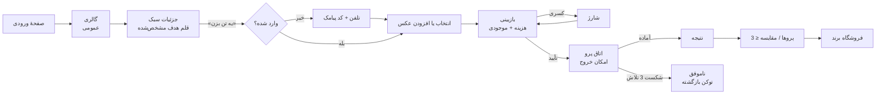
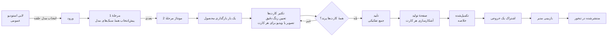

# تنخور — سند نیازمندی‌های محصول (PRD)

**نسخهٔ 1.1 · 3 November 2026 · مالک: Ali Shokoohi**

> **در یک جمله:** تنخور به خریداران ایرانی امکان می‌دهد پیش از خرید، لباس واقعی برندها را روی عکس خود ببینند و به فروشندگان ایرانی امکان می‌دهد عکس محصول را بدون عکاسی به تصویر و ویدیوی تبلیغاتی حرفه‌ای تبدیل کنند — با یک حساب و پرداخت از یک کیف پول توکن.

---

## 0. دربارهٔ این سند

### 0.1 هدف

این PRD مشخص می‌کند تنخور **چه کاری**، **برای چه کسی** و **چرا** باید انجام دهد و **چگونه بفهمیم درست کار می‌کند**. این سند، همراهِ محصول‌محورِ *مشخصات فنی تنخور v4.0* است که **چگونگی** ساخت آن به‌دست مهندسی را تعریف می‌کند. در نقاط هم‌پوشانی، دو سند همسو هستند؛ اگر اختلافی پیش بیاید، این PRD مرجع رفتار محصول و مشخصات فنی مرجع پیاده‌سازی است.

### 0.2 وضعیت و تأیید نهایی

| مورد | وضعیت |
| --- | --- |
| تصمیم‌های محصول (Q01–Q41) | **همگی نهایی شده‌اند** در 3 Nov 2026 (بخش §7 و پیوست B را ببینید) |
| تأیید حقوقی: ضبط توکن‌ها هنگام حذف حساب (Q11) | **در انتظار** — باید پیش از عرضه دریافت شود |
| تأیید حسابداری: شناسایی درآمد هنگام خرج توکن (Q24) | **در انتظار** — باید پیش از عرضه دریافت شود |
| بازبینی مهندسی این PRD | در انتظار |
| بازبینی طراحی این PRD | در انتظار |
| بازبینی معیارهای پذیرش توسط QA | در انتظار |

### 0.3 اسناد مرتبط

| سند | نقش |
| --- | --- |
| مشخصات فنی تنخور v4.0 (`tankhor-technical-spec.md` / `.pdf`) | جزئیات پیاده‌سازی، مدل داده، ناورداهای دفترکل، مشخصات صفحات P01–P49 |
| پرسش‌وپاسخ تصمیم‌های تنخور (`tankhor-decisions-qa.md`) | تک‌تک پرسش‌های تصمیم، همهٔ گزینه‌ها و پاسخ انتخاب‌شده |
| مشخصات جامع محصول تنخور v3.0 (فارسی) | منبع اولیه؛ مرجع متن فارسی رابط کاربری |
| `Tan_Full_Design_Specification_v3(1).docx` | منبع بالادستی طراحی (مشخصات Word) |
| بررسی برند (`brand-review.html`، پیش‌نویس 2 نوامبر 2026) | راهبرد برند، فرضیه‌های مخاطب، پژوهش رقبا، لحن، پیام، جهت لوگو و گزارش تضاد رنگ. این سند در دورهٔ نام کاری تنه نوشته شده است؛ هر جا Q02، Q03، Q04، Q30 یا Q38 را باز نشان می‌دهد، تصمیم‌های `tankhor-decisions-qa.md` معتبرند |

### 0.4 شیوهٔ خواندن نیازمندی‌ها

- **شناسه‌های نیازمندی.** نیازمندی‌های کارکردی به‌شکل `FR-<epic>-<nn>` هستند (مثلاً `FR-TRY-07`). هرکدام در ستون *ردیابی* به شناسه‌های مشخصات فنی (`P`، `R`، `U`، `F`، `Q`) نگاشت می‌شود تا چیزی میان اسناد از قلم نیفتد.
- **اولویت.**

| اولویت | معنا |
| --- | --- |
| **P0** | باید هنگام عرضه کار کند. بدون آن عرضه مسدود است. |
| **P0-OFF** | باید هنگام عرضه کاملاً ساخته، یکپارچه و آزموده شده باشد و سپس پشت یک فلگ، **غیرفعال** منتشر شود. ماک، پیاده‌سازی صوری یا «به‌زودی» الزامات P0-OFF را **برآورده نمی‌کند**. |
| **P1** | بهتر است هنگام عرضه کار کند. تنها با تأیید مالک که در تاریخچهٔ تغییرات ثبت شده باشد می‌تواند یک انتشار عقب بیفتد. |
| **P2** | آینده. برای عرضه ساخته نمی‌شود؛ ذکر شده تا کسی سهواً آن را نسازد یا طراحی را طوری انجام ندهد که افزودن آن ناممکن شود. |
| **OUT** | صریحاً جزو محصول نیست. نسازید. |

- **واژه‌های الزام‌آور.** باید / نباید / بهتر است / مجاز است، به‌ترتیب معادل MUST / MUST NOT / SHOULD / MAY و تابع RFC 2119 هستند.
- **اعداد.** هر عدد در این PRD یا یک قاعدهٔ کسب‌وکارِ تصمیم‌گیری‌شده است (با شناسهٔ Q مربوط)، یا برچسب *پیشنهادی* دارد. همهٔ اعداد قواعد کسب‌وکار در §10 گرد آمده‌اند تا تغییرشان در یک نقطه انجام شود.

### 0.5 تاریخچهٔ تغییرات

| نسخه | تاریخ | تغییر | نویسنده |
| --- | --- | --- | --- |
| 1.0 | 3 Nov 2026 | نخستین PRD کامل؛ هر 41 تصمیم اعمال شده است | Ali Shokoohi |
| 1.1 | 3 Nov 2026 | تغییر نام محصول به تنخور / Tankhor (بازنگری Q38). اعمال بررسی برند: ادعاهایی که هرگز نمی‌کنیم (§2.4)، حذف ادعای یگانگی (§1)، قاعدهٔ برند یکپارچه (§3.3)، وابستگی‌های بررسی آزادبودن نام، شعار و جهت لوگو (§6.6، §17.2)، توکن‌های مرز کنترل و پرده (FR-UX-07)، قواعد ادعا، معماری برند و اطلاعیهٔ هوش مصنوعی (FR-UX-16 تا FR-UX-18)، ریسک‌های نام (RK15، RK16) | Ali Shokoohi |

---

## 1. خلاصهٔ مدیریتی

**چه می‌سازیم.** یک محصول، دو تجربه، یک کیف پول:

1. **یه تن بزن** («یه تن بزن») — گالری عمومی و تصویرمحور از لباس واقعی برندهای ایرانی. خریدار لباسی انتخاب می‌کند، یک عکس از خود اضافه می‌کند، چند توکن می‌پردازد و تصویر تولیدشده با هوش مصنوعی از خود با آن لباس را می‌بیند. نتیجه‌ها را نگه می‌دارد، تا سه مورد را کنار هم مقایسه می‌کند و برای خرید به فروشگاه خود برند می‌رود. تنخور فروشگاه نیست و هرگز قیمت نمایش نمی‌دهد.
2. **استودیو تنخور** («استودیو تنخور») — استودیوی حرفه‌ای محتوا برای فروشندگان. فروشنده سبک‌ها و مدل‌های گزینش‌شده را انتخاب می‌کند، عکس محصولات خود را به هر سبک اختصاص می‌دهد و تصاویر آمادهٔ تبلیغ (2048 px) یا ویدیوهای کوتاه (1080p، حداکثر 10 s) می‌سازد. یک بارگذاری می‌تواند گونه‌های رنگی متعددی تولید کند. خروجی‌ها را می‌توان برای انتشار در تنخور ارسال کرد.
3. **کنسول مالک** — برنامهٔ مدیریتی مجزا و امن برای کنترل محتوا، قیمت‌گذاری، ارائه‌دهندگان هوش مصنوعی، بازبینی انتشار، کاربران، امور مالی، عرضهٔ تدریجی و بازیابی، بدون دست‌زدن به کد یا فضای ذخیره‌سازی.

**چه کسی و چگونه پرداخت می‌کند.** هر کاربر یک کیف پول توکن دارد که از طریق درگاه پرداخت داخلی با ریال (IRR) شارژ می‌شود. هر تولید برحسب توکن قیمت‌گذاری می‌شود، قیمت پیش از تأیید نشان داده می‌شود و هزینه فقط با تأیید صریح کسر می‌شود. توکن تولیدهای ناموفق خودکار بازگردانده می‌شود.

**چرا می‌تواند موفق شود.** کشف پیش از ثبت‌نام ممکن است. پرو مجازی تنها یک عکس می‌خواهد و اندازه‌گیری لازم ندارد. همان حساب و کیف پول به خریداران و فروشندگان خدمت می‌کند و خروجی تأییدشدهٔ فروشنده می‌تواند گالری خریداران را تغذیه کند — چرخه‌ای دوسویه. این ترکیب به‌تنهایی یگانه نیست (برخی رقبا هم پرو و هم محتوای محصول را پوشش می‌دهند)؛ پس هر مزیتی باید از اجرا بیاید: مسیر روشن، هزینهٔ آشکار، حفظ کار و محتوای ایرانی دارای مجوز.

**شکل عرضه.** ورود فقط با شمارهٔ موبایل + پیامک. فارسی و انگلیسی، پوسته‌های روشن و تیره، از روز نخست. فقط اعلان درون‌برنامه‌ای. شش قابلیت ثانویه (ویجت/API فروشگاه، عرضهٔ درصدی، سقف مصرف هر کاربر، تیکت، اعلان بیرونی، انتشار پولی) ساخته و آزموده می‌شوند ولی خاموش می‌مانند. هدف ظرفیت عرضه: 1,000 تولید در روز.

---

## 2. مسئله و فرصت

### 2.1 مسئلهٔ خریدار

| # | مسئلهٔ امروز | پیامد | پاسخ تنخور |
| --- | --- | --- | --- |
| S1 | خریداران پیش از خرید آنلاین نمی‌توانند ببینند لباس روی *خودشان* چگونه است | تردید، تعلل، رهاکردن علاقه | پرو مجازی یک لباس مشخص با هوش مصنوعی و یک عکس |
| S2 | ابزارهای پرو موجود از ابتدا ثبت‌نام، اندازه‌ها یا عکس‌های متعدد می‌خواهند | ریزش پیش از دیدن هرگونه ارزش | گالری عمومی؛ ورود فقط هنگام پرو؛ یک عکس کافی است |
| S3 | مقایسهٔ گزینه‌های فروشگاه‌های مختلف مستلزم جابه‌جایی بین تب‌ها و عکس‌های صفحه است | تصمیم‌گیری متوقف می‌شود | گالری شخصی نتایج؛ مقایسهٔ کنارهم تا 3 مورد از فروشگاه‌های مختلف |
| S4 | لباس پیدا‌شده در جای دیگر در ابزار محدود به کاتالوگ قابل پرو نیست | ابزار برای یافتهٔ واقعی خریدار بی‌فایده است | بارگذاری عکس لباس یا چسباندن لینک فروشگاه پذیرفته‌شده |

### 2.2 مسئلهٔ فروشنده

| # | مسئلهٔ امروز | پیامد | پاسخ تنخور |
| --- | --- | --- | --- |
| B1 | هر محصول یا رنگ جدید به عکاس، مدل و جلسهٔ عکاسی نیاز دارد | هزینه و تأخیر برای هر محصول | سبک‌ها و مدل‌های گزینش‌شده؛ فروشنده فقط عکس محصول می‌دهد |
| B2 | ابزارهای محتوا پیچیده و تکراری‌اند (بارگذاری و تنظیم دوباره) | اتلاف وقت برای هر گونه | کتابخانهٔ محصول، تکثیر کارت، یک بارگذاری → رنگ‌های متعدد |
| B3 | هزینهٔ ابزارهای مولد شفاف نیست | ترس از هزینه‌های غیرمنتظره | نمایش زندهٔ قیمت هر کارت؛ کسر توکن فقط با تأیید؛ بازگشت خودکار هزینهٔ خروجی ناموفق |
| B4 | فروشنده مسیری از تولید محتوا به کشف‌شدن توسط خریدار ندارد | محتوا بی‌استفاده می‌ماند | اشتراک در تنخور: ارسال هر خروجی برای بازبینی و انتشار |

### 2.3 زمینه و محدودیت‌های بازار

- **بازار اصلی: ایران.** پرداخت ریالی از درگاه‌های داخلی؛ رابط فارسی‌محور با برابری کامل نسخهٔ انگلیسی.
- **هنجارهای هویتی محلی.** شمارهٔ موبایل فراگیرترین شناسه است؛ بنابراین ورود فقط با تلفن + کد پیامک است (Q09).
- **وابستگی به هوش مصنوعی بیرونی.** تولید به ارائه‌دهندگان خارجی هوش مصنوعی وابسته است. دسترسی، صورتحساب و شرایط داده از ایران، ریسک عرضه‌اند (نگاه کنید به §15).
- **اعتماد برند.** خریداران لباس واقعی برندهای ایرانی را فقط با مجوز امضاشدهٔ استفاده از تصویر می‌بینند؛ نام برندهایی که در استودیو به‌عنوان مرجع کیفیت می‌آیند (مثلاً Nike، Calvin Klein، Gucci) به‌معنای همکاری نیست.

### 2.4 چه ادعاهایی نمی‌کنیم

- اینکه پرو مجازی اندازه یا فرم واقعی لباس روی تن را نشان می‌دهد. این یک تصویر تولیدشده با هوش مصنوعی است.
- اینکه کلیک خرید، خرید محسوب می‌شود.
- اینکه محتوای استودیو فروش را افزایش می‌دهد. استفاده و استفادهٔ مجدد را می‌سنجیم، نه درآمد منتسب را.
- هیچ رقم اندازهٔ بازار یا درصد صرفه‌جویی بدون داده.
- ادعای یگانگی یا برتری: «اولین»، «تنها»، «بهترین»، «دقیق‌ترین»، «بی‌نقص»، «انقلابی»، مگر ادعایی دقیق با شاهد مستقل بعداً تصویب شود. ترکیب پرو و محتوا، رابط فارسی، کیف پول مشترک یا اطلاعیهٔ هوش مصنوعی هیچ‌کدام به‌تنهایی یگانه نیستند؛ بررسی برند برای هر کدام رقیب یافته است.
- ادعای سرعت یا قیمت («فوری»، «در چند ثانیه»، «رایگان») بدون شاهد اندازه‌گیری‌شده؛ «رایگان» فقط وقتی هزینه 0 است.
- «صددرصد خصوصی» به‌گونه‌ای که دسترسی ثبت‌شده و محدود به پروندهٔ مدیر در Q12 را انکار کند.
- همکاری، رضایت‌نامهٔ مشتری، تعداد کاربر، نقل‌قول بنیان‌گذار یا تاریخ عرضه بدون شاهد. برندهایی که مرجع کیفیت‌اند شریک نیستند.
- فعال‌بودن قابلیتی که هنوز فعال نیست. نیازمندی این PRD شاهد تحویل نیست.

---

## 3. اهداف، موارد خارج از هدف و اصول

### 3.1 اهداف محصول

| ID | هدف | چگونه می‌فهمیم (نگاه کنید به §5) |
| --- | --- | --- |
| G1 | خریدار با کمترین مراحل ممکن به نتیجهٔ پرو برسد | تبدیل گالری → پرو تأییدشده؛ نرخ تکمیل پرو |
| G2 | خریداران بازگردند و برای تصمیم‌گیری از نتایج استفاده کنند | نرخ بازگشت به پروها؛ استفاده از مقایسه؛ ارجاع به فروشگاه به‌ازای نتیجه |
| G3 | فروشندگان سریع محتوای قابل‌استفاده تولید کنند و تنظیماتشان را دوباره به‌کار گیرند | تکمیل مونتاژ؛ نرخ موفقیت کارت؛ پروژه‌های تکرارشدهٔ هر فروشنده |
| G4 | هر توکن کسرشده قابل‌توضیح و هزینهٔ هر شکست بازگردانده شود | صفر برداشت تکراری؛ رهگیری نرخ بازگشت؛ تطبیق موفق روزانه |
| G5 | مالک عملیات روزمرهٔ پلتفرم را بدون مهندس اداره کند | همهٔ عملیات روزمره در کنسول؛ بدون ویرایش مستقیم DB/فضای ذخیره‌سازی |
| G6 | پلتفرم در دسترس و قابل‌بازیابی بماند | تحقق RPO 1 h / RTO 4 h در مانورها؛ کارکرد توقف اضطراری |

### 3.2 موارد خارج از هدف

| ID | مورد خارج از هدف | دلیل |
| --- | --- | --- |
| NG1 | فروش لباس، نمایش قیمت، پارچه، امتیاز یا مقایسهٔ قیمت | تنخور فروشگاه نیست |
| NG2 | پیشنهاد اندازه یا فرم لباس روی تن | تصویر هوش مصنوعی نمی‌تواند اندازه یا فرم واقعی لباس را تضمین کند |
| NG3 | پرو چند لباس در یک درخواست | یک لباس در هر درخواست (Q39) |
| NG4 | شبکهٔ اجتماعی، پیام‌رسانی، پروفایل عمومی، پسند یا امتیاز | خارج از دامنه؛ حریم خصوصی |
| NG5 | لینک اشتراک عمومی برای تصاویر پرو شخصی | حریم خصوصی (Q14) |
| NG6 | امکان انتخاب موتور هوش مصنوعی توسط کاربران | موضوع عملیاتی مختص مدیر |
| NG7 | تنخور با برند اختصاصی دیگران یا API عمومی استودیو | تأیید نشده |
| NG8 | آواتار پایدار، کمد دارای سه زبانهٔ رابط کاربری | ایده‌های اولیه، تأیید نشده |
| NG9 | جست‌وجوی تصویری / «پیداکردن مشابه» | خارج از دامنهٔ فعلی |
| NG10 | لغزندهٔ قبل/بعد | خارج از دامنهٔ فعلی |
| NG11 | ورود با ایمیل/رمز عبور | فقط تلفن + پیامک (Q09) |

### 3.3 اصول محصول

1. **ارزش پیش از تعهد.** همه می‌توانند هر دو تجربه را مرور کنند؛ ورود فقط هنگام اقدام شخصی خواسته می‌شود و انتخاب‌های کاربر پس از ورود حفظ می‌شود.
2. **یک عکس، بدون فرم.** هیچ اندازه‌گیری، پروفایل یا اطلاعات فروشگاهی مانع اقدام اصلی نمی‌شود.
3. **بدون هزینهٔ غافلگیرکننده.** قیمت پیش از تأیید نمایان؛ برداشت فقط با تأیید؛ بازگشت خودکار در شکست؛ نمایش «بازگردانده شد» فقط پس از وقوع واقعی آن.
4. **هر وقت خواستی برو.** تولید روی سرور اجرا می‌شود. خروج از صفحه هرگز کار را از بین نمی‌برد.
5. **ورودی و خروجی مستقل‌اند.** حذف یا انقضای ورودی هرگز نتیجه را حذف نمی‌کند.
6. **دو لحن، یک برند.** لحن «یه تن بزن» مانند فروشندهٔ صمیمی بازار قدیم است؛ لحن استودیو مانند آژانس حرفه‌ای. هویت بصری مشترک است. تنخور برند یکپارچه است: «یه تن بزن» و «استودیو تنخور» دو تجربهٔ یک برند مادرند، نه دو برند جدا.
7. **هیچ چیز بدون بازبینی منتشر نمی‌شود.** تغییرات مالک از پیش‌نویس → پیش‌نمایش → تأیید → انتشار می‌گذرند؛ محتوای فروشنده فقط پس از تأیید مدیر عمومی می‌شود.
8. **ساخته‌شده اما خاموش یعنی واقعاً ساخته‌شده.** قابلیت غیرفعال، قابلیت واقعی و آزموده‌شده پشت فلگ است.

---

## 4. کاربران و پرسوناها

پرسوناها الگوهای کاری برای طراحی‌اند، نه پژوهش آماری.

### 4.1 خلاصهٔ پرسوناها

| ID | پرسونا | محیط | موقعیت | مانع اصلی | تنخور چه باید بکند |
| --- | --- | --- | --- | --- | --- |
| PS1 | **خریدار در حال گشت‌وگذار** | یه تن بزن | بدون کالای مشخصی در ذهن وارد می‌شود | ثبت‌نام زودهنگام، شلوغی | گالری عمومی، آرام و تصویرمحور؛ دسته‌بندی روشن |
| PS2 | **خریدار در آستانهٔ تصمیم** | یه تن بزن | بین اقلام چند فروشگاه مردد است | نتایج پراکنده | گالری پروها، مقایسه تا 3 مورد، لینک فروشگاه هر نتیجه |
| PS3 | **خریدار با یافته‌ای بیرون از تنخور** | یه تن بزن | لباس را در سایت فروشگاه یا در یک عکس دیده است | محدودبودن ابزار به کاتالوگ خودش | بارگذاری لباس یا لینک فروشگاه مجاز |
| PS4 | **فروشندهٔ عجول** | استودیو | محصول دارد و همین حالا تصویر تبلیغاتی می‌خواهد | بارگذاری تکراری، تنظیمات پیچیده | کتابخانهٔ محصول، ساخت دومرحله‌ای |
| PS5 | **فروشنده با رنگ‌های متعدد** | استودیو | یک محصول در چند رنگ دارد | ساخت مجدد پروژه برای هر رنگ | تکثیر کارت، تخصیص همان بارگذاری، تعیین رنگ دقیق |
| PS6 | **مالک / اپراتور** | کنسول | کیفیت، هزینه، انتشار و حساب‌ها را کنترل می‌کند | ترس از خراب‌کردن محصول زنده | پیش‌نمایش اجباری، نسخه‌ها، ممیزی، توقف اضطراری |
| PS7 | **فروشگاه همکار** *(پس از عرضه)* | ویجت | پرو مجازی را در صفحهٔ محصول خودش می‌خواهد | تلاش لازم برای یکپارچه‌سازی | ویجت قابل‌جاسازی؛ پرداخت خریدار از کیف پول خودش (Q21) |

### 4.2 کارهایی که باید انجام شوند

| پرسونا | وقتی… | می‌خواهم… | تا… |
| --- | --- | --- | --- |
| PS1 | بی‌هدف لباس‌ها را نگاه می‌کنم | لباس‌های جذاب را بدون ثبت‌نام ببینم | بی‌دردسر چیزی مطابق سلیقه‌ام پیدا کنم |
| PS1 | چیزی می‌بینم که دوست دارم | ظرف یک دقیقه روی عکس خودم ببینمش | بدانم به من می‌آید یا نه |
| PS2 | چند قلم را پرو کرده‌ام | کنار هم ببینمشان، هرکدام با فروشگاهش | تصمیم بگیرم و برای خرید بروم |
| PS3 | لباسی بیرون از تنخور پیدا کرده‌ام | عکس یا لینک آن را بیاورم | آن را هم پرو کنم |
| PS4 | محصولی عرضه کرده‌ام | بدون عکاسی، تصویر در حد مدل حرفه‌ای بگیرم | امروز منتشر کنم |
| PS5 | محصولم پنج رنگ دارد | از یک عکس پنج گونه بسازم | کار را پنج بار تکرار نکنم |
| PS4/PS5 | پروژه‌ای شروع می‌کنم | پیش از هر اجرا هزینهٔ دقیق توکن را ببینم | مخارجم را کنترل کنم |
| PS4 | تصویر خوبی ساخته‌ام | داخل تنخور نمایش دهم | خریداران برندم را کشف کنند |
| PS6 | قیمت‌ها یا رسانهٔ صفحهٔ اصلی را عوض می‌کنم | ابتدا در همهٔ نمایشگرها پیش‌نمایش ببینم | سایت زنده را هرگز خراب نکنم |
| PS6 | ارائه‌دهندهٔ هوش مصنوعی از کار می‌افتد | ترافیک به جایگزین منتقل و هزینه محدود شود | کاربر آسیب نبیند و قبض‌ها نجومی نشود |

### 4.3 نیازهای دسترس‌پذیری و فراگیری (همهٔ پرسوناها)

- فارسی (RTL) و انگلیسی (LTR) با کامل‌بودن برابر.
- کاربران صفحه‌کلید، صفحه‌خوان، بزرگ‌نمایی/بازچینی و حرکت کاهش‌یافته بتوانند همهٔ جریان‌های اصلی را کامل کنند.
- فیلتر مدل‌ها (گروه سنی، جنسیت، رنگ پوست) به فروشنده امکان بازنمایی مشتریانش را بدهد.
- خطاب فارسی در متن از نظر جنسیت خنثی باشد.

---

## 5. معیارهای موفقیت

هنوز دادهٔ خط مبنا وجود ندارد. برای هر KPI، **4 هفتهٔ اول پس از عرضه خط مبنا را تعیین می‌کند**؛ سپس اهداف تعیین و در تاریخچهٔ تغییرات ثبت می‌شوند. حدود حفاظتی از روز نخست قطعی‌اند.

### 5.1 معیار ستارهٔ شمالی

**تولیدهای موفقِ استفاده‌شده در هفته** = نتایج موفق پرو که دست‌کم یک بار باز شده‌اند + خروجی‌های موفق استودیو که دانلود شده یا برای اشتراک ارسال شده‌اند، در هر هفته.

دلیل: ارزش واقعاً تحویل‌شده و استفاده‌شده را می‌شمارد، نه صرفاً کلیک یا تلاش را.

### 5.2 شاخص‌های کلیدی عملکرد

| ID | KPI | تعریف | تفکیک براساس | هدف |
| --- | --- | --- | --- | --- |
| K1 | گالری → شروع پرو | نشست‌هایی که جزئیات سبک را باز و «یه تن بزن» را می‌زنند ÷ نشست‌هایی که گالری را می‌بینند | مهمان در برابر واردشده، دستگاه | پس از خط مبنا تعیین شود |
| K2 | تکمیل ورود هنگام اقدام | کاربرانی که پس از درخواست ورود در اقدام شخصی OTP را کامل می‌کنند ÷ کاربرانی که از آن‌ها درخواست شده | محیط، مبدأ (لباس، حلقه، نمونه) | پس از خط مبنا تعیین شود |
| K3 | تکمیل پرو | پروهای موفق ÷ پروهای تأییدشده | ارائه‌دهنده، نوع ورودی (گالری، بارگذاری، لینک) | پس از خط مبنا تعیین شود |
| K4 | تعامل با نتیجه | نتایج بازشدهٔ مجدد، دانلودشده، اشتراک‌گذاری‌شده یا مقایسه‌شده طی 7 روز ÷ نتایج موفق | — | پس از خط مبنا تعیین شود |
| K5 | نرخ ارجاع به فروشگاه | کلیک فروشگاه از کارت، جزئیات، نتیجه یا مقایسه ÷ نتایج موفق | برند، لباس | پس از خط مبنا تعیین شود (هرگز به‌عنوان خرید گزارش نشود) |
| K6 | تکمیل مونتاژ | پروژه‌های رسیده به تأیید ساخت ÷ پروژه‌های واردشده به مرحلهٔ 1 | مبدأ ورود (دکمه، حلقه، نمونه) | پس از خط مبنا تعیین شود |
| K7 | موفقیت کارت استودیو | کارت‌های موفق ÷ کارت‌های آغازشده | نوع خروجی، ارائه‌دهنده | پس از خط مبنا تعیین شود |
| K8 | تکرار فروشنده | فروشندگان با ≥ 2 پروژهٔ تولیدشده در 30 روز ÷ فروشندگان با ≥ 1 | — | پس از خط مبنا تعیین شود |
| K9 | خط لولهٔ اشتراک | درخواست‌های اشتراک ارسال‌شده، تأییدشده، ردشده و پس‌گرفته‌شده در هفته | فروشگاه | پس از خط مبنا تعیین شود |
| K10 | تبدیل شارژ | کاربرانی که پس از پیام کمبود موجودی شارژ را کامل می‌کنند ÷ کاربران مشاهده‌کنندهٔ پیام | محیط | پس از خط مبنا تعیین شود |

### 5.3 حدود حفاظتی (ثابت از روز نخست)

| ID | حد حفاظتی | آستانه | اقدام مالک در صورت نقض |
| --- | --- | --- | --- |
| GR1 | برداشت دوباره برای یک واحد تأییدشده | **0** | رخداد؛ توقف جریان آسیب‌دیده؛ تطبیق |
| GR2 | واریز دوباره برای یک پرداخت | **0** | رخداد؛ تطبیق با درگاه |
| GR3 | واحد ناموفق بدون بازگشت توکن ثبت‌شده | **0** پس از تکمیل پردازش | رخداد؛ ثبت بازگشت جاافتاده |
| GR4 | انحراف دفترکل (موجودی کش‌شده ≠ مجموع ثبت‌ها) | **0** حساب در بررسی شبانه | رخداد؛ مسدودکردن کیف پول‌های آسیب‌دیده |
| GR5 | ارائهٔ فایل خصوصی با URL عمومی بدون انقضا | **0** | رخداد امنیتی |
| GR6 | مشاهدهٔ عکس خصوصی توسط مدیر بدون تیکت مرتبط | **0** (در طراحی مسدود است) | رخداد امنیتی |
| GR7 | هزینهٔ هوش مصنوعی بیشتر از سقف تنظیم‌شده | توقف خودکار در سقف فعال می‌شود | بازبینی سقف و قیمت‌گذاری ارائه‌دهنده |
| GR8 | ارسال اعلان موفقیت برای واحد ناموفق | **0** | باگ؛ رفع پیش از انتشار بعدی |
| GR9 | آغاز تولید با لباس یا قیمت تأییدنشده | **0** | باگ؛ رفع پیش از انتشار بعدی |

### 5.4 معیارهای عملیاتی (پایش می‌شوند، هدف نیستند)

نرخ بازگشت توکن؛ هزینهٔ روزانهٔ هوش مصنوعی به‌ازای قابلیت (نرخ ارز تاریخ صورتحساب)؛ تعداد انتقال به ارائه‌دهندهٔ جایگزین؛ زمان انتظار صف؛ تأخیر تحویل OTP و نرخ شکست هر ارائه‌دهندهٔ پیامک؛ تعداد و زمان تعیین تکلیف پرداخت `unknown`؛ عمر نسخهٔ پشتیبان؛ نتایج مانور بازیابی.

### 5.5 گزارش‌دهی کسب‌وکار (Q24)

| معیار | تعریف |
| --- | --- |
| ورودی نقدی IRR | پرداخت‌های تأییدشدهٔ درگاه در دوره |
| درآمد شناسایی‌شده | ارزش توکن خرج‌شده برای واحدهای موفق یا مشمول هزینه در دوره، منهای بازگشت‌ها |
| بدهی توکن‌های خرج‌نشده | ارزش توکن‌های کیف پول‌ها در پایان دوره |
| توکن‌های ضبط‌شده | ارزش توکنی که هنگام حذف نهایی حساب از بدهی خارج می‌شود (Q11) |
| هزینهٔ هوش مصنوعی | صورتحساب‌های ارائه‌دهنده، تبدیل‌شده با نرخ ارز تاریخ صورتحساب |
| سود برآوردی | درآمد شناسایی‌شده − هزینهٔ هوش مصنوعی − سایر هزینه‌های تعریف‌شده؛ روش محاسبه همراه هر گزارش نمایش داده شود |

*تأیید حسابداری در انتظار است (Q24).*

---

## 6. دامنه و برنامهٔ انتشار

### 6.1 دامنهٔ عرضه (P0)

| حوزه | موارد موجود هنگام عرضه |
| --- | --- |
| صفحهٔ ورودی | مقدمهٔ پرده، دو کاشی ورود، معرفی کوتاه، پابرگ |
| هویت | موبایل + OTP پیامکی؛ نشست مشترک محیط‌ها؛ بازیابی حذف تا 30 روز |
| یه تن بزن | گالری عمومی، جست‌وجو، فیلتر، جزئیات سبک، سبک‌های مرتبط، ساخت مستقل (بارگذاری یا لینک مجاز)، گالری عکس (≤ 5)، تأیید، اتاق پرو، نتیجه، پروها، مقایسه (≤ 3)، نشون‌کرده‌ها، پروفایل اختیاری قد/وزن، اشتراک فایل |
| استودیو | لابی (پوستر، حلقهٔ مدل، ویترین)، مرحلهٔ 1 انتخاب (سبک/مدل، جزئیات، پروفایل، فیلتر)، مرحلهٔ 2 مونتاژ (کارت، تکثیر، رنگ، تصویر/ویدیو برای هر کارت، افزونهٔ تغییر رنگ، واگرد، بازگشت)، تأیید ساخت، صفحهٔ تولید، پروژه‌ها، ذخیره‌شده‌ها، کتابخانهٔ محصول، پروفایل فروشگاه، اشتراک در تنخور (رایگان) |
| کیف پول | بسته و شارژ دلخواه، سطوح تخفیف خرید عمده، درگاه IRR، تاریخچهٔ دفترکل، بازگشت خودکار |
| اعلان‌ها | فقط درون‌برنامه‌ای |
| کنسول | کلید عبور/TOTP مدیر، گزارش‌ها، کاربران، بازبینی رسانهٔ خصوصی از طریق تیکت، فروشگاه‌ها و فهرست مجاز، رسانه/پروژه‌ها، بازبینی انتشار، مالی و قیمت‌گذاری، مدیریت هوش مصنوعی با جایگزین، محتوا/صفحات، ورود گروهی CSV، زبان/پوسته/طراحی، تنظیمات و فلگ‌ها، انتشار و نسخه‌ها، عملیات و بازیابی، ممیزی |
| پلتفرم | FA + EN، روشن/تیره/سیستم، هدف WCAG 2.2 AA، برنامهٔ PWA در Android Chrome، iOS Safari، Chromium دسکتاپ |

### 6.2 ساخته‌شده هنگام عرضه، منتشرشده به‌صورت خاموش (P0-OFF)

| قابلیت | چرا اکنون ساخته می‌شود | پیش‌نیاز روشن‌کردن |
| --- | --- | --- |
| ویجت و API پرو برای فروشگاه‌های همکار | جلوگیری از بازمعماری احراز هویت و کیف پول در آینده | قرارداد همکار، قبولی فروشگاه نمونه، فهرست مجاز دامنه |
| عرضهٔ درصدی | انتشار امن تغییرات پرریسک | تصمیم مالک دربارهٔ نخستین عرضهٔ تدریجی |
| محدودیت مصرف هر کاربر | کنترل سوءاستفاده و هزینه | مشاهدهٔ الگوی سوءاستفاده یا فشار هزینه |
| تیکت | پشتیبانی در مقیاس بالا | تأمین نیروی پشتیبانی |
| اعلان بیرونی (پوش، پیامک، ایمیل) | بازگرداندن تعامل | قرارداد تحویل؛ تأیید تجربهٔ رضایت‌گیری |
| دریافت هزینه برای اشتراک | درآمدزایی آینده | تصمیم قیمت‌گذاری اشتراک |

### 6.3 آینده (P2)

| قابلیت | یادداشت |
| --- | --- |
| سازندهٔ ست چندفروشگاهی | ترکیب لباس چند فروشگاه در یک تیپ |
| گالری با تصاویر خودکارچرخان | متفاوت از ویدیوی کوتاه فعلی هر کارت |

### 6.4 صریحاً خارج از دامنه (OUT)

جست‌وجوی تصویری، لغزندهٔ قبل/بعد، پیام‌رسانی داخلی یا قابلیت اجتماعی، پسند/امتیاز عمومی، پرو چندلباسی، لینک اشتراک عمومی، انتخاب موتور هوش مصنوعی توسط کاربر، ورودی URL در استودیو، برند اختصاصی دیگران، API عمومی استودیو، رابط مدیریت دستگاه، آواتار پایدار، زبانه‌های کمد، ورود ایمیل/رمز عبور، نقدکردن توکن.

### 6.5 مراحل انتشار

| مرحله | معیار ورود | آنچه رخ می‌دهد | معیار خروج |
| --- | --- | --- | --- |
| **آلفا (داخلی)** | همهٔ P0ها ساخته‌شده؛ P0-OFFها ساخته‌شده | تیم و آزمونگران دعوت‌شده؛ پرداخت واقعی با درگاه آزمایشی؛ مانور جایگزینی ارائه‌دهنده | نبود باگ باز P0؛ رعایت GR1–GR9 در آزمون‌ها؛ قبولی مانور بازیابی |
| **بتای بسته** | خروج آلفا؛ اخذ تأیید حقوقی و حسابداری (Q11، Q24) | خریداران محدود و 5–20 فروشندهٔ دعوت‌شده *(پیشنهادی)*؛ درگاه واقعی | 2 هفتهٔ پیاپی بدون نقض حدود حفاظتی؛ گردآوری KPIهای خط مبنا |
| **عرضهٔ عمومی** | خروج بتا؛ قبولی آزمون بار در 2× 1,000 تولید/روز | ثبت‌نام باز | تعیین و ثبت اهداف براساس خط مبنا |
| **پس از عرضه** | عرضهٔ عمومی | فعال‌سازی تک‌به‌تک قابلیت‌های P0-OFF از کنسول با پیش‌نمایش اثر | تعریف معیار موفقیت هر قابلیت هنگام فعال‌سازی |

### 6.6 وابستگی‌های عرضه

| وابستگی | لازم برای | وضعیت |
| --- | --- | --- |
| قرارداد درگاه پرداخت داخلی | شارژ کیف پول | پیش از آلفا با پول واقعی لازم است |
| دو ارائه‌دهندهٔ پیامک داخلی | ورود (تنها دروازهٔ محصول) | پیش از آلفا لازم است |
| ارائه‌دهندگان هوش مصنوعی (اصلی + پشتیبان هر قابلیت) | همهٔ تولیدها | پیش از آلفا لازم است؛ دسترسی و پرداخت از ایران بررسی شود |
| کاتالوگ عرضه با مجوز (مجموعهٔ گزینش‌شده) | گالری یه تن بزن | پیش از بتا لازم است |
| سبک‌ها، مدل‌ها و پروژه‌های نمونهٔ استودیو با مجوز | استودیو | پیش از بتا لازم است |
| بررسی آزادبودن نام تنخور / Tankhor: جست‌وجوی علامت تجاری در طبقه‌ها و حوزه‌های هدف، فروشگاه اپ و نام‌های شبکهٔ اجتماعی (Q38)؛ بررسی دامنه لازم نیست | دارایی‌های برند، عرضه | پیش از نهایی‌شدن دارایی‌های برند لازم است؛ آغاز نشده |
| دارایی‌های برند (لوگو، نوشتار نام، حرکت پرده/دست) از طراح داخلی (Q04)؛ بررسی برند جهت A (شکاف پرده + نوشتار فارسی/لاتین) را نقطهٔ شروع بریف پیشنهاد می‌کند | صفحهٔ ورودی، انتظار، آشکارسازی | پیش از بتا لازم است |
| شعار تأییدشده، فارسی و انگلیسی | هیروی صفحهٔ ورودی (FR-LND-02) | پیش از بتا لازم است؛ پیشنهادهای بررسی برند تأیید نشده‌اند |
| بازبینی حقوقی Q11، بازبینی حسابداری Q24 | حذف حساب، گزارش‌ها | پیش از بتا لازم است |

---

## 7. تصمیم‌های کلیدی محصول

همهٔ تصمیم‌ها نهایی‌اند. گزینه‌ها و استدلال کامل در `tankhor-decisions-qa.md` آمده است.

| ID | تصمیم | اثر بر محصول |
| --- | --- | --- |
| Q01 | یک دامنه، محیط‌های مبتنی بر مسیر | یک نشست مشترک؛ ورود ساده بین محیط‌ها |
| Q02 | پرده به‌رنگ قهوه‌ای مخملی تیره | امضای برند؛ پالت ثابت |
| Q03 | قلم Vazirmatn (با حروف لاتین آن) | تایپوگرافی یکدست FA/EN |
| Q04 | طراح داخلی لوگو و دارایی‌های حرکتی را می‌سازد | تحویل دارایی وابستگی داخلی است |
| Q05 | بارگذاری ≤ 15 MB، JPEG/PNG/WebP/HEIC، ضلع کوتاه‌تر ≥ 512 px | محدودیت روشن، رد پیش از پرداخت |
| Q06 | «ذخیرهٔ همهٔ عکس‌های بارگذاری‌شده» پیش‌فرض روشن؛ پاک‌سازی بارگذاری ذخیره‌نشده پس از 30 روز | فروشنده خودکار کتابخانه می‌سازد |
| Q07 | کاتالوگ: مجموعهٔ گزینش‌شده برای عرضه + خودخدمتی برند در آینده | عرضه وابسته به مجموعهٔ گزینش‌شده با مجوز است |
| Q08 | لابی استودیو عمومی؛ ورود پیش از ساخت | کاوش رایگان استودیو |
| Q09 | فقط موبایل + OTP پیامکی | شمارهٔ تلفن هویت است |
| Q10 | هنگام درخواست حذف، کارها کامل می‌شوند؛ بازیابی تا 30 روز | در مهلت ارفاق، کار از دست نمی‌رود |
| Q11 | ضبط توکن باقی‌مانده هنگام حذف نهایی با هشدار صریح | نیازمند تأیید حقوقی |
| Q12 | مدیر فقط از طریق گزارش/تیکت عکس خصوصی می‌بیند | موضع قوی حریم خصوصی |
| Q13 | خروجی موفق اما نامطلوب → بازبینی پشتیبانی، بدون بازپرداخت خودکار | جلوگیری از سوءاستفاده؛ حفظ مسیر رسیدگی |
| Q14 | اشتراک پرو = فقط فایل، بدون لینک عمومی | حریم خصوصی |
| Q15 | حداکثر 50 کارت در پروژهٔ استودیو | بار و هزینهٔ قابل‌پیش‌بینی |
| Q16 | پروژهٔ ناموفق همراه خلاصه در تکمیل‌شده‌ها فهرست می‌شود | فقط دو گروه پروژه |
| Q17 | تصویر 2048 px؛ ویدیوی MP4 1080p ≤ 10 s؛ بدون واترمارک | خروجی تمیز و آمادهٔ تبلیغ |
| Q18 | تصویر یا ویدیو برای هر کارت؛ تغییر رنگ افزونهٔ پولی | پروژهٔ منعطف، قیمت‌گذاری صادقانه |
| Q19 | اشتراک نیازمند نام فروشگاه + لینک معتبر است | بررسی سبک اعتماد |
| Q20 | توقف اضطراری: کار جاری تمام می‌شود، کار جدید مسدود | بدون شکست غیرمنتظره برای کاربر پرداخت‌کننده |
| Q21 | پرداخت پرو ویجت از کیف پول خود خریدار | ورود خریدار به تنخور در جریان همکار |
| Q22 | هنگام عرضه فقط اعلان درون‌برنامه‌ای | بدون هزینهٔ پیامک/پوش یا کار رضایت‌گیری در عرضه |
| Q23 | احراز هویت دومرحله‌ای مدیر (2FA): کلید عبور + جایگزین TOTP | امنیت قوی مدیر |
| Q24 | شناسایی درآمد هنگام خرج توکن | نیازمند تأیید حسابداری |
| Q25 | جایگزینی خودکار هوش مصنوعی روشن، یک پشتیبان برای هر قابلیت | تاب‌آوری از روز نخست |
| Q26 | ورود گروهی از طریق CSV | ابزار عملیات محتوا |
| Q27 | RPO 1 h، RTO 4 h، نگهداری پشتیبان 30 روز | تعهد بازیابی |
| Q28 | هدف بار عرضه 1,000 تولید/روز | برنامهٔ ظرفیت |
| Q29 | 3 تلاش داخلی، سپس بازگشت فوری توکن | رسیدگی سریع و منصفانه به شکست |
| Q30 | نام فهرست ذخیره برای بعد «نشون‌کرده‌ها» ("Set aside") | نام‌گذاری هماهنگ با لحن |
| Q31 | لینک لباس فقط از فروشگاه‌های پذیرفته‌شده در فهرست مجاز | امنیت و مجوز |
| Q32 | نگهداری پیش‌نویس خودکار استودیو 30 روز | فرصت جبران برای فروشنده |
| Q33 | مسدودبودن ساخت تا وقتی کارتی تصویر ندارد | بدون هزینهٔ خاموش و سردرگمی |
| Q34 | ورود از حلقه همهٔ سبک‌های همان مدل را پیش‌انتخاب می‌کند | شروع سریع از مدل |
| Q35 | پس‌گرفتن اشتراک، خروجی را فوری پنهان می‌کند | کنترل فروشنده |
| Q36 | قیمت = پایهٔ نوع خروجی + اضافه‌بهای سبک (+ افزونهٔ تغییر رنگ) | قیمت‌گذاری منعطف، مدل ذهنی ساده |
| Q37 | PWA در Android Chrome، iOS Safari، Chromium دسکتاپ | نصب شبیه اپلیکیشن |
| Q38 | نام: تنخور / Tankhor (بازنگری 3 نوامبر 2026 پس از بررسی برند؛ پیش‌تر تنه / Taneh) | برند ثابت؛ بررسی آزادبودن نام هنوز در انتظار است (§6.6) |
| Q39 | یک لباس در هر پرو | هزینه و نتیجهٔ روشن |
| Q40 | گالری عکس خریدار تا 5 مورد، یک پیش‌فرض | استفادهٔ مجدد سریع |
| Q41 | پروفایل اختیاری: فقط قد و وزن | حداقل دادهٔ شخصی |

---

## 8. نیازمندی‌های کارکردی

نیازمندی‌ها در 17 اپیک گروه‌بندی شده‌اند. هر اپیک شامل هدف، نیازمندی‌ها با اولویت و ردیابی، معیارهای پذیرش (با فرض / وقتی / آنگاه)، حالت‌های مرزی و رویدادهای تحلیلی تولیدشده است (رده‌بندی کامل در §13).

| اپیک | کد | محیط |
| --- | --- | --- |
| E1 صفحهٔ ورودی و مسیریابی محیط‌ها | LND | مشترک |
| E2 هویت، نشست و حساب | IDN | مشترک |
| E3 گالری کشف و جزئیات سبک | DSC | یه تن بزن |
| E4 ساخت و تأیید پرو | TRY | یه تن بزن |
| E5 اتاق پرو، نتایج و اشتراک | RES | یه تن بزن |
| E6 کتابخانهٔ خریدار: پروها، مقایسه، نشون‌کرده‌ها، عکس‌ها، پروفایل | LIB | یه تن بزن |
| E7 لابی استودیو و ورود به ساخت | LOB | استودیو |
| E8 مرحلهٔ 1 استودیو: انتخاب | SEL | استودیو |
| E9 مرحلهٔ 2 استودیو: مونتاژ و ساخت | ASM | استودیو |
| E10 تولید استودیو و پروژه‌ها | GEN | استودیو |
| E11 کتابخانهٔ استودیو، ذخیره‌شده‌ها، پروفایل فروشگاه، اشتراک | STO | استودیو |
| E12 کیف پول، پرداخت‌ها و دفترکل | WAL | مشترک |
| E13 اعلان‌ها، راهنما و وضعیت سرویس | NTF | مشترک |
| E14 کنسول مالک | CON | کنسول |
| E15 ویجت و API همکار | WID | بیرونی |
| E16 PWA و اتصال | PWA | مشترک |
| E17 بومی‌سازی، پوسته، دسترس‌پذیری و لحن | UX | همه |

---

### E1 — صفحهٔ ورودی و مسیریابی محیط‌ها (LND)

**هدف.** معرفی برند در چند ثانیه و امکان انتخاب یه تن بزن یا استودیو بدون حساب.

| ID | نیازمندی | اولویت | ردیابی |
| --- | --- | --- | --- |
| FR-LND-01 | صفحهٔ ورودی باید لوگو، پردهٔ اتاق پرو به‌رنگ قهوه‌ای مخملی تیره و آسمان (یا رسانهٔ انتخابی مالک) پشت آن را نشان دهد. | P0 | P01, R102, Q02 |
| FR-LND-02 | پیمایش به پایین باید پرده را کنار بزند و نام **Tankhor** را با شعار بالای تصویر آشکار کند. | P0 | P01, R05 |
| FR-LND-03 | دو کاشی بزرگ مستطیلی ورود «یه تن بزن» و «استودیو» باید زیر تصویر شاخص قرار گیرند. | P0 | R103 |
| FR-LND-04 | کاشی یه تن بزن باید گالری عمومی را با گذار متناسب باز کند؛ کاشی استودیو باید لابی استودیو را باز کند. | P0 | F01 |
| FR-LND-05 | در دسکتاپ، هر کاشی مجاز است هنگام هاور و تمرکز صفحه‌کلید پیش‌نمایش متحرک نشان دهد؛ در دستگاه لمسی، کنترل صریح ضربه‌زدن باید همان پیش‌نمایش را فراهم کند. | P1 | R104 |
| FR-LND-06 | زیر کاشی‌ها: معرفی کوتاه و عمدتاً تصویری هر دو سرویس، سپس پابرگ با کانال تماس و لینک‌های حقوقی الزامی. | P0 | R105 |
| FR-LND-07 | ناوبری نباید منتظر پایان پویانمایی یا دانلود ویدیو بماند. | P0 | P01 |
| FR-LND-08 | حالت حرکت کاهش‌یافته باید همان روایت را با تغییر وضعیت‌های ساده منتقل کند. | P0 | P01 |
| FR-LND-09 | لینک مستقیم به یه تن بزن یا استودیو نباید مقدمه را اجباری کند. | P0 | §2 |
| FR-LND-10 | یه تن بزن نباید لینک مستقیمی به استودیو داشته باشد؛ جابه‌جایی محیط از صفحهٔ ورودی انجام می‌شود. | P0 | R161 |
| FR-LND-11 | همهٔ محیط‌ها از یک دامنه با مسیر ارائه می‌شوند (مثلاً `/`, `/tryon`, `/studio`, `/console`). | P0 | Q01, R04 |
| FR-LND-12 | رسانهٔ شاخص، شعار، محتوای معرفی و لینک‌های پابرگ از کنسول مالک با پیش‌نمایش قابل‌ویرایش‌اند. | P0 | P38 |

**معیارهای پذیرش**

- **AC-LND-1** با فرض بازدیدکنندهٔ نخستین‌بار در موبایل، وقتی پیمایش می‌کند، آنگاه پرده باز می‌شود، نام ظاهر می‌شود و هر دو کاشی بدون پیمایش بیشتر در نمای 360 × 640 دیده می‌شوند *(بررسی پیشنهادی)*.
- **AC-LND-2** با فرض فعال‌بودن حرکت کاهش‌یافته در سیستم‌عامل، وقتی صفحه بارگذاری می‌شود، آنگاه پویانمایی پرده اجرا نمی‌شود و هر دو کاشی فوراً قابل‌استفاده‌اند.
- **AC-LND-3** با فرض بازکردن مستقیم `/tryon` توسط بازدیدکننده، آنگاه گالری بدون مقدمهٔ صفحهٔ ورودی بارگذاری می‌شود.
- **AC-LND-4** با فرض هر صفحهٔ یه تن بزن، آنگاه هیچ عنصری به `/studio` لینک نمی‌دهد.

**حالت‌های مرزی.** بارگذاری ویدیوی شاخص ناموفق → نمایش پوستر. شبکهٔ بسیار کند → قابل‌استفاده‌بودن کاشی‌ها پیش از پایان رسانه. بازگشت کاربر واردشده به صفحهٔ ورودی → کاشی‌ها همچنان نمایش داده می‌شوند؛ کنترل حساب در سربرگ.

**رویدادها.** `landing_viewed`, `landing_tile_clicked {surface}`.

---

### E2 — هویت، نشست و حساب (IDN)

**هدف.** هویت مبتنی بر شمارهٔ تلفن با OTP پیامکی که فقط هنگام اقدام شخصی خواسته می‌شود و همهٔ انتخاب‌های کاربر را حفظ می‌کند.

| ID | نیازمندی | اولویت | ردیابی |
| --- | --- | --- | --- |
| FR-IDN-01 | ورود باید فقط با شمارهٔ موبایل + کد یک‌بارمصرف پیامکی باشد. جریان ایمیل یا رمز عبور وجود ندارد. | P0 | Q09, R60 |
| FR-IDN-02 | شمارهٔ جدید باید با نخستین تأیید موفق کد، حساب ایجاد کند. | P0 | §3.1 |
| FR-IDN-03 | ورود کد باید کنترل ارسال مجدد با شمارش معکوس و خطاهای روشن برای شمارهٔ نامعتبر، کد نادرست و کد منقضی نشان دهد. | P0 | P02 |
| FR-IDN-04 | ارسال و تأیید کد باید به‌ازای شماره و IP محدودیت نرخ داشته باشد؛ کدها باید منقضی‌شونده و یک‌بارمصرف باشند. | P0 | §10.2 |
| FR-IDN-05 | ورود باید فقط هنگام اقدام شخصی خواسته شود: آغاز هر پرو (حتی کمپین رایگان)، هر ذخیرهٔ شخصی، یا ورود به جریان ساخت استودیو. مرور نباید به ورود نیاز داشته باشد. | P0 | R11, R13, Q08 |
| FR-IDN-06 | ورود باید زمینهٔ مبدأ (لباس انتخابی، مدل حلقه، پروژهٔ نمونه، مسیر بازگشت) را حفظ کند. موفقیت به همان زمینه برمی‌گردد؛ انصراف به صفحهٔ پیشین با انتخاب دست‌نخورده بازمی‌گردد. | P0 | R11, R147, R159 |
| FR-IDN-07 | یک نشست باید در هر دو محیط معتبر باشد؛ خروج در آن مرورگر، نشست هر دو را پایان می‌دهد. | P0 | R61, R62 |
| FR-IDN-08 | ورود هم‌زمان در چند دستگاه باید مجاز باشد؛ دستگاه جدید نباید دستگاه دیگر را خارج کند. | P0 | R64 |
| FR-IDN-09 | رابط مدیریت دستگاه وجود ندارد. | OUT | R65 |
| FR-IDN-10 | تغییر شمارهٔ حساب باید تأیید هر دو شمارهٔ قدیم و جدید را لازم بداند، یا اگر شمارهٔ قدیم از دست رفته، فرایند پشتیبانی ممیزی‌شده داشته باشد. | P1 | §3.1 |
| FR-IDN-11 | تنظیمات باید زبان (FA/EN)، پوسته (روشن/تیره/سیستم)، اطلاعات حساب و مدیریت حریم خصوصی ارائه کند. پروفایل خریدار، اطلاعات فروشگاه و تنظیمات هویت باید صفحات جدا باشند، نه یک فرم اجباری بلند. | P0 | P14 |
| FR-IDN-12 | درخواست حذف حساب باید تاریخ پایان بازیابی 30روزه، موجودی کنونی توکن و تصریح به ضبط موجودی پس از این مهلت را نمایش دهد. | P0 | Q11, R26 |
| FR-IDN-13 | در مهلت 30روزه، کارهای جاری باید تمام و نتایجشان نگهداری شوند. | P0 | Q10 |
| FR-IDN-14 | ورود با همان شماره در مهلت باید حساب را دقیقاً بازیابی کند. | P0 | Q10 |
| FR-IDN-15 | پس از مهلت، دادهٔ شخصی باید حذف یا ناشناس‌سازی شود؛ ردیف‌های دفترکل ناشناس بمانند؛ توکن باقی‌مانده به ضبط منتقل شود. بدون بازپرداخت IRR، بدون نقدکردن. | P0 | Q11 |

**معیارهای پذیرش**

- **AC-IDN-1** با فرض مهمان در جزئیات سبک، وقتی «یه تن بزن» را می‌زند، آنگاه ورود تلفنی ظاهر می‌شود؛ پس از کد معتبر، به همان سبک با همان قلم هدف انتخاب‌شده برمی‌گردد.
- **AC-IDN-2** با فرض انتخاب مدل در حلقهٔ استودیو توسط مهمان، وقتی ورود را لغو می‌کند، آنگاه به لابی برمی‌گردد و همان مدل همچنان برجسته است.
- **AC-IDN-3** با فرض کاربر واردشده در یه تن بزن، وقتی صفحهٔ ورودی را باز و استودیو را انتخاب می‌کند، آنگاه از قبل وارد است.
- **AC-IDN-4** با فرض درخواست حذف توسط کاربری با 120 توکن، آنگاه پنجرهٔ تأیید تاریخ پایان 30روزه و ازدست‌رفتن 120 توکن پس از آن را بیان می‌کند.
- **AC-IDN-5** با فرض درخواست حذف در روز 1، وقتی کاربر در روز 29 وارد می‌شود، آنگاه حساب، عکس‌ها، نتایج، پروژه‌ها و موجودی بازمی‌گردند.
- **AC-IDN-6** با فرض درخواست کد بیش از حد مجاز از یک شماره، آنگاه درخواست بیشتر همراه زمان انتظار رد می‌شود.

**حالت‌های مرزی.** پیامک تحویل نشد → ارسال مجدد پس از شمارش معکوس؛ استفادهٔ خودکار از ارائه‌دهندهٔ دوم پیامک (نگاه کنید به §14). ورود شماره با ارقام فارسی یا پیشوند `+98`/`0` → نرمال‌سازی. درخواست حذف در وضعیت `unknown` شارژ → تعیین تکلیف و واریز پرداخت پیش از اجرای منطق ضبط. واگذاری شماره به شخص دیگر توسط اپراتور → فرایند پشتیبانی.

**رویدادها.** `auth_prompt_shown {origin}`, `auth_code_sent`, `auth_code_failed {reason}`, `auth_completed {new_account}`, `auth_cancelled {origin}`, `account_deletion_requested`, `account_restored`, `account_deleted_final`.

---

### E3 — گالری کشف و جزئیات سبک (DSC)

**هدف.** گالری عمومی آرام و به‌سبک Pinterest از تیپ‌های واقعی برندهای ایرانی که در هر کارت دقیقاً مشخص است کدام تک‌لباس قابل پرو است.

| ID | نیازمندی | اولویت | ردیابی |
| --- | --- | --- | --- |
| FR-DSC-01 | گالری باید عمومی، تصویرمحور و نمایش‌دهندهٔ مدل‌های ایرانی و لباس برندهای ایرانی با مجوز باشد. | P0 | R06, R107 |
| FR-DSC-02 | هر کارت باید تیپ کامل را در تصویر اصلی و قلم هدفِ قابل‌پرو را به‌صورت بندانگشتی نشان دهد. | P0 | R07 |
| FR-DSC-03 | اقدامات کارت باید مستقل باشند: بازکردن جزئیات، نشون‌کردن، پرو، رفتن به فروشگاه (وقتی لینک معتبر هست). | P0 | R109 |
| FR-DSC-04 | جست‌وجوی متنی و فیلتر باید نوع لباس، رنگ، برند، مدل و حال‌وهوای سبک را پوشش دهند. فیلترها جمع‌وجور و آرام‌اند. | P0 | R108 |
| FR-DSC-05 | هیچ قیمت، پارچه، امتیاز یا مقایسهٔ تجاری در هیچ جای یه تن بزن وجود ندارد. | P0 | NG1, R108 |
| FR-DSC-06 | اقدام اصلی «یه تن بزن» هنگام مرور باید در موبایل در دسترس شست و در دسکتاپ نمایان بماند، بدون پوشاندن محتوا. این اقدام جریان ساخت مستقل (E4) را هم باز می‌کند. | P0 | W20 |
| FR-DSC-07 | بازگشت از جزئیات باید عبارت جست‌وجو، فیلترها، دسته و موقعیت پیمایش را بازیابی کند. | P0 | P03 |
| FR-DSC-08 | نتایج خالی باید «پاک‌کردن فیلترها» ارائه کنند؛ خطای رسانه باید تلاش مجدد بدهد؛ ویدیو باید پوستر جایگزین داشته باشد. | P0 | P03 |
| FR-DSC-09 | جزئیات سبک باید تصویر اصلی بزرگ و بندانگشتی هر جزء تیپ، برچسب‌ها، دسته، مدل، برند و لینک فروشگاه (فقط اگر معتبر است) نشان دهد. | P0 | R10, R163 |
| FR-DSC-10 | قلم هدف باید با متن و تصویر مشخص باشد تا دیدن تیپ چندجزئی هرگز به‌معنای پرو همهٔ اجزا نباشد. | P0 | R07, Q39 |
| FR-DSC-11 | جزئیات سبک باید سبک‌های مرتبط براساس برچسب و دستهٔ مشترک نشان دهد. | P0 | R162 |
| FR-DSC-12 | جست‌وجوی تصویری یا «پیداکردن مشابه» نباید افزوده شود. | OUT | R124 |
| FR-DSC-13 | هر لباس عمومی باید مجوز امضاشدهٔ استفاده از تصویر ثبت‌شده در کنسول داشته باشد. | P0 | Q07 |
| FR-DSC-14 | هنگام عرضه، محتوای کاتالوگ از مجموعهٔ گزینش‌شده می‌آید؛ پذیرش خودخدمت برند از طریق کنسول و CSV بعداً فعال می‌شود. | P0 / P1 | Q07 |

**معیارهای پذیرش**

- **AC-DSC-1** با فرض مهمان در گالری، آنگاه بدون هیچ درخواست ورود می‌تواند جست‌وجو، فیلتر، بازکردن جزئیات و مشاهدهٔ سبک مرتبط را انجام دهد.
- **AC-DSC-2** با فرض سبکی با بالاتنه، شلوار و کفش که پیراهن هدف است، آنگاه بندانگشتی پیراهن به‌عنوان قلم قابل‌پرو برچسب دارد و صفحهٔ تأیید بعداً فقط پیراهن را نشان می‌دهد.
- **AC-DSC-3** با فرض فیلترهای اعمال‌شده و پیمایش تا قلم 40، وقتی کاربر جزئیات را باز کند و برگردد، آنگاه فیلترها و موقعیت بدون تغییرند.
- **AC-DSC-4** با فرض لباس بدون لینک معتبر فروشگاه، آنگاه اقدام «رفتن به فروشگاه» ظاهر نمی‌شود.

**حالت‌های مرزی.** پس‌گرفتن لباس توسط برند پس از نشون‌کردن کاربر → وضعیت «دیگر موجود نیست». انقضای مجوز → پنهان‌شدن خودکار لباس از گالری عمومی؛ نتایج موجود کاربران باقی می‌مانند.

**رویدادها.** `gallery_viewed`, `gallery_filter_applied {filter, value}`, `gallery_search {query_length}`, `style_card_viewed {style_id, garment_id}`, `style_detail_opened`, `store_link_clicked {source: card|detail|result|compare, brand_id}`.

---

### E4 — ساخت و تأیید پرو (TRY)

**هدف.** رسیدن از «این را دوست دارم» به درخواست پرو تأییدشده و قیمت‌گذاری‌شده با یک عکس و یک لباس.

| ID | نیازمندی | اولویت | ردیابی |
| --- | --- | --- | --- |
| FR-TRY-01 | درخواست پرو باید دقیقاً یک عکس شخصی و دقیقاً یک لباس هدف داشته باشد. | P0 | Q39 |
| FR-TRY-02 | از جزئیات سبک، لباس هدف پیش‌انتخاب است؛ کاربر فقط عکس اضافه یا انتخاب می‌کند. | P0 | W19 |
| FR-TRY-03 | جریان ساخت مستقل ("+ یه تن بزن") باید لباس را از این راه‌ها بپذیرد: بارگذاری فایل تصویر؛ لینک تصویر یا محصول از فروشگاه مجاز؛ انتخاب از گالری؛ انتخاب از نشون‌کرده‌ها. | P0 | R24, R111 |
| FR-TRY-04 | لینک فقط باید از میزبان‌های فهرست مجاز فروشگاه‌های پذیرفته‌شده که مالک اداره می‌کند پذیرفته شود. سایر میزبان‌ها باید با ارائهٔ راه جایگزین بارگذاری رد شوند. | P0 | Q31, R112 |
| FR-TRY-05 | تصویر دریافت‌شده از لینک باید پیش از هر مرحلهٔ هزینه برای تأیید کاربر به‌عنوان هدف نمایش داده شود. صفحهٔ مبهم (چند تصویر نامزد) باید امکان انتخاب یا بازگشت به بارگذاری بدهد. | P0 | P05 |
| FR-TRY-06 | تولید نباید با لباس حدس‌زده‌شده یا تأییدنشده آغاز شود. | P0 | GR9 |
| FR-TRY-07 | عکس، لباس و بازبینی یک جریان کوتاه‌اند، نه چهار صفحهٔ اجباری؛ انتخاب معتبر دوباره پرسیده نمی‌شود. | P0 | P05 |
| FR-TRY-08 | یک عکس شخصی کافی است. قد، وزن، اندازه‌ها، عکس چندزاویه یا تکمیل پروفایل نباید الزامی باشد. | P0 | R14 |
| FR-TRY-09 | محدودیت بارگذاری: تا 15 MB؛ JPEG، PNG، WebP یا HEIC؛ ضلع کوتاه‌تر ≥ 512 px. تخلف باید پیش از هر هزینهٔ توکن با پیام مشخص رد شود. | P0 | Q05 |
| FR-TRY-10 | نور کم، ژست ناقص یا کیفیت متوسط نباید مانع شود؛ مجاز است توصیهٔ اختیاری نشان داده شود. فایل خراب، پشتیبانی‌نشده یا پردازش‌ناپذیر خطای فنی است و باید پیش از هزینه رد شود. | P0 | R164 |
| FR-TRY-11 | نخستین ذخیرهٔ دائمی عکس شخصی باید رضایت صریح بگیرد و اطلاعیهٔ پردازش هوش مصنوعی نشان دهد. عدم پذیرش، عکس را موقت نگه می‌دارد (پیش‌فرض 14 روز). | P0 | Q12, R113 |
| FR-TRY-12 | عکس پیش‌فرض ذخیره‌شده مجاز است پیش‌انتخاب باشد ولی باید قابل‌تعویض بماند؛ پیش‌انتخاب هرگز تأیید هزینه نیست. | P0 | P06 |
| FR-TRY-13 | مرحلهٔ بازبینی باید لباس هدف، عکس شخصی، هزینهٔ توکن و موجودی کنونی را کنار اقدام تأیید نشان دهد. | P0 | R12 |
| FR-TRY-14 | پیش از تأیید کاربر، هیچ چیز تولید و هیچ مبلغی کسر نمی‌شود. | P0 | R12 |
| FR-TRY-15 | کمپین رایگان هزینهٔ 0 نشان می‌دهد و همچنان ورود می‌خواهد. | P0 | R13 |
| FR-TRY-16 | کمبود موجودی باید کسری دقیق و مسیر شارژ نشان دهد؛ پس از شارژ کاربر با ورودی‌های دست‌نخورده به همان بازبینی برگردد؛ همچنان تأیید جدا لازم است. | P0 | R44, F04 |
| FR-TRY-17 | اگر قیمت از زمان نمایش عوض شده باشد، باید تأیید تازه لازم شود. | P0 | R66 |
| FR-TRY-18 | کلیک مکرر تأیید باید یک درخواست و یک برداشت ایجاد کند. | P0 | GR1 |
| FR-TRY-19 | انصراف در هر مرحله، ورودی‌های معتبر را نگه می‌دارد. | P0 | P07 |
| FR-TRY-20 | برای لباس بدون فروشگاه نباید اطلاعات خرید ساختگی ایجاد شود. | P0 | P05 |

**معیارهای پذیرش**

- **AC-TRY-1** با فرض عکس 16 MB، وقتی بارگذاری می‌شود، آنگاه پیش از مرحلهٔ بازبینی با پیام «بیشتر از 15 MB» رد می‌شود؛ موجودی بی‌تغییر است.
- **AC-TRY-2** با فرض عکس HEIC با ابعاد 3024 × 4032 px، آنگاه پذیرفته می‌شود.
- **AC-TRY-3** با فرض لینک میزبان خارج از فهرست مجاز، آنگاه کاربر «این فروشگاه هنوز پشتیبانی نمی‌شود» و گزینهٔ بارگذاری می‌بیند؛ هیچ درخواستی برای دریافت به آن میزبان ارسال نمی‌شود.
- **AC-TRY-4** با فرض صفحهٔ محصول مجاز با سه تصویر، آنگاه کاربر پیش از ادامه یکی را انتخاب می‌کند.
- **AC-TRY-5** با فرض موجودی 3 و هزینهٔ 5، وقتی کاربر تأیید را می‌زند، آنگاه «2 توکن کم داری» را می‌بیند، شارژ می‌کند، به همان بازبینی برمی‌گردد، دوباره تأیید می‌کند و دقیقاً 5 توکن یک بار کسر می‌شود.
- **AC-TRY-6** با فرض دوبار ضربه بر تأیید، آنگاه یک درخواست و یک برداشت ثبت می‌شود.

**حالت‌های مرزی.** عکس بدون تشخیص شخص → توصیهٔ کیفیت محسوب می‌شود، مگر ارائه‌دهنده در اعتبارسنجی آن را پردازش‌ناپذیر بداند. قطع شبکه میان تأیید و پاسخ → تلاش مجدد کلاینت با همان کلید هم‌توانی؛ بدون تکرار. حذف فروشگاه از فهرست مجاز وسط جریان → رد لینک هنگام تأیید؛ ارائهٔ بارگذاری.

**رویدادها.** `tryon_create_opened {entry: detail|standalone}`, `tryon_garment_selected {source: gallery|upload|link|set_aside}`, `tryon_link_rejected {reason}`, `tryon_photo_selected {source: new|saved|default}`, `upload_rejected {reason, surface}`, `tryon_review_shown {cost, balance}`, `tryon_confirmed {cost}`, `insufficient_balance_shown {shortfall, surface}`.

---

### E5 — اتاق پرو، نتایج و اشتراک (RES)

**هدف.** انتظار دلپذیر اما صادقانه باشد، کاربر بتواند خارج شود و نتایج کاربردی باشند.

| ID | نیازمندی | اولویت | ردیابی |
| --- | --- | --- | --- |
| FR-RES-01 | درخواست تأییدشده باید پشت پردهٔ بسته ظاهر شود. کشیدن زودهنگام آن باید تعامل دستِ بستن پرده را اجرا کند. | P0 | P08, R115 |
| FR-RES-02 | صفحه باید وضعیت واقعی (در صف، در حال پردازش) را منعکس کند. بدون درصد پیشرفت یا زمان تخمینی ساختگی. | P0 | R18 |
| FR-RES-03 | وضعیت صفحه‌خوان باید حالت را اعلام کند؛ حرکت کاهش‌یافته معنا و امکان خروج را حفظ می‌کند. | P0 | §12.6 |
| FR-RES-04 | کاربر مجاز است هر زمان خارج شود؛ سرور ادامه می‌دهد. متن باید این را بیان کند. | P0 | R19 |
| FR-RES-05 | هنگام موفقیت، اعلان درون‌برنامه‌ای «بیا یه نظر بده!» باید به همان نتیجه لینک مستقیم دهد. اگر مرورگر بسته بوده، نتیجه باید هنگام بازگشت پیدا شود. | P0 | R116, Q22 |
| FR-RES-06 | نتایج موفق باید خودکار در پروها ذخیره شوند. | P0 | R22 |
| FR-RES-07 | در شکست نهایی (پس از حداکثر 3 تلاش داخلی)، توکن باید فوراً بازگردد. وضعیت «در حال بازگشت» و «بازگردانده شد» باید متمایز باشد؛ متن «بازگردانده شد» فقط پس از ثبت آن. | P0 | Q29, R21 |
| FR-RES-08 | درخواست ناموفق هرگز نباید اعلان موفقیت ایجاد کند. | P0 | GR8 |
| FR-RES-09 | نمای نتیجه باید تصویر را با لباس هدف، برند، تاریخ و لینک خرید معتبر نمایش دهد، همراه اطلاعیهٔ متناسبِ تولید با هوش مصنوعی / نبود تضمین اندازه یا فرم واقعی لباس (متن در FR-UX-18) که تصویر را نپوشاند. | P0 | R118, FR-UX-18 |
| FR-RES-10 | اقدامات نتیجه: بزرگ‌نمایی، دانلود، تولید مجدد، تغییر لباس، مقایسه، اشتراک، حذف، بازگشت به گالری، رفتن به فروشگاه. | P0 | R117 |
| FR-RES-11 | تولید مجدد ورودی‌ها را نگه می‌دارد و تأیید هزینهٔ تازه لازم دارد. | P0 | R117 |
| FR-RES-12 | تغییر لباس عکس شخصی معتبر را نگه می‌دارد و انتخاب لباس را باز می‌کند؛ عکس منقضی نیازمند انتخاب تازه است. نتیجهٔ قبلی می‌ماند. | P0 | R117 |
| FR-RES-13 | اشتراک باید صریح و فایل‌محور باشد: برگهٔ اشتراک سیستم با فایل تصویر در صورت پشتیبانی، وگرنه دانلود. بدون لینک عمومی. بدون پیام‌رسانی درون‌برنامه‌ای. | P0 | Q14, R120 |
| FR-RES-14 | حذف نتیجه نباید عکس شخصی یا لباس نشون‌شده را حذف کند. | P0 | P09 |
| FR-RES-15 | نتیجهٔ موفق اما نامطلوب بازپرداخت خودکار ندارد؛ مسیر راهنما توضیح می‌دهد پشتیبانی می‌تواند بازبینی کند. | P0 | Q13 |
| FR-RES-16 | لغزندهٔ قبل/بعد وجود ندارد. | OUT | R124 |

**معیارهای پذیرش**

- **AC-RES-1** با فرض پرو تأییدشده، وقتی کاربر به گالری می‌رود و کار موفق می‌شود، آنگاه اعلان درون‌برنامه‌ای ظاهر می‌شود و ضربه بر آن نتیجه را باز می‌کند.
- **AC-RES-2** با فرض سه شکست ارائه‌دهنده، آنگاه درخواست ناموفق نشان داده می‌شود، دفترکل یک بازگشت برابر برداشت دارد و کاربر فقط پس از ثبت بازگشت «{cost} توکن به کیف پولت برگشت» می‌بیند.
- **AC-RES-3** با فرض iOS Safari، وقتی کاربر اشتراک را می‌زند، آنگاه برگهٔ اشتراک فایل تصویر را ارائه می‌کند؛ هیچ URL به اشتراک گذاشته نمی‌شود.
- **AC-RES-4** با فرض نتیجه‌ای که عکسش منقضی شده، وقتی کاربر تغییر لباس را می‌زند، آنگاه از او انتخاب عکس خواسته می‌شود.

**حالت‌های مرزی.** قطع ارائه‌دهندهٔ اصلی → استفادهٔ شفاف از پشتیبان (هوش مصنوعی E14). موفقیت دیررس تلاش جایگزین‌شده → دورریزی. حذف عکس منبع توسط کاربر حین اجرا → تکمیل کار با نسخهٔ نگه‌داشته‌شده و سپس پاک‌سازی آن نسخه.

**رویدادها.** `fitting_room_viewed`, `curtain_pulled_early`, `tryon_succeeded {provider, attempts, duration_ms}`, `tryon_failed {provider, attempts, reason_class}`, `tokens_returned {unit_type, amount}`, `notification_opened {type}`, `result_viewed`, `result_downloaded`, `result_shared {method: share_sheet|download}`, `result_regenerate_clicked`, `result_change_outfit_clicked`, `result_deleted`.

---

### E6 — کتابخانهٔ خریدار: پروها، مقایسه، نشون‌کرده‌ها، عکس‌ها، پروفایل (LIB)

**هدف.** کمک به خریدار برای نگهداری، مرور مجدد و تصمیم‌گیری.

| ID | نیازمندی | اولویت | ردیابی |
| --- | --- | --- | --- |
| FR-LIB-01 | **پروها** («تن‌زده‌ها») باید همهٔ نتایج موفق را تا حذف کاربر فهرست کند؛ بدون زیرعنوان تبلیغاتی؛ موارد جاری یا ناموفق، در صورت نمایش، به‌وضوح جدا باشند. | P0 | P10 |
| FR-LIB-02 | اقدامات پروها: بازکردن، دانلود، اشتراک (فایل)، حذف، انتخاب برای مقایسه، رفتن به فروشگاه. صفحه‌بندی و بازگشت، پیمایش و انتخاب مقایسه را حفظ می‌کنند. | P0 | P10 |
| FR-LIB-03 | **مقایسه** باید 1 تا 3 نتیجه از هر فروشگاهی بپذیرد. انتخاب 4ام پیام محدودیت نشان می‌دهد و سه مورد نخست را نگه می‌دارد. | P0 | R23 |
| FR-LIB-04 | مقایسه باید هر نتیجه را فقط با لباس و لینک فروشگاه خودش نشان دهد؛ بدون قیمت، پارچه، امتیاز یا دادهٔ تجاری. | P0 | R174 |
| FR-LIB-05 | در موبایل همهٔ موارد مقایسه باید قابل‌دسترسی باشند (پیمایش یا زبانه). حذف از مقایسه هرگز نتیجه را حذف نمی‌کند. | P0 | P11 |
| FR-LIB-06 | **نشون‌کرده‌ها** («نشون‌کرده‌ها») باید لباس‌های موردنظر کاربر برای بعد را، پروشده یا نشده، نگه دارد. ذخیرهٔ مهمان ورود می‌خواهد و سپس همان لباس را ذخیره می‌کند. ذخیره‌های مکرر هم‌توان‌اند. | P0 | Q30, R110 |
| FR-LIB-07 | موارد نشون‌کرده را می‌توان باز، پرو، خرید (لینک فروشگاه) یا حذف کرد. حذف هرگز عکس یا نتیجه را پاک نمی‌کند. مورد ناموجود وضعیت روشن دارد. | P0 | P45 |
| FR-LIB-08 | نشون‌کرده‌ها از پروها و ذخیره‌شده‌های استودیو جداست. | P0 | R110 |
| FR-LIB-09 | **عکس‌های من** باید تا 5 عکس دائمی با یک پیش‌فرض نگه دارد. افزودن ششمین عکس نیازمند حذف یکی است. | P0 | Q40 |
| FR-LIB-10 | عکس موقت و دائمی به‌وضوح مشخص‌اند. عکس موقت پیش‌فرض پس از 14 روز منقضی می‌شود (قابل‌تنظیم توسط مالک). | P0 | R15 |
| FR-LIB-11 | حذف عکس پیش‌فرض، پیش‌فرض را پاک می‌کند یا جایگزین صریح می‌پرسد؛ هرگز جایگزین تصادفی نمی‌گذارد. | P0 | P13 |
| FR-LIB-12 | **پروفایل** باید فقط قد و وزن، هر دو اختیاری، ارائه کند، با نشان کوچک زرد "!" (نام دسترس‌پذیر «تکمیل اختیاری پروفایل») تا تکمیل. بدون پنجره‌های تکراری. | P0 | Q41, R114 |
| FR-LIB-13 | قد و وزن فقط وقتی باید به ارائه‌دهنده ارسال شوند که از آن‌ها استفاده کند؛ رابط نباید مدعی بهبود نتایج شود مگر واقعاً چنین باشد. | P0 | Q41 |
| FR-LIB-14 | **ناوبری خریدار** باید این‌ها را فراهم کند: کاوش، + یه تن بزن، عکس‌های من، پروها، نشون‌کرده‌ها، پروفایل، حساب و کیف پول، راهنما. نماد حساب و موجودی توکن همیشه نمایان، همراه برآورد تعداد قابل‌تولید براساس قیمت واقعی. هر مفهوم یک ورودی منو. | P0 | P12, R165 |

**معیارهای پذیرش**

- **AC-LIB-1** با فرض انتخاب 3 نتیجه برای مقایسه، وقتی مورد 4ام لمس می‌شود، آنگاه پیام محدودیت 3 را توضیح می‌دهد و همان 3 انتخاب می‌مانند.
- **AC-LIB-2** با فرض 5 عکس ذخیره‌شده، وقتی کاربر عکس تازه‌ای دائمی اضافه می‌کند، آنگاه از او می‌پرسند کدام را حذف کند.
- **AC-LIB-3** با فرض لباسی نشون‌شده که بعداً پرو می‌شود، آنگاه هم در نشون‌کرده‌ها و هم (به‌صورت نتیجه) در پروها ظاهر می‌شود؛ حذف از نشون‌کرده‌ها نتیجه را باقی می‌گذارد.
- **AC-LIB-4** با فرض نشان پروفایل، وقتی صفحه‌خوان آن را می‌خواند، آنگاه «تکمیل اختیاری پروفایل» اعلام می‌شود.

**رویدادها.** `tryons_viewed`, `compare_opened {count}`, `compare_limit_hit`, `set_aside_added {garment_id}`, `set_aside_removed`, `photo_saved {permanent}`, `photo_deleted`, `photo_default_set`, `profile_updated {fields}`.

---

### E7 — لابی استودیو و ورود به ساخت (LOB)

**هدف.** ایجاد حس ورود فروشنده به آژانس حرفه‌ای مد، کاوش آزادانه و سه راه روشن برای شروع.

| ID | نیازمندی | اولویت | ردیابی |
| --- | --- | --- | --- |
| FR-LOB-01 | ترتیب لابی از بالا به پایین: پوستر سینمایی → حلقهٔ مدل → ویترین پروژه‌های نمونهٔ آماده. | P0 | P15, R127 |
| FR-LOB-02 | پوستر: ویدیو/تصویر سینمایی چرخشی؛ پخش خودکار بی‌صدا، کنترل مکث، پوستر جایگزین، حرکت کاهش‌یافته. مدل‌های درون پوستر انتخاب قابل‌کلیک نیستند. | P0 | R28 |
| FR-LOB-03 | حلقهٔ مدل: چرخ‌وفلک قابل‌چرخش؛ هاور/تمرکز مدل، سبک‌هایش را پیرامون آن نشان می‌دهد؛ لمس و کنترل صریح (از جمله توقف) در موبایل همان امکان را می‌دهند. | P0 | R29, R129 |
| FR-LOB-04 | ویترین: پروژه‌های نمونه (تصویر + ویدیو). هاور، تمرکز یا ضربه، رسانهٔ هر نمونه را مرور می‌کند. | P0 | R30 |
| FR-LOB-05 | همهٔ دارایی‌های مدل و نمونه باید حق استفاده داشته باشند؛ ذکر منبع مجوز نیست. نام برند به‌عنوان مرجع کیفیت به‌معنای همکاری نیست. | P0 | W35 |
| FR-LOB-06 | **ساخت پروژه** باید همیشه در دسترس باشد: ابتدا کوچک در گوشهٔ بالا، با پیمایش برجسته‌تر. | P0 | R128 |
| FR-LOB-07 | نوار کناری کامل فضای کار نباید روی لابی سینمایی بیفتد؛ کنترل کوچک حساب نمایان است. | P0 | R32 |
| FR-LOB-08 | مرور لابی حساب نمی‌خواهد. ورود به جریان ساخت از هر مبدأ، ابتدا ورود می‌خواهد و مبدأ را حفظ می‌کند. | P0 | Q08, R159 |
| FR-LOB-09 | ورود با **ساخت پروژه** → مرحلهٔ 1 (P16)، نمای سبک‌ها، انتخاب خالی. | P0 | R31 |
| FR-LOB-10 | ورود با **مدل حلقه** → مرحلهٔ 1 با **پیش‌انتخاب همهٔ سبک‌های همان مدل**؛ کاربر می‌تواند برخی یا همه را حذف و موارد دیگر اضافه کند. انتخاب هزینه ندارد؛ تعداد و هزینهٔ برآوردی پیش از ادامه نمایان‌اند. | P0 | Q34, R130 |
| FR-LOB-11 | ورود با **پروژهٔ نمونه** → مرحلهٔ 2 (P17) با سبک‌ها و عکس محصولات نمونه؛ کاربر می‌تواند جایگزین یا حذف کند یا به مرحلهٔ 1 برگردد. محصولات نمونه دارایی نمونه می‌مانند. | P0 | R131 |

**معیارهای پذیرش**

- **AC-LOB-1** با فرض انتخاب مدلی با 7 سبک توسط مهمان، وقتی وارد می‌شود، آنگاه مرحلهٔ 1 با دقیقاً همان 7 سبک انتخاب‌شده و هزینهٔ کل باز می‌شود.
- **AC-LOB-2** با فرض انتخاب پروژهٔ نمونه توسط مهمان، وقتی وارد می‌شود، آنگاه مرحلهٔ 2 با کارت‌ها و تصاویر نمونه باز می‌شود.
- **AC-LOB-3** با فرض حرکت کاهش‌یافته، آنگاه حلقه خودکار نمی‌چرخد و پوستر تصویر ثابت با کنترل پخش نشان می‌دهد.

**رویدادها.** `studio_lobby_viewed`, `ring_model_focused {model_id}`, `sample_previewed {sample_id}`, `studio_build_entry {origin: button|ring|sample}`.

---

### E8 — مرحلهٔ 1 استودیو: انتخاب (SEL)

**هدف.** امکان انتخاب هر ترکیب سبک و مدل در یک انتخاب مشترک، با قیمت‌های نمایان از نخستین نگاه.

| ID | نیازمندی | اولویت | ردیابی |
| --- | --- | --- | --- |
| FR-SEL-01 | مرحلهٔ 1 باید با نمای سبک‌ها باز شود، بدون صفحهٔ واسط «مدل یا سبک؟». نماهای سبک و مدل دو پنجره بر یک انتخاب مشترک‌اند. | P0 | R133 |
| FR-SEL-02 | کارت سبک رسانه، قیمت (پایهٔ نوع خروجی پیش‌فرض + اضافه‌بهای احتمالی سبک)، انتخاب، ذخیره و بازکردن جزئیات را نشان می‌دهد. | P0 | R35, Q36 |
| FR-SEL-03 | بازکردن جزئیات سبک یا پروفایل مدل نباید چیزی را انتخاب کند یا هزینه را تغییر دهد. | P0 | R134 |
| FR-SEL-04 | جزئیات سبک: رسانهٔ بزرگ‌تر، مدل، ویژگی‌ها، قیمت؛ سه اقدام جدا — انتخاب برای پروژه، ذخیرهٔ سبک، مشاهدهٔ مدل. | P0 | P47 |
| FR-SEL-05 | پروفایل مدل: مرور تصویر و سبک؛ انتخاب یک، چند یا همهٔ سبک‌ها؛ ذخیرهٔ مستقل مدل. «انتخاب همه» تعداد و اثر هزینه را بیان می‌کند و سبک ازقبل‌انتخاب‌شده را تکرار نمی‌کند. | P0 | P48, R135 |
| FR-SEL-06 | فیلترها: سبک براساس نوع محصول و حال‌وهوا (کفش، پوشاک، ورزشی، کلاسیک، روزمره، لوکس)؛ مدل براساس گروه سنی، جنسیت، رنگ پوست و ویژگی ظاهری مرتبط. پنل جمع‌شونده؛ پس از بستن، فیلتر فعال به‌شکل برچسب قابل‌حذف باقی می‌ماند. | P0 | R136, R173 |
| FR-SEL-07 | خلاصهٔ فشرده باید از اولین انتخاب، اقلام انتخابی، تعداد و جمع جاری را با به‌روزرسانی زنده نشان دهد. | P0 | R37, R137 |
| FR-SEL-08 | قیمت‌ها باید در دستگاه لمسی بدون هاور نمایان باشند. | P0 | R145 |
| FR-SEL-09 | جابه‌جایی بین نما، جزئیات، پروفایل، ذخیره‌شده‌ها و بازگشت باید انتخاب را حفظ کند. | P0 | R137 |
| FR-SEL-10 | ترکیب نامعتبر سبک–مدل نباید بی‌سروصدا پذیرفته شود؛ فقط گزینهٔ سازگار ارائه شود. | P0 | R36 |
| FR-SEL-11 | سقف 50 کارت پروژه باید پیش از رسیدن کاربر به آن در خلاصه نمایش داده شود؛ انتخاب بیش از 50 با توضیح مسدود شود. | P0 | Q15 |
| FR-SEL-12 | **بعدی** انتخاب‌های معتبر را به مرحلهٔ 2 می‌برد. | P0 | R34 |
| FR-SEL-13 | پسند و امتیاز عمومی وجود ندارد. در داخل، بازدید، بازکردن جزئیات، انتخاب و استفادهٔ واقعی در پروژه جدا ثبت می‌شوند. | P0 | R139 |

**معیارهای پذیرش**

- **AC-SEL-1** با فرض 3 سبک انتخاب‌شده در نمای سبک‌ها، وقتی کاربر به مدل‌ها و دوباره برمی‌گردد، آنگاه همان 3 انتخاب باقی می‌مانند.
- **AC-SEL-2** با فرض سبکی با اضافه‌بهای 2 و پایهٔ تصویر 10، آنگاه کارت هزینهٔ تصویر پیش‌فرض را 12 توکن نشان می‌دهد.
- **AC-SEL-3** با فرض 48 انتخاب، وقتی کاربر «همه» را برای مدلی با 5 سبک می‌زند، آنگاه می‌بیند فقط 2 مورد در سقف 50 جا می‌گیرد و انتخاب می‌کند کدام بماند.

**رویدادها.** `studio_style_viewed`, `studio_style_detail_opened`, `studio_model_profile_opened`, `studio_style_selected`, `studio_style_deselected`, `studio_select_all {model_id, count}`, `studio_filter_applied`, `studio_card_limit_hit`.

---

### E9 — مرحلهٔ 2 استودیو: مونتاژ و ساخت (ASM)

**هدف.** تخصیص سریع محصول به سبک، تکثیر کم‌هزینهٔ گونه‌ها و تأیید پروژه با قیمت روشن.

| ID | نیازمندی | اولویت | ردیابی |
| --- | --- | --- | --- |
| FR-ASM-01 | برچسب مرحلهٔ 2 «مرحلهٔ 2 از 2» است. مرحلهٔ 3 وجود ندارد. | P0 | R34 |
| FR-ASM-02 | برای هر نمونهٔ سبک یک کارت؛ هر کارت یک جایگاه محصول دارد و یک خروجی تولید می‌کند. | P0 | R38, R140 |
| FR-ASM-03 | جایگاه خالی با پردهٔ مخملی پوشانده می‌شود؛ ضربه، **انتخاب از کتابخانه** یا **بارگذاری تصویر جدید** ارائه می‌کند. استودیو ورودی URL ندارد. | P0 | R39, R160 |
| FR-ASM-04 | پس از تخصیص تصویر، پرده باز می‌ماند؛ حذف تصویر آن را می‌بندد. | P0 | R39 |
| FR-ASM-05 | هر کارت خروجی **تصویر** یا **ویدیو** انتخاب می‌کند؛ **تغییر رنگ** افزونهٔ اختیاری هر کارت با قیمت مستقل است. | P0 | Q18 |
| FR-ASM-06 | قیمت کارت = پایهٔ نوع خروجی + اضافه‌بهای سبک + افزونهٔ تغییر رنگ (اگر روشن باشد). هر کارت قیمت خود را نشان می‌دهد؛ جمع پروژه همیشه نمایان است. | P0 | Q36, R145 |
| FR-ASM-07 | اقدامات متمایز هر کارت: جایگزینی تصویر، فقط حذف تصویر، حذف کارت (با تخصیص آن)، تکثیر، تعیین رنگ. حذف تصویر یا کارت هرگز فایل کتابخانه را حذف نمی‌کند. | P0 | R143 |
| FR-ASM-08 | **تکثیر** کارت جدید با همان مدل، ژست و تنظیمات و جایگاه تصویر **خالی** می‌سازد. | P0 | R142 |
| FR-ASM-09 | یک تصویر بارگذاری‌شده مجاز است به چند کارت تخصیص یابد؛ هر کارت می‌تواند رنگ دقیق متفاوتی داشته باشد (مقدار + نمونه‌رنگ نمایان). | P0 | R166 |
| FR-ASM-10 | سقف 50 کارت پروژه بر تکثیر هم اعمال می‌شود. | P0 | Q15 |
| FR-ASM-11 | **بازگشت** با حفظ تصویرها، رنگ‌ها، نسخه‌های تکثیری و انتخاب‌ها به مرحلهٔ 1 می‌رود؛ بازگشت دوباره، تخصیص‌های سازگار را دست‌نخورده نشان می‌دهد. | P0 | R144 |
| FR-ASM-12 | **واگرد** دست‌کم آخرین ویرایش صفحه را برمی‌گرداند (حذف تصویر، حذف کارت با تخصیص، جایگزینی تصویر). واگرد هرگز ناوبری نمی‌کند. | P0 | R144 |
| FR-ASM-13 | حذف سبک در مرحلهٔ 1 که بر کارت پرشده اثر دارد، باید پیش از اعمال، اثر را روشن نشان دهد. | P0 | P17 |
| FR-ASM-14 | **ذخیرهٔ پروژه** مونتاژ را در ذخیره‌شده‌ها → پروژه‌های مونتاژشده نگه می‌دارد. خروج بدون ذخیره، پیش‌نویس خودکار را تا 30 روز از آخرین فعالیت حفظ می‌کند. | P0 | Q32, R46 |
| FR-ASM-15 | اگر هر کارتی تصویر محصول ندارد، **ساخت غیرفعال است** و کارت خالی با تعداد برجسته می‌شود («3 کارت هنوز تصویر محصول می‌خواهند»). | P0 | Q33 |
| FR-ASM-16 | با آماده‌بودن همهٔ کارت‌ها، ساخت تأییدی با تعداد خروجی، تفکیک هر کارت، کل توکن و موجودی باز می‌کند، همراه مسیر اختیاری «سبک دیگری اضافه می‌کنی؟». | P0 | R167 |
| FR-ASM-17 | تأیید با موجودی کافی یک بار توکن کم می‌کند و تولید آغاز می‌شود. کسری به شارژ و بازگشت به همان مونتاژ می‌رود؛ همچنان تأیید لازم است. | P0 | R146, R147 |
| FR-ASM-18 | هزینهٔ پروژه فقط از موجودی توکن پرداخت می‌شود؛ پرداخت مستقیم هر پروژه وجود ندارد. | P0 | R146 |
| FR-ASM-19 | محدودیت بارگذاری مانند خریدار است (15 MB، JPEG/PNG/WebP/HEIC، ≥ 512 px). | P0 | Q05 |

**معیارهای پذیرش**

- **AC-ASM-1** با فرض کارت دارای تصویر پیراهن قرمز، وقتی دو بار تکثیر شود، آنگاه دو کارت جدید با همان مدل و ژست و جایگاه خالی ظاهر می‌شود؛ هزینهٔ کل به‌اندازهٔ قیمت دو کارت بالا می‌رود.
- **AC-ASM-2** با فرض تخصیص یک بارگذاری به پنج کارت با پنج رنگ، آنگاه تأیید پنج خروجی و قیمت هرکدام را فهرست می‌کند.
- **AC-ASM-3** با فرض 8 کارت و 2 کارت خالی، آنگاه ساخت غیرفعال و همان 2 کارت برجسته‌اند؛ پرکردن یا حذفشان ساخت را فعال می‌کند.
- **AC-ASM-4** با فرض حذف کارت پرشده توسط کاربر، وقتی واگرد می‌زند، آنگاه کارت و تصویرش برمی‌گردند.
- **AC-ASM-5** با فرض خروج فروشنده از مرحلهٔ 2 بدون ذخیره، وقتی 29 روز بعد برگردد، آنگاه پیش‌نویس پیشنهاد می‌شود؛ در روز 31 از بین رفته و فایل کتابخانه باقی است.

**حالت‌های مرزی.** حذف تصویر کتابخانه در جای دیگر هنگام تخصیص → کارت «تصویر دیگر موجود نیست» نشان می‌دهد و خالی می‌شود. انقضای بارگذاری موقت پیش از ساخت → کارت نیاز به بارگذاری مجدد نشان می‌دهد. تغییر نسخهٔ قیمت هنگام مونتاژ → تأیید جمع جدید را نشان می‌دهد و تأیید می‌خواهد.

**رویدادها.** `assembly_opened {origin}`, `card_image_assigned {source: library|upload}`, `card_duplicated`, `card_deleted`, `card_output_type_set {type}`, `card_recolour_toggled`, `assembly_undo`, `assembly_saved`, `create_blocked_empty_cards {count}`, `project_confirm_shown {cards, total}`, `project_confirmed {cards, total, image_count, video_count, recolour_count}`.

---

### E10 — تولید استودیو و پروژه‌ها (GEN)

**هدف.** آشکارسازی هر خروجی به‌محض آماده‌شدن، آگاه نگه‌داشتن فروشنده و بایگانی همه‌چیز در دو گروه روشن پروژه.

| ID | نیازمندی | اولویت | ردیابی |
| --- | --- | --- | --- |
| FR-GEN-01 | پس از تأیید، کارت‌ها در صفحهٔ تولید جداگانه ادامه می‌یابند (نه مرحلهٔ ساخت). پرده اکنون خروجی‌های در حال تولید را می‌پوشاند. | P0 | R151 |
| FR-GEN-02 | هر کارت وضعیت خودش را نشان می‌دهد: در صف، در حال پردازش، آماده، ناموفق. | P0 | P19 |
| FR-GEN-03 | ضربه به پردهٔ ناتمام کمی آن را باز می‌کند، لوگوی تنخور لحظه‌ای نمایان می‌شود، سپس دستی آن را می‌بندد. متن اختیاری «در حال تولید خروجی». بدون خروجی ساختگی. | P0 | R47 |
| FR-GEN-04 | هر خروجی آماده فوراً و مستقل از سایر کارت‌ها آشکار و قابل‌دانلود می‌شود. شمارندهٔ واقعی «N از M خروجی آماده است» نشان می‌دهد. | P0 | R152 |
| FR-GEN-05 | خروج از صفحه هرگز تولید را متوقف نمی‌کند؛ پروژه از پروژه‌ها در دسترس است. | P0 | R48 |
| FR-GEN-06 | کارت ناموفق (پس از 3 تلاش داخلی) فقط توکن خودش را فوراً برمی‌گرداند؛ کارت موفق تحت‌تأثیر نیست. | P0 | Q29, R48 |
| FR-GEN-07 | اعلان درون‌برنامه‌ای برای هر خروجی آماده، به‌علاوه یک رویداد نهایی وقتی همهٔ کارت‌ها نهایی شوند. اگر شکستی باشد، رویداد نهایی تفکیک را نشان می‌دهد («6 آماده، 2 ناموفق، 24 توکن بازگشته»)، هرگز «همه آماده‌اند» نمی‌گوید. | P0 | Q22, R153 |
| FR-GEN-08 | **پروژه‌ها** دقیقاً دو گروه دارد: در حال تولید و تکمیل‌شده؛ قابل‌تعویض در صفحه و دسترسی مستقیم از نوار کناری. | P0 | R49, R157 |
| FR-GEN-09 | پروژه با نهایی‌شدن همهٔ کارت‌ها به تکمیل‌شده منتقل می‌شود؛ پروژهٔ بخشی یا کاملاً ناموفق خلاصهٔ نتیجه دارد؛ پروژهٔ بدون موفقیت آشکارا علامت می‌خورد. | P0 | Q16 |
| FR-GEN-10 | جزئیات پروژه خروجی، وضعیت هر کارت، دانلودها، توکن کسرشده و بازگشته و درخواست‌های اشتراک را نشان می‌دهد. | P0 | P20 |
| FR-GEN-11 | خروجی براساس پروژه، مدل یا سبک قابل‌مرور است؛ رسانهٔ تولیدشده دسته‌بندی و برچسب‌گذاری می‌شود. | P0 | R169, R170 |
| FR-GEN-12 | مشخصات خروجی: ضلع بلند تصویر 2048 px (WebP یا JPEG)؛ ویدیوی MP4 1080p، حداکثر 10 s؛ بدون واترمارک. | P0 | Q17, R154 |
| FR-GEN-13 | همهٔ خروجی‌ها فارغ از تنظیمات نگهداری ورودی، در گالری باقی می‌مانند. | P0 | R172 |

**معیارهای پذیرش**

- **AC-GEN-1** با فرض 8 کارت، وقتی کارت 3 زودتر تمام می‌شود، آنگاه آشکار و قابل‌دانلود است، دیگران همچنان پرده دارند و شمارنده «1 از 8» نشان می‌دهد.
- **AC-GEN-2** با فرض شکست 2 کارت از 8، آنگاه 2 بازگشت ثبت می‌شود، اعلان نهایی «6 آماده، 2 ناموفق» می‌گوید و پروژه همراه خلاصه در تکمیل‌شده قرار می‌گیرد.
- **AC-GEN-3** با فرض کارت ویدیو، آنگاه فایل دانلودی MP4، 1080p، ≤ 10 s و بدون واترمارک است.

**رویدادها.** `generation_page_viewed`, `card_succeeded {output_type, provider, attempts}`, `card_failed {output_type, provider, reason_class}`, `project_completed {ready, failed}`, `output_downloaded {output_type}`.

---

### E11 — کتابخانهٔ استودیو، ذخیره‌شده‌ها، پروفایل فروشگاه و اشتراک (STO)

**هدف.** امکان استفادهٔ مجدد از دارایی فروشنده، سازمان‌دهی کار و نمایش بهترین خروجی به خریداران.

| ID | نیازمندی | اولویت | ردیابی |
| --- | --- | --- | --- |
| FR-STO-01 | **کتابخانهٔ محصول**: بارگذاری گروهی یا تدریجی؛ دسته و برچسب ساختاریافتهٔ پوشاک (زنانه، مردانه، کفش، پوشاک، سبک)، نوع محصول، موجود/ناموجود. | P0 | R42, R171 |
| FR-STO-02 | تنظیم **«ذخیرهٔ همهٔ عکس‌های بارگذاری‌شده»** باید پیش‌فرض روشن باشد. روشن: بارگذاری وارد کتابخانه می‌شود. خاموش: بارگذاری جدید موقت و 30 روز پس از بارگذاری پاک می‌شود. خاموش‌کردن هرگز فایل موجود کتابخانه را حذف نمی‌کند. | P0 | Q06, R168 |
| FR-STO-03 | رابط بارگذاری باید سیاست نگهداری فایل در حال بارگذاری را بیان کند. | P0 | U46 |
| FR-STO-04 | انقضای پیش‌نویس، حذف کارت یا لغو تخصیص هرگز فایل دائمی کتابخانه را حذف نمی‌کند؛ حذف یا انقضای ورودی هرگز خروجی را خراب نمی‌کند. | P0 | R150 |
| FR-STO-05 | **ذخیره‌شده‌ها** سه زبانهٔ مستقل دارد: مدل‌ها، سبک‌ها، پروژه‌های مونتاژشده. مونتاژ ذخیره‌شده در مرحلهٔ 2 ادامه می‌یابد؛ مدل و سبک ذخیره‌شده انتخاب یا جزئیات را باز می‌کند. | P0 | R43, R149 |
| FR-STO-06 | حذف مورد ذخیره‌شده هرگز پروژهٔ تولیدشده یا فایل کتابخانه را حذف نمی‌کند. ارجاع نامعتبر (سبک غیرفعال، تصویر حذف‌شده) وضعیت روشن و گزینهٔ جایگزینی دارد؛ تولید هرگز با ارجاع نامعتبر آغاز نمی‌شود. | P0 | P21 |
| FR-STO-07 | **داشبورد استودیو**: یک نوار کناری برای پروژه‌ها (در حال تولید، تکمیل‌شده)، ذخیره‌شده‌ها، کتابخانه، کیف پول، حساب. در لابی کم‌جلوه، در فضای کار صریح. موبایل نسخهٔ جمع‌شونده با همان مقصدها دارد. | P0 | R138 |
| FR-STO-08 | **پروفایل فروشگاه**: نام، لینک و اطلاعات مرتبط فروشگاه؛ هر حساب یک فروشگاه؛ هرگز برای ساخت پروژه لازم نیست؛ نشان تکمیل کوچک و غیرمزاحم. | P0 | R52, R53 |
| FR-STO-09 | **اشتراک در تنخور**: ارسال یک تصویر یا ویدیوی مشخص برای بازبینی و انتشار از صفحهٔ تولید یا پروژهٔ تکمیل‌شده. یک خروجی هرگز کل پروژه را منتشر نمی‌کند. | P0 | R155 |
| FR-STO-10 | اشتراک نام فروشگاه + لینک معتبر می‌خواهد که در بازبینی مدیر بررسی می‌شود. | P0 | Q19 |
| FR-STO-11 | اشتراک هنگام عرضه رایگان است؛ دریافت هزینهٔ اشتراک ساخته‌شده و خاموش است. | P0 / P0-OFF | R51 |
| FR-STO-12 | وضعیت‌های اشتراک: ارسال‌نشده، در انتظار بازبینی، تأییدشده (منتشرشده)، ردشده (با دلیل)، پس‌گرفته‌شده. گروه اضافه‌ای در پروژه‌ها نمی‌سازند. | P0 | P24 |
| FR-STO-13 | لغو پیش از انتشار مانع انتشار است. پس‌گرفتن پس از انتشار، خروجی را فوراً از همهٔ نمایش‌های عمومی پنهان می‌کند؛ پنجره توضیح می‌دهد نسخه‌هایی که دیگران قبلاً دانلود کرده‌اند قابل‌پس‌گرفتن نیستند. | P0 | Q35, R156 |

**معیارهای پذیرش**

- **AC-STO-1** با فرض فروشندهٔ تازه، آنگاه «ذخیرهٔ همهٔ عکس‌های بارگذاری‌شده» روشن و نخستین بارگذاری او در کتابخانه ظاهر می‌شود.
- **AC-STO-2** با فرض خاموش‌بودن تنظیم، وقتی فروشنده در روز 0 بارگذاری کند، آنگاه فایل در روز 31 از بین رفته و هر خروجی ساخته‌شده از آن باقی است.
- **AC-STO-3** با فرض خروجی منتشرشده، وقتی پس گرفته شود، آنگاه در درخواست بعدی از گالری عمومی و صفحات جزئیات ناپدید می‌شود.
- **AC-STO-4** با فرض پروفایل فروشگاه بدون لینک، وقتی فروشنده اشتراک می‌فرستد، آنگاه درخواست پذیرفته می‌شود ولی به او گفته می‌شود لینک پیش از تأیید لازم است.

**رویدادها.** `library_uploaded {count}`, `library_setting_changed {save_all}`, `saved_item_added {type}`, `store_profile_updated`, `share_submitted {output_type}`, `share_cancelled`, `share_approved`, `share_rejected {reason}`, `share_withdrawn`.

---

### E12 — کیف پول، پرداخت‌ها و دفترکل (WAL)

**هدف.** یک کیف پول توکن قابل‌اعتماد برای همه‌چیز، بدون امکان برداشت دوباره و با بازگشت خودکار در شکست.

| ID | نیازمندی | اولویت | ردیابی |
| --- | --- | --- | --- |
| FR-WAL-01 | هر حساب یک کیف پول توکن، قابل‌خرج در هر دو محیط. | P0 | R63 |
| FR-WAL-02 | شارژ با بستهٔ آماده یا مبلغ دلخواه، پرداخت IRR از درگاه داخلی. IRR و توکن همیشه جدا با واحد نمایش داده شوند. | P0 | R67, R69 |
| FR-WAL-03 | تخفیف فقط برای خرید توکن بیشتر است (سطوح عمده)؛ تولید بیشتر هرگز تخفیف نمی‌آورد. | P0 | R68 |
| FR-WAL-04 | موجودی فقط پس از تأیید سمت سرور درگاه افزایش می‌یابد. وضعیت‌های پرداخت `succeeded`, `failed`, `cancelled`, `unknown` متمایزند. | P0 | P25 |
| FR-WAL-05 | پرداخت `unknown` باید خودکار تطبیق یابد؛ رابط نباید تا وقتی پرداختی نامعلوم است کاربر را به خرید دوم سوق دهد. | P0 | P25 |
| FR-WAL-06 | تأیید یا فراخوان بازگشت مکرر یک پرداخت دقیقاً یک بار اعتبار می‌دهد. | P0 | GR2 |
| FR-WAL-07 | پس از شارژ، کاربر با ورودی‌های دست‌نخورده به همان درخواست یا مونتاژ بازمی‌گردد. | P0 | F04 |
| FR-WAL-08 | **تاریخچه** خرید، واریز، برداشت، بازگشت، اصلاح مدیر و ضبط را با زمان، مبلغ، وضعیت و ارجاع درخواست یا کارت فهرست می‌کند. | P0 | P26 |
| FR-WAL-09 | هر واحد تأییدشده حداکثر یک برداشت و حداکثر یک بازگشت ثبت می‌کند. | P0 | GR1, GR3 |
| FR-WAL-10 | موجودی هرگز منفی نمی‌شود. | P0 | L3 |
| FR-WAL-11 | حساب مسدود موجودی را حفظ می‌کند و نمی‌تواند خرج کند. | P0 | R84 |
| FR-WAL-12 | بازگشت توکن، بازپرداخت IRR نیست. نقدکردن توکن وجود ندارد. | P0 | P26 |
| FR-WAL-13 | کاربران هرگز دادهٔ حساب دیگر، کلید ارائه‌دهنده یا هزینهٔ ارائه‌دهنده را نمی‌بینند. | P0 | P26 |
| FR-WAL-14 | هر واحد تأییدشده قیمت دقیق زمان تأیید (نسخهٔ قیمت، پایه، اضافه‌بها، افزونه) را نگه می‌دارد؛ تغییر قیمت بعدی آن را تغییر نمی‌دهد. | P0 | Q36 |

**معیارهای پذیرش**

- **AC-WAL-1** با فرض دو فراخوان بازگشت درگاه برای یک پرداخت، آنگاه یک واریز وجود دارد.
- **AC-WAL-2** با فرض بسته‌شدن مرورگر پس از پرداخت و پیش از هدایت، آنگاه تطبیق‌دهنده پرداخت را تأیید و کیف پول را شارژ می‌کند؛ تاریخچه آن را نشان می‌دهد.
- **AC-WAL-3** با فرض حساب مسدود با 50 توکن، وقتی برای تأیید پرو تلاش کند، آنگاه تأیید رد و موجودی 50 باقی می‌ماند.

**رویدادها.** `topup_started {pack|custom, irr_amount, tokens}`, `topup_result {state}`, `topup_reconciled`, `wallet_history_viewed`.

---

### E13 — اعلان‌ها، راهنما و وضعیت سرویس (NTF)

| ID | نیازمندی | اولویت | ردیابی |
| --- | --- | --- | --- |
| FR-NTF-01 | اعلان درون‌برنامه‌ای برای: آماده‌شدن پرو خریدار، آماده‌شدن خروجی استودیو، خلاصهٔ نهایی پروژهٔ استودیو، بازگشت توکن، تأیید/رد اشتراک. هرکدام به موضوع خود لینک مستقیم دارد و بعداً در فهرست اعلان قابل‌بازیابی است. | P0 | Q22 |
| FR-NTF-02 | اعلان پوش، پیامک و ایمیل ساخته‌شده، آزموده و خاموش‌اند؛ فعال‌سازی قرارداد تحویل و رضایت صریح کاربر می‌خواهد. نصب PWA مجوز ارسال نمی‌دهد. | P0-OFF | R93 |
| FR-NTF-03 | محتوای عمومی راهنما هر دو محیط را پوشش می‌دهد. | P0 | P29 |
| FR-NTF-04 | تیکت ساخته‌شده و خاموش است؛ هنگام عرضه دکمهٔ بی‌عمل «تماس با پشتیبانی» نباشد — به‌جای آن کانال تماس نمایان باشد. | P0-OFF | R93 |
| FR-NTF-05 | بنر نگهداری می‌گوید کدام بخش در دسترس نیست و چه چیزی هنوز کار می‌کند. یه تن بزن و استودیو می‌توانند مستقل در نگهداری باشند. | P0 | R90, R91 |
| FR-NTF-06 | هنگام توقف اضطراری، رابط می‌گوید تولید جدید متوقف است؛ کار جاری تمام و طبق روال تحویل می‌شود یا توکنش بازمی‌گردد. | P0 | Q20 |

**رویدادها.** `notification_shown {type}`, `notification_opened {type}`, `help_viewed {article}`, `maintenance_banner_shown {surface}`.

---

### E14 — کنسول مالک (CON)

**هدف.** ادارهٔ امن کل پلتفرم: هیچ چیز بدون پیش‌نمایش و تأیید منتشر نشود، هر اقدام مدیر قابل‌انتساب باشد و هزینه و شکست کنترل شوند.

**قواعد سراسری همهٔ ماژول‌های کنسول**

| ID | نیازمندی | اولویت | ردیابی |
| --- | --- | --- | --- |
| FR-CON-01 | کنسول برنامه‌ای مجزا در مسیر خودش است و فقط حساب مدیر به آن دسترسی دارد. | P0 | R03 |
| FR-CON-02 | ورود مدیر باید عامل دوم بخواهد: ترجیحاً کلید عبور (WebAuthn)، جایگزین TOTP. بدون آن کنسول هرگز باز نمی‌شود. | P0 | Q23, R86 |
| FR-CON-03 | مدیر قفل‌شده را مدیر دیگر بازیابی می‌کند؛ هر بازیابی و افزودن مدیر ممیزی می‌شود. | P0 | Q23 |
| FR-CON-04 | همهٔ مدیران هنگام عرضه مجوز کامل و برابر دارند؛ اقدامات هر مدیر جدا ثبت می‌شود. | P0 | R86 |
| FR-CON-05 | ذخیرهٔ هر تغییر محتوا، طراحی، قیمت یا تنظیم فقط **پیش‌نویس** می‌سازد. انتشار نیازمند پیش‌نمایش → تأیید → انتشار (اکنون یا زمان‌بندی‌شده) → نسخه است. | P0 | R73–R76 |
| FR-CON-06 | پیش‌نمایش باید موبایل، تبلت، دسکتاپ، هر دو زبان و حالت نمایش را از همان نسخهٔ پیش‌نویس پوشش دهد. | P0 | R74 |
| FR-CON-07 | تأیید به همان نسخهٔ دقیق متصل است؛ هر ویرایش بعدی آن را باطل می‌کند. | P0 | P42 |
| FR-CON-08 | بازگردانی، نسخهٔ پیشین را به‌شکل رویداد جدید منتشر می‌کند؛ هرگز تراکنش اجراشده را پاک نمی‌کند. | P0 | R76 |
| FR-CON-09 | پیش‌نمایش/شبیه‌سازی مالی و عملیاتی هرگز تراکنش واقعی نمی‌سازد یا موجودی واقعی را تغییر نمی‌دهد. | P0 | R75 |
| FR-CON-10 | اقدامات فوری (مسدودسازی، اصلاح، توقف) هم پیش‌نمایش اثر دارند و تأیید متناسب لازم دارند. | P0 | P42 |
| FR-CON-11 | کنسول در FA و EN با پوستهٔ روشن/تیره/سیستم در دسترس است. | P0 | R58 |

**ماژول‌ها**

| ID | ماژول | نیازمندی‌ها | اولویت | ردیابی |
| --- | --- | --- | --- | --- |
| FR-CON-20 | نمای کلی و گزارش‌ها | کاربران، ورودی نقدی IRR، درآمد شناسایی‌شده (هنگام خرج توکن)، بدهی توکن خرج‌نشده، توکن ضبط‌شده، خرید و مصرف توکن، هزینهٔ هوش مصنوعی (نرخ ارز تاریخ صورتحساب)، خطا، بازگشت، سود برآوردی (با روش)، روند مصرف. هر معیار تعریف، بازه، زمان تازه‌سازی و تبار داده دارد. بازدید/کلیک/پرو/کلیک خرید خریدار به‌ازای لباس و برند. بازدید مدل/سبک استودیو، بازکردن جزئیات، انتخاب، استفادهٔ واقعی. | P0 | P31, Q24, R87 |
| FR-CON-21 | کاربران | جست‌وجو؛ مشاهدهٔ حساب، فروشگاه، پروژه‌ها، دفترکل. مسدودسازی موقت و غیرفعال‌سازی دائمی اقدامات جدا با ثبت مدت، دلیل و اثرند. مسدودی موجودی را نگه می‌دارد و خرج را می‌بندد. | P0 | P32, R83, R84 |
| FR-CON-22 | اصلاح موجودی | رویدادهای اصلاح جدا، مستدل و تأییدشده؛ هرگز ویرایش تاریخچه نکنید. مثلاً برای بازگشت حسن‌نیت پشتیبانی دربارهٔ خروجی مورد اختلاف. | P0 | R85, Q13 |
| FR-CON-23 | بازبینی رسانهٔ خصوصی | عکس شخصی و خروجی پرو **فقط** وقتی قابل‌مشاهده است که مدیر شناسهٔ گزارش کاربر یا تیکت پشتیبانی را پیوند دهد؛ مشاهده محدود به همان پرونده؛ ثبت هر مشاهده با مدیر، زمان و تیکت. مشاهده هرگز فایل را عمومی نمی‌کند. | P0 | Q12, R71 |
| FR-CON-24 | فروشگاه‌ها | یک فروشگاه برای هر حساب؛ پروفایل، وضعیت، محتوا. انتشار نام + لینک معتبر می‌خواهد. مدیریت **فهرست مجاز دریافت از لینک** میزبان فروشگاه‌های پذیرفته‌شده. ثبت مجوز استفادهٔ تصویر برای هر برند. | P0 | P33, Q19, Q31, Q07 |
| FR-CON-25 | رسانه و پروژه‌ها | رهگیری فایل، درخواست و کارت براساس مالک، نوع، وضعیت، TTL و خصوصی/عمومی. نمایش خطا و بازگشت هر کارت. حذف، اصلاح یا اجرای مجدد ابتدا اثر وابستگی و هزینه را نشان می‌دهد. | P0 | P34 |
| FR-CON-26 | بازبینی انتشار | صف درخواست‌های اشتراک با خروجی، قلم هدف، فروشگاه و وضعیت مجوز. تأیید یا رد هر خروجی با دلیل؛ نگهداری تاریخچه. موارد پس‌گرفته‌شده فوراً نمایش عمومی را ترک می‌کنند. صف جدا از تولید است. | P0 | P35, Q35 |
| FR-CON-27 | مالی و قیمت‌گذاری | بستهٔ توکن، قواعد مبلغ دلخواه، سطوح تخفیف خرید عمده؛ قیمت پایهٔ نوع خروجی (پرو، تصویر استودیو، ویدیوی استودیو)، افزونهٔ تغییر رنگ، اضافه‌بهای هر سبک. نسخه‌دار؛ واحد تأییدشده قیمتش را حفظ می‌کند. دفترکل پرداخت، توکن، بازگشت، اصلاح و ضبط؛ نمای تطبیق؛ صف پرداخت `unknown`. | P0 | P36, Q36 |
| FR-CON-28 | مدیریت هوش مصنوعی | برای هر قابلیت (پرو، تصویر استودیو، ویدیوی استودیو، تغییر رنگ): ارائه‌دهنده و مدل اصلی و یک پشتیبان، جایگزینی خودکار روشن هنگام عرضه با شرایط، سقف هزینه با هشدار و توقف خودکار، آزمون اتصال بدون هزینه برای کاربر یا تولید دوباره، داشبورد تأخیر/هزینه/خطای ارائه‌دهنده. کلید کامل هرگز نمایش داده نمی‌شود. | P0 | P37, Q25, R79–R82 |
| FR-CON-29 | محتوا و صفحات | ویرایش بدون کد متن، تصویر، ویدیو، ترتیب بخش، کارت، منو، مدل، سبک، کمپین و متن دوزبانه (شامل همهٔ کلیدهای ریزمتن). پنهان‌کردن بخش، مسیرهای کاربری وابسته را هشدار می‌دهد. | P0 | P38, R77 |
| FR-CON-30 | ورود گروهی | ورود CSV: یک CSV برای هر موجودیت (سبک، مدل، لباس، رابطه) به‌علاوه آرشیو رسانه؛ UTF-8 با BOM؛ شناسهٔ پایدار؛ نام FA/EN؛ ارجاع فایل؛ روابط به‌شکل فهرست شناسه با جداکنندهٔ `|`. اعتبارسنجی در محیط موقت؛ نمایش خطای هر ردیف (فایل مفقود، شناسهٔ تکراری، رابطهٔ نامعتبر)؛ انتشار به‌عنوان یک نسخهٔ محتوا؛ تولید گزارش ورود. الگوهای قابل‌دانلود با مثال. | P0 | Q26, R78 |
| FR-CON-31 | زبان، پوسته، طراحی | مدیریت ترجمه، رنگ، مؤلفه، رسانه و پویانمایی با پیش‌نمایش کامل؛ ترجمهٔ مفقود نمایان و با سیاست انتشار مسدود می‌شود. | P0 | P40 |
| FR-CON-32 | تنظیمات و فلگ‌ها | هر تنظیم‌پذیر (TTL عکس موقت خریدار 14 d، TTL بارگذاری موقت استودیو 30 d، TTL پیش‌نویس 30 d، سقف کارت 50، محدودیت بارگذاری، کمپین، هدیه، سقف مصرف) واحد، مقدار، دامنهٔ مجاز، زمان اثر و تاریخچه دارد. کوتاه‌کردن TTL پیش از انتشار اثرش را نشان می‌دهد. هر قابلیت P0-OFF کلید فعال‌سازی، پیش‌نمایش اثر و بررسی سلامت دارد. امنیت و یکپارچگی مالی با تنظیمات تضعیف نمی‌شوند. | P0 | P41, R72 |
| FR-CON-33 | عرضهٔ درصدی | تخصیص پایدار مخاطب براساس حساب؛ بازگردانی آزموده؛ خاموش هنگام عرضه. | P0-OFF | R94 |
| FR-CON-34 | محدودیت مصرف هر کاربر | سقف قابل‌تنظیم با پیام کاربرپسند؛ خاموش هنگام عرضه. | P0-OFF | R92 |
| FR-CON-35 | عملیات و بازیابی | صف، سلامت سرویس، هزینه، خطا، تحویل پیامک، وضعیت پشتیبان. پشتیبان کامل روزانه + WAL پیوسته؛ RPO 1 h؛ RTO 4 h؛ نگهداری پشتیبان 30 روز؛ مانور بازیابی ثبت‌شده. | P0 | P43, Q27, R88 |
| FR-CON-36 | توقف اضطراری و نگهداری | توقف تولید جدید (برای محیط یا سراسری)؛ کار جاری تمام می‌شود. حالت نگهداری مستقل برای یه تن بزن و استودیو. بنر عمومی از مسیر پیش‌نویس/تأیید. | P0 | Q20, R89–R91 |
| FR-CON-37 | ممیزی | گزارش قابل‌جست‌وجو و منتسب از اقدامات مدیر، مشاهدهٔ رسانهٔ خصوصی (با تیکت)، مسدودسازی، اصلاح، تغییر هوش مصنوعی، انتشار، بازگردانی و بازیابی. محافظت‌شده از ویرایش. | P0 | P44 |
| FR-CON-38 | هشدار الزامی | رسیدن به سقف هزینه، قطع ارائه‌دهنده، افت تحویل پیامک، انباشت تطبیق پرداخت، انحراف دفترکل، شکست پشتیبان. هرگز با تنظیم اعلان کاربر خاموش نمی‌شود. | P0 | P44 |

**معیارهای پذیرش**

- **AC-CON-1** با فرض ویرایش ویدیوی شاخص توسط مدیر و زدن ذخیره، آنگاه سایت زنده تا پیش‌نمایش، تأیید و انتشار پیش‌نویس بی‌تغییر است.
- **AC-CON-2** با فرض بازکردن عکس خصوصی کاربر توسط مدیر بدون شناسهٔ تیکت، آنگاه دسترسی رد می‌شود.
- **AC-CON-3** با فرض خطادادن ارائه‌دهندهٔ اصلی پرو، آنگاه تلاش جدید به پشتیبان هدایت و جایگزینی در داشبورد نشان داده می‌شود.
- **AC-CON-4** با فرض رسیدن به سقف هزینهٔ هوش مصنوعی، آنگاه تولید جدید متوقف، مدیران آگاه و کارهای جاری تمام می‌شوند.
- **AC-CON-5** با فرض CSV با شناسهٔ تکراری در ردیف 12، آنگاه ورود خطای همان ردیف را نشان می‌دهد و تا رفع آن چیزی منتشر نمی‌شود.
- **AC-CON-6** با فرض مانور بازیابی، آنگاه داده طی 4 ساعت با حداکثر 1 ساعت ازدست‌رفتگی بازیابی می‌شود.

**رویدادها (ممیزی مدیر، نه تحلیل محصول).** `admin_signed_in {factor}`, `admin_draft_saved`, `admin_published {entity, version}`, `admin_rollback`, `admin_private_media_viewed {ticket_id}`, `admin_user_blocked`, `admin_balance_adjusted`, `admin_share_reviewed {decision}`, `admin_ai_config_changed`, `admin_emergency_stop {scope}`, `admin_restore_executed`.

---

### E15 — ویجت و API همکار (WID) — **P0-OFF**

**هدف.** امکان جاسازی یه تن بزن در صفحات محصول خود فروشگاه همکار، وقتی مالک آن را روشن کند.

| ID | نیازمندی | اولویت | ردیابی |
| --- | --- | --- | --- |
| FR-WID-01 | ویجت قابل‌جاسازی که پرو لباس همکار را روی عکس خود خریدار باز می‌کند. | P0-OFF | R96 |
| FR-WID-02 | خریدار از کیف پول تنخورِ خودش می‌پردازد و با OTP پیامکی به تنخور وارد می‌شود. | P0-OFF | Q21 |
| FR-WID-03 | ورود و شارژ باید با کوکی شخص ثالث مسدود کار کند: جریان پنجرهٔ بازشو یا هدایت سطح‌بالا، نه نشست صرفاً iframe. | P0-OFF | Q21 |
| FR-WID-04 | پیکربندی همکار: اعتبارنامه، دامنهٔ مجاز، قالب ارجاع لباس. فروشگاه هنگام عرضه به‌ازای پرو چیزی نمی‌پردازد. | P0-OFF | R96 |
| FR-WID-05 | نتایج در پروهای خریدار هم ظاهر می‌شود. | P0-OFF | F31 |
| FR-WID-06 | ویجت، تنخور با برند اختصاصی دیگران نیست و API استودیو عرضه نمی‌کند. | OUT | R97 |
| FR-WID-07 | فروشگاه نمونهٔ همکار باید جریان کامل (ورود، شارژ، پرو، نتیجه) و حالت خاموش را در آزمون خودکار بگذراند. | P0-OFF | R96 |

**معیارهای پذیرش.** **AC-WID-1** با فرض Safari با جلوگیری از رهگیری بین‌سایتی، وقتی خریدار پرو را در فروشگاه نمونه می‌زند، آنگاه پنجرهٔ بازشو ورود را کامل می‌کند و ویجت ادامه می‌دهد. **AC-WID-2** با فرض خاموش‌بودن فلگ، آنگاه اسکریپت ویجت چیزی رندر نمی‌کند و API درخواست را با پاسخ روشن «فعال نیست» رد می‌کند.

**رویدادها.** `widget_loaded {partner_id}`, `widget_auth_popup_opened`, `widget_tryon_confirmed`.

---

### E16 — PWA و اتصال (PWA)

| ID | نیازمندی | اولویت | ردیابی |
| --- | --- | --- | --- |
| FR-PWA-01 | سایت، شامل استودیو، به‌صورت PWA در Android Chrome، iOS Safari (افزودن به صفحهٔ اصلی) و Chromium دسکتاپ نصب‌پذیر است. Firefox به‌صورت وب‌سایت معمولی کار می‌کند. | P0 | Q37, R158 |
| FR-PWA-02 | نصب هرگز برای استفاده از برنامهٔ وب لازم نیست. | P0 | §11.3 |
| FR-PWA-03 | برنامهٔ نصب‌شده با حساب واردشده باز می‌شود و پروژه‌های در جریان و نتایج را بازیابی می‌کند. | P0 | F30 |
| FR-PWA-04 | نصب به‌معنای تولید آفلاین یا مجوز اعلان نیست. | P0 | §11.3 |
| FR-PWA-05 | آفلاین: وضعیت روشن آفلاین نشان دهد؛ بدون تأیید سرور هرگز خرید یا تولید موفق نمایش ندهد؛ با بازگشت آنلاین به‌درستی بازیابی شود. | P0 | §11.3 |

**رویدادها.** `pwa_install_prompt_shown`, `pwa_installed {platform}`, `app_offline_shown`.

---

### E17 — بومی‌سازی، پوسته، دسترس‌پذیری و لحن (UX)

| ID | نیازمندی | اولویت | ردیابی |
| --- | --- | --- | --- |
| FR-UX-01 | فارسی کامل (RTL) و انگلیسی (LTR) از عرضه در همهٔ محیط‌ها از جمله کنسول. | P0 | R58 |
| FR-UX-02 | پوستهٔ روشن، تیره و سیستم در همهٔ محیط‌ها. | P0 | R57 |
| FR-UX-03 | تغییر زبان یا پوسته هرگز انتخاب، مونتاژ، دادهٔ مالی یا نتیجه را تغییر نمی‌دهد. | P0 | §12.1 |
| FR-UX-04 | FA: ترتیب خواندن و تمرکز RTL؛ شناسه، URL و کد هگز جهت خود را نگه می‌دارند؛ لوگو و عکس محصول هرگز آینه نمی‌شوند؛ فقط آیکون جهت‌دار برمی‌گردد. | P0 | §12.1 |
| FR-UX-05 | رقم فارسی در نثر فارسی؛ رقم لاتین در URL، کد و شناسه. پول با برچسب ریال (IRR). | P0 | §12.3 |
| FR-UX-06 | قلم: Vazirmatn (با حروف لاتین آن)، جایگزین Tahoma و sans-serif، میزبانی‌شده روی خود سامانه. | P0 | Q03 |
| FR-UX-07 | پالت طبق توکن تأییدشده (قهوه‌ای مخملی تیره + آبی آسمانی)، شامل `borderStrong` برای مرز معنادار کنترل‌ها و `onCurtain` برای متن روی پرده. تضاد هر جفت متن/پس‌زمینه (≥ 4.5:1، متن بزرگ ≥ 3:1) و هر جفت مرز کنترل (≥ 3:1) پیش از نهایی‌کردن توکن‌ها روی نسبت گردنشده بررسی می‌شود. توکن پایهٔ `border` به 3:1 نمی‌رسد و نباید تنها مرز یک کنترل باشد؛ متن سفید کوچک روی آسمان روشن مجاز نیست. | P0 | Q02، مشخصات فنی §12.2 |
| FR-UX-08 | هدف دسترس‌پذیری WCAG 2.2 AA: تضاد متن ≥ 4.5:1 (بزرگ ≥ 3:1)؛ هدف لمسی 44 × 44 px؛ کار کامل با صفحه‌کلید؛ تمرکز نمایان؛ کنترل نام‌دار؛ متن جایگزین؛ وضعیت صفحه‌خوان برای تولید؛ خطا متصل به فیلد و نه صرفاً رنگی؛ بزرگ‌نمایی/بازچینی؛ بدون تله. | P0 | §12.6 |
| FR-UX-09 | حرکت خودکار بیش از 5 s (حلقه، پوستر، کمپین) باید مکث/توقف داشته باشد. حالت حرکت کاهش‌یافته همه‌جا. هاور همیشه معادل لمسی و صفحه‌کلیدی دارد. | P0 | §12.6 |
| FR-UX-10 | **لحن یه تن بزن**: فروشندهٔ صمیمی و صبور بازار قدیم؛ «تو»ی غیررسمی؛ جملهٔ گفتاری کوتاه؛ بدون فشار و وعدهٔ اندازه؛ واژه‌هایی مانند «حاجی»، «آبجی»، «داداش» تکراری استفاده نشوند. | P0 | R175 |
| FR-UX-11 | **لحن استودیو**: مدیر پروژهٔ آژانس حرفه‌ای؛ «شما»ی رسمی؛ فعل دقیق؛ هزینهٔ تفکیکی؛ بدون وعدهٔ فروش. | P0 | R176 |
| FR-UX-12 | صفحهٔ مشترک (ورود، کیف پول) متن اصلی خنثی دارد؛ راهنمای کوتاه می‌تواند تابع محیط مبدأ باشد. | P0 | §12.7 |
| FR-UX-13 | متن پول و رضایت همیشه صریح است: عدد، واحد، اثر؛ «رایگان» فقط با هزینهٔ 0؛ «بازگردانده شد» فقط پس از ثبت؛ رضایت ذخیره و انتشار هرگز پشت لحن دوستانه پنهان نشود. | P0 | §12.7 |
| FR-UX-14 | همهٔ رشته‌های رابط در پنل محتوا با کلید محیط و موقعیت قرار دارند (کلید متن در مشخصات فنی §12.7). | P0 | P38 |
| FR-UX-15 | دارایی برند (لوگو، نوشتار لاتین نام، حرکت پرده/دست) توسط طراح داخلی به‌صورت Lottie/SVG همراه تصاویر ثابت حرکت کاهش‌یافته تحویل می‌شود. | P0 | Q04 |
| FR-UX-16 | متن عمومی و درون محصول نباید ادعاهای §2.4 را به کار ببرد. هر ادعای قابلیت در صفحهٔ عمومی به رفتار تحویل‌شده و آزموده نگاشت می‌شود؛ متن معرفی ایده یا پیش‌نمایش با برچسب «ایده» می‌آید، نه اعلام عرضه. | P0 | §2.4، مشخصات فنی §12.7 |
| FR-UX-17 | معماری برند: یک برند مادر، تنخور / Tankhor. «یه تن بزن» / Try It On نام تجربهٔ خریدار و اقدام اصلی آن است؛ «استودیو تنخور» / Tankhor Studio نام تجربهٔ فروشنده است و درون استودیو به «استودیو» کوتاه می‌شود. کیف پول، حساب و کنسول مالک با برند مادر می‌آیند، نه با لوگوی جدا. | P0 | Q38, R01 |
| FR-UX-18 | متن اطلاعیهٔ هوش مصنوعی ثابت است: FA «این تصویر با هوش مصنوعی ساخته شده و تضمین اندازه یا فرم واقعی لباس روی تن نیست.»، EN "AI-generated image. It does not guarantee size or real-world fit." متن فارسی نباید واژهٔ عام «تن‌خور» (به معنای fit) را جایی به کار ببرد که با نام برند اشتباه خوانده شود. | P0 | R118, Q38 |

---

## 9. سفرهای کلیدی کاربر

فهرست کامل 31 جریان (F01–F31) در مشخصات فنی §14 است. این پنج جریان حامل ارزش محصول و مبنای آزمون سرتاسری‌اند.

### J1 — خریدار: کشف → پرو → تصمیم

**باید برقرار باشد:** لباس انتخابی پس از ورود و شارژ حفظ شود؛ پیش از تأیید هزینه‌ای نباشد؛ خروج هرگز کار را متوقف نکند؛ شکست توکن را یک بار برگرداند.

### J2 — خریدار: لباس بیرونی از طریق لینک

ساخت مستقل → چسباندن لینک → بررسی فهرست مجاز → دریافت → انتخاب تصویر هدف → انتخاب عکس → بازبینی → تأیید. میزبان غیرمجاز → جایگزین بارگذاری؛ بدون دریافت، بدون هزینه.

### J3 — فروشنده: حلقهٔ مدل → گونه‌های رنگی متعدد → اشتراک

**باید برقرار باشد:** مدل مبدأ پس از ورود حفظ شود؛ کارت تکثیرشده جایگاه خالی داشته باشد؛ ساخت تا وقتی هر جایگاهی خالی است مسدود باشد؛ قیمت هر کارت نمایان باشد؛ کارت ناموفق فقط توکن خودش را برگرداند؛ پس‌گرفتن فوراً پنهان کند.

### J4 — فروشنده: بازگشت در آینده

فروشنده از مرحلهٔ 2 خارج می‌شود → پیش‌نویس خودکار 30 روز می‌ماند → از ذخیره‌شده‌ها/پروژه‌ها برمی‌گردد → دقیقاً از محل قبلی ادامه می‌دهد؛ فایل موقت پس از 30 روز (وقتی ذخیره خاموش است) برای بارگذاری مجدد علامت می‌خورد.

### J5 — مالک: تغییر امن و رخداد

ویرایش قیمت → ذخیرهٔ پیش‌نویس → پیش‌نمایش در سه اندازه و هر دو زبان → تأیید → زمان‌بندی انتشار → ثبت نسخه. قطعی ارائه‌دهنده → جایگزینی خودکار با پشتیبان → در صورت رسیدن به سقف هزینه، توقف خودکار → آگاه‌سازی مدیر → تکمیل کار جاری → رفع توقف توسط مدیر پس از بازبینی.

---

## 10. فهرست قواعد کسب‌وکار

همهٔ اعداد و قواعد تصمیم‌گیری‌شده در یک نقطه. مقادیر با برچسب *قابل‌تنظیم* در کنسول (با تاریخچه) ویرایش می‌شوند؛ بقیه قواعد ثابت محصول‌اند.

### 10.1 محدودیت‌ها و نگهداری

| قاعده | مقدار | قابل‌تنظیم | منبع |
| --- | --- | --- | --- |
| لباس در هر درخواست پرو | 1 | خیر | Q39 |
| عکس شخصی (دائمی) هر خریدار | 5، یک پیش‌فرض | بله | Q40 |
| عمر عکس موقت خریدار | 14 روز | بله | R15 |
| حداکثر اندازهٔ بارگذاری | 15 MB | بله | Q05 |
| قالب بارگذاری | JPEG, PNG, WebP, HEIC | بله | Q05 |
| حداقل ضلع کوتاه‌تر بارگذاری | 512 px | بله | Q05 |
| نتایج مقایسه‌شدهٔ هم‌زمان | 1–3 | خیر | R23 |
| کارت در هر پروژهٔ استودیو | 50 | بله | Q15 |
| عمر پیش‌نویس خودکار استودیو | 30 روز از آخرین فعالیت | بله | Q32 |
| پیش‌فرض «ذخیرهٔ همهٔ عکس‌های بارگذاری‌شده» | ON | به‌ازای فروشنده | Q06 |
| عمر بارگذاری موقت استودیو (تنظیم خاموش) | 30 روز از بارگذاری | بله | Q06 |
| مهلت بازیابی حذف حساب | 30 روز | بله | R26 |
| تلاش داخلی هر واحد تولید | 3 | بله | Q29 |
| نگهداری پشتیبان | 30 روز | عملیات | Q27 |
| RPO / RTO | 1 ساعت / 4 ساعت | عملیات | Q27 |
| هدف آزمون بار عرضه | 1,000 تولید/روز، آزموده در 2× | — | Q28 |

### 10.2 خروجی‌ها

| خروجی | مشخصات | منبع |
| --- | --- | --- |
| نتیجهٔ پرو | تصویر؛ وضوح تعیین‌شده در پیکربندی ارائه‌دهنده | P09 |
| تصویر استودیو | ضلع بلند 2048 px، WebP یا JPEG، بدون واترمارک | Q17 |
| ویدیوی استودیو | MP4، 1080p، حداکثر 10 s، بدون واترمارک | Q17 |
| تغییر رنگ | افزونهٔ هر کارت برای تصویر یا ویدیو | Q18 |

### 10.3 قیمت‌گذاری و پول

| قاعده | جزئیات | منبع |
| --- | --- | --- |
| ارز | ریال (IRR) برای پرداخت؛ توکن برای عملیات | R69 |
| اجزای قیمت | قیمت پایهٔ نوع خروجی (پرو، تصویر استودیو، ویدیوی استودیو) + اضافه‌بهای اختیاری سبک + افزونهٔ تغییر رنگ | Q36 |
| نمایانی قیمت | پیش از هر تأیید؛ هر کارت و جمع در استودیو | R37, R145 |
| زمان دریافت هزینه | فقط هنگام تأیید صریح | R12, R146 |
| تثبیت قیمت | ذخیرهٔ قیمت تأییدشده در هر واحد؛ تغییر بعدی اعمال نمی‌شود | Q36 |
| تغییر قیمت پیش از تأیید | نیازمند تأیید تازه | R66 |
| تخفیف | فقط سطوح خرید عمدهٔ توکن؛ هرگز برای تولید بیشتر | R68 |
| کمپین رایگان | نمایش هزینهٔ 0؛ ورود همچنان لازم | R13 |
| بازگشت هزینهٔ شکست | خودکار، فوری پس از تلاش نهایی، یک بار برای هر واحد | Q29 |
| خروجی موفق نامطلوب | بدون بازگشت خودکار؛ بازبینی پشتیبانی، اصلاح ممیزی‌شده | Q13 |
| اشتراک | رایگان هنگام عرضه؛ دریافت هزینه ساخته‌شده و خاموش | R51 |
| حذف حساب | ضبط توکن باقی‌مانده پس از 30 روز با هشدار صریح | Q11 ⚖️ |
| نقدکردن | ارائه نمی‌شود | P26 |
| شناسایی درآمد | هنگام خرج توکن؛ توکن خرج‌نشده بدهی است | Q24 ⚖️ |

### 10.4 دسترسی و حریم خصوصی

| قاعده | جزئیات | منبع |
| --- | --- | --- |
| هویت | شمارهٔ موبایل + OTP پیامکی | Q09 |
| زمان درخواست ورود | فقط هنگام اقدام شخصی (پرو، ذخیره، ساخت استودیو) | Q08, R11 |
| عامل دوم مدیر | کلید عبور، جایگزین TOTP | Q23 |
| مشاهدهٔ عکس خصوصی توسط مدیر | فقط با گزارش/تیکت پیوندشده؛ ثبت می‌شود | Q12 |
| ذخیرهٔ عکس شخصی | دائمی فقط با رضایت صریح + اطلاعیهٔ هوش مصنوعی | Q12, R113 |
| اشتراک پرو | فقط فایل؛ بدون لینک عمومی | Q14 |
| لینک لباس | فقط فروشگاه پذیرفته‌شده در فهرست مجاز | Q31 |
| انتشار اشتراک | تأیید مدیر؛ نام فروشگاه + لینک معتبر | Q19 |
| پس‌گرفتن اشتراک | حذف فوری از نمایش عمومی | Q35 |
| تصاویر کاتالوگ | نیازمند مجوز امضاشدهٔ استفاده از تصویر | Q07 |

---

## 11. مدل‌های وضعیت

### 11.1 واحد تولید (درخواست پرو یا کارت استودیو)

| وضعیت | زمان ورود | آنچه کاربر می‌بیند | اثر بر دفترکل |
| --- | --- | --- | --- |
| `validating` | ارسال ورودی | صفحهٔ بازبینی | هیچ |
| `rejected` | خطای فنی ورودی پیش از تأیید | خطای مشخص | هیچ |
| `queued` | تأیید کاربر | در صف / پرده بسته | یک برداشت |
| `processing` | دریافت کار توسط پردازشگر | در حال پردازش / پرده بسته | هیچ |
| `retryable_error` | شکست گذرا، تلاش‌ها < 3 | همچنان در حال پردازش | هیچ |
| `succeeded` | ذخیرهٔ خروجی | آماده / آشکارشده | هیچ |
| `failed` | پایان 3 تلاش یا خطای قطعی | ناموفق | زمان‌بندی بازگشت در همان تراکنش |
| `returned` | ثبت بازگشت | «{cost} توکن بازگردانده شد» | یک بازگشت |

### 11.2 سفارش پرداخت

| وضعیت | معنا | موجودی |
| --- | --- | --- |
| `created` | آغاز پرداخت توسط کاربر | بدون تغییر |
| `succeeded` | تأیید سمت سرور درگاه | +توکن، یک بار |
| `failed` / `cancelled` | اعلام شکست درگاه یا لغو کاربر | بدون تغییر |
| `unknown` | هنوز نتیجهٔ قطعی نیست | تا تطبیق بی‌تغییر؛ تطبیق‌دهنده به موفق/ناموفق تعیین تکلیف می‌کند |

### 11.3 پروژهٔ استودیو

| وضعیت | معنا |
| --- | --- |
| `draft` | در حال مونتاژ؛ ذخیرهٔ خودکار؛ انقضا 30 روز پس از آخرین فعالیت مگر ذخیرهٔ دستی |
| `saved` | مونتاژ ذخیره‌شدهٔ دستی در ذخیره‌شده‌ها → پروژه‌های مونتاژشده؛ بدون انقضا |
| `in_production` | تأییدشده؛ دست‌کم یک کارت نهایی نیست |
| `completed` | همهٔ کارت‌ها نهایی؛ خلاصهٔ آماده / ناموفق / بازگشته؛ علامت‌گذاری موفقیت صفر |

### 11.4 درخواست اشتراک

`not_submitted` → `pending_review` → `approved` (عمومی) یا `rejected` (با دلیل). از `pending_review`، لغو → `withdrawn` (هرگز عمومی نشده). از `approved`، پس‌گرفتن → `withdrawn` (پنهان‌سازی فوری).

### 11.5 حساب

`active` → (`blocked` ↔ `active`) · `active` → `deletion_pending` (30 روز؛ کارها تمام می‌شوند؛ قابل‌بازیابی با ورود پیامکی) → `deleted` (دادهٔ شخصی حذف/ناشناس، توکن ضبط‌شده). مدیر می‌تواند جداگانه `deactivated` (دائمی) تعیین کند.

### 11.6 عکس شخصی / بارگذاری استودیو

| نوع | وضعیت‌ها |
| --- | --- |
| عکس خریدار | `temporary` (14 d) → `expired`؛ یا `permanent` (با رضایت) → `deleted` توسط کاربر |
| بارگذاری استودیو | `library` (تنظیم ON) → `deleted` توسط فروشنده؛ یا `temporary` (تنظیم OFF، 30 d) → `expired` |

خروجی‌ها هرگز در این زنجیره‌ها نیستند؛ اشیای مستقل‌اند.

---

## 12. نیازمندی‌های غیرکارکردی

اعداد با برچسب *پیشنهادی* اهداف اولیه‌ای هستند که در آلفا تأیید می‌شوند.

### 12.1 کارایی

| ID | نیازمندی | هدف |
| --- | --- | --- |
| NFR-PERF-01 | بزرگ‌ترین ترسیم محتوایی گالری و لابی روی گوشی میان‌رده با 4G | ≤ 2.5 s در p75 *(پیشنهادی؛ سطح «خوب» Core Web Vitals)* |
| NFR-PERF-02 | تعامل تا ترسیم بعدی برای همهٔ اقدامات اصلی | ≤ 200 ms در p75 *(پیشنهادی)* |
| NFR-PERF-03 | خواندن API غیرتولیدی (گالری، پروژه‌ها، کیف پول) | p95 ≤ 500 ms زمان سرور *(پیشنهادی)* |
| NFR-PERF-04 | تأیید → اعلام قرارگرفتن کار در صف | p95 ≤ 1 s *(پیشنهادی)* |
| NFR-PERF-05 | تحویل OTP پیامکی | 95% طی 30 s *(پیشنهادی)*؛ جایگزینی با ارائه‌دهندهٔ دوم |
| NFR-PERF-06 | مدت تولید | تعهدی ندارد؛ برای هر ارائه‌دهنده و قابلیت سنجیده و صادقانه نمایش داده می‌شود (بدون زمان تخمینی ساختگی) |

### 12.2 ظرفیت و مقیاس‌پذیری

| ID | نیازمندی |
| --- | --- |
| NFR-CAP-01 | قبولی آزمون بار در 2× هدف عرضه (نرخ معادل 2,000 تولید/روز) با ترکیب واقع‌گرایانهٔ تصویر/ویدیو و تمرکز ساعت اوج. |
| NFR-CAP-02 | پردازشگرهای تولید افقی مقیاس می‌گیرند؛ ظرفیت بدون بازطراحی در مسیر ~1 میلیون کاربر رشد می‌کند (R98). |
| NFR-CAP-03 | اعمال سقف هزینهٔ هوش مصنوعی و محدودیت نرخ هر ارائه‌دهنده پیش از ارسال. |

### 12.3 دسترس‌پذیری سرویس و بازیابی

| ID | نیازمندی | هدف |
| --- | --- | --- |
| NFR-AV-01 | دسترس‌پذیری ماهانهٔ مرور، ورود، کیف پول و تأیید | 99.5% *(پیشنهادی)* |
| NFR-AV-02 | هدف نقطهٔ بازیابی | 1 ساعت (Q27) |
| NFR-AV-03 | هدف زمان بازیابی | 4 ساعت (Q27) |
| NFR-AV-04 | پشتیبان‌ها | کامل روزانه + WAL پیوسته؛ نگهداری 30 روز؛ مانور بازیابی دست‌کم فصلی *(تناوب پیشنهادی)* |
| NFR-AV-05 | قطعی ارائه‌دهندهٔ هوش مصنوعی | جایگزینی خودکار با ارائه‌دهندهٔ پشتیبان هر قابلیت (Q25) |
| NFR-AV-06 | قطعی ارائه‌دهندهٔ پیامک | جایگزینی خودکار با دومین ارائه‌دهندهٔ داخلی |
| NFR-AV-07 | نگهداری مستقل | یه تن بزن و استودیو جداگانه متوقف‌پذیرند |

### 12.4 امنیت

| ID | نیازمندی |
| --- | --- |
| NFR-SEC-01 | مجوزدهی سمت سرور برای هر فایل و درخواست. |
| NFR-SEC-02 | رسانهٔ خصوصی فقط با URL امضاشدهٔ کوتاه‌عمر؛ بدون URL عمومی دائمی. |
| NFR-SEC-03 | کلید درگاه، پیامک و هوش مصنوعی هرگز در رابط، بستهٔ کلاینت یا گزارش‌ها نباشد. |
| NFR-SEC-04 | محدودیت نرخ OTP برای شماره و IP؛ کد هش‌شده، یک‌بارمصرف و کوتاه‌عمر. |
| NFR-SEC-05 | احراز هویت دومرحله‌ای مدیر (2FA، کلید عبور/TOTP)؛ نشست مدیر جدا از نشست کاربر. |
| NFR-SEC-06 | اعتبارسنجی بارگذاری با نوع واقعی فایل، اندازه و ابعاد؛ بازکدگذاری؛ حذف فراداده (از جمله GPS). |
| NFR-SEC-07 | دریافت لینک: فهرست مجاز برای میزبان نهایی پس از هدایت‌ها، مسدودسازی محدوده‌های IP خصوصی، سقف اندازه و هدایت، دریافت‌کنندهٔ ایزوله. |
| NFR-SEC-08 | هرگز به ورودی CSV و نام فایل اعتماد نشود. |
| NFR-SEC-09 | گزارش ممیزی فقط‌افزودنی و دارای کنترل دسترسی. |
| NFR-SEC-10 | آزمون نفوذ بیرونی پیش از عرضهٔ عمومی، سپس سالانه *(پیشنهادی)*. |

### 12.5 حریم خصوصی و حفاظت داده

| ID | نیازمندی |
| --- | --- |
| NFR-PRV-01 | رضایت صریح پیش از ذخیرهٔ دائمی عکس شخصی؛ اطلاعیهٔ پردازش هوش مصنوعی هنگام نخستین بارگذاری. |
| NFR-PRV-02 | عکس شخصی، قد و وزن هرگز وارد تحلیل رفتاری نشوند. |
| NFR-PRV-03 | دادهٔ ارسالی به ارائه‌دهندهٔ هوش مصنوعی محدود به نیاز عملیات؛ بازبینی شرایط دادهٔ ارائه‌دهنده پیش از یکپارچه‌سازی. |
| NFR-PRV-04 | حذف شامل ذخیره‌سازی اصلی، کش، پشتیبان‌ها (با پایان عمرشان) و نسخهٔ ارائه‌دهنده طبق شرایط آن باشد. |
| NFR-PRV-05 | نگهداری سوابق مالی به‌شکل ناشناس پس از حذف حساب. |

### 12.6 یکپارچگی مالی

ناورداهای دفترکل L1–L9 (مشخصات فنی §6.3) الزامی‌اند: موجودی مشتق‌شده، رویداد فقط‌افزودنی، نبود موجودی منفی، یک واریز برای هر پرداخت، یک برداشت و حداکثر یک بازگشت برای هر واحد، ایجاد اتمی برداشت و کار، تلاش مجدد بدون دریافت دوباره، حفظ موجودی حساب مسدود، شبیه‌سازی بدون نوشتن. تطبیق شبانهٔ موجودی کش‌شده و تسویه‌های درگاه.

### 12.7 سازگاری

| پلتفرم | پشتیبانی |
| --- | --- |
| Android Chrome (نسخهٔ اصلی کنونی و قبلی) | کامل + نصب PWA |
| iOS Safari (نسخهٔ اصلی کنونی و قبلی) | کامل + افزودن به صفحهٔ اصلی |
| Chromium دسکتاپ (Chrome، Edge) | کامل + نصب PWA |
| Safari دسکتاپ، Firefox | وب کامل؛ بدون نصب |
| عرض نما | از 360 px؛ بررسی در 360, 768, 1024, 1440 |

### 12.8 دسترس‌پذیری و بومی‌سازی

E17 را ببینید. هدف WCAG 2.2 AA، برابری کامل FA/EN، سه پوسته، حرکت کاهش‌یافته.

### 12.9 مشاهده‌پذیری

ردیابی توزیع‌شده از تأیید تا اعلان برای هر واحد؛ داشبورد صف، تأخیر/خطا/هزینهٔ ارائه‌دهنده، تحویل پیامک، وضعیت پرداخت، تطبیق دفترکل؛ هشداردهی طبق FR-CON-38.

---

## 13. تحلیل و رده‌بندی رویدادها

### 13.1 قواعد

- هر رویداد شامل این موارد است: `event_id` (UUID ساخته‌شده توسط کلاینت برای حذف تکرار)، `event_name`، `occurred_at` (UTC)، `account_id` (برای مهمان تهی‌پذیر)، `anon_id` (شناسهٔ دستگاه مهمان)، `session_id`، `surface` (`landing` | `tryon` | `studio` | `account` | `widget`)، `locale` (`fa` | `en`)، `theme`، `platform` (`android` | `ios` | `desktop`)، `pwa` (bool)، `app_version`.
- **هرگز ثبت نمی‌شود:** محتوای عکس یا URL عکس شخصی، قد، وزن، شمارهٔ تلفن، کد OTP، کلید، اطلاعات کارت پرداخت.
- «نمایش در خوراک» (`style_card_viewed`، یک بار برای هر کارت در هر نشست وقتی ≥ 50% آن برای ≥ 1 s نمایان است *(پیشنهادی)*) از «بازکردن جزئیات» (`style_detail_opened`) متمایز است.
- رویداد سمت سرور (نتیجهٔ کار و دفترکل) مرجع حقیقت KPIهای K3، K7 و همهٔ معیارهای مالی است؛ رویداد کلاینت برای قیف استفاده می‌شود.
- تحلیل فقط پس از تأیید قواعد رتبه‌بندی توسط مالک در کنسول مجاز است بر ترتیب نمایش اثر بگذارد.
- پسند و امتیاز عمومی وجود ندارد؛ رویداد پسند/امتیاز نداریم.

### 13.2 فهرست رویدادها

| رویداد | سمت | ویژگی‌های کلیدی | کاربرد |
| --- | --- | --- | --- |
| `landing_viewed` | کلاینت | — | قیف |
| `landing_tile_clicked` | کلاینت | `surface` | قیف |
| `auth_prompt_shown` | کلاینت | `origin` (`tryon`, `save`, `ring`, `sample`, `create_project`) | K2 |
| `auth_code_sent` | سرور | `provider` | عملیات |
| `auth_code_failed` | سرور | `reason` | عملیات |
| `auth_completed` | سرور | `new_account`, `origin` | K2 |
| `auth_cancelled` | کلاینت | `origin` | K2 |
| `gallery_viewed` | کلاینت | — | K1 |
| `gallery_filter_applied` | کلاینت | `filter`, `value` | کشف |
| `gallery_search` | کلاینت | `query_length` | کشف |
| `style_card_viewed` | کلاینت | `style_id`, `garment_id`, `brand_id` | به‌ازای لباس |
| `style_detail_opened` | کلاینت | `style_id`, `garment_id`, `brand_id` | K1، به‌ازای لباس |
| `store_link_clicked` | کلاینت | `source`, `garment_id`, `brand_id` | K5 |
| `set_aside_added` / `set_aside_removed` | سرور | `garment_id` | کتابخانه |
| `tryon_create_opened` | کلاینت | `entry` | K1 |
| `tryon_garment_selected` | کلاینت | `source` | ترکیب ورودی |
| `tryon_link_rejected` | سرور | `reason` (`not_allowlisted`, `fetch_failed`, `no_image`) | پایش Q31 |
| `upload_rejected` | سرور | `reason` (`size`, `format`, `dimensions`, `corrupt`), `surface` | پایش Q05 |
| `tryon_photo_selected` | کلاینت | `source` | کتابخانه |
| `tryon_review_shown` | کلاینت | `cost`, `balance` | K1 |
| `insufficient_balance_shown` | کلاینت | `shortfall`, `surface` | K10 |
| `tryon_confirmed` | سرور | `unit_id`, `cost`, `price_version` | K1, K3 |
| `tryon_succeeded` / `tryon_failed` | سرور | `unit_id`, `provider`, `attempts`, `duration_ms`, `reason_class` | K3 |
| `tokens_returned` | سرور | `unit_id`, `unit_type`, `amount` | GR3 |
| `notification_shown` / `notification_opened` | کلاینت | `type` | تعامل |
| `result_viewed` / `result_downloaded` / `result_shared` / `result_deleted` | کلاینت/سرور | `result_id`, `method` | K4، ستارهٔ شمالی |
| `compare_opened` / `compare_limit_hit` | کلاینت | `count` | K4 |
| `photo_saved` / `photo_deleted` / `photo_default_set` | سرور | `permanent` | کتابخانه |
| `profile_updated` | سرور | `fields` (فقط نام‌ها) | پروفایل |
| `studio_lobby_viewed` | کلاینت | — | قیف استودیو |
| `ring_model_focused` / `sample_previewed` | کلاینت | `model_id` / `sample_id` | قیف استودیو |
| `studio_build_entry` | کلاینت | `origin` | K6 |
| `studio_style_viewed` / `studio_style_detail_opened` / `studio_model_profile_opened` | کلاینت | شناسه‌ها | تحلیل داخلی |
| `studio_style_selected` / `studio_style_deselected` / `studio_select_all` | کلاینت | شناسه‌ها، `count` | تحلیل داخلی |
| `studio_card_limit_hit` | کلاینت | — | پایش Q15 |
| `assembly_opened` | کلاینت | `origin` | K6 |
| `card_image_assigned` | سرور | `source` | استفادهٔ مجدد کتابخانه |
| `card_duplicated` / `card_deleted` / `card_output_type_set` / `card_recolour_toggled` / `assembly_undo` | کلاینت | — | تجربهٔ مونتاژ |
| `assembly_saved` | سرور | — | J4 |
| `create_blocked_empty_cards` | کلاینت | `count` | پایش Q33 |
| `project_confirm_shown` | کلاینت | `cards`, `total` | K6 |
| `project_confirmed` | سرور | `project_id`, `cards`, `total`, `image_count`, `video_count`, `recolour_count` | K6 |
| `card_succeeded` / `card_failed` | سرور | `card_id`, `output_type`, `provider`, `attempts`, `reason_class` | K7 |
| `project_completed` | سرور | `ready`, `failed` | K7, K8 |
| `output_downloaded` | کلاینت | `output_type` | ستارهٔ شمالی |
| `share_submitted` / `share_cancelled` / `share_approved` / `share_rejected` / `share_withdrawn` | سرور | `output_id`, `reason` | K9 |
| `library_uploaded` / `library_setting_changed` | سرور | `count`, `save_all` | کتابخانه |
| `topup_started` / `topup_result` / `topup_reconciled` | سرور | `irr_amount`, `tokens`, `state` | K10، مالی |
| `account_deletion_requested` / `account_restored` / `account_deleted_final` | سرور | `balance_at_request` | چرخهٔ عمر |
| `pwa_install_prompt_shown` / `pwa_installed` / `app_offline_shown` | کلاینت | `platform` | PWA |
| `widget_*` | کلاینت/سرور | `partner_id` | P0-OFF |

### 13.3 داشبوردهای لازم هنگام عرضه

| داشبورد | مخاطب | محتوا |
| --- | --- | --- |
| قیف‌های محصول | مالک | قیف‌های K1، K2، K6، K10 براساس محیط، دستگاه و مبدأ |
| کیفیت | مالک، هوش مصنوعی | K3، K7 براساس ارائه‌دهنده و قابلیت؛ دلایل شکست؛ توزیع تلاش‌ها؛ نرخ بازگشت |
| کاتالوگ | مالک، محتوا | بازدید، جزئیات، پرو و کلیک فروشگاه به‌ازای لباس و برند |
| مصرف استودیو | مالک | بازدید مدل/سبک در برابر انتخاب در برابر استفادهٔ واقعی؛ نوع خروجی؛ مصرف تغییر رنگ؛ خط لولهٔ اشتراک |
| مالی | مالک، مالی | ورودی نقدی، درآمد شناسایی‌شده، بدهی، ضبط، هزینهٔ هوش مصنوعی، سود برآوردی؛ وضعیت تطبیق |
| عملیات | مهندسی | عمق/انتظار صف، سلامت ارائه‌دهنده، جایگزینی، هزینه در برابر سقف، تحویل پیامک، انباشت پرداخت `unknown`، پشتیبان‌ها |

---

## 14. وابستگی‌ها و یکپارچه‌سازی‌ها

| یکپارچه‌سازی | هدف | نیازمندی‌ها | رفتار در شکست |
| --- | --- | --- | --- |
| درگاه پرداخت داخلی IRR | شارژ کیف پول | API تأیید سمت سرور؛ فراخوان بازگشت؛ گزارش تسویه برای تطبیق | وضعیت `unknown` + تطبیق‌دهنده؛ هرگز واریز دوباره؛ کاربر به دو بار پرداخت سوق داده نشود |
| ارائه‌دهندگان پیامک (×2، داخلی) | ورود OTP | تحویل قابل‌اعتماد به همهٔ اپراتورهای ایران؛ گزارش تحویل | جایگزینی خودکار؛ شمارش معکوس ارسال مجدد؛ هشدار افت تحویل |
| ارائه‌دهندگان هوش مصنوعی (اصلی + پشتیبان هر قابلیت) | پرو، تصویر استودیو، ویدیوی استودیو، تغییر رنگ | قابلیت آزمودهٔ هر مدل؛ دسترس‌پذیر و قابل‌پرداخت از ایران؛ شرایط دادهٔ پذیرفتنی؛ رعایت مشخصات خروجی (Q17) | جایگزینی؛ 3 تلاش؛ بازگشت خودکار توکن؛ توقف خودکار سقف هزینه |
| ذخیره‌سازی شیء + CDN | رسانه | جداسازی خصوصی/عمومی؛ URL امضاشده؛ چرخهٔ عمر از طریق پاک‌سازی‌های هدایت‌شده توسط برنامه | نمایش خطای بارگذاری پیش از هزینه؛ ذخیرهٔ خروجی پیش از موفقیت |
| فروشگاه همکار (فهرست مجاز) | لینک لباس (Q31)، ویجت (P0-OFF) | میزبان مجاز؛ مجوز ثبت‌شده | غیرمجاز → جایگزین بارگذاری |
| منابع کاتالوگ برند | گالری عرضه | مجوز امضاشدهٔ استفاده از تصویر؛ لینک فروشگاه معتبر | مورد بدون مجوز هرگز عمومی نیست |
| طراحی داخلی | دارایی برند و حرکت | لوگو، نوشتار نام، حرکت پرده/دست به‌صورت Lottie/SVG + تصویر ثابت حرکت کاهش‌یافته | تصویر ثابت جایگزین |

---

## 15. ریسک‌ها و راهکارهای کاهش

| ID | ریسک | احتمال | اثر | کاهش ریسک | مسئول |
| --- | --- | --- | --- | --- | --- |
| RK1 | ارائه‌دهندگان خارجی هوش مصنوعی از ایران در دسترس، قابل‌پرداخت یا مجاز نباشند | متوسط | زیاد | اعتبارسنجی دسترسی و پرداخت اصلی و پشتیبان هر قابلیت پیش از آلفا؛ انتزاعی نگه‌داشتن مسیریاب ارائه‌دهنده؛ سقف هزینه | مهندسی + مالک |
| RK2 | کیفیت پرو کاربران را ناامید کند | متوسط | زیاد | رهگیری K3 و دلایل شکست براساس ارائه‌دهنده؛ تعویض ارائه‌دهندهٔ هر قابلیت در کنسول؛ اطلاعیهٔ صادقانهٔ هوش مصنوعی؛ مسیر بازبینی پشتیبانی (Q13) | محصول + هوش مصنوعی |
| RK3 | شکست تحویل پیامک همهٔ ورودها را مسدود کند | متوسط | زیاد | دو ارائه‌دهنده با جایگزینی؛ پایش؛ هشدار | مهندسی |
| RK4 | ناسازگاری درگاه باعث واریز تکراری یا جاافتاده شود | کم | زیاد | فقط تأیید سرور؛ واریز هم‌توان؛ تطبیق‌دهندهٔ `unknown`؛ تطبیق شبانه؛ GR2 | مهندسی + مالی |
| RK5 | ضبط توکن هنگام حذف با قانون یا حمایت مصرف‌کننده تعارض داشته باشد | نامعلوم | زیاد | بازبینی حقوقی پیش از بتا (Q11)؛ پشتیبانی دفترکل از نتیجهٔ جایگزین بدون تغییر طرحواره | مالک + حقوقی |
| RK6 | حسابدار روش شناسایی درآمد را نپذیرد | نامعلوم | متوسط | بازبینی حسابداری پیش از بتا (Q24)؛ گزارش بتواند هر دو نمای ورودی نقدی و درآمد شناسایی‌شده را نشان دهد | مالک + مالی |
| RK7 | خلأ مجوز در کاتالوگ، مدل یا رسانهٔ نمونه | متوسط | زیاد | ثبت مجوز هر دارایی در کنسول؛ مورد بی‌مجوز عمومی نشود | عملیات محتوا |
| RK8 | شش قابلیت P0-OFF تحویل را تحت فشار بگذارد | زیاد | متوسط | رهگیری به‌عنوان نقاط عطف جدا؛ مالک می‌تواند با تصمیم ثبت‌شده موارد را به پس از عرضه منتقل کند | محصول |
| RK9 | رخداد حریم خصوصی مربوط به عکس شخصی | کم | بسیار زیاد | URL امضاشده، مشاهدهٔ مدیر با شرط تیکت، رضایت، حذف فراداده، آزمون نفوذ | امنیت |
| RK10 | عبور هزینهٔ هوش مصنوعی از بودجه | متوسط | زیاد | کنترل بودجه پیش از ارسال، توقف خودکار سقف هزینه، داشبورد هزینهٔ هر قابلیت | مهندسی + مالک |
| RK11 | اصطکاک ویجت با پرداخت خریدار (ورود و شارژ در جریان همکار) پذیرش همکار را محدود کند | متوسط | متوسط | آزمون ورود بازشو در Safari ITP؛ بازنگری Q21 هنگام فعال‌سازی ویجت | محصول |
| RK12 | دشواری CSV برای عملیات محتوا (کدگذاری فارسی) | متوسط | کم | الگوهای UTF-8 BOM، مثال، گزارش خطای هر ردیف | عملیات محتوا |
| RK13 | سوءاستفاده: ادعای مکرر «خروجی نامطلوب» یا بهره‌کشی از کمپین رایگان | متوسط | متوسط | فقط بازبینی پشتیبانی (Q13)؛ سقف هر کاربر ساخته‌شده (P0-OFF) و آمادهٔ فعال‌سازی | عملیات |
| RK14 | جهش بار عرضه به بیش از 1,000/روز | کم | متوسط | آزمون بار در 2×؛ پردازشگر افقی؛ توقف اضطراری؛ صداقت دربارهٔ صف | مهندسی |
| RK15 | نام تنخور با واژهٔ عام «تن‌خور» (fit) هم‌شکل است و اطلاعیهٔ هوش مصنوعی ممکن است ادعای برند خوانده شود، یا نوشتار لاتین اشتباه نوشته شود (Tankhor / Tankhur / Tanxor) | متوسط | متوسط | قاعدهٔ متن FR-UX-18؛ نوشتار لاتین ثابت در Q38؛ آزمون خوانش، املا و یادآوری بدون کمک با فارسی‌زبانان پیش از نهایی‌شدن دارایی‌ها | محصول + طراحی |
| RK16 | تعارض علامت تجاری یا نام کاربری برای تنخور / Tankhor پس از ساخت دارایی‌های برند کشف شود | نامعلوم | زیاد | بررسی آزادبودن نام پیش از نهایی‌شدن دارایی‌ها (§6.6)؛ بدون استفادهٔ عمومی پیش از آن | مالک + حقوقی |

---

## 16. آمادگی عرضه (انجام / عدم انجام)

همهٔ موارد باید پیش از **عرضهٔ عمومی** تیک بخورند. موارد † همچنین باید پیش از **بتای بسته** بررسی شوند.

### 16.1 محصول

- [ ] † همهٔ نیازمندی‌های P0 پیاده و براساس معیار پذیرش پذیرفته شده‌اند.
- [ ] † همهٔ قابلیت‌های P0-OFF پیاده، یکپارچه، در حالت روشن و خاموش آزموده و خاموش منتشر شده‌اند.
- [ ] † سفرهای سرتاسری J1–J5 در Android Chrome، iOS Safari و Chromium دسکتاپ، در FA و EN، روشن و تیره، موفق‌اند.
- [ ] † باگ باز P0 وجود ندارد.
- [ ] کاتالوگ گزینش‌شدهٔ عرضه با مجوز ثبت‌شده منتشر است.
- [ ] سبک‌ها، مدل‌ها و پروژه‌های نمونهٔ استودیو با مجوز ثبت‌شده منتشرند.
- [ ] محتوای راهنما به FA و EN منتشر است.

### 16.2 یکپارچگی پول و داده

- [ ] † حدود حفاظتی GR1–GR9 با آزمون خودکار تأیید شده‌اند (شامل فراخوان بازگشت تکراری، دوبار ضربه، تلاش مجدد ارائه‌دهنده، موفقیت دیررس).
- [ ] † آزمون‌های مبتنی بر خاصیت دفترکل موفق‌اند (L1–L9).
- [ ] † تطبیق شبانه در بتا به‌مدت 14 روز پیاپی با انحراف صفر اجرا شده است.
- [ ] † شارژ با پول واقعی، برداشت، بازگشت شکست و ضبط سرتاسری آزموده شده‌اند.

### 16.3 امنیت و حریم خصوصی

- [ ] † کلید عبور مدیر و جایگزین TOTP کار می‌کنند؛ بازیابی مدیر آزموده شده است.
- [ ] † دسترسی رسانهٔ خصوصی با شرط تیکت اعمال و ممیزی می‌شود.
- [ ] † اعتبارسنجی بارگذاری (15 MB، قالب‌ها، 512 px)، حذف فراداده و فهرست مجاز لینک بررسی شده‌اند.
- [ ] آزمون نفوذ بیرونی کامل و یافته‌های با شدت زیاد رفع شده‌اند.
- [ ] اطلاعیهٔ حریم خصوصی و متن رضایت تأیید شده‌اند.

### 16.4 عملیات

- [ ] † مانور بازیابی به RPO 1 h و RTO 4 h رسیده است.
- [ ] † مانور جایگزینی هوش مصنوعی هر قابلیت و مانور توقف خودکار سقف هزینه موفق‌اند.
- [ ] † مانور جایگزینی ارائه‌دهندهٔ پیامک موفق است.
- [ ] † مانور توقف اضطراری موفق است (کار جاری کامل، جدید مسدود).
- [ ] آزمون بار در 2× هدف عرضه موفق است.
- [ ] هشدار به مسئول کشیک هدایت می‌شود؛ برای هر هشدار FR-CON-38 دستورالعمل عملیاتی نوشته شده است.

### 16.5 حقوقی و مالی

- [ ] † تأیید حقوقی ضبط توکن (Q11).
- [ ] † تأیید حسابداری شناسایی درآمد (Q24).
- [ ] شرایط خدمات و سیاست حریم خصوصی به FA و EN منتشر شده‌اند.
- [ ] قرارداد عملیاتی درگاه پرداخت فعال است.

### 16.6 دسترس‌پذیری و بومی‌سازی

- [ ] ممیزی WCAG 2.2 AA سفرهای اصلی؛ رفع مسائل مسدودکننده.
- [ ] متن فارسی طبق قواعد لحن هر دو محیط بازبینی شده؛ متن انگلیسی از نظر طبیعی‌بودن لحن بازبینی شده است.
- [ ] همهٔ توکن‌ها در نمونهٔ واقعی آزمون تضاد را می‌گذرانند، از جمله مرز کنترل‌ها (`borderStrong` ≥ 3:1).
- [ ] متن عمومی و درون محصول با ادعاهای §2.4 تطبیق داده شده است (FR-UX-16).

---

## 17. فرض‌ها و موارد در انتظار

### 17.1 فرض‌ها

| ID | فرض | اگر نادرست باشد |
| --- | --- | --- |
| AS1 | گوشی میان‌رده با 4G دستگاه غالب خریداران است | بازنگری بودجه‌های کارایی |
| AS2 | دست‌کم یک ارائه‌دهندهٔ هوش مصنوعی در هر قابلیت نیاز کیفیت، دسترسی و مشخصات خروجی از ایران را برآورده می‌کند | عرضهٔ آن قابلیت مسدود؛ RK1 |
| AS3 | فروشنده قیمت توکنی با اضافه‌بهای هر سبک را می‌پذیرد | بازنگری Q36 پس از بتا |
| AS4 | یک عکس با ارائه‌دهندگان انتخابی کیفیت پذیرفتنی پرو می‌دهد | اصلاح راهنمای عکس؛ بررسی زاویه‌های اضافهٔ اختیاری در آینده (اکنون تأیید نشده) |
| AS5 | خریداران ورود به تنخور در ویجت همکار را می‌پذیرند | بازنگری Q21 پیش از فعال‌سازی ویجت |
| AS6 | دو ارائه‌دهندهٔ داخلی پیامک می‌توانند به همهٔ اپراتورها قابل‌اعتماد تحویل دهند | RK3 |

### 17.2 تأییدهای در انتظار

| مورد | تأییدکنندهٔ لازم | مهلت |
| --- | --- | --- |
| ضبط توکن Q11 | حقوقی | بتای بسته |
| شناسایی درآمد Q24 | حسابداری | بتای بسته |
| بررسی نهایی تضاد پالت | طراحی | نهایی‌کردن توکن‌ها، پیش از بتا |
| بررسی آزادبودن نام تنخور / Tankhor (علامت تجاری، نام‌های کاربری) | مالک + حقوقی | پیش از نهایی‌شدن دارایی‌های برند |
| جهت لوگو: A شکاف پرده (پیشنهادی)، B نوشتار فارسی، C قاب ارائه | مالک + طراح داخلی (Q04) | پیش از تولید دارایی‌های برند |
| شعار فارسی و انگلیسی (پیشنهاد بررسی برند «لباس، در تصویری تازه» / "Clothing, in a new frame." تأیید نشده است) | مالک | پیش از بتا |
| اهداف KPIهای K1–K10 | مالک | 4 هفته پس از عرضهٔ عمومی |
| مقادیر *پیشنهادی* NFR (§12) | مهندسی + مالک | پایان آلفا |

---

## پیوست A — واژه‌نامه

| اصطلاح | معنا |
| --- | --- |
| Tankhor (تنخور) | نام محصول |
| یه تن بزن («یه تن بزن») | تجربهٔ خریدار |
| استودیو تنخور («استودیو تنخور») | تجربهٔ فروشنده |
| کنسول مالک | برنامهٔ مدیریتی |
| قلم هدف | تک‌لباس یک تیپ که پرو بر آن اعمال می‌شود |
| پروها («تن‌زده‌ها») | گالری نتایج موفق خریدار |
| نشون‌کرده‌ها («نشون‌کرده‌ها») | فهرست لباس‌های نگه‌داشته‌شدهٔ خریدار برای بعد |
| سبک استودیو | ترکیب‌بندی آماده: مدل، ژست، ویژگی‌های عکاسی |
| مدل استودیو | شخصیت انسانی نشان‌داده‌شده در نمونه‌ها (نه مدل هوش مصنوعی) |
| مدل / ارائه‌دهندهٔ هوش مصنوعی | موتور تولید بیرونی انتخاب‌شده توسط مدیران |
| کارت | یک نمونهٔ سبک در پروژهٔ استودیو با یک جایگاه محصول و یک خروجی |
| مونتاژ | مرحلهٔ 2 ساخت استودیو |
| پیش‌نویس خودکار | کار ذخیره‌نشدهٔ استودیو با نگهداری 30روزه |
| ذخیره‌شده‌ها | محل مدل‌ها، سبک‌ها و پروژه‌های مونتاژشدهٔ استودیو |
| پروژه‌ها | پروژه‌های استودیو در حال تولید یا تکمیل‌شده |
| اشتراک در تنخور | درخواست فروشنده برای انتشار یک خروجی داخل تنخور |
| توکن | واحد کیف پول؛ خرید با IRR، مصرف در عملیات |
| بازگشت توکن | بازپرداخت خودکار توکن برای واحد ناموفق |
| ضبط | حذف توکن باقی‌مانده هنگام حذف نهایی حساب |
| واحد | یک درخواست پرو یا یک کارت استودیو — آنچه هزینه می‌گیرد و تولید می‌شود |
| P0-OFF | ساخته و آزموده هنگام عرضه، منتشرشده به‌صورت غیرفعال |

## پیوست B — تصمیم‌ها

هر 41 تصمیم، با همهٔ گزینه‌های ارائه‌شده و پاسخ انتخابی، در `tankhor-decisions-qa.md` آمده است. خلاصه در §7 این PRD است.

## پیوست C — ردیابی: اپیک‌ها به مشخصات فنی

| اپیک | صفحات (P) | نیازمندی‌ها (R) | داستان‌ها (U) | جریان‌ها (F) |
| --- | --- | --- | --- | --- |
| E1 LND | P01 | R01, R04, R05, R102–R105, R161 | U30 | F01, F13 |
| E2 IDN | P02, P14 | R11, R13, R26, R60–R65 | U09, U10, U29, U52 | F14, F26 |
| E3 DSC | P03, P04 | R06–R10, R107–R109, R124, R162, R163 | U01, U02, U37, U40 | F02 |
| E4 TRY | P05, P06, P07 | R12–R14, R24, R44, R66, R111–R113, R164 | U03, U04, U05, U32, U34 | F03, F04, F18 |
| E5 RES | P08, P09 | R18–R22, R115–R118, R120 | U06, U07, U35, U36, U38 | F05, F20, F21 |
| E6 LIB | P10–P13, P45, P46 | R15, R16, R23, R25, R110, R114, R119, R125, R165, R174 | U08, U31, U33 | F06, F15, F17, F19 |
| E7 LOB | P15 | R27–R33, R126–R132, R159 | U11, U41, U52 | F07, F08, F22, F23, F26 |
| E8 SEL | P16, P47, P48 | R34–R37, R133–R137, R139, R145, R173 | U12, U42, U43 | F24 |
| E9 ASM | P17, P18 | R38–R41, R44, R46, R140–R148, R160, R166, R167 | U13–U16, U44, U45, U48 | F09, F10, F25 |
| E10 GEN | P19, P20 | R45, R47–R49, R151–R154, R157, R169, R170, R172 | U17, U49 | F11, F27 |
| E11 STO | P21–P24, P49 | R42, R43, R50–R53, R138, R149, R150, R155, R156, R168, R171 | U18, U19, U46, U47, U50, U51 | F12, F28, F29 |
| E12 WAL | P25, P26 | R63, R66–R69, R84 | U20 | F04 |
| E13 NTF | P27, P29 | R90, R91, R93 | U35, U49 | F20, F27 |
| E14 CON | P30–P44 | R70–R92, R94, R95, R98–R100 | U21–U27 | F16 |
| E15 WID | P28 | R96, R97 | U55 | F31 |
| E16 PWA | — | R158 | U53 | F30 |
| E17 UX | — | R54–R59, R101, R122, R175, R176 | U28 | — |

## پیوست D — ریزمتن‌ها

مجموعهٔ کامل کلیدهای متن رابط (یه تن بزن در برابر استودیو، FA مرجع، EN پیشنهادی)، شامل پیام‌های پول، شکست، رضایت، حذف و پس‌گرفتن، در مشخصات فنی §12.7 آمده است. هر رشتهٔ جدید باید از قواعد لحن FR-UX-10 تا FR-UX-13 پیروی کند و به پنل محتوا افزوده شود.

