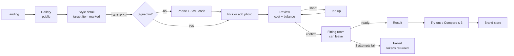
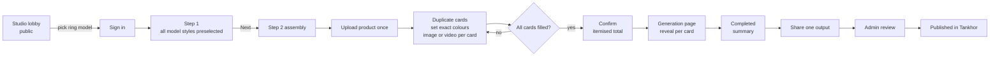

# Tankhor — Product Requirements Document (PRD)

**Version 1.1 · 3 November 2026 · Owner: Ali Shokoohi**

> **One line:** Tankhor lets Iranian shoppers see real brand clothes on their own photo before they buy, and lets Iranian sellers turn product photos into professional ad images and videos without a shoot — on one account, paid with one token wallet.

---

## 0. About this document

### 0.1 Purpose

This PRD defines **what** Tankhor must do, **for whom**, **why**, and **how we will know it works**. It is the product-level companion to the *Tankhor Technical Specification v4.0*, which defines **how** engineering builds it. Where the two overlap, they agree; if they ever disagree, this PRD decides product behaviour and the technical specification decides implementation.

### 0.2 Status and sign-off

| Item | Status |
| --- | --- |
| Product decisions (Q01–Q41) | **All closed** on 3 Nov 2026 (see §7 and Appendix B) |
| Legal sign-off: token forfeiture at account deletion (Q11) | **Pending** — must be obtained before launch |
| Accounting sign-off: revenue recognised at token spend (Q24) | **Pending** — must be obtained before launch |
| Engineering review of this PRD | Pending |
| Design review of this PRD | Pending |
| QA review of acceptance criteria | Pending |

### 0.3 Related documents

| Document | Role |
| --- | --- |
| Tankhor Technical Specification v4.0 (`tankhor-technical-spec.md` / `.pdf`) | Implementation detail, data model, ledger invariants, page specs P01–P49 |
| Tankhor Decision Q&A (`tankhor-decisions-qa.md`) | Every decision question, every option, the chosen answer |
| Tankhor Comprehensive Product Specification v3.0 (Persian) | Original source; canonical Persian UI copy |
| `Tan_Full_Design_Specification_v3(1).docx` | Upstream design source (Word spec) |
| Brand review (`brand-review.html`, 2 Nov 2026 draft) | Brand strategy, audience hypotheses, competitor research, voice, messaging, logo direction, contrast report. Written while the working name was تنه; where it shows Q02, Q03, Q04, Q30 or Q38 as open, the decisions in `tankhor-decisions-qa.md` win |

### 0.4 How to read requirements

- **Requirement IDs.** Functional requirements are `FR-<epic>-<nn>` (e.g. `FR-TRY-07`). Each maps back to technical-spec IDs (`P`, `R`, `U`, `F`, `Q`) in its *Trace* column so nothing is lost between documents.
- **Priority.**

| Priority | Meaning |
| --- | --- |
| **P0** | Must work at launch. Launch is blocked without it. |
| **P0-OFF** | Must be fully built, integrated and tested at launch, then shipped **disabled** behind a flag. A mock, stub or "coming soon" does **not** satisfy P0-OFF. |
| **P1** | Should work at launch. Can slip by one release only with owner approval recorded in the change log. |
| **P2** | Future. Not built for launch; listed so nobody builds it by accident or designs it out. |
| **OUT** | Explicitly not part of the product. Do not build. |

- **Normative words.** MUST / MUST NOT / SHOULD / MAY follow RFC 2119.
- **Numbers.** Every number in this PRD is either a decided business rule (with its Q ID) or labelled *proposed*. All business-rule numbers are collected in §10 so they can be changed in one place.

### 0.5 Change log

| Version | Date | Change | Author |
| --- | --- | --- | --- |
| 1.0 | 3 Nov 2026 | First complete PRD; all 41 decisions applied | Ali Shokoohi |
| 1.1 | 3 Nov 2026 | Product renamed تنخور / Tankhor (Q38 revised). Brand review applied: claims we never make (§2.4), uniqueness claim removed (§1), branded-house rule (§3.3), name clearance, slogan and logo-direction dependencies (§6.6, §17.2), control-boundary and curtain tokens (FR-UX-07), claim, brand-architecture and AI-notice rules (FR-UX-16 to FR-UX-18), name risks (RK15, RK16) | Ali Shokoohi |

---

## 1. Executive summary

**What we are building.** One product, two experiences, one wallet:

1. **Try It On** («یه تن بزن») — a public, image-first gallery of real Iranian brand clothes. A shopper picks a garment, adds one photo of themselves, pays a few tokens, and sees an AI-generated image of themselves wearing it. They keep results, compare up to three side by side, and leave to the brand's own store to buy. Tankhor is not a store and never shows prices.
2. **Tankhor Studio** («استودیو تنخور») — a professional content studio for sellers. A seller picks curated styles and models, assigns their own product photos to each style, and generates ad-ready images (2048 px) or short videos (1080p, up to 10 s). One upload can produce many colour variants. Outputs can be submitted for publication inside Tankhor.
3. **Owner Console** — a separate, secure admin app that controls content, pricing, AI providers, publishing review, users, finance, rollout and recovery, without anyone touching code or storage.

**Who pays and how.** Every user has one token wallet, topped up in rial (IRR) through a domestic payment gateway. Every generation is priced in tokens, shown before confirmation, and charged only on explicit confirmation. Failed generations return their tokens automatically.

**Why it can win.** Discovery works before sign-up. Try-on needs one photo and no measurements. The same account and wallet serve both shoppers and sellers, and approved seller output can feed the shopper gallery — a two-sided loop. The combination is not unique on its own (some competitors also cover both try-on and product content), so any advantage has to come from execution: clear paths, visible cost, kept work and licensed Iranian content.

**Launch shape.** Mobile-number + SMS sign-in only. Persian and English, light and dark themes, from day one. In-app notifications only. Six secondary capabilities (store widget/API, percentage rollout, per-user usage caps, ticketing, external notifications, paid publishing) are built and tested but switched off. Launch capacity target: 1,000 generations per day.

---

## 2. Problem and opportunity

### 2.1 Shopper problem

| # | Problem today | Consequence | Tankhor response |
| --- | --- | --- | --- |
| S1 | Shoppers cannot see how a garment looks on *them* before buying online | Uncertainty, hesitation, abandoned interest | One-photo AI try-on of a specific garment |
| S2 | Existing try-on tools demand sign-up, measurements or many photos up front | Drop-off before any value is seen | Public gallery; sign-in only at the moment of trying on; one photo is enough |
| S3 | Comparing options across different shops means juggling tabs and screenshots | Decisions stall | Personal gallery of results; side-by-side compare of up to 3 across shops |
| S4 | A garment found elsewhere cannot be tried on inside a catalogue-bound tool | Tool is useless for the shopper's real find | Upload a garment photo, or paste a link from an onboarded store |

### 2.2 Seller problem

| # | Problem today | Consequence | Tankhor response |
| --- | --- | --- | --- |
| B1 | Every new product or colour needs a photographer, model and shoot | Cost and delay per product | Curated styles and models; seller only supplies product photos |
| B2 | Content tools are complex and repetitive (re-uploading, re-configuring) | Time lost per variant | Product library, card duplication, one upload → many colours |
| B3 | Costs of generative tools are opaque | Fear of surprise charges | Price per card shown live; token debit only on confirm; failed outputs refunded automatically |
| B4 | Sellers have no channel from content creation to shopper discovery | Content sits unused | Share to Tankhor: submit any output for review and publication |

### 2.3 Market context and constraints

- **Primary market: Iran.** Payments in rial through domestic gateways; Persian-first UI with full English parity.
- **Local identity norms.** Mobile number is the most universal identity, so sign-in is phone + SMS code only (Q09).
- **External AI dependency.** Generation relies on external AI providers. Access, billing and data terms from Iran are a launch risk (see §15).
- **Brand trust.** Shoppers see real Iranian brand garments only with a signed image-use licence; brand names used as quality references in Studio (e.g. Nike, Calvin Klein, Gucci) imply no partnership.

### 2.4 What we will not claim

- That the try-on shows true size or fit. It is an AI-generated image.
- That a purchase click is a purchase.
- That Studio content increases sales. We measure usage and reuse, not attributed revenue.
- Any market-size or percentage-saving figure without data.
- Uniqueness or leadership: "first", "only", "best", "most accurate", "flawless", "revolutionary", unless a precise claim with independent evidence is approved later. A try-on + content combination, Persian UI, a shared wallet or the AI notice are not unique on their own; the brand review found competitors covering each of them.
- Speed or price claims ("instant", "in seconds", "free") without measured evidence; "free" only when the cost is 0.
- "100% private" in a way that denies the logged, case-scoped admin access in Q12.
- Partnerships, customer testimonials, user counts, founder quotes or launch dates without evidence. Brands named as quality references are not partners.
- That a capability is live before it is. A requirement in this PRD is not delivery evidence.

---

## 3. Goals, non-goals and principles

### 3.1 Product goals

| ID | Goal | How we will know (see §5) |
| --- | --- | --- |
| G1 | Shoppers reach a try-on result with the fewest steps possible | Gallery → confirmed try-on conversion; try-on completion rate |
| G2 | Shoppers come back and use their results to decide | Return rate to Try-ons; compare usage; store referrals per result |
| G3 | Sellers produce usable content quickly and reuse their setup | Assembly completion; card success rate; repeat projects per seller |
| G4 | Every token charged is explainable and every failure is refunded | Zero double charges; return rate tracked; reconciliation passes daily |
| G5 | The owner runs the platform without engineers for daily operations | All daily ops done in console; no direct DB/storage edits |
| G6 | The platform stays up and recoverable | RPO 1 h / RTO 4 h met in drills; emergency stop works |

### 3.2 Non-goals

| ID | Non-goal | Reason |
| --- | --- | --- |
| NG1 | Selling clothes, showing prices, fabric, ratings or price comparison | Tankhor is not a store |
| NG2 | Size or fit recommendation | AI image cannot guarantee fit |
| NG3 | Multi-garment try-on in one request | One garment per request (Q39) |
| NG4 | Social network, messaging, public profiles, likes or ratings | Out of scope; privacy |
| NG5 | Public share links for personal try-on images | Privacy (Q14) |
| NG6 | Letting users choose AI engines | Admin-only operational concern |
| NG7 | White-label Tankhor or a public Studio API | Not approved |
| NG8 | Persistent avatar, three-tab wardrobe | Early ideas, not approved |
| NG9 | Visual search / "find similar" | Out of current scope |
| NG10 | Before/after slider | Out of current scope |
| NG11 | Email/password sign-in | Phone + SMS only (Q09) |

### 3.3 Product principles

1. **Value before commitment.** Anyone can browse both experiences; sign-in is asked only at the moment of a personal action, and whatever the user picked survives sign-in.
2. **One photo, no forms.** No measurement, profile or store detail ever blocks the core action.
3. **No surprise charges.** Price visible before confirm; debit only on confirm; automatic return on failure; "returned" shown only once it really happened.
4. **Leave anytime.** Generation runs on the server. Leaving the page never loses work.
5. **Inputs and outputs are independent.** Deleting or expiring an input never deletes a result.
6. **Two voices, one brand.** Try It On sounds like a warm old-bazaar seller; Studio sounds like a professional agency. Visual identity is shared. Tankhor is a branded house: Try It On and Tankhor Studio are experiences of one parent brand, not separate brands.
7. **Nothing goes live unreviewed.** Owner changes pass draft → preview → approval → publish; seller content becomes public only after admin approval.
8. **Built-off means built.** Disabled features are real, tested features behind a flag.

---

## 4. Users and personas

Personas are working models for design. They are not statistical research.

### 4.1 Persona summary

| ID | Persona | Surface | Situation | Main barrier | What Tankhor must do |
| --- | --- | --- | --- | --- | --- |
| PS1 | **Browsing shopper** | Try It On | Arrives with no specific item in mind | Early sign-up, clutter | Public, calm, image-first gallery; clear categories |
| PS2 | **Deciding shopper** | Try It On | Torn between items from several shops | Scattered results | Try-ons gallery, compare up to 3, store link per result |
| PS3 | **Shopper with an outside find** | Try It On | Found a garment on a store site or as a photo | Tool limited to its own catalogue | Garment upload or allowlisted store link |
| PS4 | **Seller in a hurry** | Studio | Has products, needs ad images now | Repetitive uploads, complex settings | Product library, two-step build |
| PS5 | **Seller with many colours** | Studio | Same product in several colours | Rebuilding projects per colour | Duplicate card, assign same upload, set exact colour |
| PS6 | **Owner / operator** | Console | Controls quality, cost, publishing, accounts | Fear of breaking live product | Mandatory preview, versions, audit, emergency stop |
| PS7 | **Partner store** *(post-launch)* | Widget | Wants try-on on its own product page | Integration effort | Embeddable widget; shopper pays from own wallet (Q21) |

### 4.2 Jobs to be done

| Persona | When… | I want to… | So that… |
| --- | --- | --- | --- |
| PS1 | I'm idly browsing clothes | see attractive outfits without signing up | I can find something I like with no effort |
| PS1 | I see something I like | see it on my own photo in a minute | I know whether it suits me |
| PS2 | I've tried several items | see them side by side, each with its shop | I can decide and go buy |
| PS3 | I found a piece outside Tankhor | bring its photo or link | I can try it on too |
| PS4 | I've launched a product | get model-quality images without a shoot | I can post today |
| PS5 | My product comes in five colours | produce five variants from one photo | I don't redo the work five times |
| PS4/PS5 | I start a project | see the exact token cost before anything runs | I control my spend |
| PS4 | I made a great image | show it inside Tankhor | shoppers discover my brand |
| PS6 | I change prices or homepage media | preview it on all screens first | I never break the live site |
| PS6 | An AI provider fails | have traffic fail over and costs capped | users aren't hurt and bills don't explode |

### 4.3 Accessibility and inclusion needs (all personas)

- Persian (RTL) and English (LTR) with equal completeness.
- Keyboard, screen reader, zoom/reflow and reduced-motion users can complete every core flow.
- Model filters (age group, gender, skin tone) let sellers represent their customers.
- Copy is gender-neutral in Persian address.

---

## 5. Success metrics

No baseline data exists yet. For each KPI, the **first 4 weeks after launch establish the baseline**; targets are then set and recorded in the change log. Guardrails are absolute from day one.

### 5.1 North-star metric

**Weekly successful generations used** = successful try-on results opened at least once + successful Studio outputs downloaded or submitted for Share, per week.

Why: it counts value actually delivered and used, not just clicks or attempts.

### 5.2 Key performance indicators

| ID | KPI | Definition | Segment by | Target |
| --- | --- | --- | --- | --- |
| K1 | Gallery → try-on start | Sessions that open a style detail and press «یه تن بزن» ÷ sessions that view the gallery | Guest vs signed-in, device | Set after baseline |
| K2 | Sign-in completion at action | Users who complete OTP after being asked at a personal action ÷ users asked | Surface, origin (garment, ring, sample) | Set after baseline |
| K3 | Try-on completion | Successful try-ons ÷ confirmed try-ons | Provider, input type (gallery, upload, link) | Set after baseline |
| K4 | Result engagement | Results opened again, downloaded, shared or compared within 7 days ÷ successful results | — | Set after baseline |
| K5 | Store referral rate | Store clicks from card, detail, result or compare ÷ successful results | Brand, garment | Set after baseline (never reported as purchases) |
| K6 | Assembly completion | Projects reaching Create confirm ÷ projects entering step 1 | Entry origin (button, ring, sample) | Set after baseline |
| K7 | Studio card success | Successful cards ÷ started cards | Output type, provider | Set after baseline |
| K8 | Seller repeat | Sellers with ≥ 2 generated projects within 30 days ÷ sellers with ≥ 1 | — | Set after baseline |
| K9 | Share pipeline | Share requests submitted, approved, rejected, withdrawn per week | Store | Set after baseline |
| K10 | Top-up conversion | Users completing a top-up after an insufficient-balance prompt ÷ users shown the prompt | Surface | Set after baseline |

### 5.3 Guardrails (fixed from day one)

| ID | Guardrail | Threshold | Owner action if breached |
| --- | --- | --- | --- |
| GR1 | Double debits for one confirmed unit | **0** | Incident; freeze affected flow; reconcile |
| GR2 | Double credits for one payment | **0** | Incident; reconcile with gateway |
| GR3 | Failed unit without a recorded token return | **0** after processing completes | Incident; post missing return |
| GR4 | Ledger drift (cached balance ≠ sum of entries) | **0** accounts in nightly check | Incident; freeze affected wallets |
| GR5 | Private file served via a non-expiring public URL | **0** | Security incident |
| GR6 | Admin view of private photo without linked ticket | **0** (blocked by design) | Security incident |
| GR7 | AI spend above configured cap | Auto-stop triggers at cap | Review cap and provider pricing |
| GR8 | Success notification sent for a failed unit | **0** | Bug; fix before next release |
| GR9 | Generation started on an unconfirmed garment or price | **0** | Bug; fix before next release |

### 5.4 Operational metrics (monitored, not goals)

Token return rate; AI cost per capability per day (invoice-date FX); provider failover count; queue wait time; OTP delivery latency and failure rate per SMS provider; payment `unknown` count and resolution time; backup age; restore drill results.

### 5.5 Business reporting (Q24)

| Metric | Definition |
| --- | --- |
| IRR cash in | Verified gateway payments in the period |
| Recognised revenue | Token value spent on successful-or-charged units in the period, minus returns |
| Unspent-token liability | Value of tokens held in wallets at period end |
| Forfeited tokens | Token value moved out of liability at final account deletion (Q11) |
| AI cost | Provider invoices converted at invoice-date FX |
| Estimated profit | Recognised revenue − AI cost − other defined costs; method shown with every report |

*Accounting sign-off pending (Q24).*

---

## 6. Scope and release plan

### 6.1 Launch scope (P0)

| Area | Included at launch |
| --- | --- |
| Landing | Curtain intro, two entry tiles, short intro, footer |
| Identity | Mobile + SMS OTP; shared session across surfaces; 30-day deletion recovery |
| Try It On | Public gallery, search, filters, style detail, related styles, standalone create (upload or allowlisted link), photo gallery (≤ 5), confirm, fitting room, result, Try-ons, compare (≤ 3), Set aside, optional height/weight profile, file share |
| Studio | Lobby (poster, model ring, showcase), step 1 selection (styles/models, detail, profile, filters), step 2 assembly (cards, duplicate, colour, image/video per card, recolour add-on, Undo, Back), Create confirm, generation page, Projects, Saved, product library, store profile, Share to Tankhor (free) |
| Wallet | Packs and custom top-up, bulk-buy discount tiers, IRR gateway, ledger history, automatic returns |
| Notifications | In-app only |
| Console | Admin passkey/TOTP, reports, users, private-media review via ticket, stores and allowlist, media/projects, publication review, finance and pricing, AI management with fallback, content/pages, CSV bulk import, language/theme/design, settings and flags, publishing and versions, operations and recovery, audit |
| Platform | FA + EN, light/dark/system, WCAG 2.2 AA target, PWA on Android Chrome, iOS Safari, desktop Chromium |

### 6.2 Built at launch, shipped OFF (P0-OFF)

| Feature | Why built now | Switch-on prerequisite |
| --- | --- | --- |
| Try-on widget and API for partner stores | Avoids re-architecture of auth and wallet later | Partner contract, sample store pass, domain allowlist |
| Percentage rollout | Safe release of risky changes | Owner decides first rollout |
| Per-user usage limits | Abuse and cost control | Abuse pattern or cost pressure observed |
| Ticketing | Support at scale | Support staffing |
| External notifications (push, SMS, email) | Re-engagement | Delivery contracts; opt-in UX approved |
| Paid Share billing | Future monetisation | Pricing decision for Share |

### 6.3 Future (P2)

| Feature | Note |
| --- | --- |
| Multi-store outfit builder | Combine garments from several shops into one look |
| Gallery with auto-rotating images | Distinct from today's per-card short video |

### 6.4 Explicitly out (OUT)

Visual search, before/after slider, internal messaging or social features, public likes/ratings, multi-garment try-on, public share links, user-selectable AI engine, URL input in Studio, white-label, public Studio API, device-management UI, persistent avatar, wardrobe tabs, email/password sign-in, token cash-out.

### 6.5 Release phases

| Phase | Entry criteria | What happens | Exit criteria |
| --- | --- | --- | --- |
| **Alpha (internal)** | All P0 built; P0-OFF built | Team and invited testers; real payments with test gateway; provider failover drills | No open P0 bugs; GR1–GR9 hold in tests; restore drill passed |
| **Closed beta** | Alpha exit; legal and accounting sign-off obtained (Q11, Q24) | Limited shoppers and 5–20 invited sellers *(proposed)*; real gateway | 2 consecutive weeks with zero guardrail breaches; baseline KPIs collected |
| **Public launch** | Beta exit; load test at 2× 1,000 generations/day passed | Open sign-up | Targets set from baseline and recorded |
| **Post-launch** | Public launch | P0-OFF features enabled one by one via console with impact preview | Per-feature success criteria defined at enablement |

### 6.6 Launch dependencies

| Dependency | Needed for | Status |
| --- | --- | --- |
| Domestic payment gateway contract | Wallet top-up | Required before alpha with real money |
| Two domestic SMS providers | Sign-in (single gate to product) | Required before alpha |
| AI providers (primary + backup per capability) | All generation | Required before alpha; reachability and billing from Iran verified |
| Licensed launch catalogue (curated set) | Try It On gallery | Required before beta |
| Licensed Studio styles, models and sample projects | Studio | Required before beta |
| Name clearance for تنخور / Tankhor: trademark search in target classes and jurisdictions, app-store and social handles (Q38); no domain check needed | Brand assets, launch | Required before brand assets are finalised; not started |
| Brand assets (logo, wordmark, curtain/hand motion) from in-house designer (Q04); brand review recommends logo direction A (curtain gap + FA/EN wordmark) as the starting brief | Landing, waiting, reveal | Required before beta |
| Approved slogan, FA and EN | Landing hero (FR-LND-02) | Required before beta; brand-review proposals are not approved |
| Legal review of Q11, accounting review of Q24 | Account deletion, reports | Required before beta |

---

## 7. Key product decisions

All decisions are final. Full options and rationale are in `tankhor-decisions-qa.md`.

| ID | Decision | Product impact |
| --- | --- | --- |
| Q01 | One domain, path-based surfaces | One shared session; simple sign-in across surfaces |
| Q02 | Curtain is dark velvet brown | Brand signature; palette fixed |
| Q03 | Vazirmatn font (with its Latin) | Consistent FA/EN typography |
| Q04 | In-house designer makes logo and motion assets | Asset delivery is an internal dependency |
| Q05 | Uploads ≤ 15 MB, JPEG/PNG/WebP/HEIC, shortest edge ≥ 512 px | Clear limits, rejected before payment |
| Q06 | "Save all uploaded photos" ON by default; unsaved uploads purged after 30 days | Sellers build a library automatically |
| Q07 | Catalogue: curated launch set + brand self-service later | Launch depends on a curated, licensed set |
| Q08 | Studio lobby public; sign-in before building | Free exploration of Studio |
| Q09 | Mobile + SMS OTP only | Phone number is identity |
| Q10 | On deletion request, jobs finish; restore within 30 days | No lost work during grace period |
| Q11 | Remaining tokens forfeited at final deletion, with explicit warning | Needs legal sign-off |
| Q12 | Admins see private photos only via report/ticket | Strong privacy stance |
| Q13 | Unwanted but successful output → support review, no auto-refund | Prevents abuse; keeps goodwill path |
| Q14 | Try-on share = file only, no public link | Privacy |
| Q15 | Max 50 cards per Studio project | Predictable load and cost |
| Q16 | Failed projects listed in Completed with summary | Two project groups only |
| Q17 | Images 2048 px; video MP4 1080p ≤ 10 s; no watermark | Clean, ad-ready output |
| Q18 | Image or video per card; recolour priced add-on | Flexible projects, honest pricing |
| Q19 | Share requires store name + valid link | Light trust check |
| Q20 | Emergency stop: running jobs finish, new blocked | No surprise failures for paying users |
| Q21 | Widget try-ons paid from shopper's own wallet | Shopper signs in to Tankhor inside partner flow |
| Q22 | In-app notifications only at launch | No SMS/push cost or consent work at launch |
| Q23 | Admin 2FA: passkey + TOTP fallback | Strong admin security |
| Q24 | Revenue recognised at token spend | Needs accounting sign-off |
| Q25 | AI auto-fallback ON, one backup per capability | Resilience from day one |
| Q26 | Bulk import via CSV | Content ops tooling |
| Q27 | RPO 1 h, RTO 4 h, backups kept 30 days | Recovery commitment |
| Q28 | Launch load target 1,000 generations/day | Capacity plan |
| Q29 | 3 internal attempts, then immediate token return | Fast, fair failure handling |
| Q30 | Saved-for-later list named «نشون‌کرده‌ها» ("Set aside") | Voice-consistent naming |
| Q31 | Garment links only from allowlisted onboarded stores | Security and licensing |
| Q32 | Studio auto-draft kept 30 days | Forgiving to sellers |
| Q33 | Create blocked while any card lacks an image | No silent charges, no confusion |
| Q34 | Ring entry pre-selects all of that model's styles | Fast start from a model |
| Q35 | Share withdrawal hides output immediately | Seller control |
| Q36 | Pricing = base per output type + style premium (+ recolour add-on) | Flexible pricing, simple mental model |
| Q37 | PWA on Android Chrome, iOS Safari, desktop Chromium | App-like install |
| Q38 | Name: تنخور / Tankhor (revised 3 Nov 2026 after the brand review; was تنه / Taneh) | Brand fixed; name clearance still pending (§6.6) |
| Q39 | One garment per try-on | Clear cost and result |
| Q40 | Buyer photo gallery up to 5, one default | Fast reuse |
| Q41 | Optional profile: height and weight only | Minimal personal data |

---

## 8. Functional requirements

Requirements are grouped into 17 epics. Each epic gives: purpose, requirements with priority and trace, acceptance criteria (Given / When / Then), edge cases, and the analytics events it emits (full taxonomy in §13).

| Epic | Code | Surface |
| --- | --- | --- |
| E1 Landing and surface routing | LND | Shared |
| E2 Identity, session and account | IDN | Shared |
| E3 Discovery gallery and style detail | DSC | Try It On |
| E4 Try-on creation and confirmation | TRY | Try It On |
| E5 Fitting room, results and sharing | RES | Try It On |
| E6 Buyer library: Try-ons, compare, Set aside, photos, profile | LIB | Try It On |
| E7 Studio lobby and build entry | LOB | Studio |
| E8 Studio step 1: selection | SEL | Studio |
| E9 Studio step 2: assembly and Create | ASM | Studio |
| E10 Studio generation and Projects | GEN | Studio |
| E11 Studio library, Saved, store profile, Share | STO | Studio |
| E12 Wallet, payments and ledger | WAL | Shared |
| E13 Notifications, help and service status | NTF | Shared |
| E14 Owner Console | CON | Console |
| E15 Partner widget and API | WID | External |
| E16 PWA and connectivity | PWA | Shared |
| E17 Localisation, theming, accessibility and voice | UX | All |

---

### E1 — Landing and surface routing (LND)

**Purpose.** Introduce the brand in seconds and let the visitor choose Try It On or Studio, with no account.

| ID | Requirement | Priority | Trace |
| --- | --- | --- | --- |
| FR-LND-01 | The landing page MUST show the logo, a dark velvet-brown fitting-room curtain and sky (or owner-selected media) behind it. | P0 | P01, R102, Q02 |
| FR-LND-02 | Scrolling down MUST draw the curtain aside and reveal the name **Tankhor**, with the slogan above the image. | P0 | P01, R05 |
| FR-LND-03 | Two large rectangular entry tiles «یه تن بزن» and «استودیو» MUST sit below the hero image. | P0 | R103 |
| FR-LND-04 | The Try It On tile MUST open the public gallery with a matching transition; the Studio tile MUST open the Studio lobby. | P0 | F01 |
| FR-LND-05 | On desktop each tile MAY show an animated preview on hover and keyboard focus; on touch devices an explicit tap control MUST give the same preview. | P1 | R104 |
| FR-LND-06 | Below the tiles: a short, mostly visual intro of both services, then a footer with contact channel and mandatory legal links. | P0 | R105 |
| FR-LND-07 | Navigation MUST NOT wait for animation completion or video download. | P0 | P01 |
| FR-LND-08 | Reduced-motion mode MUST convey the same story with simple state changes. | P0 | P01 |
| FR-LND-09 | Deep links into Try It On or Studio MUST NOT force the intro. | P0 | §2 |
| FR-LND-10 | Try It On MUST NOT contain any direct link to Studio; switching surfaces goes through the landing page. | P0 | R161 |
| FR-LND-11 | All surfaces are served from one domain using paths (e.g. `/`, `/tryon`, `/studio`, `/console`). | P0 | Q01, R04 |
| FR-LND-12 | Hero media, slogan, intro content and footer links are editable from the Owner Console with preview. | P0 | P38 |

**Acceptance criteria**

- **AC-LND-1** Given a first-time visitor on mobile, when they scroll, then the curtain opens, the name appears, and both tiles are visible without further scrolling on a 360 × 640 viewport *(proposed check)*.
- **AC-LND-2** Given reduced motion is enabled in the OS, when the page loads, then no curtain animation plays and both tiles are immediately usable.
- **AC-LND-3** Given a visitor opens `/tryon` directly, then the gallery loads without the landing intro.
- **AC-LND-4** Given any Try It On page, then no element links to `/studio`.

**Edge cases.** Hero video fails to load → poster image shown. Very slow network → tiles usable before media finishes. Signed-in user returns to landing → tiles still shown; account control in header.

**Events.** `landing_viewed`, `landing_tile_clicked {surface}`.

---

### E2 — Identity, session and account (IDN)

**Purpose.** Phone-number identity with SMS OTP, asked only at the moment of a personal action, preserving everything the user had chosen.

| ID | Requirement | Priority | Trace |
| --- | --- | --- | --- |
| FR-IDN-01 | Sign-in MUST use mobile number + SMS one-time code only. No email or password flow. | P0 | Q09, R60 |
| FR-IDN-02 | A new number MUST create an account on first successful code verification. | P0 | §3.1 |
| FR-IDN-03 | Code entry MUST show a resend control with countdown and clear errors for invalid number, wrong code and expired code. | P0 | P02 |
| FR-IDN-04 | Code send and verify MUST be rate-limited per phone number and per IP; codes MUST expire and be single-use. | P0 | §10.2 |
| FR-IDN-05 | Sign-in MUST be requested only at a personal action: starting any try-on (including free campaigns), any personal save, or entering the Studio build flow. Browsing MUST NOT require sign-in. | P0 | R11, R13, Q08 |
| FR-IDN-06 | Sign-in MUST preserve the origin context (selected garment, ring model, sample project, return path). Success returns to that exact context; cancel returns to the prior screen with the selection intact. | P0 | R11, R147, R159 |
| FR-IDN-07 | One session MUST be valid on both surfaces; signing out ends it for both in that browser. | P0 | R61, R62 |
| FR-IDN-08 | Concurrent sign-in on multiple devices MUST be allowed; a new device MUST NOT sign out another. | P0 | R64 |
| FR-IDN-09 | No device-management UI. | OUT | R65 |
| FR-IDN-10 | Changing the account phone number MUST require verification of both old and new numbers, or an audited support process if the old number is lost. | P1 | §3.1 |
| FR-IDN-11 | Settings MUST offer language (FA/EN), theme (light/dark/system), account info and privacy management. Buyer profile, store details and identity settings MUST be separate screens, never one long mandatory form. | P0 | P14 |
| FR-IDN-12 | Account deletion request MUST show: the 30-day recovery end date, the current token balance, and an explicit statement that the balance is forfeited after the window. | P0 | Q11, R26 |
| FR-IDN-13 | During the 30-day window, running jobs MUST finish and their results MUST be kept. | P0 | Q10 |
| FR-IDN-14 | Signing in with the same phone number within the window MUST restore the account exactly. | P0 | Q10 |
| FR-IDN-15 | After the window, personal data MUST be deleted or anonymised; ledger rows kept anonymised; remaining tokens moved to forfeiture. No IRR refund, no cash-out. | P0 | Q11 |

**Acceptance criteria**

- **AC-IDN-1** Given a guest on a style detail, when they press «یه تن بزن», then the phone sign-in appears; after a valid code they land back on the same style with the same target item selected.
- **AC-IDN-2** Given a guest picks a model in the Studio ring, when they cancel sign-in, then they return to the lobby with that model still highlighted.
- **AC-IDN-3** Given a signed-in user on Try It On, when they open the landing page and choose Studio, then they are already signed in.
- **AC-IDN-4** Given a user with 120 tokens requests deletion, then the confirmation dialog states the 30-day end date and that 120 tokens will be lost after it.
- **AC-IDN-5** Given a deletion request on day 1, when the user signs in on day 29, then the account, photos, results, projects and balance are back.
- **AC-IDN-6** Given more than the allowed code requests from one number, then further requests are refused with a wait time.

**Edge cases.** SMS not delivered → resend after countdown; second SMS provider used automatically (see §14). User enters number with Persian digits or leading `+98`/`0` → normalised. Deletion request while a top-up is `unknown` → payment resolved and credited before forfeiture logic runs. Phone number reassigned by carrier to another person → support process.

**Events.** `auth_prompt_shown {origin}`, `auth_code_sent`, `auth_code_failed {reason}`, `auth_completed {new_account}`, `auth_cancelled {origin}`, `account_deletion_requested`, `account_restored`, `account_deleted_final`.

---

### E3 — Discovery gallery and style detail (DSC)

**Purpose.** A calm, Pinterest-style public gallery of real Iranian brand outfits where every card clearly shows which single garment can be tried on.

| ID | Requirement | Priority | Trace |
| --- | --- | --- | --- |
| FR-DSC-01 | The gallery MUST be public, image-first, and show Iranian models and licensed Iranian brand garments. | P0 | R06, R107 |
| FR-DSC-02 | Every card MUST show the full outfit as the main image and the try-on-able target item as a thumbnail. | P0 | R07 |
| FR-DSC-03 | Card actions MUST be independent: open detail, set aside, try on, go to store (when a valid link exists). | P0 | R109 |
| FR-DSC-04 | Text search and filters MUST cover garment type, colour, brand, model and style mood. Filters are compact and calm. | P0 | R108 |
| FR-DSC-05 | No price, fabric, rating or commercial comparison anywhere in Try It On. | P0 | NG1, R108 |
| FR-DSC-06 | The primary «یه تن بزن» action MUST stay within thumb reach on mobile and visible on desktop during browsing, without covering content. It also opens the standalone create flow (E4). | P0 | W20 |
| FR-DSC-07 | Back from detail MUST restore search query, filters, category and scroll position. | P0 | P03 |
| FR-DSC-08 | Empty results MUST offer "clear filters"; media errors MUST offer retry; videos MUST have poster fallbacks. | P0 | P03 |
| FR-DSC-09 | Style detail MUST show a large main image and thumbnails of each outfit part, tags, category, model, brand and store link (only if valid). | P0 | R10, R163 |
| FR-DSC-10 | The target item MUST be marked by text and image so that viewing a multi-part outfit never implies trying all parts. | P0 | R07, Q39 |
| FR-DSC-11 | Style detail MUST show related styles based on shared tags and categories. | P0 | R162 |
| FR-DSC-12 | Visual search or "find similar" MUST NOT be added. | OUT | R124 |
| FR-DSC-13 | Every public garment MUST have a signed image-use licence recorded in the console. | P0 | Q07 |
| FR-DSC-14 | Catalogue content comes from a curated launch set at launch; brand self-service onboarding via console and CSV is enabled later. | P0 / P1 | Q07 |

**Acceptance criteria**

- **AC-DSC-1** Given a guest on the gallery, then they can search, filter, open details and view related styles without any sign-in prompt.
- **AC-DSC-2** Given a style with top, trousers and shoes where the shirt is the target, then the shirt thumbnail is labelled as the item to try on, and the confirm screen later shows only the shirt.
- **AC-DSC-3** Given filters applied and scrolled to item 40, when the user opens a detail and returns, then filters and position are unchanged.
- **AC-DSC-4** Given a garment with no valid store link, then no "go to store" action appears.

**Edge cases.** Garment withdrawn by brand after a user set it aside → item shows "no longer available" state. Licence expired → garment hidden from public gallery automatically; existing user results remain.

**Events.** `gallery_viewed`, `gallery_filter_applied {filter, value}`, `gallery_search {query_length}`, `style_card_viewed {style_id, garment_id}`, `style_detail_opened`, `store_link_clicked {source: card|detail|result|compare, brand_id}`.

---

### E4 — Try-on creation and confirmation (TRY)

**Purpose.** Get from "I like this" to a confirmed, priced try-on request with one photo and one garment.

| ID | Requirement | Priority | Trace |
| --- | --- | --- | --- |
| FR-TRY-01 | A try-on request MUST have exactly one personal photo and exactly one target garment. | P0 | Q39 |
| FR-TRY-02 | From a style detail, the target garment is preselected; the user only adds or picks a photo. | P0 | W19 |
| FR-TRY-03 | The standalone create flow ("+ یه تن بزن") MUST accept a garment from: image file upload; image or product link from an allowlisted store; pick from gallery; pick from Set aside. | P0 | R24, R111 |
| FR-TRY-04 | Links MUST be accepted only from hosts on the owner-managed allowlist of onboarded stores. Other hosts MUST be refused with an upload fallback. | P0 | Q31, R112 |
| FR-TRY-05 | A fetched link image MUST be shown for the user to confirm as the target before any cost step. Ambiguous pages (several candidate images) MUST let the user choose or fall back to upload. | P0 | P05 |
| FR-TRY-06 | Generation MUST NOT start on a guessed or unconfirmed garment. | P0 | GR9 |
| FR-TRY-07 | Photo, garment and review are one short flow, not four mandatory pages; already-valid choices are not asked again. | P0 | P05 |
| FR-TRY-08 | One personal photo is enough. Height, weight, measurements, multi-angle photos or profile completion MUST NOT be required. | P0 | R14 |
| FR-TRY-09 | Upload limits: up to 15 MB; JPEG, PNG, WebP or HEIC; shortest edge ≥ 512 px. Violations MUST be rejected with a specific message before any token cost. | P0 | Q05 |
| FR-TRY-10 | Low light, imperfect pose or modest quality MUST NOT block; they MAY show optional advice. Corrupt, unsupported or unprocessable files are technical errors and MUST be rejected before cost. | P0 | R164 |
| FR-TRY-11 | First permanent save of a personal photo MUST ask for explicit consent and show an AI-processing notice. Declining keeps the photo temporary (14 days by default). | P0 | Q12, R113 |
| FR-TRY-12 | A saved default photo MAY be preselected but MUST remain swappable; preselection is never cost confirmation. | P0 | P06 |
| FR-TRY-13 | The review step MUST show target garment, personal photo, token cost and current balance beside the confirm action. | P0 | R12 |
| FR-TRY-14 | Nothing is generated and nothing is debited before the user confirms. | P0 | R12 |
| FR-TRY-15 | Free campaigns show cost 0 and still require sign-in. | P0 | R13 |
| FR-TRY-16 | Insufficient balance MUST show the exact shortfall and a top-up path; after top-up the user returns to the same review step with inputs intact; a separate confirm is still required. | P0 | R44, F04 |
| FR-TRY-17 | If the price changed since display, a fresh confirmation MUST be required. | P0 | R66 |
| FR-TRY-18 | Repeated clicks on confirm MUST create one request and one debit. | P0 | GR1 |
| FR-TRY-19 | Cancel at any step keeps valid inputs. | P0 | P07 |
| FR-TRY-20 | A garment with no store MUST NOT get fabricated purchase information. | P0 | P05 |

**Acceptance criteria**

- **AC-TRY-1** Given a 16 MB photo, when uploaded, then it is rejected with "over 15 MB" before the review step; balance unchanged.
- **AC-TRY-2** Given a HEIC photo of 3024 × 4032 px, then it is accepted.
- **AC-TRY-3** Given a link from a non-allowlisted host, then the user sees "this store isn't supported yet" and an upload option; no fetch is made to that host.
- **AC-TRY-4** Given an allowlisted product page with three images, then the user chooses one before continuing.
- **AC-TRY-5** Given balance 3 and cost 5, when the user presses confirm, then they see "2 tokens short", top up, return to the same review, press confirm again, and exactly 5 tokens are debited once.
- **AC-TRY-6** Given a double-tap on confirm, then one request exists and one debit is recorded.

**Edge cases.** Photo with no person detected → treated as quality advice unless provider rejects it as unprocessable at validation. Network drop between confirm and response → client retries with the same idempotency key; no duplicate. Allowlisted store removed from allowlist mid-flow → link refused at confirm; upload offered.

**Events.** `tryon_create_opened {entry: detail|standalone}`, `tryon_garment_selected {source: gallery|upload|link|set_aside}`, `tryon_link_rejected {reason}`, `tryon_photo_selected {source: new|saved|default}`, `upload_rejected {reason, surface}`, `tryon_review_shown {cost, balance}`, `tryon_confirmed {cost}`, `insufficient_balance_shown {shortfall, surface}`.

---

### E5 — Fitting room, results and sharing (RES)

**Purpose.** Make waiting delightful but honest, let the user leave, and make results useful.

| ID | Requirement | Priority | Trace |
| --- | --- | --- | --- |
| FR-RES-01 | A confirmed request MUST appear behind the closed curtain. Pulling it early MUST play the hand-closes-curtain interaction. | P0 | P08, R115 |
| FR-RES-02 | The screen MUST reflect real state (queued, processing). No fake progress percentage or ETA. | P0 | R18 |
| FR-RES-03 | Screen-reader status MUST announce state; reduced motion keeps meaning and exit. | P0 | §12.6 |
| FR-RES-04 | The user MAY leave at any time; the server continues. The copy MUST say so. | P0 | R19 |
| FR-RES-05 | On success, an in-app notification «بیا یه نظر بده!» MUST deep-link to that exact result. If the browser was closed, the result MUST be found on return. | P0 | R116, Q22 |
| FR-RES-06 | Successful results MUST auto-save to Try-ons. | P0 | R22 |
| FR-RES-07 | On final failure (after up to 3 internal attempts) tokens MUST be returned immediately. "Returning" and "returned" states MUST be distinct; "returned" copy only after it is recorded. | P0 | Q29, R21 |
| FR-RES-08 | A failed request MUST never trigger a success notification. | P0 | GR8 |
| FR-RES-09 | Result view MUST show the image with target garment, brand, date and purchase link if valid, plus a proportionate AI-generated / no-fit-guarantee notice (text in FR-UX-18) that does not cover the image. | P0 | R118, FR-UX-18 |
| FR-RES-10 | Result actions: zoom, download, regenerate, change outfit, compare, share, delete, back to gallery, go to store. | P0 | R117 |
| FR-RES-11 | Regenerate keeps inputs and requires a new cost confirmation. | P0 | R117 |
| FR-RES-12 | Change Outfit keeps a valid personal photo and opens garment selection; an expired photo requires a new pick. The previous result is kept. | P0 | R117 |
| FR-RES-13 | Share MUST be explicit and file-based: system share sheet with the image file where supported, download otherwise. No public link. No in-app messaging. | P0 | Q14, R120 |
| FR-RES-14 | Deleting a result MUST NOT delete the personal photo or the set-aside garment. | P0 | P09 |
| FR-RES-15 | Successful but unwanted results get no automatic refund; the help path explains that support can review. | P0 | Q13 |
| FR-RES-16 | No before/after slider. | OUT | R124 |

**Acceptance criteria**

- **AC-RES-1** Given a confirmed try-on, when the user navigates to the gallery and the job succeeds, then an in-app notice appears and tapping it opens the result.
- **AC-RES-2** Given the provider fails three times, then the request shows failed, the ledger shows one return equal to the debit, and the user sees "{cost} tokens are back in your wallet" only after the return is posted.
- **AC-RES-3** Given iOS Safari, when the user taps share, then the share sheet offers the image file; no URL is shared.
- **AC-RES-4** Given a result whose photo has expired, when the user taps Change Outfit, then they are asked to choose a photo.

**Edge cases.** Primary provider down → backup provider used transparently (E14 AI). Late success from a superseded attempt → discarded. User deletes the source photo while job runs → job completes with its retained copy, then copy purged.

**Events.** `fitting_room_viewed`, `curtain_pulled_early`, `tryon_succeeded {provider, attempts, duration_ms}`, `tryon_failed {provider, attempts, reason_class}`, `tokens_returned {unit_type, amount}`, `notification_opened {type}`, `result_viewed`, `result_downloaded`, `result_shared {method: share_sheet|download}`, `result_regenerate_clicked`, `result_change_outfit_clicked`, `result_deleted`.

---

### E6 — Buyer library: Try-ons, compare, Set aside, photos, profile (LIB)

**Purpose.** Help shoppers keep, revisit and decide.

| ID | Requirement | Priority | Trace |
| --- | --- | --- | --- |
| FR-LIB-01 | **Try-ons** («تن‌زده‌ها») MUST list all successful results until the user deletes them; no promotional subtitle; in-flight or failed items, if shown, are clearly separate. | P0 | P10 |
| FR-LIB-02 | Try-ons actions: open, download, share (file), delete, select for compare, go to store. Paging and back preserve scroll and compare selection. | P0 | P10 |
| FR-LIB-03 | **Compare** MUST accept 1 to 3 results, from any stores. A 4th selection shows a limit message and keeps the first three. | P0 | R23 |
| FR-LIB-04 | Compare MUST show each result with its own garment and store link only; no price, fabric, rating or commercial data. | P0 | R174 |
| FR-LIB-05 | On mobile every compared item MUST be reachable (scroll or tabs). Removing from compare never deletes the result. | P0 | P11 |
| FR-LIB-06 | **Set aside** («نشون‌کرده‌ها») MUST store garments the user wants to keep for later, tried or not. Guest save asks for sign-in then saves that garment. Repeated saves are idempotent. | P0 | Q30, R110 |
| FR-LIB-07 | Set aside items can be opened, tried on, bought (store link) or removed. Removing never deletes photos or results. Unavailable items show a clear state. | P0 | P45 |
| FR-LIB-08 | Set aside is separate from Try-ons and from Studio Saved. | P0 | R110 |
| FR-LIB-09 | **My Photos** MUST hold up to 5 permanent photos with one default. Adding a sixth requires deleting one. | P0 | Q40 |
| FR-LIB-10 | Temporary vs permanent photos are clearly marked. Temporary photos expire after 14 days by default (owner-configurable). | P0 | R15 |
| FR-LIB-11 | Deleting the default photo clears the default or asks for an explicit replacement; never a random substitute. | P0 | P13 |
| FR-LIB-12 | **Profile** MUST offer only height and weight, both optional, with a small yellow "!" badge (accessible name "Optional profile completion") until filled. No repeated modals. | P0 | Q41, R114 |
| FR-LIB-13 | Height and weight MUST be sent to the provider only if the provider uses them; the UI MUST NOT claim they improve results unless they do. | P0 | Q41 |
| FR-LIB-14 | **Buyer navigation** MUST provide: Explore, + Try It On, My Photos, Try-ons, Set aside, Profile, Account & wallet, Help. Account icon and token balance always visible, with a producible-count estimate based on real prices. One menu entry per concept. | P0 | P12, R165 |

**Acceptance criteria**

- **AC-LIB-1** Given 3 results selected for compare, when a 4th is tapped, then a message explains the limit of 3 and the 3 stay selected.
- **AC-LIB-2** Given 5 saved photos, when the user adds a new one permanently, then they are asked which one to remove.
- **AC-LIB-3** Given a set-aside garment later tried on, then it appears in both Set aside and (as a result) in Try-ons; removing it from Set aside leaves the result.
- **AC-LIB-4** Given the profile badge, when read by a screen reader, then it announces "Optional profile completion".

**Events.** `tryons_viewed`, `compare_opened {count}`, `compare_limit_hit`, `set_aside_added {garment_id}`, `set_aside_removed`, `photo_saved {permanent}`, `photo_deleted`, `photo_default_set`, `profile_updated {fields}`.

---

### E7 — Studio lobby and build entry (LOB)

**Purpose.** Make sellers feel they walked into a professional fashion agency, let them explore freely, and give three clear ways to start.

| ID | Requirement | Priority | Trace |
| --- | --- | --- | --- |
| FR-LOB-01 | Lobby order top to bottom: cinematic poster → model ring → showcase of ready sample projects. | P0 | P15, R127 |
| FR-LOB-02 | Poster: rotating cinematic videos/images; muted autoplay, pause control, poster fallback, reduced motion. Models inside the poster are not clickable selections. | P0 | R28 |
| FR-LOB-03 | Model ring: rotatable carousel; hover/focus on a model shows its styles around it; touch and explicit controls (including stop) give the same on mobile. | P0 | R29, R129 |
| FR-LOB-04 | Showcase: sample projects (image + video). Hover, focus or tap browses each sample's media. | P0 | R30 |
| FR-LOB-05 | All model and sample assets MUST have usage rights; naming a source is not a licence. Brand names used as quality references imply no partnership. | P0 | W35 |
| FR-LOB-06 | **Create Project** MUST always be reachable: small in a top corner at first, more prominent on scroll. | P0 | R128 |
| FR-LOB-07 | The full workspace sidebar MUST NOT overlay the cinematic lobby; a small account control is visible. | P0 | R32 |
| FR-LOB-08 | Browsing the lobby needs no account. Entering the build flow from any entry requires sign-in first, preserving the origin. | P0 | Q08, R159 |
| FR-LOB-09 | Entry by **Create Project** → step 1 (P16), Styles view, empty selection. | P0 | R31 |
| FR-LOB-10 | Entry by **ring model** → step 1 with **all styles of that model preselected**; the user can remove some or all, and add others. Picking costs nothing; count and estimated cost are visible before continuing. | P0 | Q34, R130 |
| FR-LOB-11 | Entry by **sample project** → step 2 (P17) with the sample's styles and sample product images; the user can replace, remove, or go back to step 1. Sample products stay sample assets. | P0 | R131 |

**Acceptance criteria**

- **AC-LOB-1** Given a guest picks a model with 7 styles, when they sign in, then step 1 opens with exactly those 7 styles selected and the total cost shown.
- **AC-LOB-2** Given a guest picks a sample project, when they sign in, then step 2 opens with the sample's cards and images.
- **AC-LOB-3** Given reduced motion, then the ring does not auto-rotate and the poster shows a still with a play control.

**Events.** `studio_lobby_viewed`, `ring_model_focused {model_id}`, `sample_previewed {sample_id}`, `studio_build_entry {origin: button|ring|sample}`.

---

### E8 — Studio step 1: selection (SEL)

**Purpose.** Let sellers pick any mix of styles and models in one shared selection, with prices visible from the first glance.

| ID | Requirement | Priority | Trace |
| --- | --- | --- | --- |
| FR-SEL-01 | Step 1 MUST open on the Styles view, with no "model or style?" interstitial. Styles and Models views are two windows onto one shared selection. | P0 | R133 |
| FR-SEL-02 | Style cards show media, price (base for default output type + style premium if any), select, save, open detail. | P0 | R35, Q36 |
| FR-SEL-03 | Opening a style detail or model profile MUST NOT select anything or change cost. | P0 | R134 |
| FR-SEL-04 | Style detail: larger media, model, attributes, price; three separate actions — select for project, save style, view model. | P0 | P47 |
| FR-SEL-05 | Model profile: browse images and styles; select one, several or all styles; save the model separately. "Select all" states count and cost impact and does not duplicate already-selected styles. | P0 | P48, R135 |
| FR-SEL-06 | Filters: styles by product type and mood (shoes, clothing, sport, classic, casual, luxury); models by age group, gender, skin tone and relevant appearance attributes. Collapsible panel; active filters stay as removable chips after closing. | P0 | R136, R173 |
| FR-SEL-07 | A compact summary MUST show selected items, count and running total from the first selection, updating live. | P0 | R37, R137 |
| FR-SEL-08 | Prices MUST be visible without hover on touch devices. | P0 | R145 |
| FR-SEL-09 | Moving between views, details, profiles, Saved and back MUST keep the selection. | P0 | R137 |
| FR-SEL-10 | Invalid style–model combinations MUST NOT be silently accepted; only compatible options are offered. | P0 | R36 |
| FR-SEL-11 | The project limit of 50 cards MUST be shown in the summary before the user reaches it; selection beyond 50 is blocked with an explanation. | P0 | Q15 |
| FR-SEL-12 | **Next** carries valid selections to step 2. | P0 | R34 |
| FR-SEL-13 | No public likes or ratings. Internally, views, detail opens, selections and real project use are logged separately. | P0 | R139 |

**Acceptance criteria**

- **AC-SEL-1** Given 3 styles selected in Styles view, when the user switches to Models and back, then the 3 remain selected.
- **AC-SEL-2** Given a style with premium 2 and image base 10, then the card shows 12 tokens as the default image cost.
- **AC-SEL-3** Given 48 selected, when the user selects "all" on a model with 5 styles, then they see that only 2 fit within 50 and choose what to keep.

**Events.** `studio_style_viewed`, `studio_style_detail_opened`, `studio_model_profile_opened`, `studio_style_selected`, `studio_style_deselected`, `studio_select_all {model_id, count}`, `studio_filter_applied`, `studio_card_limit_hit`.

---

### E9 — Studio step 2: assembly and Create (ASM)

**Purpose.** Assign products to styles quickly, multiply variants cheaply, and confirm a clearly priced project.

| ID | Requirement | Priority | Trace |
| --- | --- | --- | --- |
| FR-ASM-01 | Step 2 is labelled "Step 2 of 2". There is no step 3. | P0 | R34 |
| FR-ASM-02 | One card per style instance; each card has one product slot and produces one output. | P0 | R38, R140 |
| FR-ASM-03 | Empty slots are covered by the velvet curtain; tapping offers **Choose from library** or **Upload new image**. No URL input in Studio. | P0 | R39, R160 |
| FR-ASM-04 | After an image is assigned the curtain stays open; removing the image closes it. | P0 | R39 |
| FR-ASM-05 | Each card selects **image** or **video** output; **recolour** is an optional per-card add-on with its own price. | P0 | Q18 |
| FR-ASM-06 | Card price = output-type base + style premium + recolour add-on (if on). Each card shows its price; the project total is always visible. | P0 | Q36, R145 |
| FR-ASM-07 | Distinct per-card actions: replace image, remove image only, delete card (with its assignment), duplicate, set colour. Removing an image or card never deletes the library file. | P0 | R143 |
| FR-ASM-08 | **Duplicate** creates a new card with the same model, pose and settings and an **empty** image slot. | P0 | R142 |
| FR-ASM-09 | One uploaded image MAY be assigned to several cards; each card can carry a different exact colour (value + visible swatch). | P0 | R166 |
| FR-ASM-10 | The 50-card project limit applies to duplication too. | P0 | Q15 |
| FR-ASM-11 | **Back** returns to step 1 keeping images, colours, copies and selections; returning shows compatible assignments intact. | P0 | R144 |
| FR-ASM-12 | **Undo** reverts at least the last edit on this page (remove image, delete card with assignment, replace image). Undo never navigates. | P0 | R144 |
| FR-ASM-13 | Removing a style in step 1 that affects a filled card MUST show the effect clearly before applying. | P0 | P17 |
| FR-ASM-14 | **Save project** stores the assembly in Saved → Assembled projects. Leaving without saving keeps an auto-draft for 30 days from last activity. | P0 | Q32, R46 |
| FR-ASM-15 | If any card has no product image, **Create is disabled** and empty cards are highlighted with a count ("3 cards still need a product image"). | P0 | Q33 |
| FR-ASM-16 | With all cards ready, Create opens a confirmation with output count, per-card breakdown, total tokens and balance, plus an optional "Add another style?" path. | P0 | R167 |
| FR-ASM-17 | Confirm with sufficient balance debits tokens once and starts generation. Shortfall leads to top-up and back to the exact assembly; confirm still required. | P0 | R146, R147 |
| FR-ASM-18 | Project cost can only be paid from token balance; there is no direct per-project payment. | P0 | R146 |
| FR-ASM-19 | Upload limits are the same as for buyers (15 MB, JPEG/PNG/WebP/HEIC, ≥ 512 px). | P0 | Q05 |

**Acceptance criteria**

- **AC-ASM-1** Given a card with a red shirt image, when duplicated twice, then two new cards appear with the same model and pose and empty slots; total cost rises by two card prices.
- **AC-ASM-2** Given one upload assigned to five cards with five colours, then confirmation lists five outputs and the price of each.
- **AC-ASM-3** Given 8 cards and 2 empty, then Create is disabled and the 2 cards are highlighted; filling or deleting them enables Create.
- **AC-ASM-4** Given the user deletes a filled card, when they tap Undo, then the card and its image return.
- **AC-ASM-5** Given a seller leaves step 2 without saving, when they return 29 days later, then the draft is offered; on day 31 it is gone and library files remain.

**Edge cases.** Library image deleted elsewhere while assigned → card shows "image no longer available" and becomes empty. Temporary upload expires before Create → card shows re-upload need. Price version changes while assembling → confirmation shows the new total and requires confirm.

**Events.** `assembly_opened {origin}`, `card_image_assigned {source: library|upload}`, `card_duplicated`, `card_deleted`, `card_output_type_set {type}`, `card_recolour_toggled`, `assembly_undo`, `assembly_saved`, `create_blocked_empty_cards {count}`, `project_confirm_shown {cards, total}`, `project_confirmed {cards, total, image_count, video_count, recolour_count}`.

---

### E10 — Studio generation and Projects (GEN)

**Purpose.** Reveal each output the moment it's ready, keep the seller informed, and file everything into two clear project groups.

| ID | Requirement | Priority | Trace |
| --- | --- | --- | --- |
| FR-GEN-01 | After confirm, cards continue on a separate generation page (not a build step). The curtain now covers outputs in production. | P0 | R151 |
| FR-GEN-02 | Each card shows its own state: queued, processing, ready, failed. | P0 | P19 |
| FR-GEN-03 | Tapping an unfinished curtain opens it slightly, flashes the Tankhor logo, then a hand closes it. Optional text "Generating output". No fake outputs. | P0 | R47 |
| FR-GEN-04 | Each ready output is revealed and downloadable immediately, independent of other cards. A real counter shows "N of M outputs ready". | P0 | R152 |
| FR-GEN-05 | Leaving the page never stops generation; the project is reachable from Projects. | P0 | R48 |
| FR-GEN-06 | A failed card (after 3 internal attempts) returns only its own tokens immediately; successful cards are unaffected. | P0 | Q29, R48 |
| FR-GEN-07 | In-app notification per ready output, plus one final event when every card is final. If any failed, the final event shows the split ("6 ready, 2 failed, 24 tokens returned"), never "all ready". | P0 | Q22, R153 |
| FR-GEN-08 | **Projects** has exactly two groups: In Production and Completed, switchable in-page and reachable directly from the sidebar. | P0 | R49, R157 |
| FR-GEN-09 | A project moves to Completed when every card is final; partly or fully failed projects carry a result summary; zero-success projects are visibly flagged. | P0 | Q16 |
| FR-GEN-10 | Project detail shows outputs, per-card state, downloads, tokens debited and returned, and Share requests. | P0 | P20 |
| FR-GEN-11 | Outputs browsable by project, model or style; generated media is categorised and tagged. | P0 | R169, R170 |
| FR-GEN-12 | Output spec: images 2048 px long edge (WebP or JPEG); video MP4 1080p, max 10 s; no watermark. | P0 | Q17, R154 |
| FR-GEN-13 | All outputs persist in the gallery regardless of input-retention settings. | P0 | R172 |

**Acceptance criteria**

- **AC-GEN-1** Given 8 cards, when card 3 finishes first, then it is revealed and downloadable while others still show the curtain, and the counter shows "1 of 8".
- **AC-GEN-2** Given 2 of 8 cards fail, then 2 returns are posted, the final notice reports "6 ready, 2 failed", and the project sits in Completed with a summary.
- **AC-GEN-3** Given a video card, then the downloaded file is MP4, 1080p, ≤ 10 s, with no watermark.

**Events.** `generation_page_viewed`, `card_succeeded {output_type, provider, attempts}`, `card_failed {output_type, provider, reason_class}`, `project_completed {ready, failed}`, `output_downloaded {output_type}`.

---

### E11 — Studio library, Saved, store profile and Share (STO)

**Purpose.** Let sellers reuse their assets, keep work organised, and put their best output in front of shoppers.

| ID | Requirement | Priority | Trace |
| --- | --- | --- | --- |
| FR-STO-01 | **Product library**: bulk or gradual upload; structured apparel categories and tags (women, men, shoes, clothing, style), product type, in/out of stock. | P0 | R42, R171 |
| FR-STO-02 | Setting **"Save all uploaded photos"** MUST default to ON. ON: uploads join the library. OFF: new uploads are temporary and purged 30 days after upload. Turning it OFF never deletes existing library files. | P0 | Q06, R168 |
| FR-STO-03 | The upload UI MUST state which retention applies to the file being uploaded. | P0 | U46 |
| FR-STO-04 | Draft expiry, card deletion or unassignment never delete permanent library files; input deletion or expiry never breaks outputs. | P0 | R150 |
| FR-STO-05 | **Saved** has three independent tabs: Models, Styles, Assembled projects. A saved assembly resumes in step 2; saved models and styles open selection or detail. | P0 | R43, R149 |
| FR-STO-06 | Removing a saved item never deletes a generated project or library file. Invalid references (disabled style, deleted image) show a clear state and replacement option; generation never starts with an invalid reference. | P0 | P21 |
| FR-STO-07 | **Studio dashboard**: one sidebar for Projects (In Production, Completed), Saved, Library, Wallet, Account. Subtle on the lobby, explicit in the workspace. Mobile uses a collapsible version with the same destinations. | P0 | R138 |
| FR-STO-08 | **Store profile**: store name, store link and related info; one store per account; never required to create projects; small unobtrusive completion badge. | P0 | R52, R53 |
| FR-STO-09 | **Share to Tankhor**: submit one specific image or video for review and publication, from the generation page or from a completed project. One output never publishes the whole project. | P0 | R155 |
| FR-STO-10 | Share requires store name + valid store link, checked at admin review. | P0 | Q19 |
| FR-STO-11 | Share is free at launch; paid Share billing is built and OFF. | P0 / P0-OFF | R51 |
| FR-STO-12 | Share states: not submitted, pending review, approved (published), rejected (with reason), withdrawn. They do not create extra Projects groups. | P0 | P24 |
| FR-STO-13 | Cancel before publication prevents publication. Withdrawal after publication hides the output from all public display immediately; the dialog states that copies already downloaded by others cannot be recalled. | P0 | Q35, R156 |

**Acceptance criteria**

- **AC-STO-1** Given a new seller, then "Save all uploaded photos" is ON and their first upload appears in Library.
- **AC-STO-2** Given the setting is OFF, when the seller uploads on day 0, then the file is gone on day 31 and any output made from it remains.
- **AC-STO-3** Given a published output, when withdrawn, then it disappears from public gallery and detail pages on the next request.
- **AC-STO-4** Given a store profile without a link, when the seller submits a Share, then the request is accepted but the seller is told the link is required before approval.

**Events.** `library_uploaded {count}`, `library_setting_changed {save_all}`, `saved_item_added {type}`, `store_profile_updated`, `share_submitted {output_type}`, `share_cancelled`, `share_approved`, `share_rejected {reason}`, `share_withdrawn`.

---

### E12 — Wallet, payments and ledger (WAL)

**Purpose.** One trustworthy token wallet for everything, with no possible double charge and automatic refunds on failure.

| ID | Requirement | Priority | Trace |
| --- | --- | --- | --- |
| FR-WAL-01 | One token wallet per account, spendable on both surfaces. | P0 | R63 |
| FR-WAL-02 | Top-up by preset packs or custom amount, paid in IRR through a domestic gateway. IRR and tokens always shown separately with units. | P0 | R67, R69 |
| FR-WAL-03 | Discounts apply only to buying more tokens (bulk tiers); generating more never earns a discount. | P0 | R68 |
| FR-WAL-04 | Balance increases only after server-side gateway verification. Payment states `succeeded`, `failed`, `cancelled`, `unknown` are distinct. | P0 | P25 |
| FR-WAL-05 | `unknown` payments MUST be reconciled automatically; the UI MUST NOT push the user into a second purchase while one is unknown. | P0 | P25 |
| FR-WAL-06 | Repeated verification or callbacks for one payment credit exactly once. | P0 | GR2 |
| FR-WAL-07 | After top-up the user returns to the same request or assembly with inputs intact. | P0 | F04 |
| FR-WAL-08 | **History** lists purchases, credits, debits, returns, admin adjustments and forfeiture with time, amount, status and reference to the request or card. | P0 | P26 |
| FR-WAL-09 | Each confirmed unit records at most one debit and at most one return. | P0 | GR1, GR3 |
| FR-WAL-10 | The balance can never go negative. | P0 | L3 |
| FR-WAL-11 | A blocked account keeps its balance and cannot spend. | P0 | R84 |
| FR-WAL-12 | Token returns are not IRR refunds. Token cash-out does not exist. | P0 | P26 |
| FR-WAL-13 | Users never see other accounts' data, provider keys or provider costs. | P0 | P26 |
| FR-WAL-14 | Every confirmed unit stores the exact price it was confirmed at (price version, base, premium, add-on); later price changes never alter it. | P0 | Q36 |

**Acceptance criteria**

- **AC-WAL-1** Given the gateway calls back twice for one payment, then one credit exists.
- **AC-WAL-2** Given the browser closes after paying but before redirect, then the reconciler verifies the payment and credits the wallet; history shows it.
- **AC-WAL-3** Given a blocked account with 50 tokens, when it tries to confirm a try-on, then confirm is refused and the balance stays 50.

**Events.** `topup_started {pack|custom, irr_amount, tokens}`, `topup_result {state}`, `topup_reconciled`, `wallet_history_viewed`.

---

### E13 — Notifications, help and service status (NTF)

| ID | Requirement | Priority | Trace |
| --- | --- | --- | --- |
| FR-NTF-01 | In-app notifications for: buyer try-on ready, Studio output ready, Studio project final summary, token returned, Share approved/rejected. Each deep-links to its subject and is recoverable later in a notification list. | P0 | Q22 |
| FR-NTF-02 | Push, SMS and email notifications are built, tested and OFF; enabling requires delivery contracts and explicit user opt-in. Installing the PWA grants no send permission. | P0-OFF | R93 |
| FR-NTF-03 | Public help content covers both surfaces. | P0 | P29 |
| FR-NTF-04 | Ticketing is built and OFF; no dead "contact support" buttons at launch — a visible contact channel is used instead. | P0-OFF | R93 |
| FR-NTF-05 | Maintenance banners state which part is unavailable and what still works. Try It On and Studio can be in maintenance independently. | P0 | R90, R91 |
| FR-NTF-06 | During an emergency stop, the UI says new generation is paused; running jobs finish and are delivered or returned normally. | P0 | Q20 |

**Events.** `notification_shown {type}`, `notification_opened {type}`, `help_viewed {article}`, `maintenance_banner_shown {surface}`.

---

### E14 — Owner Console (CON)

**Purpose.** Run the whole platform safely: nothing goes live without preview and approval, every admin action is attributable, and costs and failures are controlled.

**Cross-cutting rules for every console module**

| ID | Requirement | Priority | Trace |
| --- | --- | --- | --- |
| FR-CON-01 | Console is a separate app at its own path, reachable only by admin accounts. | P0 | R03 |
| FR-CON-02 | Admin sign-in MUST require a second factor: passkey (WebAuthn) preferred, TOTP fallback. Without it the console never opens. | P0 | Q23, R86 |
| FR-CON-03 | A locked-out admin is recovered by another admin; every recovery and every admin addition is audited. | P0 | Q23 |
| FR-CON-04 | All admins have equal, full permissions at launch; each admin's actions are logged separately. | P0 | R86 |
| FR-CON-05 | Saving any content, design, price or setting change creates a **draft** only. Going live requires preview → approval → publish (now or scheduled) → version. | P0 | R73–R76 |
| FR-CON-06 | Preview MUST cover mobile, tablet and desktop, both languages and display modes, from the same draft version. | P0 | R74 |
| FR-CON-07 | Approval binds to the exact version approved; any later edit invalidates it. | P0 | P42 |
| FR-CON-08 | Rollback publishes a prior version as a new event; it never erases executed transactions. | P0 | R76 |
| FR-CON-09 | Financial and operational previews/simulations never create real transactions or change real balances. | P0 | R75 |
| FR-CON-10 | Urgent actions (block, adjust, stop) still show an impact preview and require proportionate confirmation. | P0 | P42 |
| FR-CON-11 | The console is available in FA and EN with light/dark/system themes. | P0 | R58 |

**Modules**

| ID | Module | Requirements | Priority | Trace |
| --- | --- | --- | --- | --- |
| FR-CON-20 | Overview and reports | Users, IRR cash in, recognised revenue (at token spend), unspent-token liability, forfeited tokens, token purchase and spend, AI cost (invoice-date FX), errors, returns, estimated profit (method shown), usage trends. Every metric has definition, window, refresh time and lineage. Buyer per-garment and per-brand view/click/try-on/buy-click. Studio model/style view, detail open, selection, real use. | P0 | P31, Q24, R87 |
| FR-CON-21 | Users | Search; view account, store, projects, ledger. Temporary block and permanent deactivation as separate actions with duration, reason and effect logged. Block keeps balance, blocks spend. | P0 | P32, R83, R84 |
| FR-CON-22 | Balance adjustment | Separate, reasoned, confirmed adjustment events; never edit history. Used e.g. for support goodwill returns on disputed outputs. | P0 | R85, Q13 |
| FR-CON-23 | Private media review | Personal photos and try-on outputs viewable **only** when the admin links a user report or support ticket ID; view scoped to that case; every view logged with admin, time, ticket. Viewing never makes files public. | P0 | Q12, R71 |
| FR-CON-24 | Stores | One store per account; profile, status, content. Publishing requires name + valid link. Manage the **link-ingestion allowlist** of onboarded store hosts. Record image-use licences per brand. | P0 | P33, Q19, Q31, Q07 |
| FR-CON-25 | Media and projects | Track files, requests and cards by owner, type, state, TTL, private/public. Show per-card errors and returns. Delete, fix or re-run shows dependency and cost impact first. | P0 | P34 |
| FR-CON-26 | Publication review | Queue of Share requests with output, target item, store, licence status. Approve or reject per output with a reason; history kept. Withdrawn items leave public display immediately. Queue is separate from generation. | P0 | P35, Q35 |
| FR-CON-27 | Finance and pricing | Token packs, custom-amount rules, bulk-buy discount tiers; base price per output type (try-on, Studio image, Studio video), recolour add-on, per-style premiums. Versioned; confirmed units keep their price. Payment, token, return, adjustment and forfeiture ledgers; reconciliation view; `unknown` payment queue. | P0 | P36, Q36 |
| FR-CON-28 | AI management | Per capability (try-on, Studio image, Studio video, recolour): primary and one backup provider and model, auto-fallback ON at launch with conditions, cost cap with alert and automatic stop, connection test that never charges users or double-generates, provider latency/cost/error dashboards. Full keys never shown. | P0 | P37, Q25, R79–R82 |
| FR-CON-29 | Content and pages | No-code editing of text, images, video, section order, cards, menus, models, styles, campaigns and bilingual copy (including all microcopy keys). Hiding a section warns about user paths that depend on it. | P0 | P38, R77 |
| FR-CON-30 | Bulk import | CSV import: one CSV per entity (styles, models, garments, relations) plus a media archive; UTF-8 with BOM; stable IDs; FA/EN names; file references; relations as `|`-separated ID lists. Validate into staging; show per-row errors (missing file, duplicate ID, invalid relation); publish as one content version; produce an import report. Downloadable templates with examples. | P0 | Q26, R78 |
| FR-CON-31 | Language, theme, design | Translations, colours, components, media and animation managed here with full preview; missing translations visible and blocked by publish policy. | P0 | P40 |
| FR-CON-32 | Settings and flags | Every tunable (buyer temp photo TTL 14 d, Studio temp upload TTL 30 d, draft TTL 30 d, card limit 50, upload limits, campaigns, gifts, usage caps) has unit, value, allowed range, effective time and history. Shortening a TTL shows its impact before publishing. P0-OFF features each have an enable switch, impact preview and health check. Security and financial integrity cannot be weakened by settings. | P0 | P41, R72 |
| FR-CON-33 | Percentage rollout | Stable audience assignment by account; rollback tested; OFF at launch. | P0-OFF | R94 |
| FR-CON-34 | Per-user usage limits | Configurable caps with user-facing messages; OFF at launch. | P0-OFF | R92 |
| FR-CON-35 | Operations and recovery | Queue, service health, cost, errors, SMS delivery, backup status. Daily full backups + continuous WAL; RPO 1 h; RTO 4 h; backups retained 30 days; recorded restore drills. | P0 | P43, Q27, R88 |
| FR-CON-36 | Emergency stop and maintenance | Stop new generation (per surface or globally); running jobs finish. Independent maintenance mode for Try It On and Studio. Public banners via draft/approve. | P0 | Q20, R89–R91 |
| FR-CON-37 | Audit | Searchable, attributed log of admin actions, private-media views (with ticket), blocks, adjustments, AI changes, publishing, rollbacks, restores. Protected from edit. | P0 | P44 |
| FR-CON-38 | Mandatory alerts | Cost cap reached, provider down, SMS delivery degraded, payment reconciliation backlog, ledger drift, backup failure. Never silenced by user-notification settings. | P0 | P44 |

**Acceptance criteria**

- **AC-CON-1** Given an admin edits the hero video and presses Save, then the live site is unchanged until the draft is previewed, approved and published.
- **AC-CON-2** Given an admin opens a user's private photo without entering a ticket ID, then access is refused.
- **AC-CON-3** Given the primary try-on provider returns errors, then new attempts route to the backup and the dashboard shows the failover.
- **AC-CON-4** Given the AI cost cap is reached, then new generation stops, admins are alerted, and running jobs finish.
- **AC-CON-5** Given a CSV with a duplicate ID on row 12, then import shows that row's error and nothing is published until fixed.
- **AC-CON-6** Given a restore drill, then data is restored within 4 hours with no more than 1 hour of loss.

**Events (admin audit, not product analytics).** `admin_signed_in {factor}`, `admin_draft_saved`, `admin_published {entity, version}`, `admin_rollback`, `admin_private_media_viewed {ticket_id}`, `admin_user_blocked`, `admin_balance_adjusted`, `admin_share_reviewed {decision}`, `admin_ai_config_changed`, `admin_emergency_stop {scope}`, `admin_restore_executed`.

---

### E15 — Partner widget and API (WID) — **P0-OFF**

**Purpose.** Let a partner store embed Try It On on its own product pages when the owner switches it on.

| ID | Requirement | Priority | Trace |
| --- | --- | --- | --- |
| FR-WID-01 | Embeddable widget that opens try-on for the partner's garment on the shopper's own photo. | P0-OFF | R96 |
| FR-WID-02 | The shopper pays from their own Tankhor wallet and signs in to Tankhor with SMS OTP. | P0-OFF | Q21 |
| FR-WID-03 | Sign-in and top-up MUST work with third-party cookies blocked: popup or top-level redirect flow, never an iframe-only session. | P0-OFF | Q21 |
| FR-WID-04 | Partner configuration: credentials, allowed domains, garment reference format. Stores pay nothing per try-on at launch. | P0-OFF | R96 |
| FR-WID-05 | Results also appear in the shopper's Try-ons. | P0-OFF | F31 |
| FR-WID-06 | The widget is not white-label Tankhor and does not expose a Studio API. | OUT | R97 |
| FR-WID-07 | A sample partner store MUST pass the full flow (sign-in, top-up, try-on, result) and the OFF state in automated tests. | P0-OFF | R96 |

**Acceptance criteria.** **AC-WID-1** Given Safari with cross-site tracking prevention, when a shopper taps try-on in the sample store, then a popup completes sign-in and the widget proceeds. **AC-WID-2** Given the flag is OFF, then the widget script renders nothing and the API refuses requests with a clear "not enabled" response.

**Events.** `widget_loaded {partner_id}`, `widget_auth_popup_opened`, `widget_tryon_confirmed`.

---

### E16 — PWA and connectivity (PWA)

| ID | Requirement | Priority | Trace |
| --- | --- | --- | --- |
| FR-PWA-01 | The site, including Studio, is installable as a PWA on Android Chrome, iOS Safari (Add to Home Screen) and desktop Chromium. Firefox works as a normal website. | P0 | Q37, R158 |
| FR-PWA-02 | Installation is never required to use the web app. | P0 | §11.3 |
| FR-PWA-03 | The installed app opens to the signed-in account and restores in-progress projects and results. | P0 | F30 |
| FR-PWA-04 | Install does not imply offline generation or notification permission. | P0 | §11.3 |
| FR-PWA-05 | Offline: show a clear offline state; never show a purchase or generation as successful without server confirmation; recover cleanly when back online. | P0 | §11.3 |

**Events.** `pwa_install_prompt_shown`, `pwa_installed {platform}`, `app_offline_shown`.

---

### E17 — Localisation, theming, accessibility and voice (UX)

| ID | Requirement | Priority | Trace |
| --- | --- | --- | --- |
| FR-UX-01 | Full Persian (RTL) and English (LTR) from launch on all surfaces including the console. | P0 | R58 |
| FR-UX-02 | Light, dark and system themes on all surfaces. | P0 | R57 |
| FR-UX-03 | Switching language or theme never changes selections, assembly, financial data or results. | P0 | §12.1 |
| FR-UX-04 | FA: RTL reading and focus order; IDs, URLs and hex codes keep their own direction; logos and product photos are never mirrored; only directional icons flip. | P0 | §12.1 |
| FR-UX-05 | Persian digits in Persian prose; Latin digits in URLs, codes and IDs. Money labelled in rial (IRR). | P0 | §12.3 |
| FR-UX-06 | Typeface: Vazirmatn (with its Latin), Tahoma and sans-serif fallback, self-hosted. | P0 | Q03 |
| FR-UX-07 | Palette per approved tokens (dark velvet brown + sky blue), including `borderStrong` for meaningful control boundaries and `onCurtain` for text on the curtain. Every text/background pair (≥ 4.5:1, large ≥ 3:1) and control-boundary pair (≥ 3:1) is verified on the unrounded ratio before token freeze. The base `border` token fails 3:1 and MUST NOT be a control's only boundary; small white text on light sky is not allowed. | P0 | Q02, Tech Spec §12.2 |
| FR-UX-08 | Accessibility target WCAG 2.2 AA: text contrast ≥ 4.5:1 (large ≥ 3:1); touch targets 44 × 44 px; full keyboard operation; visible focus; named controls; alt text; screen-reader status for generation; errors tied to fields and not colour-only; zoom/reflow; no traps. | P0 | §12.6 |
| FR-UX-09 | Auto-motion longer than 5 s (ring, poster, campaigns) MUST have pause/stop. Reduced-motion mode everywhere. Hover always has touch and keyboard equivalents. | P0 | §12.6 |
| FR-UX-10 | **Try It On voice**: warm, patient old-bazaar seller; informal «تو»; short spoken sentences; no pressure, no fit promises; dialect words like «حاجی», «آبجی», «داداش» not used repeatedly. | P0 | R175 |
| FR-UX-11 | **Studio voice**: professional agency project lead; formal «شما»; precise verbs; itemised costs; no sales promises. | P0 | R176 |
| FR-UX-12 | Shared pages (sign-in, wallet) use neutral main copy; short hints may follow the origin surface. | P0 | §12.7 |
| FR-UX-13 | Money and consent copy is always explicit: numbers, units, effect; "free" only when cost is 0; "returned" only after it is recorded; storage and publication consent never hidden behind friendly tone. | P0 | §12.7 |
| FR-UX-14 | All UI strings live in the content panel, keyed by surface and situation (copy keys in Technical Spec §12.7). | P0 | P38 |
| FR-UX-15 | Brand assets (logo, Latin wordmark, curtain/hand motion) delivered by the in-house designer as Lottie/SVG with reduced-motion stills. | P0 | Q04 |
| FR-UX-16 | Public and in-product copy MUST NOT use the claims in §2.4. Each capability claim on a public page maps to delivered, tested behaviour; concept or teaser copy is labelled as a concept, not a launch. | P0 | §2.4, Tech Spec §12.7 |
| FR-UX-17 | Brand architecture: one parent brand, تنخور / Tankhor. «یه تن بزن» / Try It On names the buyer experience and its main action; «استودیو تنخور» / Tankhor Studio names the seller experience, shortened to «استودیو» inside Studio. Wallet, account and Owner Console carry the parent brand, not their own logos. | P0 | Q38, R01 |
| FR-UX-18 | AI notice text is fixed: FA «این تصویر با هوش مصنوعی ساخته شده و تضمین اندازه یا فرم واقعی لباس روی تن نیست.», EN "AI-generated image. It does not guarantee size or real-world fit." Persian copy MUST NOT use the common noun «تن‌خور» ("fit") where it can be read as the brand name. | P0 | R118, Q38 |

---

## 9. Key user journeys

The full list of 31 flows (F01–F31) is in the Technical Specification §14. These five carry the product's value and are the basis for end-to-end tests.

### J1 — Shopper: discover → try on → decide

**Must hold:** selected garment survives sign-in and top-up; nothing charged before confirm; leaving never stops the job; failure returns tokens once.

### J2 — Shopper: outside garment by link

Standalone create → paste link → allowlist check → fetch → choose the target image → pick photo → review → confirm. Non-allowlisted host → upload fallback; no fetch, no charge.

### J3 — Seller: model ring → many colour variants → share

**Must hold:** origin model survives sign-in; duplicates have empty slots; Create blocked while any slot is empty; each card priced visibly; failed cards return only their own tokens; withdrawal hides immediately.

### J4 — Seller: come back later

Seller leaves step 2 → auto-draft kept 30 days → returns from Saved/Projects → continues exactly where they left; temporary files past 30 days (when saving is OFF) are flagged for re-upload.

### J5 — Owner: safe change and incident

Edit prices → save draft → preview on three sizes and both languages → approve → schedule publish → version recorded. Provider outage → automatic failover to backup → if cost cap reached, automatic stop → admin alerted → running jobs finish → admin lifts stop after review.

---

## 10. Business rules catalogue

Every decided number and rule in one place. Values marked *configurable* are editable in the console (with history); others are fixed product rules.

### 10.1 Limits and retention

| Rule | Value | Configurable | Source |
| --- | --- | --- | --- |
| Garments per try-on request | 1 | No | Q39 |
| Personal photos (permanent) per buyer | 5, one default | Yes | Q40 |
| Buyer temporary photo lifetime | 14 days | Yes | R15 |
| Upload max size | 15 MB | Yes | Q05 |
| Upload formats | JPEG, PNG, WebP, HEIC | Yes | Q05 |
| Upload minimum shortest edge | 512 px | Yes | Q05 |
| Results compared at once | 1–3 | No | R23 |
| Cards per Studio project | 50 | Yes | Q15 |
| Studio auto-draft lifetime | 30 days from last activity | Yes | Q32 |
| "Save all uploaded photos" default | ON | Per seller | Q06 |
| Studio temporary upload lifetime (setting OFF) | 30 days from upload | Yes | Q06 |
| Account deletion recovery window | 30 days | Yes | R26 |
| Internal attempts per generation unit | 3 | Yes | Q29 |
| Backup retention | 30 days | Ops | Q27 |
| RPO / RTO | 1 hour / 4 hours | Ops | Q27 |
| Launch load-test target | 1,000 generations/day, tested at 2× | — | Q28 |

### 10.2 Outputs

| Output | Spec | Source |
| --- | --- | --- |
| Try-on result | Image; resolution set by provider config | P09 |
| Studio image | 2048 px long edge, WebP or JPEG, no watermark | Q17 |
| Studio video | MP4, 1080p, max 10 s, no watermark | Q17 |
| Recolour | Per-card add-on to image or video | Q18 |

### 10.3 Pricing and money

| Rule | Detail | Source |
| --- | --- | --- |
| Currency | Rial (IRR) for payments; tokens for operations | R69 |
| Price components | Base price per output type (try-on, Studio image, Studio video) + optional style premium + recolour add-on | Q36 |
| Price visibility | Before every confirmation; per card and total in Studio | R37, R145 |
| Charge moment | On explicit confirmation only | R12, R146 |
| Price lock | Confirmed price is stored per unit; later changes don't apply | Q36 |
| Price change before confirm | Requires fresh confirmation | R66 |
| Discounts | Only bulk token purchase tiers; never for generating more | R68 |
| Free campaigns | Cost 0 shown; sign-in still required | R13 |
| Failure refund | Automatic, immediate after final attempt, once per unit | Q29 |
| Unwanted successful output | No automatic refund; support review, audited adjustment | Q13 |
| Share | Free at launch; paid billing built and OFF | R51 |
| Account deletion | Remaining tokens forfeited after 30 days, with explicit warning | Q11 ⚖️ |
| Cash-out | Not offered | P26 |
| Revenue recognition | At token spend; unspent tokens are a liability | Q24 ⚖️ |

### 10.4 Access and privacy

| Rule | Detail | Source |
| --- | --- | --- |
| Identity | Mobile number + SMS OTP | Q09 |
| When sign-in is asked | At personal action only (try-on, save, Studio build) | Q08, R11 |
| Admin second factor | Passkey, TOTP fallback | Q23 |
| Admin view of private photos | Only with linked report/ticket; logged | Q12 |
| Personal photo storage | Permanent only with explicit consent + AI notice | Q12, R113 |
| Try-on sharing | File only; no public links | Q14 |
| Garment links | Allowlisted onboarded stores only | Q31 |
| Share publication | Admin approval; store name + valid link | Q19 |
| Share withdrawal | Immediate removal from public display | Q35 |
| Catalogue images | Signed image-use licence required | Q07 |

---

## 11. State models

### 11.1 Generation unit (try-on request or Studio card)

| State | Entered when | User sees | Ledger effect |
| --- | --- | --- | --- |
| `validating` | Inputs submitted | Review screen | None |
| `rejected` | Technical input error before confirm | Specific error | None |
| `queued` | User confirmed | Queued / curtain closed | One debit |
| `processing` | Worker picked it up | Processing / curtain closed | None |
| `retryable_error` | Transient failure, attempts < 3 | Still processing | None |
| `succeeded` | Output stored | Ready / revealed | None |
| `failed` | 3 attempts exhausted or fatal error | Failed | Return scheduled in same transaction |
| `returned` | Return recorded | "{cost} tokens returned" | One return |

### 11.2 Payment order

| State | Meaning | Balance |
| --- | --- | --- |
| `created` | User started payment | Unchanged |
| `succeeded` | Gateway verified server-side | +tokens once |
| `failed` / `cancelled` | Gateway reported failure or user cancelled | Unchanged |
| `unknown` | No definitive result yet | Unchanged until reconciled; reconciler resolves to succeeded/failed |

### 11.3 Studio project

| State | Meaning |
| --- | --- |
| `draft` | Being assembled; auto-saved; expires 30 days after last activity unless manually saved |
| `saved` | Manually saved assembly in Saved → Assembled projects; no expiry |
| `in_production` | Confirmed; at least one card not final |
| `completed` | All cards final; summary shows ready / failed / returned; zero-success flagged |

### 11.4 Share request

`not_submitted` → `pending_review` → `approved` (public) or `rejected` (with reason). From `pending_review`, cancel → `withdrawn` (never public). From `approved`, withdraw → `withdrawn` (hidden immediately).

### 11.5 Account

`active` → (`blocked` ↔ `active`) · `active` → `deletion_pending` (30 days; jobs finish; restorable by SMS sign-in) → `deleted` (personal data removed/anonymised, tokens forfeited). Admin may set `deactivated` (permanent) separately.

### 11.6 Personal photo / Studio upload

| Type | States |
| --- | --- |
| Buyer photo | `temporary` (14 d) → `expired`; or `permanent` (consented) → `deleted` by user |
| Studio upload | `library` (setting ON) → `deleted` by seller; or `temporary` (setting OFF, 30 d) → `expired` |

Outputs are never in these chains; they are independent objects.

---

## 12. Non-functional requirements

Numbers marked *proposed* are starting targets to be confirmed in alpha.

### 12.1 Performance

| ID | Requirement | Target |
| --- | --- | --- |
| NFR-PERF-01 | Gallery and lobby Largest Contentful Paint on a mid-range phone over 4G | ≤ 2.5 s at p75 *(proposed; Core Web Vitals "good")* |
| NFR-PERF-02 | Interaction to Next Paint on all primary actions | ≤ 200 ms at p75 *(proposed)* |
| NFR-PERF-03 | Non-generation API reads (gallery, projects, wallet) | p95 ≤ 500 ms server time *(proposed)* |
| NFR-PERF-04 | Confirm → job queued acknowledgement | p95 ≤ 1 s *(proposed)* |
| NFR-PERF-05 | SMS OTP delivery | 95% within 30 s *(proposed)*; failover to second provider |
| NFR-PERF-06 | Generation duration | Not committed; measured per provider and capability, shown honestly (no fake ETA) |

### 12.2 Capacity and scalability

| ID | Requirement |
| --- | --- |
| NFR-CAP-01 | Pass a load test at 2× the launch target (2,000 generations/day equivalent rate) with realistic image/video mix and peak-hour concentration. |
| NFR-CAP-02 | Generation workers scale horizontally; capacity can grow without redesign toward the ~1 million-user path (R98). |
| NFR-CAP-03 | AI cost cap and per-provider rate limits enforced before dispatch. |

### 12.3 Availability and recovery

| ID | Requirement | Target |
| --- | --- | --- |
| NFR-AV-01 | Monthly availability of browsing, sign-in, wallet and confirm | 99.5% *(proposed)* |
| NFR-AV-02 | Recovery point objective | 1 hour (Q27) |
| NFR-AV-03 | Recovery time objective | 4 hours (Q27) |
| NFR-AV-04 | Backups | Daily full + continuous WAL; kept 30 days; restore drill at least quarterly *(proposed cadence)* |
| NFR-AV-05 | AI provider outage | Automatic failover to backup provider per capability (Q25) |
| NFR-AV-06 | SMS provider outage | Automatic failover to second domestic provider |
| NFR-AV-07 | Independent maintenance | Try It On and Studio can be stopped separately |

### 12.4 Security

| ID | Requirement |
| --- | --- |
| NFR-SEC-01 | Server-side authorisation on every file and request. |
| NFR-SEC-02 | Private media only via short-lived signed URLs; no permanent public URLs. |
| NFR-SEC-03 | Gateway, SMS and AI keys never in UI, client bundles or logs. |
| NFR-SEC-04 | OTP rate limits per number and IP; codes hashed, single-use, short-lived. |
| NFR-SEC-05 | Admin 2FA (passkey/TOTP); admin session separate from user session. |
| NFR-SEC-06 | Uploads validated by real file type, size and dimensions; re-encoded; metadata (incl. GPS) stripped. |
| NFR-SEC-07 | Link ingestion: allowlist on final host after redirects, private IP ranges blocked, size and redirect caps, isolated fetcher. |
| NFR-SEC-08 | CSV input and file names never trusted. |
| NFR-SEC-09 | Audit log append-only and access-controlled. |
| NFR-SEC-10 | External penetration test before public launch, then yearly *(proposed)*. |

### 12.5 Privacy and data protection

| ID | Requirement |
| --- | --- |
| NFR-PRV-01 | Explicit consent before storing personal photos permanently; AI-processing notice at first upload. |
| NFR-PRV-02 | Personal photos, height and weight never enter behaviour analytics. |
| NFR-PRV-03 | Data sent to AI providers limited to what the operation needs; provider data terms reviewed before integration. |
| NFR-PRV-04 | Deletion covers primary storage, caches, backups (as they age out) and provider copies per provider terms. |
| NFR-PRV-05 | Financial records kept anonymised after account deletion. |

### 12.6 Financial integrity

Ledger invariants L1–L9 (Technical Spec §6.3) are mandatory: derived balances, append-only events, no negative balance, one credit per payment, one debit and at most one return per unit, debit and job created atomically, retries never re-charge, blocked accounts keep balance, simulations write nothing. Nightly reconciliation of cached balances and gateway settlements.

### 12.7 Compatibility

| Platform | Support |
| --- | --- |
| Android Chrome (current and previous major) | Full + PWA install |
| iOS Safari (current and previous major) | Full + Add to Home Screen |
| Desktop Chromium (Chrome, Edge) | Full + PWA install |
| Desktop Safari, Firefox | Full web; no install |
| Viewport widths | 360 px and up; verified at 360, 768, 1024, 1440 |

### 12.8 Accessibility and localisation

See E17. WCAG 2.2 AA target, full FA/EN parity, three themes, reduced motion.

### 12.9 Observability

Distributed tracing from confirm to notification per unit; dashboards for queue, provider latency/errors/cost, SMS delivery, payment states, ledger reconciliation; alerting per FR-CON-38.

---

## 13. Analytics and event taxonomy

### 13.1 Rules

- Every event carries: `event_id` (client-generated UUID, used for dedup), `event_name`, `occurred_at` (UTC), `account_id` (nullable for guests), `anon_id` (guest device id), `session_id`, `surface` (`landing` | `tryon` | `studio` | `account` | `widget`), `locale` (`fa` | `en`), `theme`, `platform` (`android` | `ios` | `desktop`), `pwa` (bool), `app_version`.
- **Never logged:** photo content or URLs of personal photos, height, weight, phone numbers, OTP codes, keys, payment card data.
- "Shown in feed" (`style_card_viewed`, counted once per card per session when ≥ 50% visible for ≥ 1 s *(proposed)*) is distinct from "opened detail" (`style_detail_opened`).
- Server-side events (job and ledger outcomes) are the source of truth for KPIs K3, K7 and all financial metrics; client events are used for funnels.
- Analytics MAY inform display ordering only after the owner approves the ranking rules in the console.
- No public likes or ratings exist; there are no like/rating events.

### 13.2 Event list

| Event | Side | Key properties | Feeds |
| --- | --- | --- | --- |
| `landing_viewed` | Client | — | Funnel |
| `landing_tile_clicked` | Client | `surface` | Funnel |
| `auth_prompt_shown` | Client | `origin` (`tryon`, `save`, `ring`, `sample`, `create_project`) | K2 |
| `auth_code_sent` | Server | `provider` | Ops |
| `auth_code_failed` | Server | `reason` | Ops |
| `auth_completed` | Server | `new_account`, `origin` | K2 |
| `auth_cancelled` | Client | `origin` | K2 |
| `gallery_viewed` | Client | — | K1 |
| `gallery_filter_applied` | Client | `filter`, `value` | Discovery |
| `gallery_search` | Client | `query_length` | Discovery |
| `style_card_viewed` | Client | `style_id`, `garment_id`, `brand_id` | Per-garment |
| `style_detail_opened` | Client | `style_id`, `garment_id`, `brand_id` | K1, per-garment |
| `store_link_clicked` | Client | `source`, `garment_id`, `brand_id` | K5 |
| `set_aside_added` / `set_aside_removed` | Server | `garment_id` | Library |
| `tryon_create_opened` | Client | `entry` | K1 |
| `tryon_garment_selected` | Client | `source` | Input mix |
| `tryon_link_rejected` | Server | `reason` (`not_allowlisted`, `fetch_failed`, `no_image`) | Q31 monitoring |
| `upload_rejected` | Server | `reason` (`size`, `format`, `dimensions`, `corrupt`), `surface` | Q05 monitoring |
| `tryon_photo_selected` | Client | `source` | Library |
| `tryon_review_shown` | Client | `cost`, `balance` | K1 |
| `insufficient_balance_shown` | Client | `shortfall`, `surface` | K10 |
| `tryon_confirmed` | Server | `unit_id`, `cost`, `price_version` | K1, K3 |
| `tryon_succeeded` / `tryon_failed` | Server | `unit_id`, `provider`, `attempts`, `duration_ms`, `reason_class` | K3 |
| `tokens_returned` | Server | `unit_id`, `unit_type`, `amount` | GR3 |
| `notification_shown` / `notification_opened` | Client | `type` | Engagement |
| `result_viewed` / `result_downloaded` / `result_shared` / `result_deleted` | Client/Server | `result_id`, `method` | K4, north star |
| `compare_opened` / `compare_limit_hit` | Client | `count` | K4 |
| `photo_saved` / `photo_deleted` / `photo_default_set` | Server | `permanent` | Library |
| `profile_updated` | Server | `fields` (names only) | Profile |
| `studio_lobby_viewed` | Client | — | Studio funnel |
| `ring_model_focused` / `sample_previewed` | Client | `model_id` / `sample_id` | Studio funnel |
| `studio_build_entry` | Client | `origin` | K6 |
| `studio_style_viewed` / `studio_style_detail_opened` / `studio_model_profile_opened` | Client | ids | Internal analytics |
| `studio_style_selected` / `studio_style_deselected` / `studio_select_all` | Client | ids, `count` | Internal analytics |
| `studio_card_limit_hit` | Client | — | Q15 monitoring |
| `assembly_opened` | Client | `origin` | K6 |
| `card_image_assigned` | Server | `source` | Library reuse |
| `card_duplicated` / `card_deleted` / `card_output_type_set` / `card_recolour_toggled` / `assembly_undo` | Client | — | Assembly UX |
| `assembly_saved` | Server | — | J4 |
| `create_blocked_empty_cards` | Client | `count` | Q33 monitoring |
| `project_confirm_shown` | Client | `cards`, `total` | K6 |
| `project_confirmed` | Server | `project_id`, `cards`, `total`, `image_count`, `video_count`, `recolour_count` | K6 |
| `card_succeeded` / `card_failed` | Server | `card_id`, `output_type`, `provider`, `attempts`, `reason_class` | K7 |
| `project_completed` | Server | `ready`, `failed` | K7, K8 |
| `output_downloaded` | Client | `output_type` | North star |
| `share_submitted` / `share_cancelled` / `share_approved` / `share_rejected` / `share_withdrawn` | Server | `output_id`, `reason` | K9 |
| `library_uploaded` / `library_setting_changed` | Server | `count`, `save_all` | Library |
| `topup_started` / `topup_result` / `topup_reconciled` | Server | `irr_amount`, `tokens`, `state` | K10, finance |
| `account_deletion_requested` / `account_restored` / `account_deleted_final` | Server | `balance_at_request` | Lifecycle |
| `pwa_install_prompt_shown` / `pwa_installed` / `app_offline_shown` | Client | `platform` | PWA |
| `widget_*` | Client/Server | `partner_id` | P0-OFF |

### 13.3 Dashboards required at launch

| Dashboard | Audience | Contents |
| --- | --- | --- |
| Product funnels | Owner | K1, K2, K6, K10 funnels by surface, device, origin |
| Quality | Owner, AI | K3, K7 by provider and capability; failure reasons; attempts distribution; return rate |
| Catalogue | Owner, content | Per-garment and per-brand views, details, try-ons, store clicks |
| Studio usage | Owner | Model/style views vs selections vs real use; output types; recolour usage; Share pipeline |
| Finance | Owner, finance | Cash in, recognised revenue, liability, forfeiture, AI cost, estimated profit; reconciliation status |
| Operations | Engineering | Queue depth/wait, provider health, failovers, cost vs cap, SMS delivery, payment `unknown` backlog, backups |

---

## 14. Dependencies and integrations

| Integration | Purpose | Requirements | Failure behaviour |
| --- | --- | --- | --- |
| Domestic IRR payment gateway | Wallet top-up | Server-side verification API; callback; settlement reports for reconciliation | `unknown` state + reconciler; never double credit; user not pushed to pay twice |
| SMS providers (×2, domestic) | OTP sign-in | Reliable delivery to all Iranian operators; delivery reports | Automatic failover; resend countdown; alert on degraded delivery |
| AI providers (primary + backup per capability) | Try-on, Studio image, Studio video, recolour | Tested capability per model; reachable and billable from Iran; acceptable data terms; output specs met (Q17) | Failover; 3 attempts; automatic token return; cost cap auto-stop |
| Object storage + CDN | Media | Private/public separation; signed URLs; lifecycle via app-driven sweeps | Upload errors shown before cost; outputs stored before success |
| Partner stores (allowlist) | Garment links (Q31), widget (P0-OFF) | Host on allowlist; licence on file | Non-allowlisted → upload fallback |
| Brand catalogue sources | Launch gallery | Signed image-use licences; valid store links | Unlicensed items never public |
| In-house design | Brand and motion assets | Logo, wordmark, curtain/hand motion as Lottie/SVG + reduced-motion stills | Static fallback images |

---

## 15. Risks and mitigations

| ID | Risk | Likelihood | Impact | Mitigation | Owner |
| --- | --- | --- | --- | --- | --- |
| RK1 | External AI providers unreachable, unbillable or restricted from Iran | Medium | High | Validate access and billing for primary and backup per capability before alpha; keep provider router abstract; cost cap | Engineering + owner |
| RK2 | Try-on quality disappoints users | Medium | High | Track K3 and failure reasons by provider; switch provider per capability in console; honest AI notice; support review path (Q13) | Product + AI |
| RK3 | SMS delivery failures block all sign-ins | Medium | High | Two providers with failover; monitoring; alerts | Engineering |
| RK4 | Payment gateway inconsistencies cause double or missing credits | Low | High | Server verification only; idempotent credit; `unknown` reconciler; nightly reconciliation; GR2 | Engineering + finance |
| RK5 | Token forfeiture at deletion conflicts with law or consumer protection | Unknown | High | Legal review before beta (Q11); ledger supports alternate outcomes without schema change | Owner + legal |
| RK6 | Revenue recognition method rejected by accountant | Unknown | Medium | Accounting review before beta (Q24); reports can show both cash-in and recognised views | Owner + finance |
| RK7 | Licensing gaps for catalogue, models or sample media | Medium | High | Licence recorded per asset in console; unlicensed items cannot go public | Content ops |
| RK8 | Six P0-OFF features stretch delivery | High | Medium | Track them as separate milestones; owner may move items to post-launch with a recorded decision | Product |
| RK9 | Privacy incident involving personal photos | Low | Very high | Signed URLs, ticket-gated admin views, consent, metadata stripping, pen test | Security |
| RK10 | AI cost overrun | Medium | High | Budget guard before dispatch, cost cap auto-stop, per-capability cost dashboards | Engineering + owner |
| RK11 | Shopper-paid widget friction (sign-in and top-up inside a partner flow) limits partner adoption | Medium | Medium | Popup sign-in tested on Safari ITP; revisit Q21 when enabling the widget | Product |
| RK12 | Content ops struggle with CSV (Persian encoding) | Medium | Low | UTF-8 BOM templates, examples, per-row error report | Content ops |
| RK13 | Abuse: repeated "unwanted output" claims or free-campaign farming | Medium | Medium | Support review only (Q13); per-user caps built (P0-OFF) and ready to enable | Ops |
| RK14 | Load above 1,000/day at launch spike | Low | Medium | Load test at 2×; horizontal workers; emergency stop; queue honesty | Engineering |
| RK15 | Name تنخور collides with the common noun «تن‌خور» ("fit"), so AI notices read as brand claims, or the Latin form is misspelled (Tankhor / Tankhur / Tanxor) | Medium | Medium | FR-UX-18 copy rule; Latin spelling fixed in Q38; pronunciation, spelling and unaided-recall test with Persian speakers before assets are final | Product + design |
| RK16 | Trademark or handle conflict for تنخور / Tankhor found after brand assets are made | Unknown | High | Name clearance before brand assets are finalised (§6.6); no public use before clearance | Owner + legal |

---

## 16. Launch readiness (go / no-go)

All items must be checked before **public launch**. Items marked † must also be checked before **closed beta**.

### 16.1 Product

- [ ] † All P0 requirements implemented and accepted against their acceptance criteria.
- [ ] † All P0-OFF features implemented, integrated, tested ON and OFF, and shipped OFF.
- [ ] † End-to-end journeys J1–J5 pass on Android Chrome, iOS Safari and desktop Chromium, in FA and EN, light and dark.
- [ ] † No open P0 bug.
- [ ] Curated launch catalogue live with licences recorded.
- [ ] Studio styles, models and sample projects live with licences recorded.
- [ ] Help content published in FA and EN.

### 16.2 Money and data integrity

- [ ] † Guardrails GR1–GR9 verified by automated tests (including duplicate callbacks, double-taps, provider retries, late successes).
- [ ] † Property-based ledger tests pass (L1–L9).
- [ ] † Nightly reconciliation running with zero drift for 14 consecutive days in beta.
- [ ] † Real-money top-up, debit, failure return and forfeiture tested end to end.

### 16.3 Security and privacy

- [ ] † Admin passkey and TOTP fallback working; admin recovery tested.
- [ ] † Ticket-gated private media access enforced and audited.
- [ ] † Upload validation (15 MB, formats, 512 px), metadata stripping and link allowlist verified.
- [ ] External penetration test completed; high findings fixed.
- [ ] Privacy notice and consent texts approved.

### 16.4 Operations

- [ ] † Restore drill met RPO 1 h and RTO 4 h.
- [ ] † AI failover drill per capability passed; cost cap auto-stop drill passed.
- [ ] † SMS provider failover drill passed.
- [ ] † Emergency stop drill passed (running jobs finished, new blocked).
- [ ] Load test at 2× launch target passed.
- [ ] Alerts routed to on-call; runbooks written for each FR-CON-38 alert.

### 16.5 Legal and finance

- [ ] † Legal sign-off on token forfeiture (Q11).
- [ ] † Accounting sign-off on revenue recognition (Q24).
- [ ] Terms of service and privacy policy published in FA and EN.
- [ ] Payment gateway production contract active.

### 16.6 Accessibility and localisation

- [ ] WCAG 2.2 AA audit on core journeys; blocking issues fixed.
- [ ] Persian copy reviewed against voice rules for both surfaces; English copy reviewed for natural tone.
- [ ] All tokens pass contrast checks on real samples, including control boundaries (`borderStrong` ≥ 3:1).
- [ ] Public and in-product copy checked against the claims in §2.4 (FR-UX-16).

---

## 17. Assumptions and pending items

### 17.1 Assumptions

| ID | Assumption | If wrong |
| --- | --- | --- |
| AS1 | Mid-range phones on 4G are the dominant shopper device | Revisit performance budgets |
| AS2 | At least one AI provider per capability meets quality, access and output-spec needs from Iran | Launch blocked for that capability; RK1 |
| AS3 | Sellers accept token pricing with a per-style premium | Revisit Q36 after beta |
| AS4 | One photo gives acceptable try-on quality with chosen providers | Adjust photo guidance; consider optional extra angles later (not approved now) |
| AS5 | Shoppers accept signing in to Tankhor inside partner widgets | Revisit Q21 before enabling the widget |
| AS6 | Two domestic SMS providers can deliver to all operators reliably | RK3 |

### 17.2 Pending sign-offs

| Item | Needed from | Needed by |
| --- | --- | --- |
| Q11 token forfeiture | Legal | Closed beta |
| Q24 revenue recognition | Accounting | Closed beta |
| Final palette contrast verification | Design | Token freeze, before beta |
| Name clearance for تنخور / Tankhor (trademark, handles) | Owner + legal | Before brand assets are finalised |
| Logo direction: A curtain gap (recommended), B Persian wordmark, C presentation frame | Owner + in-house designer (Q04) | Before brand-asset production |
| Slogan, FA and EN (brand-review proposal «لباس، در تصویری تازه» / "Clothing, in a new frame." is not approved) | Owner | Before beta |
| KPI targets K1–K10 | Owner | 4 weeks after public launch |
| *Proposed* NFR values (§12) | Engineering + owner | End of alpha |

---

## Appendix A — Glossary

| Term | Meaning |
| --- | --- |
| Tankhor (تنخور) | Product name |
| Try It On («یه تن بزن») | Shopper experience |
| Tankhor Studio («استودیو تنخور») | Seller experience |
| Owner Console | Admin app |
| Target item | The single garment of an outfit that a try-on applies |
| Try-ons («تن‌زده‌ها») | Shopper's gallery of successful results |
| Set aside («نشون‌کرده‌ها») | Shopper's list of garments kept for later |
| Studio style | Ready composition: model, pose, photographic attributes |
| Studio model | Human persona shown in samples (not the AI model) |
| AI model / provider | External generation engine chosen by admins |
| Card | One style instance in a Studio project with one product slot and one output |
| Assembly | Step 2 of a Studio build |
| Auto-draft | Unsaved Studio work kept 30 days |
| Saved | Studio bucket for models, styles and assembled projects |
| Projects | Studio projects in production or completed |
| Share to Tankhor | Seller request to publish one output inside Tankhor |
| Token | Unit of the wallet; bought with IRR, spent on operations |
| Token return | Automatic refund of tokens for a failed unit |
| Forfeiture | Removal of remaining tokens at final account deletion |
| Unit | One try-on request or one Studio card — the thing that is charged and generated |
| P0-OFF | Built and tested at launch, shipped disabled |

## Appendix B — Decisions

All 41 decisions with every option offered and the chosen answer are in `tankhor-decisions-qa.md`. A summary is in §7 of this PRD.

## Appendix C — Traceability: epics to technical specification

| Epic | Pages (P) | Requirements (R) | Stories (U) | Flows (F) |
| --- | --- | --- | --- | --- |
| E1 LND | P01 | R01, R04, R05, R102–R105, R161 | U30 | F01, F13 |
| E2 IDN | P02, P14 | R11, R13, R26, R60–R65 | U09, U10, U29, U52 | F14, F26 |
| E3 DSC | P03, P04 | R06–R10, R107–R109, R124, R162, R163 | U01, U02, U37, U40 | F02 |
| E4 TRY | P05, P06, P07 | R12–R14, R24, R44, R66, R111–R113, R164 | U03, U04, U05, U32, U34 | F03, F04, F18 |
| E5 RES | P08, P09 | R18–R22, R115–R118, R120 | U06, U07, U35, U36, U38 | F05, F20, F21 |
| E6 LIB | P10–P13, P45, P46 | R15, R16, R23, R25, R110, R114, R119, R125, R165, R174 | U08, U31, U33 | F06, F15, F17, F19 |
| E7 LOB | P15 | R27–R33, R126–R132, R159 | U11, U41, U52 | F07, F08, F22, F23, F26 |
| E8 SEL | P16, P47, P48 | R34–R37, R133–R137, R139, R145, R173 | U12, U42, U43 | F24 |
| E9 ASM | P17, P18 | R38–R41, R44, R46, R140–R148, R160, R166, R167 | U13–U16, U44, U45, U48 | F09, F10, F25 |
| E10 GEN | P19, P20 | R45, R47–R49, R151–R154, R157, R169, R170, R172 | U17, U49 | F11, F27 |
| E11 STO | P21–P24, P49 | R42, R43, R50–R53, R138, R149, R150, R155, R156, R168, R171 | U18, U19, U46, U47, U50, U51 | F12, F28, F29 |
| E12 WAL | P25, P26 | R63, R66–R69, R84 | U20 | F04 |
| E13 NTF | P27, P29 | R90, R91, R93 | U35, U49 | F20, F27 |
| E14 CON | P30–P44 | R70–R92, R94, R95, R98–R100 | U21–U27 | F16 |
| E15 WID | P28 | R96, R97 | U55 | F31 |
| E16 PWA | — | R158 | U53 | F30 |
| E17 UX | — | R54–R59, R101, R122, R175, R176 | U28 | — |

## Appendix D — Microcopy

The full set of UI copy keys (Try It On vs Studio, FA canonical, EN proposed), including money, failure, consent, deletion and withdrawal messages, is in Technical Specification §12.7. Any new string must follow the voice rules in FR-UX-10 to FR-UX-13 and be added to the content panel.
