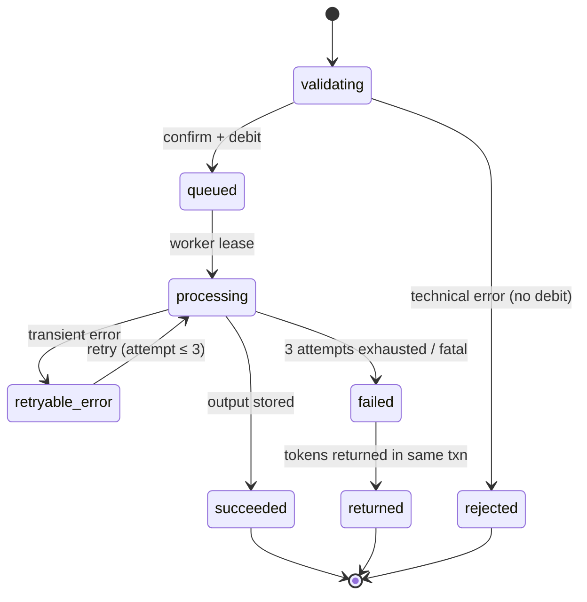
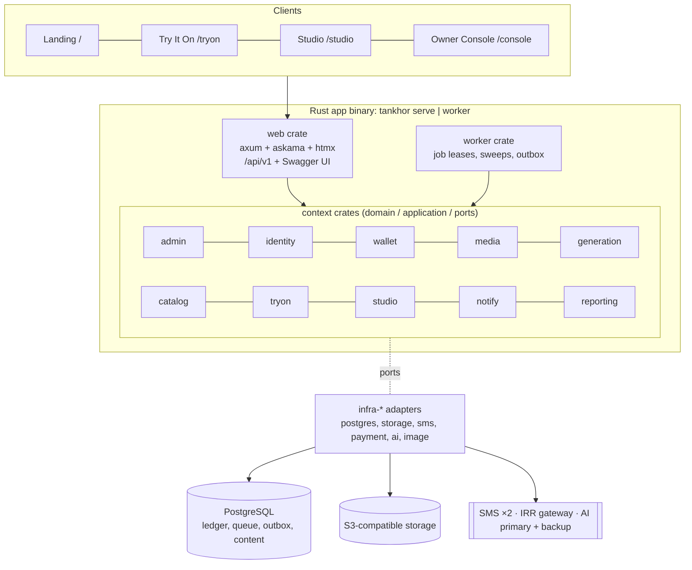

# Tankhor — Technical Specification

**Version 4.1.1 (final) · 5 November 2026 · Ali Shokoohi**

## 0. Document control

This is the final English engineering specification for **Tankhor** (تن‌خور). It translates the Persian *Tankhor Comprehensive Product Specification v3.0* (2 Nov 2026), itself reconciled with `Tan_Full_Design_Specification_v3(1).docx`, and merges all 41 product decisions taken on 3 Nov 2026. No decision is left open; every former "open" item now states its approved rule and points to its Q ID.

| Item | Value |
| --- | --- |
| Source | Tankhor Comprehensive Product Specification v3.0 (Persian), 2 Nov 2026 |
| Upstream authority | Word spec v3; owner decisions of 3 Nov 2026 (§16) override earlier open items |
| Product name | **Tankhor** (تن‌خور), final (Q38, Revised 2026-11-04, owner). Buyer surface: **Try It On** («یه تن بزن»). Seller surface: **Tankhor Studio** («استودیو تن‌خور») |
| Product name (superseded) | **Tankhor** (تنخور), final (Q38, revised 3 Nov 2026 after the brand review; previously تنه / Taneh). Buyer surface: **Try It On** («یه تن بزن»). Seller surface: **Tankhor Studio** («استودیو تنخور») |
| Brand reference | `brand-review.html` (2 Nov 2026 draft, written under the working name تنه). Its strategy, voice, messaging, logo and contrast findings are applied in §12; where it shows Q02, Q03, Q04, Q30 or Q38 as open, §16 wins | <!-- superseded -->
| Primary market | Iran; IRR payments via domestic gateways |
| Audience | Backend, frontend, AI/ML, QA, DevOps, design and product |

**Normative language.** MUST / MUST NOT / SHOULD / MAY follow RFC 2119. *Proposed* marks a design value that still needs visual sign-off on real samples (tokens, motion timings). A feature listed as "built but off" MUST be fully implemented, wired and tested, then shipped disabled behind a flag.

**ID scheme (kept from source for traceability).**

| Prefix | Meaning | Range |
| --- | --- | --- |
| P | Page / screen / module | P01–P49 |
| F | End-to-end user flow | F01–F31 |
| U | User story with acceptance criteria | U01–U55 |
| Q | Product decision (all decided) | Q01–Q41 |
| R | Requirement | R01–R177 |
| W | Mapping to Word source sections | W01–W60 |
| L | Ledger invariant | L1–L9 |

**Section 18 is non-normative.** It holds the Rust implementation recommendations (detailed in `tankhor-rust-implementation-pack.md`); anything there that conflicts with §0–§17 loses.

**Revision 4.1 (3 Nov 2026).** Product renamed تنخور / Tankhor (Q38). Brand review applied: brand architecture and logo brief (§12.1), `borderStrong` and `onCurtain` tokens with measured contrast (§12.2), curtain states (§12.4), non-text contrast (§12.6), naming, claim and AI-notice rules plus new copy keys (§12.7). <!-- superseded -->

**Revision 4.1.1 (2026-11-05).** §8.1 new: P41 settings bounds, upload-format rule and lowering rules (owner bounds 2026-11-04; recovery-window rule 2026-11-05). §12.2: one source for all visual identity values and automatic WCAG 2.2 AA text/background contrast check. §12.4: reduced-motion stills as SVG (Q04). §12.7: «تن‌خور» only as the brand name; no emoji in finance, consent, deletion and error copy. §12.8: brand book path `docs/brand/brandbook.html`. §16 Q04: formats (logo and reduced-motion stills SVG, motion Lottie). P39: `\|` escaped in the table row.

**Sign-off still required outside engineering:** Q11 (token forfeiture at account deletion) needs legal review; Q24 (revenue recognition) needs accounting review. Both are decided by the owner and implemented as stated unless those reviews change them.

## 1. Product overview

Tankhor is an AI fashion platform with two surfaces on one account and one token wallet: **Try It On** renders real brand garments onto a buyer's own photo, and **Tankhor Studio** turns a seller's product photos into ad images and videos using curated models and styles. An **Owner Console** controls content, quality, cost, publishing and operations for both.

### 1.1 Goals

- Buyer: shortest path from seeing a garment to seeing it on one's own photo; keep, compare, then leave to the retailer to buy.
- Seller: produce usable product content without a photographer or live model per shoot, with minimal re-uploading.
- Owner: full control of content, pricing, AI providers, rollout and recovery without touching code or storage directly.

### 1.2 Non-goals and hard constraints

- Tankhor is **not a store**. No product price, fabric, commercial ranking, or price/quality comparison is shown.
- A try-on result is an AI-generated image. It MUST NOT be presented as a size or fit guarantee.
- A purchase click is not proof of purchase; generating content is not proof of increased sales. Success metrics MUST rely on flow completion, reuse and real behaviour.
- Each account has at most **one** store profile. Studio does not need a second account.
- Payment is IRR via domestic gateways. IRR buys tokens; operations spend tokens. No direct per-project payment.
- One try-on request applies exactly **one** garment (Q39).

### 1.3 Differentiators (design basis, not market claims)

| Differentiator | Concrete behaviour | Proposed measure |
| --- | --- | --- |
| Discovery before sign-up | Public image-first gallery before registration | Gallery → detail → try-on start |
| Simple try-on start | One personal photo, no body measurements | Request completion after garment selection |
| Visual comparison | 1–3 results side by side, each with its own store link | Compare usage and store referrals |
| Two-sided link | Approved Studio output can be published in Tankhor | Approved content usable in gallery |
| Shared identity and economy | One account and balance for buyer and Studio | Same account using both surfaces |
| Visual Studio assembly | Two-step build, card duplication, per-card product or colour | Prep time, project reuse |
| Work continuity | Generation continues after exit; inputs survive login or top-up | Correct recovery of result or assembly |
| Brand signature | Dark velvet-brown curtain, independent reveal of each output | State comprehension and brand recall in user tests |

### 1.4 Glossary

| Term | Definition |
| --- | --- |
| Target item | The single garment chosen from a full outfit for try-on |
| Studio style | Ready visual composition: model, pose, photographic/output attributes |
| Studio model | Human persona shown in fashion samples. Not the AI model |
| AI model | External generation engine assigned per capability by an admin |
| Assembly card | One independent instance of a style plus its product slot, output type and settings |
| Try-ons («تن‌زده‌ها») | Gallery of successful buyer try-on outputs |
| Set aside («نشون‌کرده‌ها») | Buyer's garments saved for later, not necessarily tried on (Q30) |
| Studio Saved | Three independent buckets: models, styles, assembled projects |
| Studio Projects | Projects whose generation started: In Production or Completed |
| Auto-draft | Transient unfinished-work state, kept 30 days, separate from manual save and library |
| Share to Tankhor | Request to review and publish one Studio output inside Tankhor |
| Token return | Refunding tokens of a failed operation to the wallet. Not an IRR refund |

### 1.5 Scope status

| Group | Scope |
| --- | --- |
| Buyer, current | Gallery, text search and filters, garment file or allowlisted link in a dedicated space, tag-based related styles, try-on, Try-ons, Set aside, compare, external file share |
| Studio, current | Cinematic landing, model ring and showcase, model/style selection, two-step assembly, image, video and recolour, library, project management, Share |
| Shared infrastructure | SMS-OTP auth, account, wallet, history, language and theme, privacy, Owner Console |
| Built, tested, shipped OFF | Try-on widget and API, percentage rollout, per-user usage limits, ticketing, external notifications (push, SMS, email), paid Share billing |
| Future (buyer) | Multi-store outfit builder; gallery with auto-rotating images |
| Out of current experience | Visual search and similar-image matching, before/after slider, internal messaging or social network, long mandatory photo flow, multi-garment try-on |
| Outside approved commitment | White-label Tankhor, public Studio API, device-management UI, user-selectable AI engine, URL input in Studio assembly, public share links |

Persistent avatar and a three-tab wardrobe were early ideas and are **not** approved. Playing a short per-card video differs from an auto-rotating gallery. Current comparison is not a multi-garment outfit builder. The "built but off" rule does not cover the two items explicitly deferred to the future.

## 2. System context

Three client surfaces share one identity, one wallet and one generation backend on **one domain with path-based routing** (Q01); only the landing page routes between the two user surfaces.

| Surface | Path (example) | Users | Navigation | Voice |
| --- | --- | --- | --- | --- |
| Landing (P01) | `/` | Anonymous and signed-in | Two entry tiles: Try It On, Studio | Neutral, image-led |
| Try It On (P03–P13, P45, P46) | `/tryon` | Buyers | Buyer dashboard (P12) | Warm, informal "tu" |
| Tankhor Studio (P15–P24, P47–P49) | `/studio` | Sellers | One shared Studio sidebar (P49) | Professional "shoma" |
| Shared (P02, P14, P25, P26, P27, P29) | `/account`, `/wallet` | All | Reached from either surface | Neutral; hints follow origin surface |
| Owner Console (P30–P44) | `/console` | Admins | Separate secure app | Plain administrative |

Exact path names are an implementation choice; the one-host rule is fixed.

**Routing rules.**

- Try It On MUST NOT contain a direct link or shortcut to Studio (R161). Switching surfaces goes through P01.
- Shared session on one host: signing in on one surface is valid on the other; signing out in a browser ends the shared session for both (R61, R62).
- Deep links to a surface MUST NOT force the intro animation.
- PWA targets: Android Chrome, iOS Safari, desktop Chromium (Q37).

### 2.1 P01 — Landing and path selection

- Hero: logo, fitting-room curtain in **dark velvet brown** (Q02), sky or selected media behind it. Scrolling down draws the curtain aside, reveals the name **Tankhor**, slogan sits above the image. Motion evokes dressing behind a curtain and reopening it. Hero media is chosen in the content panel.
- Below the image: two large rectangular entry tiles, **«یه تن بزن»** (Try It On) and **«استودیو»** (Studio). The first opens the public gallery with a matching transition; the second opens the Studio lobby.
- Then a short scroll: visual intro of both services, footer with contact, email or chosen channel, and mandatory links. Page stays short, image-led, low-text.
- Browsing and path choice need no account. Desktop MAY preview each tile on hover and focus; mobile MUST have an explicit touch control.
- Navigation MUST NOT wait for animation end or video download. Reduced-motion mode conveys the same meaning with a simple state change.
- Logo and Latin wordmark are produced by the owner as SVG; curtain/hand motion as Lottie plus reduced-motion stills as SVG are produced by the in-house designer (Q04).

## 3. Identity, sessions and account

Sign-in is **mobile number + SMS OTP only**; the phone number is the account identity (Q09). Authentication is deferred to the moment of a personal action, and the originating context MUST survive the auth round-trip.

### 3.1 P02 — Sign-in and sign-up with origin preservation

- One form: phone number, then a one-time code. New numbers create an account on first successful verification. No email or password flow at launch.
- The UI MUST show clear errors (invalid number, wrong or expired code), a resend control with countdown, and rate limits on send and verify.
- Recovery is by re-verifying the same phone number. Changing the account phone number requires verifying both the old and the new number, or a support-assisted, audited process when the old number is lost.

**When auth is required.**

| Surface | Public (no auth) | Requires auth |
| --- | --- | --- |
| Try It On | Gallery, detail, filters, search | Starting a try-on (including free campaigns), any personal save |
| Studio | Lobby, model ring, showcase previews | Entering the build flow from any of the three entries (Create Project, ring model, sample project), before P16 or P17 (Q08) |

Viewing samples or previews is not starting a build.

**Origin preservation (R11, R147, R159).** Auth MUST carry the selected garment, origin model or sample project, and the return destination. Success returns to that exact context. Cancel returns to the previous location without clearing the origin selection. Completing buyer profile or store details is a separate, non-blocking step.

**Sessions.**

- One account, one balance across both surfaces; no re-auth or second account (R02, R61).
- Sign-out in one browser ends the shared session (R62).
- Concurrent multi-device sign-in is allowed; a second device MUST NOT evict the first (R64).
- A device-management UI is out of scope (R65).
- Because the phone number is the only identity, two diverging wallets for one person cannot arise from method linking.

### 3.2 P14 — Account settings and deletion

- Settings: language (FA/EN), theme (light, dark, system), account info, privacy management. Buyer progressive profile, store details and shared identity settings are three distinct functions and MUST NOT merge into one long mandatory form.
- **Deletion request** starts a **30-day recovery window** (R26). End date MUST be visible. In-flight jobs finish normally and their results are kept until final deletion (Q10).
- **Restore** within the window by signing in with the same phone number (SMS OTP); the account returns exactly as it was.
- **Remaining tokens** are **forfeited** at final deletion. The confirmation dialog MUST show the current balance and state the forfeit explicitly before the user confirms (Q11). Ledger rows are kept with the person anonymised.
- After the window, personal data is deleted or anonymised; financial records are retained anonymised per data policy. No IRR refund or token cash-out is offered. Q11 is subject to legal review before launch.

## 4. Buyer domain — Try It On

Every try-on request has exactly one target item and one personal photo, is priced and confirmed before it runs, survives the user leaving, and either delivers an output or returns its tokens.

### 4.1 P03 — Public gallery and discovery

- Pinterest/fashion-show style gallery of Iranian models and real Iranian brand garments. Brand intro is secondary; the core action is virtual try-on. Guests can browse, filter, open details.
- **Catalogue sourcing (Q07):** a curated launch set sourced and licensed by the Tankhor team, plus brand self-service through the console and CSV import later. Every garment requires a signed image-use licence before it is public.
- Each style carries structured tags: garment type (shoes, shirt…), style category, model, women/men. Text search plus filters on type, colour, brand, model and style mood. Filters are visible but compact; data managed in the content panel. **No price or fabric filters.**
- Card: main image = full outfit; thumbnail = the try-on-able item. Independent actions: open detail, set aside for later, try on, go to store.
- Primary CTA «یه تن بزن» stays within thumb reach on mobile and desktop throughout browsing without covering the gallery. Upload of an external garment goes through the same CTA into P05.
- Back from detail MUST restore query, filters, category and scroll position. Empty state offers "clear filters"; media error offers retry; video has a poster fallback.
- Day-one event capture: view, click, try-on, store referral. Free brand onboarding does not waive image licensing or store-link validity.

### 4.2 P04 — Style detail and outfit parts

- Large main image plus thumbnails of each outfit part (single item or set: top, trousers, shoes). Tags, style category, model and Iranian store link. The target item MUST be identified by text and image so viewing an outfit never implies selecting all parts.
- Pick or upload a personal photo and start try-on from here. Guests authenticate at the action; style and item persist. A saved reusable photo with valid consent is not asked again but stays swappable. Style can be set aside for later.
- Related styles below, based on shared tags and categories. This is content-driven, not visual search.
- Store link shown only when valid. Multi-part display is fixed; **one garment per try-on request** (Q39): cost and result cover that item only. To try another part, the user starts another request.

### 4.3 P05 — Standalone try-on (Create)

Opened from "+ یه تن بزن". Two required inputs:

| Input | Sources |
| --- | --- |
| Personal photo | New upload, one of up to 5 saved photos, or the default photo |
| Garment | Image file; image or product link from an **allowlisted onboarded store** (Q31); pick from Explore or Set aside |

- A garment already chosen from a card is kept and not re-requested.
- **Link ingestion (Q31):** only hosts on the owner-managed allowlist of onboarded stores are fetched. The fetched image MUST be shown for target confirmation before generation. Non-allowlisted host, invalid link, fetch failure or ambiguous multiple images → clear error plus upload fallback. **Generation MUST NOT start on a guessed garment.** URL input MUST NOT be extended to Studio assembly.
- Person, garment and review are tasks within one short flow, not four mandatory pages. Profile and avatar are not prerequisites. A garment without a store gets no fabricated purchase info.

### 4.4 P06 — Personal photo selection

- One photo is enough. Height, weight, body measurements and multi-angle photos are not prerequisites. Preview and swap before confirm; short non-blocking photo guidance.
- **Upload limits (Q05):** up to **15 MB**; JPEG, PNG, WebP or HEIC; shortest edge **≥ 512 px**. Files outside these limits are rejected with a specific message **before any token is debited**.
- **Quality advice vs technical failure.** Low light, non-ideal pose or low quality MUST NOT block the user. Corrupt file, unsupported format, oversize or truly unprocessable input is a separate technical error. Copy and acceptance criteria MUST distinguish the two.
- **Personal gallery (Q40):** up to **5** saved photos, one marked default. Reuse is instant; a fresh photo is always possible. Adding a sixth requires deleting one.
- Permanent storage needs explicit consent with an AI-processing notice at first upload (Q12); declining keeps the temporary path. **Temporary photo default TTL: 14 days**, owner-configurable.
- A deleted or expired photo is never reused. Picking the default photo is not auto-confirmation of cost. Deleting an input does not delete prior successful outputs.

### 4.5 P07 — Review and confirm

- Shows target item, personal photo, token cost and balance beside the confirm action. Free campaigns show real cost 0 and still require an account. Each request carries its own confirmed price; nothing runs before confirmation.
- Insufficient balance → shortfall + top-up path. After payment the same request returns; payment alone never starts an unconfirmed job. Changed price → fresh confirmation.
- Double-click MUST NOT create duplicate requests or debits. Cancel keeps valid inputs.

### 4.6 P08 — Fitting room and waiting

- Accepted request sits behind the curtain in front of the sky or selected image. Pulling the curtain early: a hand draws it back closed. No mandatory visual text; screen-reader status MUST exist. Animation MUST NOT hide real queue/processing state. **No fake percentages or ETAs.** Reduced-motion keeps the message and the exit.
- User may leave; server work continues. On success an **in-app** notification «بیا یه نظر بده!» deep-links to that result (Q22). If the browser was closed, the result and ready state are found on return. No SMS, push or email at launch.
- Success lands in Try-ons. Failure without a usable output returns that request's tokens immediately after the last retry (Q29); *return pending* and *returned* are distinct states. Retry is a new request with new cost confirmation.
- **Successful but unwanted output (Q13):** no automatic return. The user may contact support; support reviews case by case and MAY return tokens via an audited admin adjustment. A final failure never gets a success notification.

### 4.7 P09 — Result view

- Large image with target item, brand, date, available purchase info. AI-generated notice and no-fit-guarantee disclosure (copy key `ai_notice`, §12.7), proportionate and not covering the image.
- Actions: zoom, Download, Regenerate, Change Outfit, Compare, Share, Delete, back to Explore, and Go to store when a valid destination exists.
    - Regenerate keeps the inputs for a new cost confirmation.
    - Change Outfit keeps a valid personal photo and opens garment selection; an expired photo requires a new pick. Prior output is not deleted.
- No before/after slider.
- Success auto-saves to Try-ons; no extra save step, no new wardrobe. Setting the garment aside is the independent P45 action. Deleting a result MUST NOT delete the personal photo or set-aside item.
- **External share is file only (Q14):** Web Share API with the image file where supported, download as fallback; Telegram, WhatsApp, email are example targets. **No public link** is ever created. No inbox, contacts or internal social network.

### 4.8 P10 — Try-ons gallery

- Image-first gallery of all successful try-ons; persists until user deletes. No promotional subtitle under the heading; accessible name is kept. Set-aside-only items are not members.
- Actions: open, download, file share, delete, select for compare, go to store (if purchasable). In-flight or failed jobs, if shown, are separated from successes. Empty state links to discover or create. Paging and back preserve scroll and compare selection.

### 4.9 P11 — Comparison

- 1 to 3 results, from different stores allowed. Each image shows its own garment and store; each store link belongs to its own result. Selecting a 4th shows a limit message and keeps the previous 3.
- **Purely visual.** No price, fabric, commercial quality, store rating or shopping comparison. Removing from compare does not delete the result. Mobile MUST reach every selection via scroll or tabs. Consistent framing helps but MUST NOT distort the garment or imply size. Reachable from result and Try-ons; no duplicate menu.

### 4.10 P45 — Set aside («نشون‌کرده‌ها»)

- Garments saved without necessarily trying them on. UI name: **«نشون‌کرده‌ها»** (EN "Set aside", Q30). Guest save authenticates at the action then saves that garment; repeat saves are idempotent. Stores outfit image, target item, valid brand and store info.
- Open, try on, buy, or remove. Can coexist with a Try-ons result. Removing an item does not delete photos, outputs or store products. Unavailable items show a clear state. Not the same as Studio Saved.

### 4.11 P13 — Personal photos

- Private space to view, pick, swap and delete up to **5** photos and choose the default (Q40). Temporary vs permanent clearly marked; first photo saved only with consent.
- Deleting the default either clears it or asks for an explicit replacement; never a random substitute. Deleting an input never breaks a prior result. A photo deleted mid-generation is kept only as long as the running job needs it, then purged.

### 4.12 P46 — Progressive profile

- Small yellow exclamation badge beside the profile until suggested fields are done; never blocks. Meaning is not colour-only: accessible name "Optional profile completion". No repeated intrusive modal.
- **Fields (Q41): height and weight only**, both optional. They are passed to the try-on provider only if that provider uses them; otherwise collecting them MUST NOT be marketed as a quality improvement. Changes do not alter past results. The base of try-on is a real photo; a persistent avatar is not approved.

### 4.13 P12 — Buyer navigation

Account icon and token balance always visible. Producible-count estimate uses real per-operation pricing; no single fake rate. No Studio link here.

| Entry | Destination | Access |
| --- | --- | --- |
| Explore | Gallery, search, categories, detail | Public |
| + Try It On / Create | Standalone file/link try-on | Run and personal save after auth |
| My Photos | Private gallery (max 5) and default photo | Personal |
| Try-ons | Successful results and compare | Personal |
| Set aside («نشون‌کرده‌ها») | Garments saved for later | Save after auth |
| Profile | Optional height/weight, photo guide | Optional for try-on |
| Account and wallet | Settings, financial history | Personal |
| Help | Usage guide, support path | Guide public; tickets per flag |

Home routes to Explore; visual History routes to Try-ons. One menu per concept. Financial history is separate from image history.

## 5. Studio domain

A Studio build is exactly two steps (select, then assemble) over one shared selection state; each card yields one independent output, priced and debited only on explicit Create confirmation.

### 5.1 P15 — Studio lobby

- Feel of entering a professional fashion design and advertising agency. Top-to-bottom: poster with cinematic media → model ring → showcase of ready projects.
- **Poster:** rotating cinematic videos and images; models walk like a runway. Media is presentational; the model inside the poster video is not a selection target. Muted autoplay, pause control, poster fallback, reduced motion.
- **Model ring:** rotatable carousel of many models. Hover/focus on a model reveals its styles around it; touch, explicit controls and stop provide the same on mobile. Assets may come from Pinterest or other sources **only with usage rights**; naming a source is not a licence.
- **Showcase:** ready sample projects (image + video). Nike, Calvin Klein, Gucci are the Word spec's quality references (Adidas in base version). These names imply no partnership or asset licence. Hover/focus/touch browses a sample's media set.
- **Create Project** is always reachable: small top-corner at first, more prominent on scroll. Account control small but findable. The full work sidebar MUST NOT sit on the cinematic view.

| Build entry | Auth | Destination and initial state |
| --- | --- | --- |
| Create Project | Before entering build | P16, default Styles view, empty selection |
| Model from ring | Before entering build; origin model kept | P16 with **all styles of that model pre-selected**; removable, extendable, clearable (Q34) |
| Ready sample project | Before entering build; sample kept | P17 with the sample's styles and product images; replaceable, removable, Back to P16 |

Picking a ring model costs nothing; pre-selected count and token estimate MUST be visible before continuing.

### 5.2 P16 — Step 1: select styles and models

- Opens on Styles. No interstitial "model or style?" page. Styles view and Models view are two windows onto **one shared selection state**, not two steps.
- Style gallery: image or video, token price, select, save, open detail. **Opening detail is not selecting.** Model gallery: search, filter, open profile; select one, several or all of a model's styles, or save the model alone. Combining independent model and style MUST NOT make output count or cost ambiguous.
- Filters: styles by product type and mood (shoes, clothing, sport, classic, casual, luxury); models by age or age group, gender, skin tone and relevant appearance attributes. Collapsible panel; active removable chips persist after closing. No deep multi-level taxonomy; lists managed in the content panel.
- **Pricing display (Q36):** each style card shows its premium surcharge, if any, on top of the output-type base price. Running total from first selection, live on add/remove. Price MUST NOT depend on hover on mobile.
- Mini summary keeps items and count visible. Projects and Saved reachable from the same dashboard nav. Moving between views, detail, profile and saved keeps selections. **Next** moves valid selections to step 2. No public likes or ratings; views, selections and real usage are tracked internally.
- **Limit (Q15):** at most **50 cards per project**, stated in the summary before the user reaches it.

### 5.3 P47 — Style detail

Larger media, model, style attributes, price. Select-for-project, save style and view model are three separate actions. Opening or closing detail does not change count or cost. Going to the model profile and back keeps shared selection and gallery context.

### 5.4 P48 — Model profile

Browse the model's images and styles. Select one, several or all styles; save the model independently. "Select all" MUST state count and cost impact and MUST NOT duplicate already-selected items (intentional duplication happens in step 2). Entering the profile does not clear other selections.

### 5.5 P17 — Step 2: assembly

Entered from manual selection, from ring selections after P16, or from a sample project, labelled "Step 2 of 2".

- **One card per style instance**, each with one product slot. Empty slot is covered by the velvet curtain; click opens Library or New upload. After assignment the curtain stays open; removing the image closes it. Samples show their product image from the start. Hint: "Assign the product image to this style".
- **Output type per card (Q18):** each card picks **image** or **video**; **recolour** is a separately priced add-on on that card. Card price = output-type base price + style premium + recolour add-on if used.
- Distinct operations: replace image, remove image only, delete whole card with its assignment, duplicate. Removing an assignment or card never deletes the library file. Small per-card menu; every action named with clear effect.
- **Duplicate** creates a new card with the same model, pose and settings and an **empty** image slot, up to the 50-card project limit (Q15). Five or six different garments on one style is valid. One upload can be assigned deliberately to several copies with different exact colours (value + visible swatch) — e.g. one upload, five outputs, five colours. A temporary project file is reusable until its TTL, independent of permanent storage.
- **Back** goes to P16 preserving images, colours, copies and selections; add/remove styles and return to see compatible assignments. **Undo** reverts at least the last edit on this page (remove image, delete card with assignment, replace image). Undo is not navigation; multi-level history is not committed. Removing a step-1 selection that affects a filled card MUST have an understandable effect.
- Token total always visible: duplicate increases, delete decreases. Manual save moves the assembly to Saved → Projects tab. Leaving without saving keeps an **auto-draft for 30 days from last activity** (Q32). Draft expiry never deletes the library or manual saves.
- **Create:** if any card has no product image, **Create is disabled** and empty cards are highlighted until each is filled or removed (Q33). With all cards ready: confirmation dialog with output count, total tokens, balance, plus optional prompt "Would you like to add another style?" (two clear paths: extend or confirm). Sufficient balance + confirm → token debit and generation start. Shortfall → top-up → back to the exact page and state; confirmation still required. **No direct project payment.** After confirm, a separate generation page opens; there is no step 3.

### 5.6 P18 — Product input: library or upload

- Two inputs only: Choose from library, Upload new image. **No URL input in Studio.** Same upload limits as buyers: 15 MB, JPEG/PNG/WebP/HEIC, ≥ 512 px (Q05). Preview before applying; cancel or upload error never replaces a valid previous image. Assignment belongs to one card; unassigning is not deleting the file.
- Sellers can preload all store product images and find them by structured apparel categories and tags. Setting **"Save all uploaded photos" is ON by default** (Q06): new project uploads join the permanent library. When the seller turns it off, new uploads are temporary and purged **30 days** after upload.
- One upload is reusable across the project and its copies. Storing is not publishing. Sample products stay sample assets and never become the seller's product. If a file used in a saved assembly expires, state and re-upload need are shown; prior outputs survive.

### 5.7 P19 — Generation and reveal

- After confirm, the same cards continue on a page outside the two build steps. The curtain now covers the output in production. Each card has its own queued, processing, ready or final-error state.
- Clicking an unfinished curtain opens it slightly, flashes the Tankhor logo/animation, then a hand closes it. Optional text: "Generating output" (professional voice). Accessible status always present. No fake outputs.
- Each ready image or video is revealed and downloadable immediately, not waiting for siblings. Real counter: "3 of 8 outputs ready". User may leave and return via Projects; server work continues. A failed card returns **only its own** tokens immediately after its last retry (Q29); successes stay.
- **Notifications (Q22):** in-app only at launch — one event per ready output and one final event when all cards are final. If any card failed, the final event reports the split ("6 ready, 2 failed, tokens returned"), never "all ready". Download and Share are available here.

### 5.8 P49 — Studio dashboard and sidebar

One dashboard and one sidebar connect Projects, Saved, Library, Wallet and Account; direct entries to In Production and Completed. Workspace access is explicit; on the landing it is subtle. No second dashboard for top-up or saves. Navigation preserves selections, images and return target. Mobile collapsible nav has the same destinations. Not merged with the buyer dashboard or Owner Console.

### 5.9 P20 — My Projects

- Exactly two groups: **In Production** and **Completed**, switchable in-page. In-production opens that project's processing page. Detail shows outputs, per-card state, download, token debit and return, publish requests. Outputs browsable by project, model or style; opening a project shows only its outputs. Generated media is categorised and tagged. All outputs persist; turning off input storage never deletes them. Drafts and Saved are not a third tab.
- **Failed projects (Q16):** once every card is final, the project moves to **Completed** with a result summary (ready, failed, tokens returned). A project with zero successful outputs is visibly flagged as failed inside Completed.
- **Output spec (Q17):** images **2048 px** on the long edge, WebP or JPEG; video **MP4, 1080p, max 10 s**; **no watermark**. Outputs are for external use (Instagram, store site, ads).

### 5.10 P21 — Saved

Independent section with three tabs: **Models**, **Styles**, **Assembled projects**. A model saves without style or project; a style saves alone; a project restores models, styles and assigned images and is not necessarily generated. Saved model/style opens selection or detail; saved assembly resumes in step 2. Removing a save never silently deletes a generated project or library file. Disabled or deleted references show clear state and a replacement choice; generation MUST NOT start with an invalid reference.

### 5.11 P22 — Product library and image retention

- Bulk or gradual upload of all store products ahead of time. Structured apparel categories and tags (women, men, shoes, clothing, style); product type, in-stock/out-of-stock and related tags. Unlimited, unrelated categories are not required.
- Setting **"Save all uploaded photos"** (default ON, Q06): on → successful uploads kept for reuse; off → project inputs kept 30 days then purged. Turning the setting off affects only uploads made afterwards; files already in the library stay. Intentionally added library images are stored assets.
- Add, edit metadata, assign to card, delete — each a clear action. Draft expiry, card or assignment deletion never delete permanent library files. Input deletion or expiry never breaks prior outputs. Continuing an assembly with an expired temporary input requires replacement, shown before generation.

### 5.12 P23 — Account and store profile

Identity, store and settings from the same dashboard. Professional profile: store name, store link, related info. Token balance visible. One store per account; no second account for Studio. Store details are **not** required to start a project; completion badge is small and unobtrusive. **Publishing a Share requires store name + a valid store link (Q19)**, checked at review; ownership proof is not required at launch.

### 5.13 P24 — Share to Tankhor

- Submit one specific image or video for review and publication on the platform, either immediately from a ready output or later from a completed project. Selecting one output never publishes the whole project. Publication only after admin approval.
- Active and **free** at launch; paid infrastructure built and OFF. States: not submitted, pending review, approved, rejected, withdrawn — not added to Projects groups. Distinct from buyer external share.
- Cancel before publication MUST prevent publication of that request. **Withdrawal after publication hides the output from all public display immediately** (Q35). Copies already downloaded by others are outside Tankhor's control; the withdrawal UI MUST say so. Target item, store and image licence are checked before public display.

## 6. Wallet, payments and token ledger

One token wallet per account; IRR only ever buys tokens, tokens only ever pay for operations, and every balance change is an immutable, idempotent ledger event.

### 6.1 P25 — Balance and top-up

- Tokens bought on either surface pay for buyer try-on, Studio image, video and recolour. **Pricing model (Q36):** a flat base price per output type (try-on, Studio image, Studio video, recolour add-on) plus an optional premium surcharge per style, all owner-set and versioned. Cost is shown before every confirmation. **Batch generation earns no separate discount** (R68).
- Top-up via preset packs or custom amount. Bulk-purchase discount tiers apply only to buying more tokens. IRR amount and token count are always shown separately with units.
- **Payment state machine:** `succeeded`, `failed`, `cancelled`, `unknown` are distinct. Balance increases **only after server-side gateway verification**. `unknown` MUST be queried (reconciled) and MUST NOT push the user into a second unintended purchase. Repeated verification of one payment MUST credit once.
- After top-up, the same request or assembly returns; a changed price needs fresh confirmation; valid inputs persist.

### 6.2 P26 — Financial history and usage

- Every IRR purchase, token credit, debit, return and admin adjustment is traceable with time, amount, status and a reference to its request or card. IRR and tokens never mix in one column.
- A token return is not an IRR refund. Token cash-out is not offered. Users never see other accounts, provider keys or confidential provider costs.
- Duplicate requests, provider auto-retries and duplicate callbacks MUST NOT create double debits or double returns.
- Failed try-on → return that request's cost. Partial Studio failure → return only failed cards' cost. Returns are posted **immediately** after the final failed attempt, in the same transaction that marks the unit failed (Q29). A definitive "returned" message appears only after the return is recorded.
- Successful but unwanted outputs follow the support-review rule in §4.6 (Q13).

### 6.3 Ledger invariants

| ID | Invariant |
| --- | --- |
| L1 | Balance is derived from valid ledger events; a cached balance MUST equal the sum of events |
| L2 | Ledger events are append-only. Corrections are new compensating events with reason and actor; history is never edited |
| L3 | Balance MUST NOT go negative |
| L4 | One payment order produces at most one credit, regardless of callback or verification repeats |
| L5 | One confirmed operation (request or card) produces at most one debit and at most one return |
| L6 | Debit and job enqueue are recorded in one transaction: no charged job without a durable job, no durable job without its charge |
| L7 | Provider retries are internal and never charge the user again |
| L8 | Freeze (block) preserves balance and rejects new spend |
| L9 | Simulations (admin preview) never write real ledger events |

**Quote snapshot.** Each confirmed operation stores the price version, the output-type base price, the style premium and any add-on it was confirmed at, so later price changes never alter what the user agreed to.

## 7. Generation pipeline

Generation is a server-side, durable, per-unit job (one try-on request or one Studio card) whose success is accepted only on delivered output and whose failure returns exactly that unit's tokens.

### 7.1 Lifecycle

1. **Pre-acceptance:** validate input (Q05 limits), permission and price. Technical rejections happen here, before any debit.
2. **Confirm:** user confirms the quoted price. Debit event, job row and outbox message are written in one transaction (L6).
3. **Process:** worker records attempts, provider used and output. Transient errors retry internally, **up to 3 attempts** total, at no user cost (L7). On provider outage the router fails over to the capability's **one backup provider** (Q25).
4. **Finalize:** success only after the output is stored. After the last failed attempt the unit is marked `failed` and its return is posted in the same transaction (Q29, L5).
5. **Notify:** in-app event linked to the exact result (buyer) or card and project (Studio).

| Internal state | Meaning | User-visible |
| --- | --- | --- |
| `validating` | Input, permission and price checks | Before confirm |
| `queued` | Durable, charged, waiting | Queued |
| `processing` | Attempt in progress with a provider | Processing |
| `retryable_error` | Transient failure; attempt count < 3 | Still processing |
| `succeeded` | Output stored and linked | Ready |
| `failed` | Final failure, no usable output | Failed + return state |

Technical rejection happens before confirm, so it never touches the ledger; every path after confirm ends in either a stored output or exactly one recorded return. On retry by the user after failure, they see the previous charge's returned status and the new cost.

### 7.2 Notifications (P29)

- **In-app only at launch (Q22).** Push, SMS and email are built, tested and OFF; enabling them needs a delivery contract and explicit opt-in. Installing the PWA grants no send permission.
- Buyer: «بیا یه نظر بده!» on ready, deep-linking to that result; recoverable after return.
- Studio: one event per ready output and one final event; partial failure is reported with its split, never as "all ready".
- Help content is public. Ticketing is built and tested, OFF at launch; no dead controls are shown. Turning channels off never halts internal generation state or result access.

### 7.3 P27 — Maintenance, emergency stop and access restrictions

- Status messages state which part is unavailable and what is still possible. Try It On and Studio maintenance are independent (R90).
- **Emergency stop (Q20):** blocks new generation immediately; jobs already running finish normally and are delivered or returned as usual. Stopping new work never blocks access to prior outputs.
- A blocked account keeps its balance and cannot spend (R84). Reopen time shown only if known. Public banners publish on owner decision.

## 8. Owner Console

Nothing an admin saves goes live directly: every content, design, price or ops change passes draft → preview → approval → publish → version, and every admin action is attributed and auditable.

All admins currently hold equal, full permissions; each admin's identity and activity are logged separately. For non-visual changes, an impact preview or simulation replaces page preview.

| ID | Module | Requirements |
| --- | --- | --- |
| P30 | Secure admin sign-in | Base auth + **mandatory second factor: passkey (WebAuthn), TOTP as fallback** (Q23). Console never opens without it. A locked-out admin is recovered by another admin; every recovery and admin addition is audited. Not extended to end users |
| P31 | Overview and reports | Users, IRR revenue, token purchase and spend, AI cost, errors, returns, estimated profit, usage trends — live from day one. **Revenue is recognised at token spend; unspent tokens are reported as a liability; AI cost is converted at invoice-date FX** (Q24, accounting sign-off pending). Every metric has a definition, window, refresh time and lineage. Buyer view/click/try-on/buy-click tied to garment and brand. Studio model/style view, detail open, selection, real project use kept separate. Data collection does not imply an auto-ranking algorithm |
| P32 | Users and private images | Inspect account, linked store, projects, ledger. Temporary block and permanent deactivation are separate actions. Block keeps balance, stops spend; balance adjustments only as separate events with reason and audit. **Private photos and try-on outputs are viewable only when tied to a user report or support ticket**, scoped to that case and logged (Q12). This never makes files public |
| P33 | Stores | One store per account; profile, status, related content. Incomplete profile never blocks normal projects. Publishing requires store name + valid link (Q19). Free brand onboarding in the buyer gallery is independent from free Studio Share. Maintains the **link-ingestion allowlist** of onboarded store hosts (Q31) |
| P34 | Media and projects | Files, requests and output cards tracked by owner, type, state, TTL, private/public. Per-card error and token return visible. Viewing in console never publishes. Delete, fix or re-run shows dependency and cost impact before confirmation. Admin re-run or token return for disputed outputs is a support action with audit (Q13) |
| P35 | Publication review | Each image/video reviewed with output, target item, store, licences. Approve/reject per output. Cancelled-before-publish never goes public; withdrawal after publish hides immediately (Q35). Understandable rejection reason, history kept. Queue separate from generation |
| P36 | Finance and pricing | Packs, custom purchase, base price per output type, per-style premiums, recolour add-on, bulk-purchase discount tiers, payment/token/return/adjustment ledgers (Q36). Simulations never change real balances. Price changes are versioned; confirmed requests keep their quoted price. Adjustments are independent, reasoned, approved and never erase history |
| P37 | AI management | Try-on, Studio image, video and recolour each have their own primary and **one backup** provider. Providers are external; OpenRouter or similar is an example; real capability of each integration MUST be tested. Only admins choose engines. **Auto-fallback ON at launch** (Q25). API cost cap, monitoring, alerting and automatic stop ready from day one. Connection and fallback tests MUST NOT double-charge or double-generate. Full keys never appear in UI or logs |
| P38 | Content and pages | Text, images, video, section order, cards, menus, models, styles, token tariffs and bilingual content managed without code. Draft then preview of that same version. Hiding a section shows user-path dependencies. Owner never needs the repo or raw storage for daily ops |
| P39 | Bulk content import | Hundreds or thousands of files plus **CSV files** (Q26): one CSV per entity (styles, models, garments, relations) and a media archive. UTF-8 with BOM (so Persian survives Excel editing), stable IDs, FA/EN names, file references; relations as `\|`-separated ID lists. Missing file, duplicate ID, invalid relation → fixable per-row errors before publish. Upload completion is not publication; an import result report is required |
| P40 | Language, theme, design | Translations, direction, colours, components, media, animation managed here. Preview covers mobile, tablet, desktop, both languages and display modes. Missing translations visible and subject to publish policy |
| P41 | Settings and feature flags | Retention defaults (14-day buyer temp photo, 30-day Studio temp upload, 30-day draft), campaigns and gifts, usage caps and other tunables live outside code. Each setting has unit, value, allowed range, effective time and history; owner bounds, the upload-format rule and the lowering rules are in §8.1, and no setting is unbounded. Shortening a TTL never triggers an ambiguous mass delete without published policy. Built-but-off features have an enable switch, impact preview and health check. Security and financial integrity cannot be bypassed by settings |
| P42 | Publishing and versions | Shared cycle: save draft, preview, admin approval, publish now or scheduled, version, rollback. Approval binds to that exact version. Financial/ops preview creates no real transaction. Rollback is a new event. Percentage rollout fully built and tested, OFF at launch, with stable audience assignment. Urgent actions (block, adjust, stop) still get impact preview and proportionate approval |
| P43 | Operations and recovery | Monitor queue, service health, cost, errors, backups. **RPO 1 hour, RTO 4 hours; daily full backup plus continuous WAL for point-in-time recovery; backups retained 30 days** (Q27). Real restore tests recorded. Emergency stop per Q20; independent maintenance per product |
| P44 | Audit and support | Admin activity, private-image views (with linked report/ticket), blocks, financial adjustments, AI changes, publishing and restores are searchable and attributed. Tickets have full flows once enabled. Turning off optional user notifications never silences mandatory owner alerts. Audit and sensitive data are protected |

### 8.1 P41 — Settings bounds and lowering rules

**Configurable settings: defaults and owner bounds** (owner bounds 2026-11-04). Every configurable setting has a minimum and a maximum; no setting has "no upper bound".

| Setting | Default | Min | Max | Decision source |
| --- | --- | --- | --- | --- |
| Buyer temporary photo lifetime | 14 days | 1 day | 30 days | R15; owner bounds 2026-11-04 |
| Studio temporary upload lifetime | 30 days | 7 days | 90 days | Q06; owner bounds 2026-11-04 |
| Studio auto-draft lifetime | 30 days | 1 day | 90 days | Q32; owner bounds 2026-11-04 |
| Account deletion recovery window | 30 days | 14 days | 90 days | R26; owner bounds 2026-11-04 |
| Cards per project | 50 | 1 | 100 | Q15; owner bounds 2026-11-04 |
| Permanent buyer photos | 5 | 1 | 10 | Q40; owner bounds 2026-11-04 |
| Upload size | 15 MB | 1 MB | 25 MB | Q05; owner bounds 2026-11-04 |
| Minimum shortest edge | 512 px | 256 px | 1024 px | Q05; owner bounds 2026-11-04 |
| Generation attempt limit | 3 | 1 | 3 | Q29; owner bounds 2026-11-04 |

**Upload formats** (Q05; owner bounds 2026-11-04). The allowed set is exactly JPEG, PNG, WebP and HEIC. An admin may enable any subset; JPEG is always enabled; at least one format is enabled; no other format can be added through settings.

**Lowering a setting** (owner bounds 2026-11-04)

| Setting group | Rule when the value is lowered |
| --- | --- |
| Lifetimes (buyer temporary photo, Studio temporary upload, Studio auto-draft) | The impact is previewed before publishing. Each item's lifetime is counted from its original start (upload or last activity), never from publication. Items past the new limit are purged at the next sweep, only after the change is published. |
| Account deletion recovery window | The impact is previewed before publishing. A lower window applies only to deletion requests made after the change is published; accounts already pending deletion keep the end date they were shown. |
| Cards per project | Existing drafts and saved projects above the limit stay intact; they cannot add cards and cannot be created until they are at or below the limit. Confirmed projects are unaffected. |
| Permanent buyer photos | Users above the limit keep their photos and cannot add another permanent photo until they are below the limit. |
| Upload size, formats, minimum shortest edge | Apply to new uploads only; stored files are never re-validated. |
| Generation attempt limit | Applies to units queued after the change is published; units already processing keep their starting limit. |

## 9. Architecture and conceptual data model

The architecture MUST cover central auth and wallet, secure file storage, a durable image/video queue, concurrency, error and retry handling, consistent financial returns, swappable AI providers, versioned content and settings, reporting and recovery. PostgreSQL, S3-compatible object storage and a CDN are **proposed**, not mandated.

**Capacity (Q28).** Launch load tests target **1,000 generations/day**, tested at 2× that rate with realistic image/video mix. The design path still scales toward the ~1 million-user growth target (R98) by adding workers and provider quota; no capacity claim beyond tested numbers.

| Entity | Relations and key data | Rule |
| --- | --- | --- |
| Account, Session | Phone-number identity; auth sessions | Shared access to both products; sign-out ends the unified session |
| StoreProfile | Belongs to Account | At most one per account |
| Wallet, TokenLedgerEvent | One wallet per account; balance-change events | Balance derived from valid events; corrections are separate events |
| PaymentOrder | IRR amount, tokens, state, gateway reference | Repeated verification of one order credits once |
| PriceVersion | Base price per output type, style premiums, recolour add-on, discount tiers | Immutable once published; quotes reference it |
| MediaAsset | Owner, type, secure location, TTL, state | Private and public separate; deletion respects dependencies |
| PersonalPhoto | Account, consent, temp/permanent, default flag | Max 5 permanent per account; one default |
| TryOnRequest | Target item, personal photo, price snapshot, generation job | One garment; output independent of photo lifetime |
| Style, Model, Campaign | Version, category, relations, premium | Valid, previewable selections |
| StudioProject, AssemblyCard | Project has ≤ 50 cards; card has output type, recolour flag, product image | One card = one output; duplicate copies model, pose, settings with empty image |
| StudioSelectionState | Style and model views and shared details | Viewing detail is not selecting; back preserves selections |
| Draft | Assembly data and last activity | Purged 30 days after last activity; independent of manual save |
| StudioSaved | Type: style, model or assembly | Independent of generated projects and drafts |
| SetAsideItem (buyer) | Account, target item, saved-at | Independent of Try-ons and Studio Saved |
| BuyerProfile | Optional height and weight | Optional; never a generation prerequisite |
| ReadyNotification | Account, request or card, result, read state | Click opens that result; recoverable after return |
| DiscoveryEvent | View, click, try-on requested/succeeded, buy click | Photos and body data never enter behaviour analytics |
| GenerationJob | State, provider, attempts (≤ 3), output | Safe retries; no double debit or double return |
| PublishRequest | Output, store, review, state | Admin approval before public; withdrawal hides immediately |
| AllowedHost | Store host for buyer link ingestion | Managed in P33 |
| ContentVersion, SettingVersion | Draft, preview, approval, publish time | Revertible with history |
| AuditEvent | Actor, action, subject, time, reason, linked ticket | Traceable and protected |

## 10. Retention, deletion and security

Inputs and outputs hold independent references, so deleting or expiring an input never breaks a successful output.

### 10.1 Retention rules

| Data | Rule |
| --- | --- |
| Buyer temporary photo | 14 days by default, owner-configurable; deletion independent of result |
| Buyer permanent photo | Stored with consent; max 5; manageable and deletable |
| Successful try-on result | Kept in Try-ons until user deletes |
| Studio product library | Permanent stored asset, independent of draft lifetime |
| New Studio upload | "Save all uploads" ON (default) → library; OFF → purged 30 days after upload (Q06) |
| Saved assembly | Manual save, independent of auto-draft and generated work |
| Studio auto-draft | Purged 30 days after last activity (Q32) |
| Account deletion request | 30-day recovery; jobs finish; then personal data deleted or anonymised, tokens forfeited (Q10, Q11) |
| Studio output | All generated outputs stay in gallery; deliberate deletion and account deletion policies are separate |
| Backups | Retained 30 days (Q27) |
| Financial records, logs | Retained anonymised per approved data policy |

Configurable lifetimes and the account deletion recovery window have owner bounds and lowering rules in §8.1.

Deletion policy MUST cover caches, backups (purged as they age out) and external providers. Financial retention and personal-identity deletion are separated.

### 10.2 Security requirements

- Authorization for every file and request is enforced **server-side**.
- Private files have no permanent public URL (short-lived signed URLs only).
- Gateway, SMS and AI keys never reach the UI or logs.
- Admin views of private media require a linked report or ticket and are logged with identity, time and scope (Q12).
- Data sent to external services is minimised to what the operation needs; each provider's policy is reviewed before integration.
- Real file type, CSV input and file names are never trusted; images are re-encoded and stripped of metadata on ingest.
- Buyer link ingestion fetches only allowlisted hosts (Q31), in an isolated worker with size and redirect caps.
- SMS OTP send and verify are rate-limited per number and per IP; codes expire and are single-use.
- Admins require passkey or TOTP second factor (Q23).

## 11. External integrations

The try-on widget and API ship fully built but disabled; the PWA is required but promises neither offline generation nor push permission.

### 11.1 P28 — Try-on widget and API for stores

- After activation, an external store can embed Try It On on a product page so a shopper tries that garment on their own photo. Built, wired and tested from the start; OFF at launch.
- **The shopper pays from their own Tankhor wallet (Q21)** and therefore signs in to Tankhor with SMS OTP. Because third-party cookies inside iframes are unreliable (Safari ITP, Chrome storage partitioning), sign-in MUST use a popup or top-level redirect flow, never an iframe-only session.
- Store side: credentials, allowed domains, and the garment reference passed to the widget. Stores pay nothing per try-on at launch.
- Does **not** create white-label Tankhor or a public Studio API (R97).
- A sample store MUST demonstrate the full flow (including popup sign-in and top-up) and the OFF state in tests.

### 11.2 AI providers

See P37. Per-capability primary + one backup provider, admin-only selection, auto-fallback ON, API cost cap with alert and automatic stop, keys never exposed.

### 11.3 PWA and connectivity

- The site, including Studio pages, is installable as a PWA on **Android Chrome, iOS Safari and desktop Chromium** (Q37). Install, reopen and account/work recovery are verified on each. Firefox works as a normal website. Web use never requires install.
- Generation runs server-side. Install does not imply offline generation or notification permission.
- Lost connectivity MUST NOT show a purchase or generation as successful. Network state, a way back and work recovery are understandable.
- FA and EN pages, both themes, reduced motion, touch and keyboard work without dropping core capability.

## 12. Frontend specification

Both surfaces share one design system, two languages (FA, EN) and three themes (light, dark, system) from day one, including the Owner Console; they differ only in voice.

### 12.1 Visual language

- Base direction: **dark velvet brown curtain** (Q02) + natural sky blue. Brown takes roughly 10% of visual space (curtain, emphasis, signature details) — a composition guide, not a pixel budget. The dominant background stays airy and legible.
- Glass / Liquid Glass only on controlled surfaces (controls over images, floating toolbars). Forms, financial tables and long text sit on stable backgrounds. Without support or with reduced transparency, fall back to opaque surfaces. Garment images keep true colour and detail.
- Apple HIG and Material Design are interaction references; Tankhor keeps its own identity.
- **Brand architecture (branded house).** One parent mark and wordmark, تن‌خور / Tankhor. Try It On and Tankhor Studio share the mark, type, colour, curtain and icon rules; they differ by voice, composition and media (airy discovery imagery for Try It On, precise editorial framing and cinematic media for Studio), never by separate logos. Wallet, account and Owner Console use the parent brand; the console applies the same system with less decoration and more emphasis on data and state.
- **Logo brief (Q04, in-house designer).** Recommended starting direction **A — curtain gap**: two simple masses opening a space, a standalone symbol plus FA/EN wordmark, the same logic continuing in the curtain motion. Alternatives: **B** Persian wordmark-led, **C** open presentation frame. The owner picks the direction before production. Avoid generic hangers, AI sparkles, idealised bodies, cliché cameras, ornate traditional seals and anything resembling a reference service's mark (Photoroom, FASHN, Botika were studied as references only). <!-- superseded -->
- **Logo brief (Q04, owner).** The owner designs the logo and wordmark; all nine assistant concepts are inactive. Final logo acceptance below remains unchanged.
- **Logo acceptance.** Symbol rendered at 16, 32, 64 and 512 px; wordmark tested separately at its real minimum size; mono black, reversed and colour on both themes. The Persian wordmark keeps correct joins and every dot legible at small sizes (ت, ن, خ; the word breaks after و because و and ر do not join forward). Latin wordmark: **Tankhor**. Final SVG has `viewBox`, `title`/`desc`, text converted to paths, no remote font, no bitmap or complex blur. Clear space and minimum size are measured from the final mark, not set in advance. Logos are never mirrored in RTL.
- **Functional icons.** 24 px canvas, 1.5–2 px stroke.
- **Imagery.** Garment colour and texture are never altered to suit the palette; no global warm filter. Every brand, sample or showcase medium records source, licence, owner/consent, publication scope and AI status; naming a source (e.g. Pinterest) or a reference brand is not a licence.
- Language and theme switches never change selections, assembly, financial data or results. FA: RTL reading and focus order; addresses, IDs and hex codes keep their own direction. Logos and product photos are never mirrored; only directional icons flip.

### 12.2 Design tokens

Palette is the provisional brown baseline (Q02), pending token freeze before closed beta; each text/background pair MUST still pass contrast on real samples before token freeze.

| Token | Light | Dark | Use |
| --- | --- | --- | --- |
| background | #F8FAFC | #101820 | Page |
| surface | #FFFFFF | #18232D | Cards, forms |
| surfaceMuted | #EEF4F8 | #22323F | Secondary surface |
| textPrimary | #18232D | #F1F5F9 | Body text |
| textSecondary | #506273 | #BCCAD6 | Helper text |
| brandVelvet | #4A2F27 | #D6B5A8 | Brand emphasis, curtain details |
| curtainBase | #4A2F27 | #4A2F27 | Curtain texture; text contrast handled separately |
| sky | #BDE4F7 | #274E66 | Blue surfaces, breathing room |
| action | #185B7A | #A7DBF3 | Interactive action |
| onAction | #FFFFFF | #102B3B | Text on action |
| border | #CCD6DF | #506273 | Decorative dividers only; never a control's sole boundary |
| borderControl | #185B7A | #A7DBF3 | Meaningful control boundaries (inputs, toggles, chips); same value as `action` |
| onCurtain | #F1F5F9 | #F1F5F9 | Text and icons on `curtainBase` |
| success | #146C43 | #80D8A6 | Success, always with text/icon |
| warning | #8A4B08 | #F3C278 | Warning, always with text/icon |
| danger | #B42318 | #FFB4AB | Errors and destructive actions |

Light sky is for surfaces; small white text on it is not allowed. Status colour always pairs with text or icon.

**Measured contrast (brand review, 2 Nov 2026).** Opaque flat sRGB pairs, unrounded ratio, WCAG 2.2 formula. Every text pair checked (body, secondary, brand, link, button, sky, curtain and status roles) passes 4.5:1 in both themes (lowest: `textSecondary` on `surfaceMuted`, 5.68:1 light). `onCurtain` on `curtainBase` is 11.10:1. `border` fails the 3:1 non-text threshold (1.47:1 on `surface` and 1.33:1 on `surfaceMuted` light; 2.53:1 and 2.09:1 dark), so it MUST NOT be a control's only visible boundary; `borderControl` passes (7.46:1 light, 10.68:1 dark). White on light `sky` is 1.35:1 and fails. Not covered by this check: photos, velvet texture, opacity, Glass, focus geometry, keyboard and assistive technology; those still need testing on real screens before token freeze.

All visual identity values (colour tokens, type, radii, icon and motion values) come from one source, so a brand change touches only that source. Every text/background pair is checked automatically against WCAG 2.2 AA (≥ 4.5:1, large text ≥ 3:1).

### 12.3 Typography and layout

**Vazirmatn** with its matching Latin, font stack Vazirmatn, Arial, Tahoma, sans-serif (Q03; SIL Open Font License, self-hosted WOFF2). UI text selectable and zoomable. Persian digits in FA prose; Latin digits with isolated direction in URLs, code, IDs. Amounts labelled in **IRR (rial)**; showing toman would need a separate decision.

| Role | Size (proposed) | Weight / line height |
| --- | --- | --- |
| Hero title, desktop | 48 px | 600 / 1.4 |
| Hero title, mobile | 32 px | 600 / 1.4 |
| Section title | 28 / 24 px (large / small screen) | 600 / 1.5 |
| Body | 16 px | 400 / 1.8 (FA) |
| Control | 16 px | 500 / 1.6 |
| Caption | 14 px | 400 / 1.7 |

Spacing scale 4, 8, 12, 16, 24, 32, 48, 64 px. Radii: controls 8 px, panels 16 px; former 24 px radii use 16 px. Primary button height 48 px; general touch target 44×44 px. Test at 360, 768, 1024, 1440 px and widths between.

### 12.4 Motion

Curtain, login logo motion, model ring, campaign cards and playful vectors each need a clear purpose; motion supports state comprehension and never blocks navigation or the gallery. Proposed: control feedback 180 ms, curtain/state continuity 500 ms, tuned on real prototypes. Reduced motion conveys the same meaning and actions via simpler state changes. The curtain has two real meanings and never fakes a third: over an empty upload slot it means "no image yet" (removing the image brings it back); over a generating unit it opens only when that unit is really ready. One signature motion is enough: no spinning cards, sparkles or aimless blur added on top. The curtain never hides queue or processing status, and no fake percentage or remaining time is shown. Curtain/hand motion assets come from the in-house designer as Lottie plus reduced-motion stills as SVG (Q04). Video has a poster fallback and pause control and starts muted. Hover always has touch and keyboard equivalents.

### 12.5 Component contracts

Every component shares one definition of state, cost, selection and error, and defines default, focus, active, disabled, loading and error states plus mobile, both languages, both themes and reduced motion.

| Component | Data and behaviour | Special rule |
| --- | --- | --- |
| Surface header | Brand, sign-in/account, balance, language, theme | Shared account; no Studio link from Try It On |
| Gallery style card | Full-outfit image, target-item thumbnail, open detail | Target identifiable by text |
| Garment detail | Large image, product, store, Try It On button | Back restores gallery position |
| Personal photo picker | Up to 5 saved photos, default, temporary upload | Preview and swap; consent at first save |
| Set-aside control | Save before try-on; auth at save point | Separate from Try-ons and Studio Saved |
| Buyer garment input | File, allowlisted link, pick from gallery or Set aside | P05 only; target preview and host errors |
| Progressive profile | Small yellow badge with "!", optional height/weight | Accessible name; no field blocks try-on |
| Ready notification | "Come take a look" linking to that result | In-app only at launch |
| Sign-in | Phone number, OTP code, resend countdown | Returns to prior context |
| Studio product upload | File or library; 15 MB, JPEG/PNG/WebP/HEIC | No URL in assembly |
| Model ring, showcase | Preview and entry, origin preserved through auth | Ring → P16 with all model styles; sample → P17 |
| Style and model card | Multi-select, save, premium, style–model relation | Opening detail is not selecting |
| Style detail, model profile | Browse one, several or all styles; save separately | Shared state across P16, P47, P48 |
| Assembly card | Curtain, product image, image/video toggle, recolour, duplicate, delete, Undo | Duplicate has empty image; Create blocked while any slot empty |
| Studio collapsible filter | Per-view options; removable active chips | Chips persist after closing the panel |
| Studio dashboard and sidebar | One nav for projects, Saved, library, finance, account | Subtle on landing, explicit in workspace |
| Create confirmation | Card count, total tokens, balance, add-style prompt | Paid only from token balance |
| Studio notification | Per ready output and a final summary event | Partial failure shows ready/failed split |
| Colour picker | Swatch, exact value, preview | Text label; AI may deviate |
| Cost summary | Card count, base + premium + add-on, total, balance, 50-card limit | Price change before run needs reconfirmation |
| Generation card | Queued, processing, success, error, token return | Independent reveal; accessible without motion |
| Try-on card | Result image and actions | Compare selection up to 3 |
| Compare | 1–3 results with each store | All reachable on mobile |
| Projects and Saved | Projects split from the three Saved buckets | One label per concept |
| Wallet and ledger | Balance, purchase, spend, return, adjustment | IRR and tokens with distinct units |
| Account deletion dialog | 30-day window, end date, token balance to forfeit | Explicit forfeit statement before confirm |
| Dialog and side panel | Primary action and close, managed focus | Unsaved data never dropped without warning |
| Admin preview | Mobile, tablet, desktop, ops simulation | Draft vs published clearly marked |
| Admin table and filter | Search, paging, detail, history | Private data access-controlled |
| Banner and empty state | Short explanation and related action | Public banners by admin decision |

### 12.6 Accessibility

- Target: **WCAG 2.2 AA**. Text contrast ≥ 4.5:1; large text ≥ 3:1 ([contrast](https://www.w3.org/WAI/WCAG22/Understanding/contrast-minimum.html)).
- Meaningful control boundaries and focus indicators need ≥ 3:1 against adjacent colours ([non-text contrast](https://www.w3.org/WAI/WCAG22/Understanding/non-text-contrast.html)); use `borderControl`, not `border` (§12.2). Thresholds are checked on the unrounded ratio.
- WCAG 2.2 minimum pointer target is 24×24 CSS px with exceptions; Tankhor targets 44×44 ([target size](https://www.w3.org/WAI/WCAG22/Understanding/target-size-minimum.html)).
- Reduced-motion support is a Tankhor product rule. The related criterion, SC 2.3.3 Animation from Interactions, is AAA; do not describe it as an AA requirement ([animation from interactions](https://www.w3.org/WAI/WCAG22/Understanding/animation-from-interactions.html)).
- Non-essential auto-motion longer than 5 s next to content needs pause, stop or hide. Ring, video and campaigns are checked against this ([pause, stop, hide](https://www.w3.org/WAI/WCAG22/Understanding/pause-stop-hide.html)).
- Fully keyboard operable; focus visible and unobscured; dialogs have defined focus return and close. Controls have understandable names; meaningful images have alt text. Generation status is announced to screen readers. Errors attach to their field and never rely on colour alone. Zoom and reflow keep reading and acting possible; no navigation or dialog traps ([WCAG quick ref](https://www.w3.org/WAI/WCAG22/quickref/)).
- Microcopy says what happened and what to do next. "Tokens returned" only after the return is recorded. Errors never clear valid input or bounce the user to the start without reason.

### 12.7 Voice and microcopy

Try It On speaks as a warm, patient, tasteful old-bazaar seller, addressing the user as informal **تو** ("tu"). Studio speaks as a project lead in a content agency, addressing the user as formal **شما** ("shoma"). Shared visual identity never merges the two voices.

| Criterion | Try It On | Studio |
| --- | --- | --- |
| Speaker | Friendly, patient, tasteful old-bazaar seller | Project lead and specialist content partner |
| Address | "tu", respectful, naturally warm, gender-neutral | "shoma", professional, clear, process-literate |
| Rhythm | Short, spoken | Concise, precise: select, assign, review, generate, receive |
| Feeling | Drop into a shop and try it on, no pressure | Confidence in process quality, cost control, order |
| Vocabulary | garment, your photo, try it on, try-ons, set aside | model, style, project, product image, colour variant, output, generation |
| Humour and motion | Light playfulness in curtain and discovery | Cinematic motion and curtain signature; ops text stays professional |
| Money and privacy | Conversational but with numbers, units, effect and clear choice | Fluent formal with itemised cost, state and next step |
| English | Warm and natural; semantic translation of bazaar idioms | Professional marketing-studio English |

Bazaar flavour comes from welcome, taste and patience, not dialect performance. Avoid constant «حاجی», «آبجی», «خانومی», «داداش», «قابل نداره», and courtesies that blur cost. «بفرما، یه تن بزن» works at the entry, not on every button. No "it'll definitely suit you", purchase pressure or fit guarantee. Studio avoids overly casual tone, sales promises, useless jargon and vague ad-speak; "campaign" only for a set of related content, "project" for the real unit of work. Buttons are short; helper text explains the effect.

**Four speakers, not one voice at two levels.** Try It On (تو) and Studio (شما) as above. Shared sign-in and wallet pages are neutral, preferably without a pronoun, and only a short hint may follow the origin surface (e.g. Try It On: «بعد از ورود، همین لباس رو ادامه می‌دیم.»; Studio: «پس از ورود، انتخاب شما حفظ می‌شود.»). The Owner Console speaks in roles, versions, scope and approval, never with humour.

**Naming in copy.** The parent brand is «تن‌خور» / "Tankhor". «یه تن بزن» / "Try It On" names the buyer experience; "Try it on" (sentence case) is the button. «استودیو تن‌خور» / "Tankhor Studio" is used in introductions and headers and shortened to «استودیو» inside Studio. «مدل» in user copy means the human Studio model; where AI models appear next to it in the console, write «مدل انسانی» and «مدل AI». «تن‌خور» appears in Persian UI copy only as the brand name (proper noun). It is never used as a common noun or descriptor of how clothes sit on the body, because that implies fit (PRD NG2); write «اندازه یا فرم واقعی لباس روی تن» instead.

**Punctuation.** Exclamation marks only in Try It On phrases such as «هنوز نپوشیدم!»; never in money, deletion, errors, consent or the console. An ellipsis never replaces a real state. English uses sentence case, natural contractions in Try It On and shared pages, and direct professional English in Studio (no "kindly" or "shall"); «بفرما» is never translated as "Here you go, sir". No emoji in finance, consent, deletion and error copy.

**We never say** (in any language, any channel): guaranteed size, fit, exact colour, detail or sales, even "with the power of AI"; "first", "only", "best", "flawless", "revolutionary"; "Tankhor is your store", "cheapest clothes" or any garment/price comparison; invented wait times, progress percentages, user counts, conversion, savings, prices or capacity; "all outputs are ready" on partial or total failure or while a card is still running; "tokens returned" before the return is `posted`, or "payment successful" from a browser redirect alone; "only you can see it" as a denial of logged admin access (Q12), or "deleting removes every copy instantly" without the approved policy; "saving means permission to publish", "submitted means published", "publishing one output publishes the project"; gendered address, purchase pressure, body anxiety, blaming the user, cost-blurring courtesies, or humour about consent and deletion; founder quotes, customer testimonials, brand partnerships or launch dates without evidence. Bazaar terms of address («حاجی», «خانومی», «داداش») and «قابل نداره» next to a cost are not used.

**Copy keys.** Values in braces come from real data. FA strings in the Persian source §2 are canonical; EN below are reviewed in context before release. — means not applicable to that surface.

| Key | Try It On (EN) | Studio (EN) |
| --- | --- | --- |
| intro | Come on in, browse the clothes; if one catches your eye, try it on. | Product images and videos with curated models and styles |
| primary_cta | Try it on | Create project |
| discover | Take a look around. | Browse the models and styles. |
| detail | Like it? See how it looks on your own photo. | View style details and related outputs. |
| photo_prompt | Add a photo of yourself to get started. | Upload a product image or choose from your library. |
| external_garment | Found your own piece? Bring its photo and try it on. | Specify a product image for each card. |
| save | Like it? Set it aside for later. | Save style / Save model / Save project |
| auth_prompt | Enter your phone number to try it on; we'll hold this piece for you. | Sign in with your phone number to create a project. Your selection is kept. |
| profile_optional | You can finish your details later. | Completing store details is not required to start a project. |
| photo_low_quality | You can go ahead with this one; a brighter photo shows details better. | Image quality may affect the output. Replace the image or continue. |
| file_invalid | This file didn't open. Pick another photo. | File cannot be processed. Re-upload in a supported format. |
| file_too_large | That photo's over 15 MB. Pick a smaller one. | File exceeds 15 MB. Upload a smaller image. |
| card_empty | Which photo should we try this on? | Assign a product image to this card. |
| create_blocked | — | {n} cards still need a product image. Fill or remove them to continue. |
| duplicate_colour | — | Duplicate card / Set variant colour |
| back | Back to the clothes | Back to style selection |
| undo | Undo that | Revert last edit |
| pre_generate | This try-on is {cost} tokens. Shall we? | Generating {count} outputs costs {cost} tokens. Review and confirm the project. |
| studio_extend | — | Project is ready to generate. Add another style? |
| insufficient | You're {shortfall} tokens short. Top up and we'll pick up right here. | You need {shortfall} more tokens. You'll return to this project after top-up. |
| waiting | Still getting dressed! | Generating output |
| may_leave | Go browse; your result will wait in your try-ons. | You can leave this page. Generation continues and outputs are saved to the project. |
| ready | Your try-on is ready. Take a look! | Output {index} is ready to download. |
| project_done | — | All project outputs are ready. |
| project_partial | — | Processing finished: {ready} ready, {failed} failed; {cost} tokens returned. |
| fail_returned | Didn't work this time; {cost} tokens are back in your wallet. Try again? | This output could not be generated. {cost} tokens were returned to your wallet. |
| fail_return_pending | Didn't work this time; returning {cost} tokens now. | This output could not be generated. Returning {cost} tokens is in progress. |
| compare | See these side by side; which one feels right? | Browse project outputs by model, style or project. |
| empty | Nothing tried on yet; go have a look around. | No projects yet. Create your first project. |
| share_request | — | Submit this output for publication review in Tankhor |
| share_pending | — | Request received. Publication happens after admin approval. |
| share_withdraw | — | Withdraw this output? It will be hidden from Tankhor immediately; copies others already downloaded cannot be recalled. |
| delete_account | Delete your account? You have 30 days to change your mind. Your {balance} tokens will be lost after that. | Delete your account? It can be restored for 30 days. Your remaining {balance} tokens are forfeited after that. |
| delete_image | Delete this photo? | Delete this image? |
| ai_notice | AI-generated image. It does not guarantee size or real-world fit. | Review product details in every result before use. Exact colour and detail reproduction, and sales growth, are not guaranteed. |

Fixed strings: «هنوز نپوشیدم!» ("Still getting dressed!") and «بیا یه نظر بده!» ("Your try-on is ready. Take a look!") are registered for Try It On only. A return message must match the real transaction state; "free" appears only when cost is 0. Delete confirmations include file name or count and effect. Photo-storage consent and public-publication consent are independent, explicit choices never hidden behind friendly tone. Shared sign-in and wallet pages use neutral main copy. All strings for both languages live in the content panel tagged by surface and situation.

**Shared and landing keys** (neutral voice; FA canonical, EN reviewed in context; *proposed* rows need owner approval before use).

| Key | FA | EN |
| --- | --- | --- |
| landing_title *(proposed)* | لباس را تصور کنید. تصویرش را بسازید. | Imagine the look. Create the image. |
| landing_body *(proposed)* | ظاهر لباس را روی عکس شخصی ببینید یا برای محصولتان محتوا بسازید. یک حساب و کیف پول، دو تجربهٔ مستقل. | Explore clothing in a personal photo or create content for your products. One account and token wallet, two distinct experiences. |
| landing_ai_notice | تصاویر با هوش مصنوعی ساخته می‌شوند و اندازه، فرم واقعی لباس یا فروش را تضمین نمی‌کنند. | AI-generated images do not guarantee size, fit or sales outcomes. |
| tryon_not_store | تن‌خور فروشگاه نیست؛ برای اطلاعات خرید به فروشگاه اصلی برو. | Tankhor is not a store. Visit the original store for purchase details. |
| wallet_shared | یک حساب و کیف پول برای هر دو تجربه | One account and token wallet for both experiences |
| topup_amount | مبلغ شارژ: {amount} ریال | Top-up amount: {amount} IRR |
| topup_tokens | افزایش موجودی: {tokens} توکن | Tokens to add: {tokens} |
| topup_no_generate | شارژ کیف پول به‌تنهایی تولید را آغاز نمی‌کند. | Topping up your wallet does not start generation. |
| payment_checking | پرداخت در حال بررسی است. دوباره پرداخت نکنید. | We're checking this payment. Please don't pay again. |
| payment_unconfirmed | اتصال برقرار نیست. وضعیت پرداخت هنوز تأیید نشده است. | No connection. This payment has not been confirmed. |
| console_draft_saved | پیش‌نویس ذخیره شد؛ نسخهٔ منتشرشده تغییر نکرد. | Draft saved. The published version is unchanged. |

The landing title is not the slogan; the slogan (FR-LND-02) is still awaiting owner approval. Every string here is a draft until it is wired to the real state it describes.

### 12.8 Brand reference (non-token)

Brandbook v2 references: `docs/brand/brandbook.html` chapters 05–06. The following tonal scales and surface/gradient recipes are exploratory references only, not semantic tokens or approved replacements for §12.2. New uses require real-sample contrast checks. They do not change garment colours or add logo effects.

| Reference | Exact values |
| --- | --- |
| Brown | 50 #F2F0F0; 100 #E4E0DF; 200 #C9C1BE; 300 #A49793; 400 #77635D; 500 #4A2F27; 600 #412922; 700 #38231D; 800 #2C1C17; 900 #211512; 950 #160E0C |
| Jade | 50 #EFF2F2; 100 #DCE4E3; 200 #B9C9C7; 300 #8AA6A1; 400 #507972; 500 #164C43; 600 #13433B; 700 #103932; 800 #0D2E28; 900 #0A221E; 950 #071714 |
| Action blue | 50 #EFF4F6; 100 #DCE6EB; 200 #BACED7; 300 #8CADBC; 400 #52849B; 500 #185B7A; 600 #15506B; 700 #12445C; 800 #0E3749; 900 #0B2937; 950 #071B25 |
| Curtain folds | `repeating-linear-gradient(90deg,transparent 0 18px,rgba(0,0,0,.08) 18px 24px),var(--curtainBase)` |
| Sky wash | `linear-gradient(135deg,var(--sky),var(--surface))` |
| Quiet surface | `linear-gradient(135deg,var(--surfaceMuted),var(--surface))` |
| Photo scrim | `linear-gradient(180deg,#18232D00,#18232DDD)` |

## 13. Analytics, metrics and launch readiness

Behaviour events are captured from day one with unique IDs and dedup, never include photos or body data, and do not by themselves activate any ranking.

### 13.1 Events

- Buyer: view, click, try-on requested, try-on succeeded, buy click.
- Studio: model/style view, detail open, selection, real use in a project; save is a proposed extra.
- Event contract MUST define unique ID, timestamp, related subject and duplicate prevention. "Shown in feed" vs "opened detail" is fixed before any numeric report.
- Excluded from behaviour analytics: personal or product photos, height, weight, phone numbers, OTP codes, service keys.
- Data MAY feed related suggestions or display order; ranking weights and activation go through owner preview and approval. Public likes are not a substitute.

### 13.2 Metrics

| Metric | Operational definition | Interpretation limit |
| --- | --- | --- |
| Try-on completion | Successful / confirmed requests | Separate input rejection from provider failure |
| Store referral | Exits to store from card, detail, result or compare | Not proof of purchase |
| Per-garment gallery behaviour | Views, clicks, try-ons, buy clicks by garment and brand | Day one; define view and dedup |
| Assembly completion | Reaching confirm from entering step 1 | Saved vs generated kept apart |
| Studio card success | Successful / started cards | Report project and card success separately |
| Token return rate | Returned tokens / related spend | Not an IRR refund |
| AI cost | Provider cost by capability and period, at invoice-date FX | Currency and conversion date shown |
| IRR cash in | Verified payments | Not revenue (Q24) |
| Recognised revenue | Value of tokens spent in the period | Unspent tokens are a liability |
| Estimated profit | Recognised revenue minus AI and defined costs | Method shown with report |
| Seller return | Accounts generating again in a period | Window and active-user definition set in P31 |

### 13.3 Launch feature states

| Feature | State at launch | Delivery evidence |
| --- | --- | --- |
| Two surfaces, SMS-OTP account, wallet | Core | Real connected flow, tested |
| Reports, AI cost monitoring, alert and stop | Live day one for ops | Financial reconciliation; cap and failure tests |
| Studio Share | On, free at start | Submit, approval, publish, immediate withdrawal |
| AI auto-fallback | **On**, one backup per capability | Failure tests and fallback rules |
| In-app notifications | On | Per-output and summary events, partial-failure split |
| Paid Share billing | Built, OFF | Test invoice; zero cost at start |
| Percentage rollout | Built, OFF | Assignment and rollback tested |
| Per-user usage limits | Built, OFF | On/off states and matching message |
| Tickets; push, SMS, email notifications | Built, OFF | Ticket flow, opt-in and opt-out |
| Try-on widget and API | Built, OFF | Sample store with popup sign-in, shopper-wallet payment |
| PWA | Required | Install and reopen on Android Chrome, iOS Safari, desktop Chromium |
| Outfit builder, auto-rotating gallery | Future (buyer) | No day-one build commitment |

A built-but-off feature needs UI, data, permissions, integration, reporting and full tests; mocks or promises do not count. Delivery is judged by real behaviour, durable data, both languages and three display modes, reconcilable cost, and control and recovery — not page or button counts.

### 13.4 Mandatory test coverage

- Guest browsing the lobby; entry from each of the three build origins; zero and sufficient balance; seller with incomplete and complete profile; admin with passkey and with TOTP fallback.
- SMS OTP: wrong code, expired code, resend limit, new number creates account, same number restores a deleted account within 30 days.
- Sign-in and top-up return to the same garment or assembly. Leaving generation never stops it. One failed card returns only its cost after 3 attempts. Repeated payment verification has no double effect. Deleting input never deletes the result. Back, Undo, Saved and draft have distinct roles.
- Upload limits: 15 MB boundary, HEIC accepted, < 512 px rejected, all before debit.
- Three Studio paths; duplicate with empty image; Create blocked with an empty card; 50-card limit; per-card image/video and recolour pricing; new uploads with saving on and off (30-day purge); draft purge at 30 days; per-output and summary notifications with partial failure; Share from both places; immediate withdrawal; mandatory admin preview; feature flags on and off; provider failover; emergency stop with running jobs; backup restore within RTO 4 h.
- Allowlisted vs non-allowlisted garment links. Admin private-photo view blocked without a linked ticket.
- Handover includes owner guide, settings, CSV and widget contracts, AI integrations, data model, test evidence and this decision log.

## 14. User flows

Each flow is end-to-end; auth, top-up, error and back branches are part of the flow, and leaving a page never clears work or stops generation.

| ID | Goal | Main path | Branches and returns |
| --- | --- | --- | --- |
| F01 | Choose surface | Curtain and sky → scroll reveals name and slogan → two large tiles → P03 or P15 | Short visual intro and contact below; reduced motion and fast entry preserved |
| F02 | Try on from gallery | P03 → P04 → P02 if needed → P06 → P07 → P08 → P09, P10 | Selected garment survives sign-in |
| F03 | Standalone try-on | P05 → new or saved photo → garment from file, allowlisted link, Explore or P45 → auth if needed → P07 → P08, P09 | Valid prior selections kept; no added sign-up or long profile |
| F04 | Top up | P07 or P17 → P25 → gateway → payment verified → same previous page | Failure or cancel keeps inputs |
| F05 | Leave during try-on | P08 → leave → later sign-in → P10 → P09 | Server work continues; failure returns that request |
| F06 | Visual compare | P10 → select 1–3 → P11 → store of chosen result | 4th selection refused; prior 3 kept |
| F07 | Studio build | Lobby P15 → P02 for guest → select P16 → assemble P17 → confirm, P19 → P20 | Only P16 and P17 are build steps; build requires auth |
| F08 | Start from model or sample | Origin in P15 → P02 if needed → model to P16 with all styles, or sample to P17 → edit and confirm | Model styles removable/extendable; origin survives auth |
| F09 | Many products or colours | P17 → duplicate card → P18 or colour picker → live total → confirm | Undo and back to P16 keep selections; 50-card limit |
| F10 | Unfinished work | Edit in select or assemble → leave without saving → recover within 30 days | Manual save and library independent of draft purge |
| F11 | Partial project finish | P19 → first card ready → download it → other cards finish → summary | Each failed card returns only its own cost |
| F12 | Publish in Tankhor | Output in P19 or P20 → P24 request → admin review → publish after approval | Cancel before publish prevents it; withdrawal after publish hides immediately |
| F13 | Switch surface, same account | Back to P01 → choose the other path → same account and wallet | No direct Studio link in Try It On; sign-out affects both |
| F14 | Delete and restore account | P14 → see balance to forfeit → confirm → 30-day window → SMS OTP restore, or final delete | Jobs finish during window; tokens forfeited at final delete |
| F15 | Manage photos | P13 or P22 → add or delete → use in picker | Max 5 buyer photos; deleting a temp photo never deletes a try-on |
| F16 | Owner publishing | Edit → save draft → preview → approve → publish now or scheduled → version and rollback | Save alone never changes live |
| F17 | Set aside for later | Card in P03 or P04 → P02 for guest → save to P45 → open or try on anytime | Try-ons holds only generated results |
| F18 | Try on from a link | P05 → paste link → host allowlist check → fetch, preview, confirm target → P06 → P07, P08 | Non-allowlisted host offers upload fallback; no tokens before confirm |
| F19 | Optional profile | Yellow badge → P46 → height and weight, photo guide → default photo in P13 | Ignoring it never blocks try-on |
| F20 | Ready notification | Leave P08 and browse → server success → in-app "Come take a look" → that result in P09 | After closing the browser, result recoverable from account |
| F21 | Share outside Tankhor | Result P09 or P10 → explicit share → device share sheet with file, or download | No public link, no auto-send |
| F22 | Enter from model ring | Rotate ring P15 → see styles → pick model → P02 if needed → P16 with all that model's styles | Reduce, extend, clear, add from other models; no tokens spent |
| F23 | Start from sample | Sample media P15 → P02 for guest → P17 with sample style and product → replace, delete or duplicate | Back to P16 keeps compatible assembly |
| F24 | Discover styles via model | P16 Styles → P47 detail (no auto-select) → P48 model → select one, several or all → back to P16 | Prior selections stay in shared state |
| F25 | Many products, one style | P17 card → duplicate → empty image slot → library or upload P18 → new total | Duplicate never auto-copies the image |
| F26 | Auth at Studio build start | Button, model or sample in P15 → P02 for guest → matching P16 or P17 | Lobby public; cancel keeps origin |
| F27 | Studio notifications | P19 → each card ready and its event → view output → all final and summary event | Partial failure reported with split |
| F28 | Share now or later | Ready output P19 or completed P20 → P24 → admin approval P35 → publish | Never automatic; store name + link required |
| F29 | Shared dashboard | Assembly P17 → sidebar P49 to P25 → top up → same project → P20 or P21 from same sidebar | Work state kept |
| F30 | Install and return via PWA | Studio in Android Chrome, iOS Safari or desktop Chromium → install → open installed app → sign in, recover projects | No offline generation or push implied |
| F31 | Widget try-on (when enabled) | Store product page → widget → popup Tankhor sign-in → photo → cost from shopper wallet → result in widget and Try-ons | Top-up in popup; store pays nothing |

## 15. User stories and acceptance criteria

Each story needs evidence of a real, running implementation; acceptance criteria are the basis for design review and QA.

| ID | Story | Acceptance criteria | Refs |
| --- | --- | --- | --- |
| U01 | New buyer browses before sign-up to see value | P03, P04 usable as guest; try-on asks for sign-in if needed; closing sign-in returns to the same garment | R06–R12, F02 |
| U02 | Buyer knows which part of the outfit is applied | Every card has an identifiable target item with thumbnail; same target in detail and confirm; other parts never implicitly selected | R07, R10 |
| U03 | Start with one photo, non-blocking guidance | No extra data required; low-light but processable photo gets advice only; corrupt, unsupported, > 15 MB or < 512 px file gets a clear error before any cost | R14, R164, P06 |
| U04 | Garment from outside the gallery | Separate space; allowlisted link works with target preview and confirmation; other hosts get upload fallback; cost confirmed before run; no fabricated purchase info | R24, R111, R112, F03, F18 |
| U05 | Cost certainty | Generation only after confirm; double click creates no duplicate; changed price after return needs reconfirm | R12, R44, R66 |
| U06 | Continue after leaving | Generation continues; success found in P10; failure after 3 attempts returns that request's tokens immediately | R18–R21, F05 |
| U07 | Result survives input deletion | After the 14-day temp photo purge, the result still opens and downloads | R15, R16, R22 |
| U08 | Visual comparison | Selecting 1, 2, 3 allowed; 4th shows limit; each store link tied to its own result | R23, F06 |
| U09 | Unified sign-in | Sign-in on one surface valid on the other; same balance; sign-out ends shared session; concurrent devices allowed | R02, R61–R65 |
| U10 | Sign in with phone and SMS code | Phone field then OTP field only; wrong/expired code errors; resend countdown; rate limits; garment or build origin kept | R60, P02, Q09 |
| U11 | Three Studio entries | All three require guest auth; button → fresh P16, ring → P16 with all model styles, sample → P17 with sample images; origin kept | R33, R130, R131, F08 |
| U12 | Two-step build | Indicator shows only two steps; P19 is a progress page; selection price updates live | R34–R37 |
| U13 | Assemble and duplicate | Duplicate keeps model, pose, settings with empty image; assigning to a copy never changes the original; each card one output and visible cost; max 50 cards | R38–R41, Q15 |
| U14 | Reuse products, choose retention | Input from library or file, no URL; saving ON by default makes uploads permanent; OFF purges after 30 days; expiry never deletes outputs | R42, R141, Q06 |
| U15 | Back and Undo | Undo reverts last supported change; moving between steps keeps images, colours and compatible selections | R40, R41 |
| U16 | Explicit save vs temporary draft | Saved has three tabs, Projects two groups; draft recoverable for 30 days; expiry never deletes library or manual saves | R43, R46, R49, Q32 |
| U17 | Independent outputs | Ready card opens; unfinished card has message and curtain interaction; leaving never stops work; partial failure returns only that card | R47, R48 |
| U18 | Non-blocking store profile | One store per account; missing fields never block projects; name + link required only to publish a Share | R52, R53, Q19 |
| U19 | Supervised publishing | Never public without admin approval; cancel before publish stops it; withdrawal after publish hides immediately; zero cost at start; paid infra provable in tests | R50, R51, Q35 |
| U20 | Shared top-up and discount | IRR and tokens clear; tokens usable on both surfaces; bulk-buy discount only; repeated verification never double-credits | R63, R67–R69 |
| U21 | Controlled admin publishing | Save is draft only; preview at three sizes; publish has approval and version; rollback logged; financial simulation creates no real transaction | R73–R76 |
| U22 | Manageable content | Text, media, layout, models, styles, bilingual design editable without code; bulk CSV import shows row and file errors before publish | R77, R78, Q26 |
| U23 | AI provider control | Try-on, image, video, recolour each have primary + backup; fallback on at launch; end users never pick providers; cost cap and auto-stop active day one | R79–R82, Q25 |
| U24 | Block and adjust balance | Block keeps balance, blocks spend; separate adjustment with reason and audit event | R83–R85 |
| U25 | Protected private images | View rejected without a linked report or ticket; authorised view logged with admin, time, ticket; no permanent public URL | R71, R86, P32, Q12 |
| U26 | Stable operations | Reports live; daily backup + WAL; restore test meets RTO 4 h and RPO 1 h; Studio maintenance does not necessarily close Try It On | R87–R91, Q27 |
| U27 | Built-but-off features | Off is never a substitute for unbuilt code; each has on/off tests; no dead paths at launch | R92–R100 |
| U28 | Two languages, three themes | Core paths, errors and notifications translated naturally; direction correct; system theme follows device | R57–R59 |
| U29 | Restore a deleted account | End date and token forfeit shown before confirm; restore via SMS OTP within 30 days; post-window anonymisation auditable | R26, Q10, Q11 |
| U30 | Curtain intro and fast path choice | Two large tiles below image; short intro and contact after; touch and reduced motion never block entry | R102–R105, P01 |
| U31 | Set aside before trying | Guest save returns to same garment after auth; «نشون‌کرده‌ها» separate from Try-ons and Studio Saved; removing never deletes outputs | R109, R110, F17, Q30 |
| U32 | Image or product link | Link entered in P05; non-allowlisted host refused with upload fallback; fetched image and target confirmed before generation; no link input in Studio | R111, R112, F18, Q31 |
| U33 | Optional height and weight | Small completion badge; only height and weight offered; neither blocks one-photo try-on | R114, F19, Q41 |
| U34 | Consent and photo gallery | Consent with AI notice at first save; up to 5 photos, one default; declining keeps temporary path; deleting a photo never deletes past results | R113, P06, P13, Q40 |
| U35 | Open result from notification | Leaving never stops work; in-app notice links to the right result; result recoverable on return | R115, R116, F20 |
| U36 | Share via any app | Explicit action shares the file via device share sheet; download fallback; never a public link | R120, F21, Q14 |
| U37 | Discover real Iranian brands | Target item, brand and valid destination identifiable; display licensed; filters and back keep context | R107–R109, P03, Q07 |
| U38 | Continue from a past result | Regenerate keeps inputs for new cost; Change Outfit keeps valid photo; prior output kept | R117, R118, P09 |
| U39 | Discovery and try-on analytics | Events tied to target garment and request; success and failure separable; buy click never inferred as purchase; no photo or body data in events | R121, P31 |
| U40 | Related styles, scope guard | P04 shows tag/category related styles; visual search, before/after, social, multi-garment try-on not added | R123, R124, R162, Q39 |
| U41 | Keep model or sample origin | Ring pre-selects all model styles in P16; remove some or all, add others; sample opens P17 and Back keeps data | R130–R132, F22, F23 |
| U42 | Detail without accidental selection | Opening P47 is not selection; P48 and back keep selections; select one/several/all is explicit | R133–R135, F24 |
| U43 | Simple visible filters | Product/mood and model attributes separate; collapsible panel with persistent chips; mobile price not hover-only | R136, R137, R145 |
| U44 | Duplicate with empty image | Two copies make three cards with same settings; copy images empty; assigning image or colour to a copy never changes the original | R140, R142, F25 |
| U45 | Back vs Undo | Back P17 → P16 and return keeps all images; Undo reverts last image removal, card deletion or image replacement | R143, R144 |
| U46 | Retention control for uploads | Setting shown in P18 and P22, ON by default; OFF purges new uploads after 30 days; toggling never deletes existing library files | R141, R150, R168, Q06 |
| U47 | Independent saves | Saved has three tabs; generated projects and auto-draft stay separate | R148, R149 |
| U48 | Create blocked until ready, paid by tokens | Create disabled with empty cards highlighted; confirm shows per-card base + premium + recolour and total; shortfall goes to top-up and back | R146, R147, F29, Q33, Q36 |
| U49 | Per-output and summary notifications | Each ready card revealed with its event; final event shows ready/failed split; never "all ready" with failures | R151–R154, F27, Q22 |
| U50 | Selective publishing | P19 and P20 both offer per-output Share; nothing before admin approval; free; cancel and immediate withdrawal work | R155, R156, F28 |
| U51 | One dashboard | All sections in P49; In Production and Completed direct and switchable; back to assembly keeps selections | R138, R157, F29 |
| U52 | Public lobby, auth before build | P15 public; build actions require auth before P16/P17; origin kept; cancel returns to prior spot | R159, Q08, F26 |
| U53 | Installable Studio | Installs and reopens on Android Chrome, iOS Safari, desktop Chromium; installed app reaches account and projects; offline never shows false success | R158, F30, Q37 |
| U54 | Internal analytics, no public ratings | Views, detail opens, selections and real project use logged separately; no public likes | R139 |
| U55 | Widget try-on paid by shopper | Widget opens popup sign-in; cost from shopper wallet; works with third-party cookies blocked; OFF at launch | R96, F31, Q21 |

## 16. Decision log

All 41 product decisions are closed. Q08 and Q34 come from the Word spec; the other 39 were decided by the owner on 3 Nov 2026. Body sections above already apply these values.

| ID | Topic | Decision | Applied in |
| --- | --- | --- | --- |
| Q01 | Domain structure | One domain, path-based surfaces (`/`, `/tryon`, `/studio`, `/console`); shared session on one host | §2 |
| Q02 | Curtain colour | Revised 2026-11-04: brown, provisional until token freeze before closed beta (brandbook v2, owner) | §2.1, §12 |
| Q02 (superseded) | Curtain colour | **Dark velvet brown**; §12.2 palette is the baseline. Flat-pair contrast measured 2 Nov 2026 (`borderStrong` for control boundaries); real-sample checks still pending | §2.1, §12 |
| Q03 | Font | **Vazirmatn** with its Latin; Arial, Tahoma, sans-serif fallback; self-hosted (OFL) | §12.3 |
| Q04 | Brand and motion assets | Revised 2026-11-04: logo by owner; curtain/hand Lottie + reduced-motion stills by in-house designer (brandbook v2, owner). Formats 2026-11-05: logo and reduced-motion stills SVG, motion Lottie (owner) | §2.1, §12.1, §12.4 |
| Q04 (superseded) | Brand and motion assets | In-house designer delivers logo, Latin wordmark, curtain/hand motion as Lottie/SVG + reduced-motion stills; brief starts from logo direction A, owner picks the direction before production | §2.1, §12.1, §12.4 |
| Q05 | Upload limits | ≤ **15 MB**; JPEG, PNG, WebP, HEIC; shortest edge ≥ 512 px; rejected before any debit | §4.4, §5.6, §7.1 |
| Q06 | Studio upload retention | "Save all uploaded photos" **ON** by default; when OFF, new uploads purged after **30 days**; toggling never deletes existing library files | §5.6, §5.11, §10 |
| Q07 | Catalogue sourcing | Both: team-curated launch set and brand self-service later; signed image-use licence always required | §4.1 |
| Q08 | Studio auth timing | Lobby public; all three build entries require auth before P16/P17 | §3.1, §5.1 |
| Q09 | Auth method | **Mobile number + SMS OTP only**; phone number is the identity | §3 |
| Q10 | Deletion and in-flight work | Jobs finish, results kept until final delete; restore within 30 days via SMS OTP | §3.2 |
| Q11 | Tokens at final deletion | **Forfeited** after explicit warning; ledger kept anonymised. *Legal review required before launch* | §3.2 |
| Q12 | Admin access to private photos | Only with a linked user report or support ticket; scoped and logged; consent + AI notice at first upload | §4.4, P32, §10.2 |
| Q13 | Unwanted but successful output | No automatic return; support reviews case by case; return via audited adjustment | §4.6, P34 |
| Q14 | External share | File only (share sheet or download); no public link | §4.7 |
| Q15 | Card limit | **50 cards per project**, shown up front | §5.2, §5.5 |
| Q16 | Failed projects | Move to Completed with result summary; zero-success projects flagged | §5.9 |
| Q17 | Output spec | Images 2048 px long edge, WebP/JPEG; video MP4 1080p ≤ 10 s; no watermark | §5.9 |
| Q18 | Output type and recolour | Image or video chosen per card in step 2; recolour is a priced add-on | §5.5 |
| Q19 | Store requirements for Share | Store name + valid link, checked at review; not needed to create projects | §5.12 |
| Q20 | Emergency stop | Running jobs finish; new jobs blocked | §7.3 |
| Q21 | Widget payment | Shopper pays from own Tankhor wallet; popup/redirect sign-in | §11.1 |
| Q22 | Notification channels | In-app only at launch; push, SMS, email built and OFF | §4.6, §5.7, §7.2 |
| Q23 | Admin 2FA | Passkey (WebAuthn) with TOTP fallback; recovery by another admin, audited | P30 |
| Q24 | Revenue basis | Recognised at token spend; unspent tokens a liability; AI cost at invoice-date FX. *Accounting sign-off required* | P31, §13.2 |
| Q25 | AI fallback | **ON** at launch; one backup provider per capability | §7.1, P37 |
| Q26 | Bulk import format | **CSV** per entity + media archive; UTF-8 with BOM; stable IDs; `\|`-separated relations | P39 |
| Q27 | Recovery targets | RPO 1 h, RTO 4 h; daily full + continuous WAL; 30-day backup retention | P43, §10 |
| Q28 | Launch capacity | Load-test target 1,000 generations/day, tested at 2× | §9 |
| Q29 | Retry and return | Up to 3 internal attempts; return posted immediately in the same transaction | §6.2, §7.1 |
| Q30 | Buyer saved-list name | «نشون‌کرده‌ها» (EN "Set aside") | §4.10 |
| Q31 | Link hosts | Allowlisted onboarded stores only; list managed in P33 | §4.3, §10.2 |
| Q32 | Auto-draft retention | **30 days** from last activity | §5.5, §10 |
| Q33 | Empty card at Create | Create disabled; empty cards highlighted until filled or removed | §5.5 |
| Q34 | Ring start state | P16 with all of the model's styles pre-selected; editable | §5.1 |
| Q35 | Share withdrawal | Hidden from public display immediately; downloaded copies outside Tankhor's control | §5.13 |
| Q36 | Pricing model | Flat base price per output type + optional per-style premium (+ recolour add-on) | §5.2, §6.1, P36 |
| Q37 | PWA targets | Android Chrome, iOS Safari, desktop Chromium | §11.3 |
| Q38 | Product name | Revised 2026-11-04: Tankhor / تن‌خور (ZWNJ U+200C); Tankhor Studio / استودیو تن‌خور; Try It On «یه تن بزن», Try-ons «تن‌زده‌ها» and Set aside «نشون‌کرده‌ها» unchanged (brandbook v2, owner) | §0, §12.1 |
| Q38 (superseded) | Product name | **تنخور / Tankhor** (revised 3 Nov 2026 after the brand review; was تنه / Taneh). Name clearance (trademark, handles) pending before brand assets are final | §0, §12.1 |
| Q39 | Garments per try-on | One garment per request | §1.2, §4.2 |
| Q40 | Buyer photos | Personal gallery of up to **5**, one default | §4.4, §4.11 |
| Q41 | Profile fields | Height and weight only, optional | §4.12 |

**Consequences engineering must carry:**

- **Q21 × widget auth.** Shopper-paid widget means Tankhor sign-in inside a third-party page. Use popup or top-level redirect; iframe sessions fail under Safari ITP and Chrome storage partitioning.
- **Q26 × content ops.** CSV must be UTF-8 with BOM or Persian breaks when edited in Excel. Publish a template per entity with examples.
- **Q36 × data model.** Quotes snapshot price version, base price, style premium and add-on (§6.3).
- **Q09 × SMS provider.** SMS OTP delivery is now on the critical path for every sign-in. Use two domestic SMS providers with failover and monitor delivery latency.

## 17. Requirements traceability

Each requirement maps to a location, an owner control and a testable acceptance criterion; IDs are frozen across document versions, and row count is not a readiness measure.

Source key: **Base** = original shared conversation; **Word §n** = Word spec section; **Buyer** / **Studio** = client-supplied experience texts; **Req** = owner request on voice; **Dec** = owner decision of 3 Nov 2026.

### 17.1 R01–R100

| ID | Requirement | Location | Owner control | Acceptance | Source |
| --- | --- | --- | --- | --- | --- |
| R01 | Two independent paths, public and Studio; final name Tankhor | P01, Q38 | P38, P40 | Two independent entries under the Tankhor brand | Word §1, Dec |
| R02 | Shared account and wallet, separate dashboards | P12, P23, P25, U09 | P32, P36 | One account and balance, two fitting navigations | Base |
| R03 | Owner Console separate from user surfaces | P30, P44 | Whole console | Admin path limited to authorised role | Base |
| R04 | One domain with path-based surfaces | §2, Q01 | P38 | All surfaces served from one host; shared session works | Dec |
| R05 | Scroll moves curtain, reveals sky, name, slogan, two large tiles | P01, U30 | P38, P40 | Intro narrative, tile placement and reduced motion honoured | Word §2 |
| R06 | Try It On opens with Pinterest-style gallery; guest browsing | P03, U01 | P38 | Guest sees gallery with no mandatory upload | Base |
| R07 | Main image = full outfit, thumbnail = try-on-able item | P03, P04, U02 | P34, P35 | Target distinguishable from other garments | Base |
| R08 | Tags for apparel, style, model, women/men | P03, P04 | P38 | Subtle, findable filters and structured tags | Word §3 |
| R09 | Attractive image-led cards, little text | P03 | P40 | Image dominant; text legible and brief | Base |
| R10 | Opened card shows large image, garment and store info, CTA | P04 | P35, P38 | Same target and prominent CTA | Base |
| R11 | Auth at try-on start, return to same garment | P02, F02, U01 | P32 | Sign-in never changes or clears the garment | Base |
| R12 | Pick photo, show cost, confirm, generate, store result | P06, P10, U05 | P36 | Nothing generated or spent before confirm | Base |
| R13 | Free try-on still needs an account | P02, P07 | P41 | Zero-token campaign does not remove auth | Base |
| R14 | One photo enough; no mandatory height/weight; low quality not blocking; 15 MB / format / 512 px limits | P06, U03, Q05 | P38 | Processable photo continues with advice; limit errors before debit | Word §5, Dec |
| R15 | Up to 5 permanent photos with consent; temporary photos 14 days | P06, P13, Q40 | P41 | Both retention types clear; temp TTL configurable | Base, Dec |
| R16 | Deleting temp photo never deletes successful output | P13, U07 | P34, P41 | After input purge, prior result opens | Base |
| R17 | Dark velvet-brown fitting-room curtain against sky | P08, Q02 | P40 | Curtain uses brandVelvet/curtainBase tokens | Word §2, Dec |
| R18 | Real request state shown during processing | P08 | P34, P37 | Queue, processing, result distinguishable | Base |
| R19 | Leaving page while server continues | P08, F05, U06 | P43 | Closing page does not stop the job | Base |
| R20 | Result available in account when ready | P09, P10 | P34 | Returning user sees result | Base |
| R21 | Failure after 3 attempts returns that request's tokens immediately | P08, P26, Q29 | P36, P37 | Single return tied to that request, same transaction | Base, Dec |
| R22 | Try-ons is a persistent gallery with open, download, file share, delete, store | P09, P10 | P34 | Result kept until user deletes | Base |
| R23 | Compare 1–3 results visually | P11, F06, U08 | P41 | No price, fabric or commercial compare | Word §5, Base |
| R24 | Separate garment-input space: file, allowlisted link, gallery or Set aside | P05, F03, U04, Q31 | P38, P33 | Inputs in separate space; no upload form inside gallery | Buyer, Dec |
| R25 | Buyer dashboard: results, photos, wallet, history, settings | P12, P14, P26 | P38 | All listed paths reachable | Base |
| R26 | Account deletion with 30-day recovery; tokens forfeited after | P14, F14, U29, Q11 | P32, P41 | Window, SMS restore and forfeit warning verifiable | Base, Dec |
| R27 | Studio for ad images and video; download for external use | P15, P20, Q17, Q18 | P37 | 2048 px images, 1080p ≤ 10 s video, no watermark | Base, Dec |
| R28 | Cinematic landing; no click on in-video model | P15, U11 | P38 | Video is presentational; playback control clear | Base |
| R29 | Independent interactive model ring | P15 | P38 | Model chosen from ring goes to build | Base |
| R30 | Showcase of samples; Nike, Calvin Klein, Gucci as quality examples | P15 | P38 | Preview on hover or touch; brand licence not assumed | Word §7 |
| R31 | Independent, clear Create Project | P15, F07 | P38 | Build starts without prior model choice | Base |
| R32 | No heavy dashboard sidebar at Studio landing start | P15 | P38, P40 | Landing never confused with workspace | Base |
| R33 | Ring → selection with all model styles; sample → assembly with sample product | P15, P16, P17, F08 | P38 | All three origins require auth; origin kept | Word §7–§9 |
| R34 | Build is exactly two steps; progress is not step 3 | P16, P17, P19, U12 | P38 | Indicator shows only two build steps | Base |
| R35 | Default styles, multi-select, filter, category, save | P16 | P38, P41 | Browsing, multi-select and saving work | Base |
| R36 | Style–model relation; show compatible options | P16 | P38 | Invalid combination never accepted silently | Base |
| R37 | Price from start; live total | P16, P17, Q36 | P36 | Changing selection updates total and each card's share | Base, Dec |
| R38 | One card per style instance; one output per card; ≤ 50 cards | P17, Q15 | P34, P38 | Output count reconciles with valid cards | Base, Dec |
| R39 | Curtain on image slot; library or upload, no URL; closes after removal | P17, P18, U14 | P38, P40 | Add and remove image toggle curtain correctly | Base |
| R40 | Replace/remove image and style, duplicate, different product, colours, recolour add-on | P17, F09, U13, Q18 | P37, P38 | Each action yields independent card and clear cost | Base, Dec |
| R41 | Move between steps without losing selections; Undo last edit | P16, P17, U15 | P38 | Round trip and Undo tested with filled data | Base |
| R42 | Structured product library; "save all uploads" ON by default, OFF → 30-day purge | P22, U14, Q06 | P34, P33 | Saved vs temporary clear; purge enforced | Word §13, Dec |
| R43 | Saved holds style, model and saved assembly, separate from Projects | P21, U16 | P38 | Three independent buckets | Base |
| R44 | Review total, insufficient balance, return to same project | P17, P25, F04 | P36 | Payment keeps route and project data | Base |
| R45 | Studio generation enters a durable AI queue | P19 | P37, P43 | Queue independent of user page | Base |
| R46 | Independent auto-draft kept 30 days from last activity | P17, F10, U16, Q32 | P41 | Purge at 30 days; Saved and library untouched | Studio, Dec |
| R47 | Unfinished output curtain closed again by hand; Studio copy professional | P19, U17 | P40 | Screen reader and reduced motion in place | Word §6, §11, Req |
| R48 | Independent reveal; continue after exit; return only failed card | P19, F11, U17 | P34, P36 | One card's failure never refunds successes | Base |
| R49 | Projects only In Production and Completed; failed projects in Completed with summary | P20, Q16 | P38 | No third tab; zero-success projects flagged | Base, Dec |
| R50 | Share to Tankhor with admin approval; cancel before, immediate hide after | P24, P35, F12, Q35 | P35 | Never public before approval; withdrawal hides at once | Studio, Dec |
| R51 | Share free at start; paid infra built and off | P24 | P36, P41 | Zero cost at start; paid model tested | Base |
| R52 | Same account in Studio; at most one store profile | P23, U18 | P33 | No second account; second store rejected | Base |
| R53 | Store details optional to start; name + link required to publish | P23, U18, Q19 | P33, P38 | Incomplete profile never blocks a project | Base, Dec |
| R54 | Palette: dark velvet brown + sky blue | Design, Q02 | P40 | Tokens pass contrast on real samples | Word §2, §14, Dec |
| R55 | Bright airy UI; controlled glass | Design system | P40 | Legibility kept on image surfaces | Base |
| R56 | Apple HIG and Material interaction alignment; own identity | Design system | P40 | Known patterns and own signature reviewed | Base |
| R57 | Light, dark and system themes | P14 | P40 | All three work in both products and console | Base |
| R58 | Full FA and EN from start, console included | P14, P40, U28 | P40 | Pages, errors and direction tested everywhere | Base |
| R59 | Natural translation; "Try It On" for «یه تن بزن» | Design system | P40 | EN microcopy not stiff literal translation | Base |
| R60 | Sign-in by mobile number + SMS OTP only | P02, U10, Q09 | P32 | OTP flow with limits; prior context kept | Word §5, Dec |
| R61 | Unified sign-in across both surfaces | P02, F13 | P32 | Sign-in on one valid on the other | Base |
| R62 | Sign-out on one surface signs out the other | P02, F13 | P32 | Shared browser session closed | Base |
| R63 | One wallet and history; tokens spendable on both | P25, P26, U20 | P36 | Purchase usable and traceable on both | Base |
| R64 | Concurrent multi-device sign-in allowed | P02 | P32 | Second device does not evict the first | Base |
| R65 | No device management UI | P02 | Scope | Not a deliverable | Base |
| R66 | Per-operation prices, owner-controlled and versioned | P07, P17, P36 | P36 | Confirmed price snapshotted per unit | Base |
| R67 | Top-up via preset packs and custom amount | P25, U20 | P36 | Both reach a valid payment | Base |
| R68 | Discount only for buying more tokens | P25, P36 | P36 | More cards never create a discount | Base |
| R69 | Iran first; IRR; domestic gateway | P25, P26 | P36 | Amounts in rial; domestic gateway connected | Base |
| R70 | Full control of users, stores, files, finance, AI, content, language, theme, reports | P31–P44 | Whole console | Each area has a management path | Base |
| R71 | Private-photo review only with linked report or ticket, logged | P32, U25, Q12 | P32, P44 | Unlinked view rejected; linked view logged | Base, Dec |
| R72 | Defaults, prices, retention, campaigns, limits configurable; security and finance not bypassable | P41 | P41 | Parameters not hard-coded | Base |
| R73 | Console save is draft only | P42, F16, U21 | P42 | Save produces no live change | Base |
| R74 | Mandatory preview on mobile, tablet, desktop | P42 | P42 | All three sizes from the same draft | Base |
| R75 | Financial and ops simulation without real effect | P36, P37, P42 | P42 | Simulation never changes real balance | Base |
| R76 | Approve, publish now or scheduled, version, rollback | P42, F16 | P42 | Publish and rollback both versioned | Base |
| R77 | No-code editing of all content types in both languages | P38, P40 | P38, P40 | All types connected to draft and preview | Base |
| R78 | Upload hundreds or thousands of files with structured CSV | P39, U22, Q26 | P39 | Mapping and validation before publish | Base, Dec |
| R79 | External AI services chosen by admin, not user | P37, U23 | P37 | No provider picker for users | Base |
| R80 | Primary + backup provider for try-on, image, video, recolour | P37, Q25 | P37 | Four capabilities configured and tested | Base, Dec |
| R81 | Auto-fallback built and ON at launch | P37, Q25 | P37, P41 | Provider failure falls back to backup | Base, Dec |
| R82 | API cost cap, monitoring, alert and auto-stop from day one | P37, P43 | P37 | Hitting cap triggers stop and alert | Base |
| R83 | Temporary block or permanent deactivation | P32, U24 | P32 | Duration, type, reason logged | Base |
| R84 | Balance kept during block; spending blocked | P27, P32 | P32, P36 | Balance equal before/after; spend rejected | Base |
| R85 | Separate admin balance adjustment with reason and audit | P36, U24 | P36, P44 | Independent, traceable, not hidden | Base |
| R86 | All admins equal; mandatory passkey or TOTP 2FA | P30, Q23 | P30, P44 | Console blocked without second factor | Base, Dec |
| R87 | Reports incl. recognised revenue at spend and unspent-token liability | P31, Q24 | P31 | Each metric has definition and reconcilable data | Base, Dec |
| R88 | Daily backup + WAL; RPO 1 h, RTO 4 h; 30-day retention | P43, Q27 | P43 | Restore test meets targets | Base, Dec |
| R89 | Emergency stop blocks new work; running jobs finish | P43, Q20 | P43 | Stop provable and logged | Base, Dec |
| R90 | Independent maintenance for Try It On and Studio | P27, P43 | P43 | One under maintenance does not stop the other | Base |
| R91 | Public banner by admin decision | P27, P38 | P38, P42 | Draft and approval before display | Base |
| R92 | Per-user usage limit built, off at start | P41 | P41 | On/off tested; off at launch | Base |
| R93 | Tickets and external notifications built and off; in-app on | P29, P44, Q22 | P41, P44 | External channels off never block in-app notice | Buyer, Dec |
| R94 | Percentage rollout built, off at start | P42 | P42 | Assignment and rollback tested | Base |
| R95 | Approved features built, wired and tested from the start | U27 | P41 | Off never accepted in place of unbuilt | Base |
| R96 | Try-on widget and API built, off at start; shopper pays from own wallet | P28, Q21 | P41 | Sample store flow with popup sign-in | Base, Dec |
| R97 | Widget is not white-label Tankhor; no public Studio API | P28 | Scope | Integration limited to try-on | Base |
| R98 | Designed toward ~1 million users; launch tested at 1,000 generations/day | §9, Q28 | P43 | Load test at 2× launch target documented | Base, Dec |
| R99 | Central auth and wallet, secure files, queue, concurrency, retries, returns, swappable AI, CMS, monitoring, recovery | §9 | P36, P37, P43 | Retry, outage, reconciliation and recovery tests | Base |
| R100 | PostgreSQL, S3, CDN are options; owner never works in repo or storage | §9 | Whole console | Daily ops via console | Base |

### 17.2 R101–R177

| ID | Requirement | Location | Owner control | Acceptance | Source |
| --- | --- | --- | --- | --- | --- |
| R101 | Tankhor; Try It On with old-bazaar voice and Try-ons | §12.7, P10, Q38 | P38, P40 | Buyer microcopy warm, short, exact | Word §1, Req |
| R102 | Logo with fitting-room curtain and sky behind | P01, U30 | P38, P40 | Scroll draws curtain and reveals name | Word §2 |
| R103 | Slogan above image; two large tiles below | P01, F01 | P38 | Both paths selectable without traversing the other | Word §1, §2 |
| R104 | Animated preview per path; entry with logo animation | P01, U30 | P40 | Touch and keyboard equivalents | Buyer |
| R105 | Short intro of both services, then contact and legal footer | P01 | P38 | Further scroll shows intros and footer | Buyer |
| R106 | Calm gallery with search, sign-in, fast primary action | P03, P12 | P38, P40 | Secondary features never cover gallery or CTA | Buyer |
| R107 | Real Iranian brand garments; curated launch set + brand self-service; licensed | P03, P33, U37, Q07 | P33, P35 | Licensed display, valid link | Buyer, Dec |
| R108 | Text search and filters; no product price | P03, U37 | P38 | No fake data or commercial compare | Word §3, §5 |
| R109 | Four card actions: try on, set aside, details, store | P03, P04, P45 | P38 | Each has its own target | Buyer |
| R110 | «نشون‌کرده‌ها» list separate from Try-ons | P45, F17, U31, Q30 | P38 | Save/remove never changes results | Buyer, Dec |
| R111 | Standalone Create with new or saved photo and garment from file, allowlisted link, gallery or Set aside | P05, P06, F18, U32 | P38 | Runs with one photo and one valid garment | Buyer |
| R112 | Link fetch only from allowlisted onboarded stores | P05, Q31 | P33, P43 | Non-allowlisted host offers upload fallback | Buyer, Dec |
| R113 | Consent with AI notice at first save; up to 5 photos; default | P06, P13, U34, Q40, Q12 | P32, P41 | Consent never assumed | Buyer, Dec |
| R114 | Optional profile: height and weight only, small badge | P46, F19, U33, Q41 | P38, P40 | Never blocks try-on | Word §5, Dec |
| R115 | Curtain animation; waiting can be left | P08 | P40 | Consistent with real state and reduced motion | Buyer |
| R116 | In-app "Come take a look" opens that result | P08, P29, F20, U35 | P38, P44 | Links to right output | Buyer |
| R117 | Download, regenerate, change outfit, share, back to discovery | P09, U38 | P38, P36 | Regenerate needs new cost; change outfit keeps photo | Buyer |
| R118 | Result detail with AI notice, no fit guarantee | P09, P10 | P35, P38 | Missing data never fabricated | Buyer |
| R119 | Visual-only compare from result and Try-ons | P11, U08 | P38 | 1–3 cap; no commercial info | Word §5 |
| R120 | External share as file only; no public link, no internal messenger | P09, F21, U36, Q14 | P38 | Explicit action; share sheet or download | Buyer, Dec |
| R121 | Day-one view, click, try-on, buy-click events | P31, U39 | P31, P42 | Buy click ≠ purchase | Buyer |
| R122 | Playful vectors and subtle motion never block action | U40 | P40 | Decoration never blocks entry | Buyer |
| R123 | Outfit builder and auto-rotating gallery are future | Scope | Owner scope | Not built-but-off at day one | Buyer |
| R124 | Visual search, before/after, social, multi-garment try-on out of scope | U40, P04, Q39 | P38, P40 | Tag-based related styles kept | Word §3, Dec |
| R125 | Buyer nav on discover, try-on, photos, Try-ons, Set aside, profile | P12, P45, P46 | Product, design | One menu per concept | Buyer |
| R126 | Professional agency identity for Studio | P15, §12.7 | P40 | Studio vocabulary professional | Word §7, Req |
| R127 | Poster, then ring, then showcase | P15 | P38, P40 | Order kept; no selection inside poster | Studio |
| R128 | Create Project always reachable; small account control | P15, P49 | P38, P40 | Reachable while scrolling | Studio |
| R129 | Interactive model ring with styles around each model | P15, F22 | P38, P40 | Rotate, stop, touch; assets licensed | Word §7 |
| R130 | Ring selection opens P16 with all model styles | P16, F22, U41 | P38 | Pre-selection editable | Word §9 |
| R131 | Sample project opens assembly with sample style and product | P17, F23, U41 | P38 | Replace, delete, Back without loss | Word §9 |
| R132 | Three entries, different start states, one shared project state | P15, P16, P17 | P38 | All reversible | Word §8, §9 |
| R133 | Two shared selection views; default Styles | P16 | P38 | Switching views keeps selections | Studio |
| R134 | Style detail never selects implicitly | P47, P48, F24, U42 | P38 | Opening never changes cost | Studio |
| R135 | Model profile with select one/several/all, independent model save | P48, P21 | P38 | Shared state kept | Studio |
| R136 | Collapsible filter; removable active chips | P16, U43 | P38 | Active state visible after closing | Studio |
| R137 | Selection summary kept across views | P16, P47, P48 | P38 | Navigation never clears selections | Studio |
| R138 | One dashboard sidebar | P49, F29, U51 | P38 | Not full on poster | Studio |
| R139 | No public likes; internal analytics only | P31, U54 | P31 | View never confused with selection | Studio |
| R140 | Each style instance has its own slot and output | P17 | P34, P38 | Independent assignment and cost share | Studio |
| R141 | Studio upload from file or library; permanence per setting (ON default) | P18, P22, U46, Q06 | P34 | ON adds to library; OFF temporary 30 days | Word §13, Dec |
| R142 | Duplicate keeps model, pose, settings with empty image | P17, F25, U44 | P38 | Image never copied | Studio |
| R143 | Replace image, remove image only, delete card are distinct | P17 | P38 | Removing image restores curtain | Studio |
| R144 | Back keeps data; Undo reverts last edit | P17, U45 | P38 | Undo never navigates | Studio |
| R145 | Base + premium shown from first display; live total | P16, P17, Q36 | P36, P40 | Mobile not hover-dependent | Studio, Dec |
| R146 | Create with confirm dialog and token debit; blocked while any card is empty | P17, P25, U48, Q33 | P36 | No debit without confirm; empty cards highlighted | Studio, Dec |
| R147 | Shortfall to top-up and back; auth before build | P02, P17, F26, F29 | P32, P36 | Auth and top-up keep all cards | Word §7, §11 |
| R148 | Auto-draft separate from manual save; 30-day TTL | P17, P21, Q32 | P41 | Purge at 30 days; permanent files kept | Studio, Dec |
| R149 | Manual save of model, style, assembly in three Saved tabs | P21, U47 | P38 | Each opens in the right place | Studio |
| R150 | Library with structured tags and input retention control | P22, Q06 | P34, P33 | Outputs independent of input deletion | Word §13 |
| R151 | Generation page outside build; output curtain behaviour | P19 | P40 | No fake unfinished result | Studio |
| R152 | Independent reveal; continues after leaving | P19, P20 | P34, P43 | First result visible before others | Studio |
| R153 | In-app event per ready output and a final summary event | P19, F27, U49, Q22 | P44 | Partial failure shows split | Studio, Dec |
| R154 | Output spec: 2048 px images, MP4 1080p ≤ 10 s, no watermark | P20, Q17 | P38 | Files match spec | Studio, Dec |
| R155 | Per-output Share from ready output or completed project | P24, P35, F28, U50 | P35 | One output never publishes the project | Studio |
| R156 | Share free; withdrawal hides immediately | P24, Q35 | P35, P36 | Withdrawal effective at once | Studio, Dec |
| R157 | Projects two groups; direct sidebar access | P20, P49 | P38 | Saved separate | Studio |
| R158 | PWA on Android Chrome, iOS Safari, desktop Chromium | F30, U53, Q37 | P38, P43 | Install and reopen verified | Studio, Dec |
| R159 | Lobby public; auth at build start from all three origins | P02, P15, U52, Q08 | P32 | Context kept through auth | Word §7 |
| R160 | Two build steps, product input from file or library, detail independent of selection | P16, P17, P47 | Product, design | No URL or step 3 | Studio |
| R161 | No direct path from Try It On to Studio | P01, P12, F13 | P38 | Switching via landing | Word §1 |
| R162 | Related styles by tag and category | P04, U40 | P38 | Visual search not assumed | Word §3 |
| R163 | Multiple outfit parts shown; one garment per request | P04, Q39 | P38 | Target of each request clear | Word §3, Dec |
| R164 | Suggest good photo without rejecting non-ideal quality | P06, U03 | P38 | Processable file continues | Word §5 |
| R165 | Account icon, tokens and producible-count estimate always reachable | P12 | P36, P40 | Estimate uses real tariffs | Word §5 |
| R166 | Duplicate for several products and colours from one upload | P17, F25 | P38, P37 | Same image reused; independent colour | Word §10 |
| R167 | Optional "add another style" prompt at confirm | P17, U48 | P38 | Extend or confirm; cost clear | Word §11 |
| R168 | "Save all uploads" setting ON by default; OFF purges after 30 days | P18, P22, Q06 | P41 | Both states work; TTL visible | Word §13, Dec |
| R169 | Browse outputs by project, model or style | P20 | P38 | All views reach the same outputs | Word §13 |
| R170 | Categorise and tag generated images | P20 | P34, P38 | Old outputs findable and shareable | Word §13 |
| R171 | Structured apparel categories and tags | P22 | P38 | No unlimited unrelated categories | Word §13 |
| R172 | All outputs persist regardless of input saving | P20, §10 | P34 | Input expiry never deletes outputs | Word §13 |
| R173 | Model filter by age group, gender, skin tone | P16 | P38 | Separate from style filter | Word §8 |
| R174 | Compare appearance only | P11, P03 | P38 | No commercial info | Word §5 |
| R175 | Public voice warm with old-bazaar flavour | §12.7 | P38 | Cost and consent stay clear | Req |
| R176 | Studio voice professional | §12.7, P15–P24 | P38 | Consistent professional copy | Req |
| R177 | All Word §14 open items decided and applied (name, colour, auth, photos, profile, tariff, retention) | §16 | P41 | No "open" markers remain in this spec | Word §14, Dec |

## 18. Engineering recommendations (non-normative)

Build Tankhor as a **Rust monorepo** (one Cargo workspace) with hexagonal crates per bounded context, a double-entry token ledger and a Postgres-backed job queue, serving server-rendered HTML with Askama and htmx plus an OpenAPI-documented JSON API. Full detail, versions, test strategy and Spec Kit prompts: `tankhor-rust-implementation-pack.md`.

### 18.1 Shape of the system

- **Context crates** hold domain, application services and port traits only; they never depend on `sqlx`, `axum`, `aws-*` or `reqwest` (enforced by `cargo-deny`).
- **Repository pattern + Unit of Work**: every persistence need is a mockable async port; cross-repository atomicity (debit + unit + outbox) goes through a Unit of Work.
- **Adapters** (`infra-*`) implement ports; the `app` crate is the only composition root.
- **UI**: `axum` 0.8 + `askama` 0.16 / `askama_web` + `htmx`, progressive enhancement, Fluent i18n, CSS logical properties for RTL.
- **API**: `/api/v1` via `utoipa-axum` `OpenApiRouter`; Swagger UI at `/api/docs`; generated spec committed and diffed in CI.

### 18.2 Identity (Q09)

OTP: 6 digits, short expiry, limited attempts, hashed, single-use; rate limits per number and origin; two SMS providers behind one port with a failover decorator. Admins use WebAuthn passkeys (`webauthn-rs`) with TOTP fallback (`totp-rs`), in a session separate from users.

### 18.3 Ledger and payments

- Append-only `ledger_txn` + `ledger_entry`, accounts for user wallet, unspent-token liability, revenue, returns, forfeiture and adjustments. **UNIQUE idempotency keys** `pay:`, `debit:`, `return:`, `adj:`, `forfeit:` make L4/L5 database-enforced.
- Cached `wallet_balance` updated in the same transaction under `SELECT … FOR UPDATE` with `CHECK (balance >= 0)`; nightly recomputation alerts on drift.
- `Tokens` and `Irr` newtypes; signed short-lived quotes carrying price version, base, style premium and add-ons (Q36); stale quote → `PriceChanged`.
- Revenue at spend (Q24): top-up credits liability; generation moves liability to revenue; returns reverse; forfeiture (Q11) moves liability to a forfeiture account.

### 18.4 Generation orchestration

Postgres job table leased with `FOR UPDATE SKIP LOCKED`, heartbeat and lease expiry; transactional outbox relayed by the worker. Max 3 attempts (Q29); final failure posts the return in the same transaction. Provider router per capability with primary + backup (Q25), circuit breaker, and a budget guard before dispatch. Emergency stop (Q20) is checked at confirm and enqueue, not at worker pickup. One OpenTelemetry trace per unit.

### 18.5 Media and retention

Private buckets, short-lived signed URLs, ticket-gated audited admin access (Q12). Upload validation by content (15 MB, JPEG/PNG/WebP/HEIC, ≥ 512 px), re-encode, metadata stripped. Retention by DB-driven sweeps (14-day buyer temp, 30-day Studio temp, 30-day drafts). Link ingestion only for allowlisted hosts with private-IP blocking after DNS resolution.

### 18.6 Testing (TDD)

Red → green → refactor is mandatory. Layers: unit (`proptest`), mock (`mockall`, `#[automock]` above `#[async_trait]`), fake/behaviour (in-memory adapters in `testkit`), contract suites run on fake and real adapters, integration with `testcontainers-modules` (Postgres, MinIO) and `wiremock` for vendors, HTTP/template tests via `tower::ServiceExt::oneshot` + `scraper` + `insta`, and browser E2E for J1–J5. Gates: `cargo-nextest`, coverage via `cargo-llvm-cov` (≥ 90% in kernel, wallet, generation, identity), mutation testing via `cargo-mutants` on wallet and generation, `cargo-deny`, OpenAPI diff.

### 18.7 Risks for the owner

- **Six built-but-off features** each cost real weeks and the spec forbids mocks. Fund them or move some to post-launch.
- **Provider access and payment from Iran** for external AI services is a launch risk; validate primary and backup per capability before building feature 005 around them.
- **Q11 and Q24** need legal and accounting sign-off; the ledger supports either outcome.

## 19. Sources, reconciliation and maintenance

### 19.1 Maintenance rule

An approved product change MUST update the related behaviour, flow, story, acceptance criterion and decision log. This document is the single source; specialised versions are derived from it.

### 19.2 Pre-release voice and consistency checks

| Check | Evidence |
| --- | --- |
| Try It On voice | Short, warm phrases inspired by the old bazaar; no purchase pressure or exaggeration |
| Studio voice | Clear specialist vocabulary, "shoma" address, precise verbs, consistent copy |
| Financial accuracy | Cost, shortfall, balance and forfeit amount from real data; "returned" only after recorded |
| Privacy | Storage and publication consent explicit, selectable and independent |
| Two languages | Equal meaning and voice; natural translation, no literal bazaar courtesies |

### 19.3 Reconciliation decisions

| Topic | Current rule |
| --- | --- |
| Studio sign-in | At build start from all three origins; earlier guest-until-Generate replaced |
| Model ring | Selection step with all model styles; earlier direct-to-assembly replaced |
| Surface link | Shared account kept; no direct Try It On → Studio link |
| Studio photo storage | "Save all uploads" setting, ON by default; earlier mandatory storage replaced |
| Related styles | Tag/category based; visual search out of scope |
| Compare | Visual only; price, fabric and commercial compare removed |
| Name, curtain, auth | Tankhor; dark velvet brown; mobile + SMS OTP |
| Voice | Public warm with old-bazaar flavour; Studio professional |

### 19.4 Word spec mapping (W01–W60)

| ID | Word § | Point carried over | Location here |
| --- | --- | --- | --- |
| W01 | 1 | Provisional name «تن»; later working name تنه; final name تنخور / Tankhor | §0, Q38 | <!-- superseded -->
| W02 | 1 | Try-on on own photo; seller content without model or shoot | §1, P03, P15 |
| W03 | 1 | Two independent paths from the start | P01, R01 |
| W04 | 1 | No direct path Try It On → Studio | P01, P12, R161 |
| W05 | 2 | Sky behind curtain logo; dressing narrative | P01, P08 |
| W06 | 2 | Curtain colour: dark velvet brown | §12.1, Q02 |
| W07 | 2 | Scroll moves curtain, name revealed, slogan above | P01, F01 |
| W08 | 2 | Two large rectangular tiles below image | P01, R103 |
| W09 | 2 | Short mostly visual intro; contact at end | P01, R105 |
| W10 | 3 | Elegant transition; Pinterest / fashion-show gallery | P03 |
| W11 | 3 | Iranian models and brands; brand intro secondary | P03, U37 |
| W12 | 3 | Guest browsing; garment from gallery or external upload | P02, P03, P05 |
| W13 | 3 | Tags: shoes, shirt, style, model, women/men | P03, R08 |
| W14 | 3 | Findable but subtle filters | P03, §12.5 |
| W15 | 3 | Related styles by tag and category | P04, R162 |
| W16 | 3 | Large main image, thumbnails of parts | P04, R163 |
| W17 | 3 | Iranian store link, tags, simple photo upload | P04 |
| W18 | 3 | Save style for later | P04, P45 |
| W19 | 4 | Path 1: gallery style, own photo, Try It On | F02, P04–P08 |
| W20 | 4 | Path 2: button always within reach | P03, P05 |
| W21 | 4 | Upload own photo and garment | P05, F03 |
| W22 | 4 | Sign-up at try-on action; fast upload | P02, P05, P06 |
| W23 | 5 | Mobile + SMS sign-in | P02, Q09 |
| W24 | 5 | Separate profile completion; height and weight | P46, Q41 |
| W25 | 5 | Recommend good photo; never reject on quality alone | P06, U03, R164 |
| W26 | 5 | Personal gallery of up to 5 photos | P06, P13, Q40 |
| W27 | 5 | Fast reuse of previous photo, or a new one | P04, P06 |
| W28 | 5 | Dashboard: details, tokens, count, photos, Try-ons, Set aside | P12, P13, P45, P46 |
| W29 | 5 | Account and tokens always visible | P12, R165 |
| W30 | 5 | Compare appearance only | P11, R174 |
| W31 | 6 | Curtain and hand before ready; no mandatory text | P08, P19 |
| W32 | 7 | Professional agency feel | §12.7, P15 |
| W33 | 7 | Cinematic videos and walking models | P15 |
| W34 | 7 | Rotating ring with styles around each model | P15, F22 |
| W35 | 7 | Model images only with licence | P15 |
| W36 | 7 | Showcase of Nike, Calvin Klein, Gucci-style projects | P15, R30 |
| W37 | 7 | Sample set on hover to build something similar | P15, F23 |
| W38 | 7 | Create Project across lobby | P15, R128 |
| W39 | 7 | Three build entries; free browsing, build with auth | P02, P15, Q08 |
| W40 | 8 | Default Styles; two views; selections kept | P16, R133 |
| W41 | 8 | Zoom, category, multi-select, model styles | P16, P47, P48 |
| W42 | 8 | Age, gender, skin filters; removable tags | P16, U43, R173 |
| W43 | 8 | Back keeps selections; save model and style | P16, P47, P48, P21 |
| W44 | 8 | Cost at selection: base + style premium | P16, Q36 |
| W45 | 9 | Main button starts from style selection | P15, F07 |
| W46 | 9 | Ring with all model styles | P15, F22, Q34 |
| W47 | 9 | Sample with garment images; Back keeps state | P15, P17, F23 |
| W48 | 10 | Card with product slot; style removable | P17, R38–R40 |
| W49 | 10 | Duplicate for many products or colours | P17, R166, F25 |
| W50 | 10 | Exact colour per copy | P17, §12.5 |
| W51 | 10 | Back keeps data; Undo; save unfinished | P17, P21, U45 |
| W52 | 11 | Token check, top-up, exact return | P17, P25, F04 |
| W53 | 11 | Final confirm; optional add-style prompt | P17, R167 |
| W54 | 11 | Curtain and hand; per-output and project notices | P19, F27 |
| W55 | 12 | Per-output publish request; selective admin approval | P24, P35, F28 |
| W56 | 13 | Dashboard; store name, link, tokens | P23, P49 |
| W57 | 13 | Preload products; structured tags | P18, P22, R171 |
| W58 | 13 | "Save all uploads" ON; OFF purges after 30 days; outputs kept | P18, P20, P22, Q06 |
| W59 | 13 | Gallery by project, model, style; three Saved groups | P20, P21, R169, R170 |
| W60 | 14 | All open items decided | §16 |

### 19.5 References

- Source: Tankhor Comprehensive Product Specification v3.0 (Persian, 2 Nov 2026) and `Tan_Full_Design_Specification_v3(1).docx`.
- Earlier base: [shared Tankhor conversation](https://chatgpt.com/share/6ae46e02-4348-83ed-8205-638b9b1bb8c4) and client-supplied buyer and Studio experience texts.
- Design references: [Apple Human Interface Guidelines](https://developer.apple.com/design/human-interface-guidelines), [Material Design](https://m3.material.io/), [WCAG 2.2](https://www.w3.org/WAI/WCAG22/quickref/). Brand mentions are quality references only and confer no asset licence.
- §18 ledger patterns align with common practice, e.g. [payment ledger design](https://dodopayments.com/blogs/payment-ledger-design/) and [wallet-as-ledger](https://dev.to/ujjawal_tyagi_c5a84255da4/why-every-d2c-wallet-should-be-a-ledger-not-a-counter-2kok).
